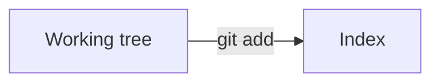

# Trang lý thuyết git-training

Mỗi bài trong 116 bài có một trang HTML tiếng Việt để đọc trước khi làm bài. Trang chạy bằng cách bấm đúp tệp (`file://`), không cần máy chủ và không cần mạng: phông chữ, Mermaid và CSS đều nằm trong `assets/`.

## Mở trang

Mở `theory/index.html` bằng trình duyệt. Chỉ mục liệt kê 11 track, có ô lọc (gõ không dấu cũng được) và cho biết bài nào đã có trang, bài nào còn "đang soạn". Mỗi trang bài có nút bài trước, bài sau và đường về chỉ mục.

## Viết một trang

Tạo tệp `theory/src/<track>/<slug>.md`. `<track>` và `<slug>` phải đúng với `src/curriculum.ts`, ví dụ `theory/src/foundations/repository-init.md`. Mẫu ngắn: `theory/examples/repository-init.sample.md`.

```markdown
---
title: Khởi tạo kho Git
track: foundations
slug: repository-init
order: 1
---

## Tiêu đề mục

Nội dung Markdown (GitHub-flavoured): bảng, danh sách, khối mã, liên kết.
```

- Front matter bắt buộc: `title`, `track`, `slug`, `order`. `order` là vị trí bài trong track, bắt đầu từ 1.
- Dòng `# ...` đầu bài (nếu có) bị bỏ vì tiêu đề đã nằm ở đầu trang. Dùng `##` cho các mục chính; chúng tạo mục lục đầu trang.
- HTML thô trong Markdown bị escape, không dùng thẻ HTML.
- Khối mã: ghi ngôn ngữ sau ba dấu huyền (`bash`, `text`, `diff`...). Mỗi khối có nút "Sao chép".
- Callout: blockquote có dòng đầu là `**Lưu ý**`, `**Mẹo**` hoặc `**Cẩn thận**`.

```markdown
> **Mẹo**
> Chạy `git status` sau mỗi bước.
```

- Sơ đồ: dùng khối `mermaid`. Trình duyệt vẽ bằng Mermaid đóng gói sẵn, tự đổi theme sáng hoặc tối theo hệ điều hành.

````markdown

````

  Đặt nhãn có dấu cách hoặc ký tự đặc biệt trong dấu nháy kép `["..."]`.
- Không dùng emoji, mũi tên Unicode (U+2190-2BFF), dingbat (U+2600-27BF), U+FE0F, U+200D hay ký tự ngoài BMP. Dùng `->` trong văn bản và để Mermaid vẽ mũi tên.
- Cuối mỗi trang, hộp "Sẵn sàng làm bài" tự có lệnh `git-training start <track>`, `git-training open <slug>` và `git-training check`. Không cần viết lại trong Markdown.

## Dựng và kiểm tra

Cần Node.js 22. Không cần `npm install`: bộ chuyển Markdown (`marked`) nằm sẵn trong `vendor/`.

```sh
node theory/check.mjs   # kiểm tra nguồn Markdown
node theory/build.mjs   # dựng HTML
```

`build.mjs` ghi `theory/<track>/<slug>.html` và `theory/index.html` (đã commit, để mở bằng `file://`). Bài chưa có `.md` được bỏ qua và hiện là "đang soạn". Tệp lỗi được báo theo tên và build thoát mã 1 sau khi dựng các trang còn lại. Build không xóa tệp nào.

`check.mjs` kiểm tra:

1. Front matter hợp lệ (`title`, `track`, `slug`, `order` khớp đường dẫn và roadmap).
2. Mỗi `.md` ứng với một bài thật trong `src/curriculum.ts`.
3. Không có ký tự bị cấm (emoji, ngoài BMP, U+2190-2BFF, U+2600-27BF, U+FE0F, U+200D), báo theo dòng.
4. Mọi khối `mermaid` hiển thị được: dùng Mermaid vendor trong Chrome, Chromium hoặc Edge headless và báo lỗi theo tên tệp và số khối. Cần Chrome trên máy; đặt `CHROME=<đường dẫn>` nếu không tự tìm thấy, hoặc thêm `--no-mermaid` để bỏ bước này.

Cả hai script nhận `--src <thư-mục>` (và `build.mjs` nhận thêm `--out <thư-mục>`, nơi cần có `assets/`) để thử trên bản nháp.

## Cấu trúc thư mục

| Đường dẫn | Nội dung |
| --- | --- |
| `src/<track>/<slug>.md` | Nội dung bài (nguồn) |
| `<track>/<slug>.html`, `index.html` | Trang đã dựng |
| `assets/theory.css`, `assets/theory.js` | Giao diện, nút sao chép, khởi tạo Mermaid, ô lọc |
| `assets/mermaid.min.js` | Mermaid 11.17.2 (MIT), chạy offline |
| `assets/fonts/`, `assets/fonts.css` | Be Vietnam Pro và JetBrains Mono (OFL), tập con latin, latin-ext, vietnamese, đậm 400/500/700 |
| `vendor/marked.esm.js` | marked 15.0.12 (MIT) |
| `build.mjs`, `check.mjs`, `lib.mjs` | Dựng, kiểm tra, hàm dùng chung |
| `examples/` | Trang mẫu, không được dựng |

Cập nhật Mermaid hoặc phông: chép tệp mới vào `assets/`, ghi phiên bản vào `assets/mermaid.version`, rồi chạy lại `check.mjs` và `build.mjs`.
