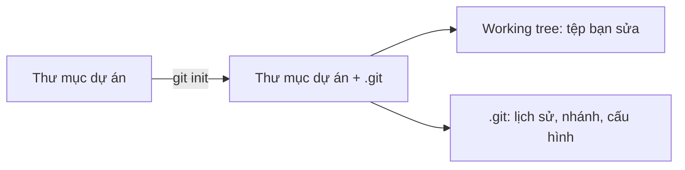

# Khởi tạo kho Git

## Repository là gì

Một repository (kho Git) là thư mục dự án cộng với một thư mục ẩn tên `.git`. Toàn bộ lịch sử commit, nhánh, tag và cấu hình của kho nằm trong `.git`. Các tệp bạn nhìn thấy và sửa hằng ngày gọi là working tree (thư mục làm việc). Chúng nằm bên ngoài `.git`.

Lệnh `git init` tạo thư mục `.git` trong thư mục hiện tại. Từ đó, Git bắt đầu theo dõi thư mục này.



## Các bước cơ bản

```bash
mkdir bai-tap
cd bai-tap
git init -b main
git status
```

Lệnh `git init -b main` đặt tên nhánh đầu tiên là `main`. Tùy chọn `-b` có từ Git 2.28. Nếu bỏ tùy chọn này, tên nhánh lấy từ cấu hình `init.defaultBranch`, và có thể là `master` trên máy cũ.

Sau khi khởi tạo, `git status` báo kho chưa có commit nào:

```text
On branch main

No commits yet

nothing to commit (create/copy files and use "git add" to track)
```

Thông báo trên có thể hiển thị bằng tiếng Việt nếu terminal của bạn dùng ngôn ngữ đó.

## Những gì nằm trong .git

| Thành phần | Vai trò |
| --- | --- |
| `HEAD` | Cho biết bạn đang ở nhánh nào |
| `config` | Cấu hình riêng của kho này |
| `objects/` | Nơi Git lưu nội dung và commit |
| `refs/` | Nơi lưu tên nhánh và tag |

> **Lưu ý**
> Chạy `git init` trong thư mục đã là một kho Git sẽ không xóa lịch sử. Git chỉ báo kho đã được khởi tạo lại và giữ nguyên dữ liệu cũ.

> **Mẹo**
> Chạy `git status` ngay sau mỗi bước khi mới học. Bạn sẽ thấy rõ từng lệnh làm thay đổi điều gì.

> **Cẩn thận**
> Không xóa thư mục `.git` nếu chưa sao lưu. Xóa nó đồng nghĩa với mất toàn bộ lịch sử. Các tệp trong working tree vẫn còn, nhưng chúng không còn là một kho Git.
