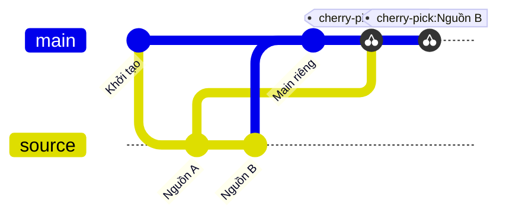
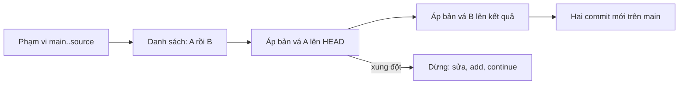

## Bạn sẽ học được gì

- Hiểu cherry-pick làm gì: áp lại bản vá của commit lên nhánh hiện tại.
- Chép một dải commit bằng cú pháp phạm vi `A..B` và `A^..B`.
- Giữ đúng thứ tự phụ thuộc khi chép nhiều commit.
- Xử lý xung đột giữa chuỗi bằng `--continue`, `--skip`, `--abort`.

## Khái niệm

`git cherry-pick` lấy thay đổi mà một commit đã đưa vào (sự khác biệt giữa commit đó và parent của nó), rồi áp thay đổi đó lên HEAD hiện tại để tạo một commit mới. Commit mới có cùng tác giả và message, nhưng là object khác: parent khác, committer và thời gian commit có thể khác, nên object ID khác.

Khi chỉ cần một commit, bạn đưa đúng một tên commit. Khi cần cả một chuỗi, cherry-pick nhận phạm vi giống `git log`:

- `main..source`: mọi commit có trong source nhưng không có trong main. Đây là cách tự nhiên để nói "những gì riêng của nhánh source".
- `A..B`: các commit từ sau A tới B, không gồm A.
- `A^..B`: gồm cả A, vì bắt đầu từ parent của A.

Git áp các commit trong phạm vi theo thứ tự từ cũ tới mới, đúng thứ tự chúng được tạo. Điều này quan trọng: commit sau thường dựa vào commit trước, ví dụ commit thứ hai sửa tệp mà commit thứ nhất tạo ra. Nếu bạn liệt kê tay từng ID theo thứ tự lộn xộn, Git sẽ áp đúng thứ tự bạn ghi, và có thể xung đột.

Cherry-pick hữu ích khi bạn cần một phần công việc mà không muốn kéo cả nhánh: đưa bản sửa lỗi sang nhánh release, mang vài commit từ một nhánh thử nghiệm bị bỏ dở. Nhưng nó tạo bản sao, nên cùng một thay đổi sẽ có hai commit ở hai nhánh. Nếu sau này hai nhánh merge, Git thường nhận ra nội dung giống nhau và không xung đột, nhưng lịch sử sẽ có hai bản.

Tùy chọn `-x` thêm dòng "(cherry picked from commit ...)" vào message, giúp sau này lần ra nguồn gốc. Nhiều nhóm yêu cầu `-x` khi backport.

## Hình dung bằng sơ đồ





## Lệnh cần biết

```bash
# Chép một commit
git cherry-pick <commit>

# Chép mọi commit riêng của source sang nhánh hiện tại, theo thứ tự
git cherry-pick main..source

# Chép từ A tới B, gồm cả A
git cherry-pick A^..B

# Ghi nguồn gốc vào message
git cherry-pick -x <commit>

# Khi dừng vì xung đột
git cherry-pick --continue
git cherry-pick --skip
git cherry-pick --abort

# Xem commit nào của source đã có bản tương đương ở main (dấu trừ là đã có)
git cherry -v main source
```

| Cú pháp | Gồm những commit nào |
| --- | --- |
| `X` | Chỉ X |
| `A..B` | Sau A tới B |
| `A^..B` | Từ A tới B |
| `main..source` | Có ở source, không có ở main |

## Ví dụ từng bước

Nhánh source có "Nguồn A" (tạo `a.txt`) và "Nguồn B" (tạo `b.txt`). Main có commit riêng "Main riêng". Object ID trên máy bạn sẽ khác.

```bash
git switch main
git log --oneline main..source
```

```text
12e7243 Nguồn B
ff790f9 Nguồn A
```

```bash
git cherry-pick main..source
```

```text
[main 1f679ab] Nguồn A
 Date: Thu Oct 15 23:44:25 2026 +0700
 1 file changed, 1 insertion(+)
 create mode 100644 a.txt
[main 249bf24] Nguồn B
 Date: Thu Oct 15 23:44:25 2026 +0700
 1 file changed, 1 insertion(+)
 create mode 100644 b.txt
```

Dòng `Date:` xuất hiện vì cherry-pick giữ ngày tác giả của commit gốc. Kiểm tra:

```bash
git log --oneline -4
git cherry -v main source
```

```text
249bf24 Nguồn B
1f679ab Nguồn A
0af9d8c Main riêng
8b004e9 Khởi tạo
- ff790f97995f21fff4779c93a48c080e30b16ee5 Nguồn A
- 12e724326c09d23ffa4c6bf6ac86c24ad208e681 Nguồn B
```

`git cherry` đánh dấu trừ cho cả hai, nghĩa là main đã có thay đổi tương đương dù ID khác.

Chép một đoạn có cả điểm đầu, kèm `-x`. Nhánh source có "Sửa 1", "Sửa 2", "Sửa 3"; mình chỉ lấy hai commit cuối:

```bash
git cherry-pick -x source~1^..source
git log -1 --format=%B
```

```text
Sửa 3

(cherry picked from commit 275e125f336aff9b83f8d5239f791492586d5703)
```

Khi gặp xung đột, Git dừng ở commit đó:

```text
CONFLICT (add/add): Merge conflict in c.txt
error: could not apply d198aa7... C1
hint: After resolving the conflicts, mark them with
hint: "git add/rm <pathspec>", then run
hint: "git cherry-pick --continue".
```

Sửa tệp, `git add`, rồi `git cherry-pick --continue` để Git tiếp tục những commit còn lại trong chuỗi.

> **Mẹo** Trước khi chép một dải dài, chạy `git log --oneline --reverse main..source` để thấy đúng thứ tự Git sẽ áp.

## Lỗi thường gặp

**Phạm vi thiếu commit đầu.** `A..B` không gồm A. Nếu muốn có A, dùng `A^..B`. Kiểm tra bằng `git log --oneline A..B` trước.

**Đứng sai nhánh.** Cherry-pick áp lên nhánh hiện tại. Chạy `git branch --show-current` trước khi chép.

**Chép commit merge.** Commit merge có nhiều parent nên Git không biết lấy diff so với parent nào; nó báo lỗi trừ khi bạn chỉ định `-m 1`. Thường nên chép các commit thường thay vì commit merge.

**Bỏ dở giữa chuỗi.** Nếu bạn quên `--continue` hoặc `--abort`, repository vẫn ở trạng thái cherry-pick dở. `git status` sẽ nhắc. Chọn một trong ba lối ra rồi mới làm việc khác.

> **Lưu ý** Cherry-pick tạo bản sao. Nếu bạn thực sự cần toàn bộ nhánh, merge hoặc rebase thường hợp lý hơn và giữ lịch sử rõ ràng hơn.

## Áp dụng trong công việc

Nhánh `feature/otp-retry` có năm commit, trong đó hai commit cuối thêm bộ test kiểm tra giới hạn số lần gửi lại OTP. Nhóm muốn bộ test này chạy ngay trên `main` để bắt lỗi sớm, còn tính năng thì chưa merge. Bạn xác định đúng hai commit, chép bằng một phạm vi gồm cả commit đầu, dùng `-x` để reviewer biết chúng đến từ đâu, rồi chạy lại test trên main.

## Chuẩn bị làm bài

Bài thực hành có nhánh source với hai commit riêng, còn main đã có một commit riêng. Bạn cần mang cả hai commit sang main, đúng thứ tự, mỗi commit thành một commit mới. Câu hỏi kiến thức hỏi lệnh dùng để sao chép một commit sang nhánh hiện tại.

Hãy chuẩn bị:

- Xác nhận bạn đang ở main.
- Liệt kê commit riêng của source và để ý thứ tự cũ, mới.
- Chọn cú pháp phạm vi phù hợp để có đủ hai commit.
- Sau khi xong, kiểm tra `git log -2 --format=%s` và nội dung hai tệp.

## Tóm tắt

- Cherry-pick áp lại bản vá của commit lên HEAD, tạo commit mới.
- Phạm vi `main..source` lấy mọi commit riêng của source, áp từ cũ tới mới.
- `A..B` bỏ A, `A^..B` gồm A.
- `-x` ghi lại nguồn gốc, hữu ích khi backport.
- Xung đột giữa chuỗi xử lý bằng `--continue`, `--skip` hoặc `--abort`.
