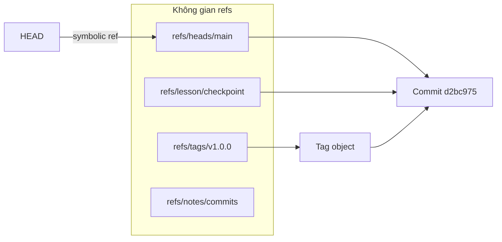
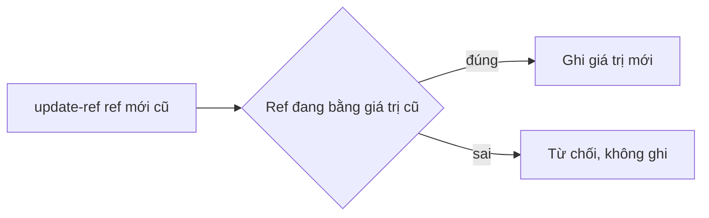

## Bạn sẽ học được gì

- Hiểu ref là gì ngoài nhánh và tag: chỉ là tên trỏ tới object ID.
- Tạo, cập nhật, xóa ref tùy chỉnh an toàn bằng `git update-ref`.
- Liệt kê và dùng ref tùy chỉnh trong các lệnh như `git log`.
- Biết ref ngoài `refs/heads` và `refs/tags` không tự push, không tự hiện trong `git branch`.

## Khái niệm

Bạn đã quen với nhánh (`refs/heads/main`) và tag (`refs/tags/v1.0.0`). Cả hai đều là ref: một cái tên trong không gian `refs/` trỏ tới một object ID. Git không bắt buộc ref chỉ nằm ở hai thư mục đó. Bạn có thể tạo ref ở bất kỳ đâu dưới `refs/`, ví dụ `refs/lesson/checkpoint`, và Git đối xử với nó như mọi ref khác: dùng được trong `git log`, `git diff`, `git show`, và giữ cho commit nó trỏ tới không bị coi là rác.

Thực tế nhiều công cụ dùng không gian riêng: `refs/remotes/` cho remote-tracking, `refs/notes/` cho git notes, `refs/stash` cho stash. Các dịch vụ hosting cũng có ref đặc biệt cho pull request. Không gian riêng giúp công cụ không đụng tới nhánh của người dùng.

Khác biệt chính giữa ref tùy chỉnh và nhánh:

- `git branch` chỉ liệt kê `refs/heads/`, nên ref tùy chỉnh không hiện ở đó.
- Bạn không "đứng trên" một ref tùy chỉnh như đứng trên nhánh. Checkout nó sẽ ra detached HEAD.
- `git push` và `git fetch` mặc định không mang ref ngoài heads và tags. Phải ghi refspec tường minh.

Lệnh plumbing để ghi ref là `git update-ref`. Bạn có thể chỉnh tay tệp trong `.git/refs`, nhưng không nên: ref có thể đang nằm trong `packed-refs`, hoặc repository dùng backend lưu ref khác, và chỉnh tay không có khóa an toàn. `update-ref` làm đúng mọi trường hợp, hỗ trợ kiểm tra giá trị cũ để tránh ghi đè nhầm, và có thể ghi reflog.

Kiểm tra giá trị cũ là tính năng đáng nhớ: `git update-ref <ref> <mới> <cũ>` chỉ cập nhật nếu ref đang có đúng giá trị cũ. Ghi giá trị cũ là 40 chữ số 0 nghĩa là "chỉ tạo nếu ref chưa tồn tại". Script tự động nên dùng cách này để không ghi đè việc của người khác.

Reflog cho ref tùy chỉnh không bật mặc định (Git chỉ tự ghi reflog cho nhánh, remote-tracking, notes và HEAD). Thêm `--create-reflog` nếu bạn muốn có lịch sử thay đổi của ref đó.

## Hình dung bằng sơ đồ





## Lệnh cần biết

```bash
# Tạo hoặc cập nhật ref trỏ tới HEAD (Git tự phân giải HEAD thành object ID)
git update-ref refs/lesson/checkpoint HEAD

# Chỉ tạo nếu ref chưa tồn tại (giá trị cũ là 40 số 0)
git update-ref refs/lesson/checkpoint HEAD 0000000000000000000000000000000000000000

# Ghi kèm reflog và lý do
git update-ref --create-reflog -m "lưu mốc" refs/lesson/checkpoint HEAD

# Xóa ref
git update-ref -d refs/lesson/checkpoint

# Liệt kê
git show-ref
git for-each-ref refs/lesson
git for-each-ref --format='%(refname) %(objectname:short)'

# Dùng như mọi tên commit
git log --oneline refs/lesson/checkpoint

# Chia sẻ lên remote (cần refspec tường minh)
git push origin refs/lesson/checkpoint
```

| Lệnh | Vai trò |
| --- | --- |
| `update-ref` | Ghi, cập nhật, xóa ref an toàn |
| `show-ref` | In mọi ref và object ID |
| `for-each-ref` | Liệt kê có lọc và định dạng |
| `rev-parse` | Phân giải tên thành object ID |
| `symbolic-ref` | Đọc, ghi ref trỏ tới ref khác |

## Ví dụ từng bước

Tạo ref tùy chỉnh tại HEAD và xem (ID trên máy bạn sẽ khác):

```bash
git update-ref refs/lesson/checkpoint HEAD
git show-ref
git rev-parse refs/lesson/checkpoint HEAD
```

```text
d2bc975470d669a7e5000b011acd49c00f9d35e5 refs/heads/main
d2bc975470d669a7e5000b011acd49c00f9d35e5 refs/lesson/checkpoint
d2bc975470d669a7e5000b011acd49c00f9d35e5
d2bc975470d669a7e5000b011acd49c00f9d35e5
```

Ref mới dùng được như tên commit, kể cả dạng rút gọn khi không trùng tên khác:

```bash
git for-each-ref refs/lesson
git log --oneline lesson/checkpoint
git branch -a
```

```text
d2bc975470d669a7e5000b011acd49c00f9d35e5 commit	refs/lesson/checkpoint
d2bc975 Khởi tạo
* main
```

`git branch -a` không thấy nó, đúng như dự đoán. Thử chế độ "chỉ tạo nếu chưa có" khi ref đã tồn tại:

```bash
git update-ref refs/lesson/checkpoint HEAD 0000000000000000000000000000000000000000
```

```text
fatal: update_ref failed for ref 'refs/lesson/checkpoint': cannot lock ref 'refs/lesson/checkpoint': reference already exists
```

Ghi reflog cho ref tùy chỉnh:

```bash
git update-ref --create-reflog -m "lưu mốc" refs/lesson/checkpoint HEAD
git reflog show refs/lesson/checkpoint
```

```text
e613ff5 refs/lesson/checkpoint@{0}: lưu mốc
```

Không có `--create-reflog`, lệnh `git reflog show` cho ref này in ra rỗng.

> **Mẹo** Luôn ghi tên đầy đủ bắt đầu bằng `refs/`. Thiếu tiền tố, ref sẽ rơi vào chỗ lạ (xem phần lỗi thường gặp).

## Lỗi thường gặp

**Sửa tay tệp trong `.git/refs`.** Có thể chạy được hôm nay nhưng sai khi ref đã được đóng gói vào `packed-refs` hoặc khi repository dùng backend khác. Dùng `update-ref`.

**Thiếu tiền tố `refs/`.** Lệnh `git update-ref lesson/checkpoint HEAD` vẫn chạy, nhưng tạo tệp `.git/lesson/checkpoint` ngay trong `.git`, không nằm dưới `refs/`, nên `git show-ref` không thấy nó. Thử xóa bằng `git update-ref -d lesson/checkpoint` thì Git báo `refusing to update ref with bad name`. Đây là trường hợp hiếm phải xóa tay đúng tệp đó trong repository bài tập, rồi tạo lại với tên đầy đủ.

**Tưởng ref tùy chỉnh được push cùng nhánh.** Phải push tường minh và người khác phải fetch với refspec tương ứng.

**Tên trùng nhau gây mơ hồ.** Nếu có cả nhánh `checkpoint` và ref `refs/lesson/checkpoint`, dạng rút gọn có thể trỏ nhầm. Dùng tên đầy đủ trong script.

> **Lưu ý** Ref tùy chỉnh giữ commit khỏi bị dọn rác. Nếu bạn tạo hàng loạt ref làm mốc, nhớ xóa khi không cần, nếu không repository sẽ giữ những object đó mãi.

## Áp dụng trong công việc

Script chạy regression đêm của nhóm QA ghi lại commit vừa kiểm thử thành công vào `refs/qa/last-green` bằng `update-ref` có kiểm tra giá trị cũ. Sáng hôm sau, khi bộ test đỏ, bạn chạy `git log --oneline refs/qa/last-green..main` để xem chính xác những commit mới từ lần xanh gần nhất, rồi bắt đầu bisect từ đó. Ref này không lẫn vào danh sách nhánh của ai.

## Chuẩn bị làm bài

Bài thực hành yêu cầu tạo một ref tùy chỉnh dưới không gian `refs/lesson/` trỏ tới cùng object ID với HEAD. Câu hỏi kiến thức hỏi lệnh dùng để cập nhật một ref bằng object ID mới.

Hãy chuẩn bị:

- Ghi đúng tên ref đầy đủ như đề bài.
- Kiểm tra sau khi tạo bằng `git rev-parse` cho cả ref mới và HEAD, hai giá trị phải trùng.
- Thử `git show-ref` để thấy ref mới nằm cạnh nhánh main.

## Tóm tắt

- Ref là tên trỏ tới object ID; không bắt buộc nằm trong heads hoặc tags.
- `git update-ref` là cách an toàn để ghi, kiểm tra giá trị cũ và xóa ref.
- Ref tùy chỉnh dùng được trong log, diff, show nhưng không hiện ở `git branch`.
- Reflog cho ref tùy chỉnh cần `--create-reflog`.
- Push và fetch ref tùy chỉnh cần refspec tường minh.
