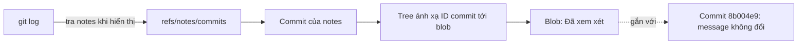
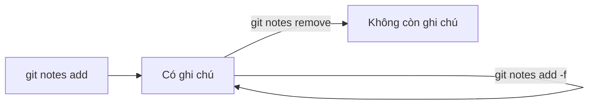

## Bạn sẽ học được gì

- Hiểu notes là gì và vì sao thêm notes không đổi object ID của commit.
- Thêm, xem, nối, xóa ghi chú bằng `git notes`.
- Dùng namespace notes riêng cho từng loại thông tin.
- Biết notes không tự đi theo khi push và fetch.

## Khái niệm

Commit trong Git là bất biến: object ID được tính từ nội dung, gồm tree, parent, tác giả, thời gian và message. Đổi bất kỳ thứ gì, kể cả một chữ trong message, là tạo commit khác. Vậy nếu sau khi commit đã chia sẻ, bạn muốn gắn thêm thông tin như "đã qua review", "build số 1234 đạt", "đã kiểm thử trên môi trường UAT" thì sao? Amend sẽ đổi ID và làm phiền mọi người.

Git notes giải quyết bằng cách lưu ghi chú ở chỗ khác. Mỗi ghi chú là một blob, và Git giữ một cây ánh xạ từ object ID của commit tới blob ghi chú đó. Cây này được commit vào một ref riêng, mặc định là `refs/notes/commits`. Commit gốc không bị đụng tới, nên ID giữ nguyên.

Khi bạn chạy `git log` hoặc `git show`, Git tra ref notes và hiện ghi chú dưới phần message, sau dòng "Notes:". Đây chỉ là hiển thị; message thật của commit không đổi.

Bạn có thể có nhiều nhóm ghi chú bằng cách dùng ref khác, ví dụ `refs/notes/qa` cho kết quả kiểm thử và `refs/notes/review` cho người duyệt. Tùy chọn `--ref=qa` chọn nhóm khi thêm, `--notes=qa` chọn nhóm khi xem log.

Một commit chỉ có một ghi chú trong mỗi nhóm. Muốn thêm nội dung, dùng `append`; muốn thay, dùng `add -f` hoặc `edit`.

Điểm hay bị bỏ qua: notes là ref nằm ngoài `refs/heads` và `refs/tags`, nên `git push` và `git fetch` mặc định không mang chúng đi. Muốn chia sẻ, bạn push ref notes một cách tường minh và cấu hình fetch cho nó.

## Hình dung bằng sơ đồ





## Lệnh cần biết

```bash
# Thêm ghi chú cho HEAD (hoặc commit bất kỳ)
git notes add -m "Đã xem xét" HEAD

# Xem ghi chú của một commit
git notes show HEAD

# Nối thêm nội dung vào ghi chú hiện có
git notes append -m "CI: 120 test đạt" HEAD

# Thay ghi chú hiện có
git notes add -f -m "Nội dung mới" HEAD

# Liệt kê: ID blob ghi chú và ID commit được ghi chú
git notes list

# Dùng nhóm ghi chú riêng
git notes --ref=qa add -m "Regression pass" HEAD
git log -1 --notes=qa

# Xóa ghi chú
git notes remove HEAD

# Chia sẻ notes lên remote (không tự động khi push thường)
git push origin refs/notes/commits
```

| Lệnh con | Tác dụng |
| --- | --- |
| `add` | Tạo ghi chú, lỗi nếu đã có (trừ khi `-f`) |
| `append` | Nối thêm vào ghi chú |
| `show` | In ghi chú |
| `edit` | Mở editor sửa ghi chú |
| `list` | Liệt kê cặp ghi chú và đối tượng |
| `remove` | Xóa ghi chú |

## Ví dụ từng bước

Ghi lại ID của HEAD, thêm ghi chú, rồi kiểm tra ID lần nữa (ID trên máy bạn sẽ khác):

```bash
git rev-parse HEAD
git notes add -m "Đã xem xét" HEAD
git notes show HEAD
git rev-parse HEAD
```

```text
8b004e9f78cf9587386eedaaf6dda5f862c37d48
Đã xem xét
8b004e9f78cf9587386eedaaf6dda5f862c37d48
```

ID không đổi. Log hiện ghi chú bên dưới message:

```bash
git log -1
```

```text
commit 8b004e9f78cf9587386eedaaf6dda5f862c37d48
Author: Duy <duy@example.invalid>
Date:   Thu Oct 15 23:44:25 2026 +0700

    Khởi tạo

Notes:
    Đã xem xét
```

Ghi chú nằm ở đâu? Ở một ref riêng:

```bash
git show-ref
```

```text
8b004e9f78cf9587386eedaaf6dda5f862c37d48 refs/heads/main
6cbc02b71df99336a198596375cf8de809eb346f refs/notes/commits
```

Thêm lần nữa bằng `add` sẽ lỗi; dùng `append`:

```bash
git notes add -m "lần hai" HEAD
```

```text
error: Cannot add notes. Found existing notes for object 8b004e9f78cf9587386eedaaf6dda5f862c37d48. Use '-f' to overwrite existing notes
```

```bash
git notes append -m "CI: 120 test đạt" HEAD
git notes show
```

```text
Đã xem xét

CI: 120 test đạt
```

Nhóm ghi chú riêng cho QA:

```bash
git notes --ref=qa add -m "Regression pass" HEAD
git log -1 --notes=qa --format="%s | %N"
```

```text
Khởi tạo | Regression pass
```

> **Mẹo** `git notes show` không kèm đối số sẽ dùng HEAD. Nhưng ghi rõ `HEAD` hoặc ID trong script giúp người đọc khỏi phải đoán.

## Lỗi thường gặp

**Tưởng notes đã lên remote sau khi push nhánh.** Không. Push ref notes tường minh, và người khác cần fetch `refs/notes/*` mới thấy.

**Dùng `add` khi đã có ghi chú.** Git báo lỗi để tránh ghi đè vô tình. Dùng `append` để nối, hoặc `-f` nếu thật sự muốn thay.

**Không thấy ghi chú nhóm riêng trong log.** `git log` mặc định chỉ hiện `refs/notes/commits`. Thêm `--notes=qa` (hoặc cấu hình `notes.displayRef`).

**Ghi chú "mất" sau rebase.** Rebase tạo commit mới, ghi chú gắn với ID cũ. Git có cấu hình `notes.rewriteRef` để chép notes khi rebase hoặc amend; nếu chưa bật, bạn cần thêm lại.

> **Lưu ý** Notes phù hợp cho metadata bổ sung sau khi commit. Thông tin cốt lõi như lý do thay đổi vẫn nên nằm trong message.

## Áp dụng trong công việc

Sau mỗi lần chạy regression trên bản release candidate, pipeline của nhóm QA gắn một ghi chú vào commit được kiểm thử trong nhóm `refs/notes/qa`, ví dụ "UAT 2026-10-15: 412 đạt, 3 bỏ qua". Commit trên nhánh release không đổi ID, tag phát hành vẫn trỏ đúng chỗ, mà ai cần biết commit đó đã được kiểm thử ra sao chỉ cần `git log --notes=qa`.

## Chuẩn bị làm bài

Bài thực hành yêu cầu gắn một ghi chú có nội dung cụ thể vào HEAD của repository bài tập, sao cho lệnh xem ghi chú của HEAD hiển thị đúng nội dung đó. Câu hỏi kiến thức hỏi lệnh dùng để xem ghi chú của HEAD.

Hãy chuẩn bị:

- Đọc kỹ nội dung ghi chú yêu cầu, gồm cả dấu tiếng Việt.
- Ôn sự khác nhau giữa các lệnh con `add`, `append`, `show`.
- Sau khi thêm, kiểm tra lại bằng cách xem ghi chú và xác nhận ID của HEAD không đổi.

## Tóm tắt

- Notes gắn thông tin vào commit mà không đổi object ID.
- Ghi chú được lưu dưới ref riêng, mặc định `refs/notes/commits`.
- Mỗi commit có tối đa một ghi chú trong mỗi nhóm; dùng `append` để nối.
- Nhóm khác chọn bằng `--ref` khi thêm, `--notes` khi xem.
- Notes không tự push hay fetch cùng nhánh.
