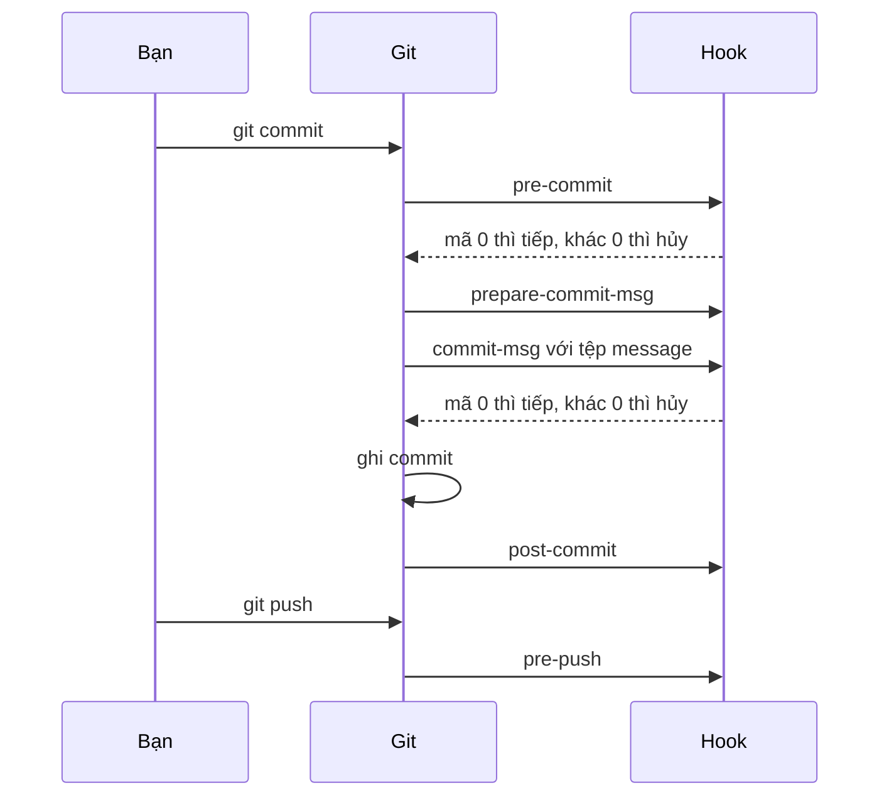
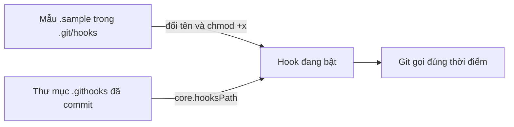

## Bạn sẽ học được gì

- Hiểu hook là gì, nằm ở đâu và Git gọi chúng vào những thời điểm nào.
- Phân biệt hook phía client (trên máy bạn) với hook phía server.
- Viết một hook đơn giản có thể chặn thao tác bằng mã thoát khác 0.
- Biết giới hạn an toàn: hook là mã chạy trên máy bạn, chỉ dùng mã đáng tin.

## Khái niệm

Hook là một chương trình (thường là script shell) mà Git tự gọi ở những thời điểm xác định trong quy trình làm việc: trước khi tạo commit, sau khi tạo commit, trước khi push, khi server nhận push... Nhờ hook, bạn có thể tự động kiểm tra hoặc bổ sung thông tin mà không cần nhớ chạy lệnh thủ công.

Mặc định Git tìm hook trong thư mục `.git/hooks` của repository. Khi bạn `git init`, thư mục này có sẵn nhiều tệp mẫu đuôi `.sample`; chúng không chạy cho tới khi bạn đổi tên bỏ đuôi `.sample` và cấp quyền thực thi. Tên tệp chính là tên hook: Git chỉ gọi tệp có đúng tên như `pre-commit`, `commit-msg`, `pre-push`.

Hook "trước" (tên bắt đầu bằng `pre-` và một số hook như `commit-msg`) có quyền phủ quyết: nếu script thoát với mã khác 0, Git hủy thao tác. Hook "sau" (`post-`) chạy khi việc đã xong, mã thoát không thay đổi kết quả, nên chỉ dùng để thông báo hoặc làm việc phụ.

Với một lệnh `git commit`, thứ tự hook phía client là:

1. `pre-commit`: chạy trước khi Git hỏi message. Hợp để chạy linter, kiểm tra tệp đã stage.
2. `prepare-commit-msg`: được sửa message mặc định trước khi editor mở.
3. `commit-msg`: nhận đường dẫn tới tệp message, hợp để kiểm tra định dạng message.
4. `post-commit`: chạy sau khi commit đã được tạo.

Các hook client khác hay gặp: `pre-push` (trước khi gửi lên remote), `pre-rebase`, `post-checkout`, `post-merge`. Phía server có `pre-receive`, `update`, `post-receive`, chạy trên máy chủ chứa repository khi nhận push. Các dịch vụ như GitHub không cho bạn đặt hook server tùy ý; họ thay bằng tính năng riêng như kiểm tra bắt buộc trước merge.

Hai điều quan trọng về chia sẻ và an toàn:

- `.git/hooks` không nằm trong lịch sử, nên không được chia sẻ khi clone. Muốn cả nhóm dùng chung, người ta commit script vào một thư mục như `.githooks` rồi mỗi người tự trỏ `core.hooksPath` tới đó, hoặc dùng công cụ quản lý hook.
- Hook là mã chạy với quyền của bạn. Đừng chép hook từ nguồn lạ, và đọc kỹ trước khi bật. Trong ứng dụng luyện tập này, hook chỉ nên được thử trong repository sandbox.

Hook cũng có thể bị bỏ qua: `git commit --no-verify` (hoặc `-n`) bỏ `pre-commit` và `commit-msg`. Vì vậy hook local là lớp hỗ trợ cho người viết mã, không phải hàng rào bảo mật. Kiểm tra bắt buộc vẫn nên chạy lại ở CI.

## Hình dung bằng sơ đồ





## Lệnh cần biết

```bash
# Xem các hook mẫu
ls .git/hooks

# Bật một hook: tạo tệp đúng tên và cấp quyền thực thi
chmod +x .git/hooks/pre-commit

# Dùng thư mục hook dùng chung đã commit trong repository
git config core.hooksPath .githooks

# Hỏi Git đang tìm hook ở đâu
git rev-parse --git-path hooks

# Chạy thử một hook mà không cần tạo commit hay push
git hook run pre-push

# Bỏ qua pre-commit và commit-msg cho một lần commit (dùng có cân nhắc)
git commit --no-verify -m "..."
```

| Hook | Khi nào chạy | Có chặn được không |
| --- | --- | --- |
| `pre-commit` | Trước khi tạo commit | Có |
| `prepare-commit-msg` | Trước khi mở editor message | Có |
| `commit-msg` | Sau khi có message | Có |
| `post-commit` | Sau khi commit xong | Không |
| `pre-push` | Trước khi gửi ref lên remote | Có |
| `pre-receive` | Trên server khi nhận push | Có |

## Ví dụ từng bước

Mình đặt năm hook đơn giản, mỗi hook chỉ in tên mình, để thấy thứ tự gọi:

```bash
for h in pre-commit prepare-commit-msg commit-msg post-commit pre-push; do
  printf '#!/bin/sh\necho "hook %s chạy"\n' $h > .git/hooks/$h
  chmod +x .git/hooks/$h
done
git add x.txt
git commit -m "feat: thêm x"
```

```text
hook pre-commit chạy
hook prepare-commit-msg chạy
hook commit-msg chạy
hook post-commit chạy
[main 3f53727] feat: thêm x
 1 file changed, 1 insertion(+)
 create mode 100644 x.txt
```

```bash
git push -q origin main
```

```text
hook pre-push chạy
```

Giờ thay `commit-msg` bằng một script kiểm tra định dạng subject:

```bash
#!/bin/sh
head -n1 "$1" | grep -Eq '^(feat|fix|docs|test|chore)(\(.+\))?!?: ' || {
  echo "commit-msg: subject cần dạng type: mô tả" >&2
  exit 1
}
```

```bash
git commit -m "update"
```

```text
hook pre-commit chạy
commit-msg: subject cần dạng type: mô tả
```

Commit bị hủy. Viết lại message đúng dạng thì qua. Nếu quên cấp quyền thực thi, Git không chạy hook mà chỉ nhắc:

```text
hint: The '.git/hooks/pre-commit' hook was ignored because it's not set as executable.
```

Kiểm tra Git tìm hook ở đâu trước và sau khi đặt `core.hooksPath`:

```bash
git config core.hooksPath .githooks
git rev-parse --git-path hooks
git config --unset core.hooksPath
git rev-parse --git-path hooks
```

```text
.githooks
.git/hooks
```

> **Mẹo** Hook nên chạy nhanh. Một `pre-commit` mất vài phút sẽ khiến cả nhóm quen tay gõ `--no-verify`. Đưa kiểm tra nặng sang `pre-push` hoặc CI.

## Lỗi thường gặp

**Hook không chạy.** Ba nguyên nhân phổ biến: tên tệp còn đuôi `.sample`, thiếu quyền thực thi, hoặc `core.hooksPath` đang trỏ chỗ khác. Kiểm tra bằng `ls -l` và `git rev-parse --git-path hooks`.

**Tưởng hook tự đi theo repository khi clone.** Không. `.git/hooks` là thư mục local. Commit hook vào thư mục riêng và hướng dẫn người mới đặt `core.hooksPath` trong README.

**Hook kiểm tra cả working tree thay vì phần đã stage.** `pre-commit` nên đọc nội dung đã stage (ví dụ `git diff --cached`), nếu không bạn có thể chặn nhầm vì một tệp chưa định commit, hoặc cho qua lỗi đã stage.

**Coi hook là biện pháp bảo mật.** Ai cũng có thể bỏ qua hook local bằng `--no-verify` hoặc xóa tệp. Quy tắc bắt buộc phải được kiểm tra lại ở server hoặc CI.

> **Cẩn thận** Hook là mã chạy trên máy bạn với quyền của bạn. Không bật hook lấy từ repository lạ khi chưa đọc nội dung.

## Áp dụng trong công việc

Trong repository test API của dự án thanh toán, nhóm bạn đặt một `pre-commit` chạy kiểm tra định dạng và một phép quét đơn giản tìm chuỗi giống khóa API trong phần đã stage. Một `pre-push` chạy bộ smoke test nhanh khoảng ba mươi giây. Các script nằm trong `.githooks`, README ghi một dòng `git config core.hooksPath .githooks` cho người mới. Pipeline CI vẫn chạy lại toàn bộ kiểm tra, vì hook local có thể bị bỏ qua.

## Chuẩn bị làm bài

Đây là bài trả lời câu hỏi, không có nhiệm vụ trạng thái Git. Câu hỏi xoay quanh việc hook nào được gọi trước khi Git tạo commit. Hãy ôn lại thứ tự hook khi commit ở trên và phân biệt hook "trước" với hook "sau".

Nếu muốn tự thử, hãy làm trong repository bài tập: tạo một hook in ra tên mình như ví dụ, commit một thay đổi nhỏ và quan sát thứ tự dòng in ra. Đừng thử trên repository công việc thật.

## Tóm tắt

- Hook là script Git tự gọi tại thời điểm xác định, tên tệp chính là tên hook.
- Hook "trước" có thể chặn thao tác bằng mã thoát khác 0; hook "sau" thì không.
- `.git/hooks` không được chia sẻ khi clone; dùng `core.hooksPath` cho hook dùng chung.
- `--no-verify` bỏ qua hook commit, nên kiểm tra bắt buộc phải có ở CI.
- Chỉ chạy hook từ nguồn tin cậy.
