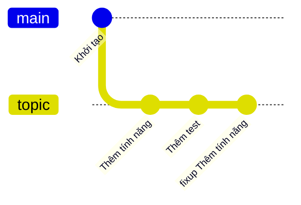
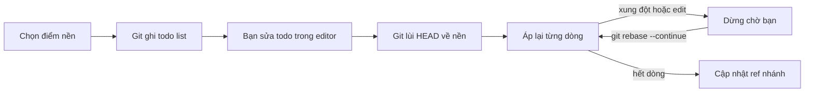

## Bạn sẽ học được gì

- Hiểu rebase tương tác thực chất làm gì với chuỗi commit của bạn.
- Đọc và chỉnh sửa danh sách thao tác (todo list) mà Git mở trong editor.
- Dùng các lệnh `pick`, `reword`, `edit`, `squash`, `fixup`, `drop` đúng chỗ.
- Biết cách thoát an toàn khi rebase gặp xung đột hoặc khi bạn đổi ý.

## Khái niệm

Khi làm việc trên một nhánh riêng, lịch sử thường không đẹp ngay từ đầu: có commit tên "WIP", có commit sửa lỗi gõ nhầm cho commit trước, có commit đáng lẽ nên tách hoặc gộp. Trước khi mở review, bạn muốn dọn chuỗi commit đó để người đọc hiểu được từng bước. Rebase tương tác là công cụ chính cho việc này.

Hãy hình dung rebase như một buổi "quay lại cảnh": Git lấy danh sách các commit nằm trên nhánh của bạn nhưng chưa có ở nền (base), lùi HEAD về nền đó, rồi lần lượt áp dụng lại từng commit theo một kịch bản. Ở chế độ thường, kịch bản là "áp lại y nguyên". Ở chế độ tương tác, Git mở kịch bản ra cho bạn sửa trước khi chạy. Kịch bản này gọi là todo list, mỗi dòng là một thao tác kèm object ID và subject của commit.

Điểm quan trọng nhất cần nhớ: mỗi commit được áp lại trên một parent mới sẽ thành commit mới, có object ID mới, kể cả khi nội dung tệp không đổi. Chỉ những commit đầu chuỗi mà nền và nội dung đều không đổi thì Git mới giữ nguyên (nó tua nhanh qua chúng). Commit cũ không biến mất ngay; chúng vẫn nằm trong reflog một thời gian. Vì vậy rebase tương tác an toàn cho commit chưa chia sẻ, nhưng nguy hiểm nếu người khác đã dựa trên các commit đó.

Các thao tác hay dùng trong todo list:

- `pick`: giữ commit như cũ.
- `reword`: giữ nội dung, dừng lại cho bạn sửa message.
- `edit`: áp commit rồi dừng lại, cho bạn amend, tách, hoặc kiểm tra.
- `squash`: gộp vào commit phía trên, ghép cả hai message để bạn sửa.
- `fixup`: gộp vào commit phía trên, bỏ message của commit này.
- `drop`: bỏ commit (xóa dòng cũng có tác dụng tương tự).
- `exec`: chạy một lệnh shell giữa các bước, ví dụ chạy test.

Các dòng được thực hiện từ trên xuống dưới, tức là từ commit cũ nhất đến mới nhất. Điều này ngược với `git log`, vốn hiện commit mới nhất ở trên cùng. Rất nhiều người nhầm chỗ này lần đầu.

Bạn chọn phạm vi rebase bằng một điểm nền: `main` (mọi commit có trên nhánh hiện tại nhưng chưa có trên main) hoặc `HEAD~3` (ba commit gần nhất). Git chỉ đưa vào todo list những commit nằm sau điểm nền đó.

## Hình dung bằng sơ đồ

Trước khi dọn, nhánh topic có ba commit, trong đó có một commit sửa vặt cho commit đầu:



Rebase tương tác hoạt động như một vòng lặp đọc kịch bản:



## Lệnh cần biết

```bash
# Mở todo list cho mọi commit có trên nhánh hiện tại nhưng chưa có trên main
git rebase -i main

# Chỉ làm việc với 3 commit gần nhất
git rebase -i HEAD~3

# Sau khi sửa xung đột hoặc amend trong lúc dừng
git rebase --continue

# Bỏ qua commit đang gây xung đột (commit đó sẽ không được áp lại)
git rebase --skip

# Hủy toàn bộ, trả nhánh về đúng trạng thái trước khi bắt đầu
git rebase --abort

# Xem lại các bước, kể cả commit cũ trước rebase
git reflog
```

| Thao tác | Viết tắt | Tác dụng |
| --- | --- | --- |
| pick | p | Giữ commit |
| reword | r | Giữ nội dung, sửa message |
| edit | e | Dừng sau khi áp commit để sửa |
| squash | s | Gộp vào commit trước, ghép message |
| fixup | f | Gộp vào commit trước, bỏ message này |
| drop | d | Bỏ commit |
| exec | x | Chạy lệnh shell |

Editor mở todo list là editor bạn cấu hình bằng `core.editor` (hoặc biến `GIT_SEQUENCE_EDITOR` nếu có). Lưu và đóng editor là ra lệnh cho Git chạy kịch bản.

## Ví dụ từng bước

Mình dựng một nhánh topic có ba commit, commit thứ hai tên là "WIP". Object ID trên máy bạn sẽ khác, chỉ cần để ý chúng đổi hay giữ nguyên.

```bash
git switch -c topic
# ... tạo ba commit: "Thêm a", "WIP", "Thêm c"
git log --oneline
```

```text
5f73336 Thêm c
1af650f WIP
2ecc4b7 Thêm a
0fe051f Khởi tạo
```

Chạy rebase tương tác lên main. Đây là phần đầu của todo list Git mở ra (đã lược bớt phần chú thích dài):

```bash
git rebase -i main
```

```text
pick 2ecc4b7 Thêm a
pick 1af650f WIP
pick 5f73336 Thêm c

# Rebase 0fe051f..5f73336 onto 0fe051f (3 commands)
#
# Commands:
# p, pick <commit> = use commit
# r, reword <commit> = use commit, but edit the commit message
# e, edit <commit> = use commit, but stop for amending
# s, squash <commit> = use commit, but meld into previous commit
# ...
# d, drop <commit> = remove commit
```

Mình đổi dòng thứ hai thành `reword 1af650f WIP`, lưu lại. Git mở editor cho message của commit WIP; mình gõ "Thêm b rõ nghĩa", lưu và đóng:

```text
Rebasing (2/3)[detached HEAD 9454463] Thêm b rõ nghĩa
 1 file changed, 1 insertion(+)
 create mode 100644 b.txt
Rebasing (3/3)Successfully rebased and updated refs/heads/topic.
```

```bash
git log --oneline
```

```text
e00afcb Thêm c
9454463 Thêm b rõ nghĩa
2ecc4b7 Thêm a
0fe051f Khởi tạo
```

So sánh với trước: "Thêm a" giữ nguyên ID vì nó không bị đổi gì và nền vẫn như cũ, Git chỉ tua nhanh qua nó. "Thêm b rõ nghĩa" có ID mới vì message đổi. "Thêm c" cũng có ID mới dù nội dung y hệt, vì parent của nó đã đổi. Reflog ghi lại từng bước:

```bash
git reflog -6
```

```text
e00afcb HEAD@{0}: rebase (finish): returning to refs/heads/topic
e00afcb HEAD@{1}: rebase (pick): Thêm c
9454463 HEAD@{2}: rebase (reword): Thêm b rõ nghĩa
1af650f HEAD@{3}: rebase: fast-forward
2ecc4b7 HEAD@{4}: rebase (start): checkout main
5f73336 HEAD@{5}: commit: Thêm c
```

Dòng `HEAD@{5}` vẫn trỏ tới commit "Thêm c" cũ, nên nếu muốn quay lại hoàn toàn, bạn biết phải về đâu.

> **Mẹo** Nếu chỉ muốn sửa message của commit cuối cùng thì `git commit --amend` nhanh hơn. Rebase tương tác đáng dùng khi commit cần sửa nằm sâu hơn trong chuỗi.

## Lỗi thường gặp

**Đọc ngược thứ tự.** Todo list liệt kê commit cũ nhất ở trên. Nếu bạn quen nhìn `git log` rồi đặt `squash` ở dòng đầu tiên, Git sẽ báo lỗi vì không có commit nào phía trên để gộp vào. Cách sửa: luôn nhớ `squash` và `fixup` gộp vào dòng ngay trên nó.

**Rebase commit đã push cho người khác dùng.** Sau rebase, nhánh local và nhánh trên remote phân kỳ. Nếu bạn force push, đồng nghiệp đã kéo các commit cũ sẽ gặp lịch sử lệch. Chỉ rebase phần chưa chia sẻ, hoặc thống nhất với nhóm trước và dùng `git push --force-with-lease` thay vì `--force`.

**Hoảng khi gặp xung đột giữa chừng.** Rebase dừng lại, `git status` báo đang rebase. Bạn có ba lựa chọn: sửa tệp, `git add` rồi `git rebase --continue`; bỏ commit đó bằng `--skip`; hoặc hủy hẳn bằng `--abort`. Không cần xóa thư mục hay clone lại.

**Xóa nhầm dòng trong todo.** Xóa dòng nghĩa là bỏ commit. Nếu đã chạy xong, tìm object ID cũ trong `git reflog` rồi tạo lại nhánh hoặc `git reset --hard` về đó (chỉ khi bạn chắc chắn không có thay đổi chưa commit).

> **Cẩn thận** `git rebase --abort` chỉ dùng được khi rebase còn đang dở. Khi rebase đã kết thúc, đường quay lại là reflog, ví dụ `ORIG_HEAD` hoặc `HEAD@{n}`.

## Áp dụng trong công việc

Bạn đang viết bộ test tự động cho luồng chuyển khoản liên ngân hàng trên nhánh `test/transfer-limit`. Sau hai ngày, nhánh có các commit "WIP", "sửa locator", "sửa locator lần 2", "thêm case vượt hạn mức". Trước khi mở review, bạn chạy rebase tương tác lên `main`, gộp hai commit sửa locator vào commit tạo page object bằng `fixup`, đổi tên WIP thành message mô tả đúng, và thêm một dòng `exec npm test` ở cuối để chắc chuỗi mới vẫn chạy được. Người review nhận được ba commit gọn, mỗi commit có một mục đích.

## Chuẩn bị làm bài

Bài thực hành dựng sẵn nhánh `topic` với một commit tính năng và một commit sửa có tiền tố đặc biệt. Bạn cần đưa topic về chỉ còn một commit sau `main`, giữ nội dung đã sửa của tệp. Câu hỏi kiến thức hỏi về tùy chọn của `git rebase` dùng để mở danh sách thao tác.

Trước khi làm, hãy:

- Chạy `git log --oneline main..topic` để biết có bao nhiêu commit sẽ nằm trong todo list.
- Xem lại sự khác nhau giữa `squash` và `fixup`.
- Biết editor nào sẽ mở (kiểm tra `git config core.editor`) và cách lưu, thoát editor đó.
- Sau khi xong, kiểm tra bằng `git rev-list --count main..topic` và `git show HEAD:bai.txt`.

> **Lưu ý** Bài sau về squash và autosquash dùng lại cùng repository mẫu. Hiểu kỹ todo list ở bài này sẽ giúp bài sau nhẹ hơn nhiều.

## Tóm tắt

- Rebase tương tác cho bạn sửa kịch bản áp lại commit trước khi Git chạy nó.
- Todo list đọc từ trên xuống, commit cũ nhất ở trên.
- Mỗi commit được áp lại thành commit mới; chỉ rebase những gì chưa chia sẻ.
- `--continue`, `--skip`, `--abort` là ba lối ra khi rebase dừng giữa chừng.
- Reflog là lưới an toàn nếu kết quả không như ý.
