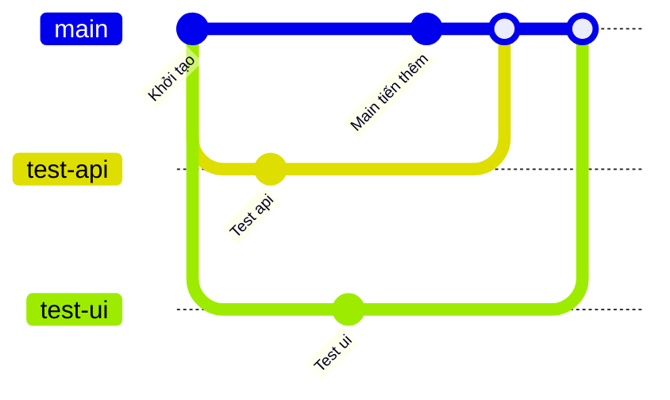
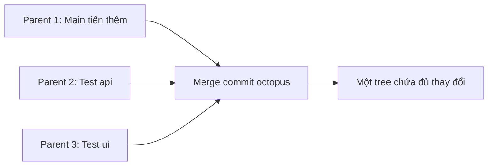

## Bạn sẽ học được gì

- Hiểu octopus merge: một merge commit gộp nhiều nhánh cùng lúc.
- Biết cách đếm parent của một merge commit và đọc chúng bằng plumbing.
- Nhận ra khi nào octopus phù hợp và khi nào nên merge từng nhánh.
- Xử lý khi octopus gặp xung đột.

## Khái niệm

Merge thông thường gộp hai dòng lịch sử: nhánh hiện tại và một nhánh khác. Merge commit tạo ra có hai parent. Nhưng cấu trúc commit trong Git không giới hạn số parent; một commit có thể có ba, bốn, hoặc nhiều hơn. Khi bạn đưa nhiều tên nhánh vào cùng một lệnh `git merge`, Git dùng chiến lược octopus để gộp tất cả trong một commit duy nhất.

Quy tắc đếm rất đơn giản: parent đầu tiên luôn là commit mà nhánh hiện tại đang trỏ tới trước khi merge, sau đó là mỗi nhánh được liệt kê trong lệnh, theo đúng thứ tự bạn gõ. Vậy merge thêm N nhánh vào nhánh hiện tại sẽ cho commit có N cộng một parent. (Trừ khi một trong các nhánh có thể fast-forward ngay từ đầu, khi đó Git tua nhanh trước và số parent ít hơn. Bạn sẽ thấy điều này trong phần lỗi.)

Octopus làm việc theo kiểu lần lượt: thử gộp nhánh thứ nhất, rồi gộp nhánh thứ hai lên kết quả, cứ thế. Điểm khác biệt quan trọng: octopus không dừng lại cho bạn giải quyết xung đột phức tạp giữa chừng như merge hai nhánh. Nếu gặp xung đột cần sửa tay, nó dừng và báo lỗi, để bạn tự quyết. Vì thế octopus chỉ hợp với các nhánh độc lập, mỗi nhánh chạm vào phần khác nhau của mã.

Khi nào dùng? Khi bạn có vài nhánh nhỏ, độc lập, đã được kiểm tra riêng, và muốn lịch sử ghi lại rằng chúng được tích hợp cùng nhau. Ví dụ dự án mã nguồn mở lớn đôi khi gộp hàng loạt nhánh chủ đề trong một lần. Trong công việc hằng ngày, merge từng nhánh thường dễ review và dễ revert hơn.

Một hệ quả khi hoàn tác: revert một merge commit cần chỉ định parent nào là "dòng chính" bằng `-m`. Với octopus có nhiều parent, việc này rối hơn và kết quả là đảo ngược toàn bộ các nhánh cùng lúc.

## Hình dung bằng sơ đồ



Sơ đồ gitGraph của mermaid vẽ hai lần merge vì nó không có ký hiệu cho commit nhiều parent. Thực tế octopus chỉ tạo một commit, như sơ đồ dưới:



## Lệnh cần biết

```bash
# Merge nhiều nhánh vào nhánh hiện tại trong một commit
git merge nhanh1 nhanh2 nhanh3

# Xem nội dung thô của commit, mỗi parent một dòng
git cat-file -p HEAD

# In danh sách parent trên một dòng
git log -1 --format=%P

# In commit kèm parent (từ đầu tiên là chính commit)
git rev-list --parents -n 1 HEAD

# Tìm các merge có từ 3 parent trở lên
git log --merges --min-parents=3 --oneline

# Hủy merge đang dở khi gặp xung đột
git merge --abort
```

| Kiểu merge | Số parent | Ghi chú |
| --- | --- | --- |
| Fast-forward | Không tạo commit | Chỉ dời ref |
| Merge hai nhánh | 2 | Có thể dừng cho bạn sửa xung đột |
| Octopus với N nhánh | N cộng 1 | Không hợp với xung đột phức tạp |

## Ví dụ từng bước

Main có hai nhánh test độc lập là `test/api` và `test/ui`, và main cũng đã tiến thêm một commit. Merge cả hai trong một lệnh (ID trên máy bạn sẽ khác):

```bash
git merge test/api test/ui
```

```text
Trying simple merge with test/api
Trying simple merge with test/ui
Merge made by the 'octopus' strategy.
 api.txt | 1 +
 ui.txt  | 1 +
 2 files changed, 2 insertions(+)
 create mode 100644 api.txt
 create mode 100644 ui.txt
```

```bash
git log --oneline --graph
```

```text
*-.   23a5634 Merge branches 'test/api' and 'test/ui'
|\ \  
| | * 310ae34 Test ui
| * | f033214 Test api
| |/  
* / ad168c5 Main tiến thêm
|/  
* 0eaeb10 Khởi tạo
```

Đọc commit ở dạng thô để đếm parent:

```bash
git cat-file -p HEAD
```

```text
tree a0047b48823532d5370980bdeee69a7531b7154a
parent ad168c5942a131c9eac34ce3c6ca1bfd90fd4272
parent f033214b4b328b447c7c10236c0f078553123feb
parent 310ae345ce00606c84bc2b0645c9252b7eef2614
author Duy <duy@example.invalid> 1792083261 +0700
committer Duy <duy@example.invalid> 1792083261 +0700

Merge branches 'test/api' and 'test/ui'
```

Parent đầu là commit cũ của main, rồi tới hai nhánh theo thứ tự đã gõ. Hai nhánh, cộng nhánh hiện tại, ra ba parent. `git rev-list --parents -n 1 HEAD | wc -w` in ra 4 vì từ đầu tiên là chính merge commit.

Giờ trường hợp xấu: hai nhánh a và b cùng sửa một dòng của `f.txt`, còn main chưa tiến thêm:

```bash
git merge a b
```

```text
Fast-forwarding to: a
Trying simple merge with b
Simple merge did not work, trying automatic merge.
Auto-merging f.txt
ERROR: content conflict in f.txt
fatal: merge program failed
Automatic merge failed; fix conflicts and then commit the result.
```

Hai điều đáng để ý: Git tua nhanh tới a trước (vì main chưa có gì riêng), và gặp xung đột ở b. Cách an toàn là `git merge --abort` rồi merge từng nhánh một.

> **Mẹo** Thứ tự nhánh trong lệnh quyết định thứ tự parent. Nếu sau này cần `git revert -m 1`, parent 1 luôn là nhánh bạn đang đứng.

## Lỗi thường gặp

**Octopus thất bại vì xung đột.** Đây là tín hiệu các nhánh không độc lập. Hủy bằng `git merge --abort` và merge từng nhánh, giải quyết xung đột ở từng bước.

**Số parent ít hơn dự kiến.** Khi nhánh hiện tại là tổ tiên của một nhánh được merge, Git có thể tua nhanh trước. Mình thử với main chưa có commit riêng và hai nhánh độc lập a, b: `git merge a b` cho merge commit chỉ có hai parent (a và b), còn `git merge --no-ff a b` cho ba parent vì giữ lại main làm parent đầu. Nếu cần đủ parent, đảm bảo nhánh hiện tại có commit riêng hoặc dùng `--no-ff`.

**Working tree chưa sạch.** Merge từ chối nếu thay đổi chưa commit bị ảnh hưởng. Commit hoặc stash trước.

**Revert octopus khó lường.** Revert với `-m 1` đảo ngược phần đóng góp của mọi nhánh còn lại cùng lúc. Nếu chỉ muốn bỏ một nhánh, revert các commit của nhánh đó thay vì revert merge.

> **Cẩn thận** Octopus làm lịch sử khó đọc với người chưa quen. Hãy thống nhất với nhóm trước khi dùng trên nhánh chung.

## Áp dụng trong công việc

Cuối sprint, ba bạn trong nhóm QA mỗi người viết một nhánh bổ sung test cho ba module khác nhau: đăng nhập, chuyển khoản, thanh toán hóa đơn. Mỗi nhánh chỉ thêm tệp trong thư mục test của module mình và đã chạy xanh riêng. Trưởng nhóm gộp cả ba vào nhánh `test/sprint-42` bằng một octopus merge, để lịch sử ghi rõ ba bộ test được đưa vào cùng một mốc, rồi chạy toàn bộ suite một lần.

## Chuẩn bị làm bài

Bài thực hành có ba nhánh độc lập, mỗi nhánh thêm một tệp riêng, và main đã có commit riêng. Bạn cần gộp cả ba vào main trong một merge duy nhất sao cho HEAD chứa đủ ba tệp và working tree sạch. Câu hỏi kiến thức hỏi merge commit đó có bao nhiêu parent.

Hãy chuẩn bị:

- Đứng ở main trước khi merge.
- Áp dụng quy tắc đếm parent ở phần khái niệm.
- Kiểm tra lại kết quả bằng `git cat-file -p HEAD` và đếm số dòng `parent`.

## Tóm tắt

- Octopus merge gộp nhiều nhánh trong một commit có nhiều parent.
- Parent đầu là nhánh hiện tại, sau đó là các nhánh theo thứ tự trong lệnh.
- Merge N nhánh vào nhánh hiện tại cho N cộng một parent.
- Octopus chỉ hợp với nhánh độc lập; xung đột thì merge từng nhánh.
- Đọc parent bằng `git cat-file -p` hoặc `git log --format=%P`.
