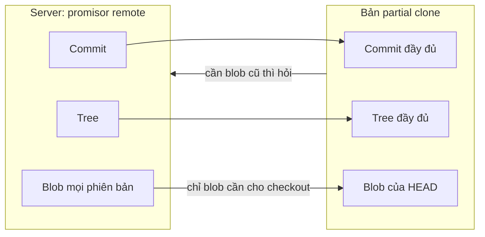
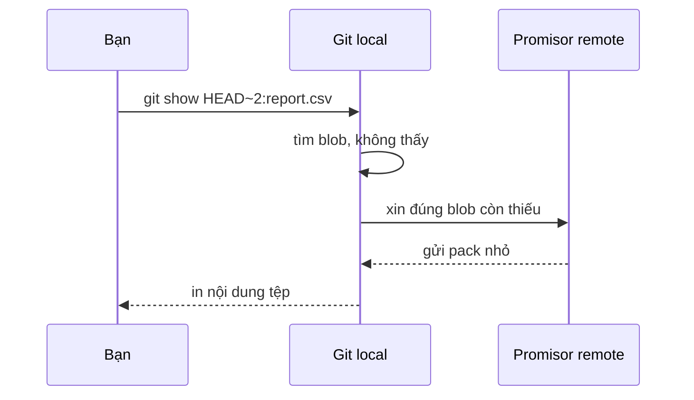

## Bạn sẽ học được gì

- Hiểu partial clone tải đủ đồ thị commit nhưng hoãn tải một số object.
- Dùng bộ lọc `--filter` khi clone và biết các bộ lọc phổ biến.
- Thấy Git tự tải object thiếu khi cần, và cách liệt kê object còn thiếu.
- Phân biệt partial clone, shallow clone và sparse checkout.

## Khái niệm

Clone bình thường tải mọi object: mọi commit, mọi tree, mọi phiên bản của mọi tệp từng tồn tại. Với repository có nhiều tệp nhị phân lớn hoặc lịch sử dài nhiều năm, việc này tốn thời gian và dung lượng, trong khi bạn chủ yếu chỉ cần nội dung hiện tại.

Partial clone cho phép yêu cầu server bỏ bớt một số object khi clone, theo một bộ lọc. Bộ lọc hay dùng nhất là bỏ mọi blob (nội dung tệp). Git vẫn tải đầy đủ commit và tree, nên `git log`, `git log -- <đường dẫn>`, `git merge-base` vẫn chạy bình thường. Chỉ khi một lệnh cần nội dung tệp cụ thể, như checkout, `git show <commit>:<tệp>` hay `git diff` giữa hai phiên bản cũ, Git mới đi hỏi remote để tải đúng blob đó.

Remote gốc được đánh dấu là "promisor remote": nơi đã hứa sẽ cung cấp object còn thiếu khi được hỏi. Git ghi điều này vào cấu hình (`remote.origin.promisor` và `remote.origin.partialclonefilter`), và các packfile tải về kèm tệp `.promisor`.

Lưu ý ngay khi clone, Git vẫn cần nội dung của commit được checkout, nên nó tải luôn các blob của snapshot hiện tại. Thứ bị hoãn là blob của các phiên bản cũ.

Các bộ lọc thường gặp:

- `blob:none`: bỏ mọi blob. Phổ biến nhất cho máy dev.
- `blob:limit=<cỡ>`: chỉ bỏ blob lớn hơn ngưỡng, ví dụ `blob:limit=1m`.
- `tree:0`: bỏ cả tree lẫn blob, chỉ giữ commit. Hợp với máy build chỉ cần một lần checkout.

Server phải hỗ trợ bộ lọc. Các dịch vụ lớn như GitHub và GitLab hỗ trợ. Với repository local, có hai điểm cần biết, và đây là lý do khái niệm của bài nói "một số remote local không hỗ trợ filter":

- Clone bằng đường dẫn thường (không có `file://`) dùng cơ chế sao chép local, Git bỏ qua bộ lọc và cảnh báo.
- Clone bằng `file://` thì đi qua giao thức thật, nhưng repository nguồn phải bật `uploadpack.allowFilter`.

So sánh với hai khái niệm dễ nhầm: shallow clone (`--depth`) cắt bớt lịch sử commit, nên `git log` chỉ thấy vài commit gần nhất. Partial clone giữ đủ lịch sử, chỉ hoãn nội dung. Sparse checkout thì không đụng gì đến việc tải, chỉ quyết định tệp nào được ghi ra đĩa.

## Hình dung bằng sơ đồ





## Lệnh cần biết

```bash
# Clone bỏ mọi blob, tải dần khi cần
git clone --filter=blob:none <url>

# Chỉ bỏ blob lớn hơn 1 MiB
git clone --filter=blob:limit=1m <url>

# Bỏ cả tree, chỉ giữ commit
git clone --filter=tree:0 <url>

# Với repository local: dùng file:// và cho phép filter ở nguồn
git -C <nguồn> config uploadpack.allowFilter true
git clone --filter=blob:none file:///duong/dan/nguon

# Liệt kê object đang thiếu (dòng bắt đầu bằng dấu hỏi)
git rev-list --objects --all --missing=print | grep '^?'

# Xem cấu hình promisor
git config --get remote.origin.promisor
git config --get remote.origin.partialclonefilter
```

| Kiểu | Tùy chọn | Lịch sử commit | Nội dung tệp |
| --- | --- | --- | --- |
| Clone đầy đủ | không | Đủ | Đủ |
| Partial clone | `--filter=...` | Đủ | Tải khi cần |
| Shallow clone | `--depth N` | Chỉ N commit | Của N commit đó |
| Sparse checkout | sau khi clone | Đủ | Đủ, chỉ ẩn trên đĩa |

## Ví dụ từng bước

Repository nguồn có `report.csv` được sửa qua ba commit. Thử clone bằng đường dẫn thường:

```bash
git clone --filter=blob:none /tmp/pb/x/w5/src local-path
```

```text
Cloning into 'local-path'...
warning: --filter is ignored in local clones; use file:// instead.
done.
```

Dùng `file://` nhưng nguồn chưa cho phép filter:

```bash
git clone --filter=blob:none file:///tmp/pb/x/w5/src via-file
```

```text
Cloning into 'via-file'...
warning: filtering not recognized by server, ignoring
```

Bật `uploadpack.allowFilter` ở nguồn rồi clone lại (đường dẫn và ID trên máy bạn sẽ khác):

```bash
git -C /tmp/pb/x/w6/src config uploadpack.allowFilter true
git clone --filter=blob:none file:///tmp/pb/x/w6/src pc
cd pc
git rev-list --objects --all --missing=print | grep '^?'
```

```text
?4fec2dade6fd430696e586310af90eb01578ec68
?7a6db1df5a613c034c6c709039d1e3c92db1745e
```

Hai blob của hai phiên bản cũ đang thiếu. Lịch sử vẫn đủ:

```bash
git log --oneline
```

```text
e613ff5 Báo cáo 3
7c62b09 Báo cáo 2
89e8c71 Báo cáo 1
2fe0c46 Khởi tạo
```

Đọc phiên bản cũ nhất; Git tự tải blob đó:

```bash
git show HEAD~2:report.csv
git rev-list --objects --all --missing=print | grep '^?'
```

```text
báo cáo phiên bản 1
?7a6db1df5a613c034c6c709039d1e3c92db1745e
```

Chỉ còn một blob thiếu. Thư mục pack có thêm các tệp `.promisor` đi kèm từng pack tải từ promisor remote.

> **Cẩn thận** Partial clone cần kết nối tới remote mỗi khi phải tải object thiếu. Nếu bạn làm việc offline, các lệnh cần blob cũ sẽ thất bại.

## Lỗi thường gặp

**Bộ lọc bị bỏ qua mà không để ý.** Với repository local, đọc kỹ cảnh báo: dùng `file://` và bật `uploadpack.allowFilter` ở nguồn.

**Chạy lệnh quét toàn bộ lịch sử.** `git log -p` hay `git blame` trên tệp có nhiều phiên bản sẽ tải dần từng blob, có thể chậm. Đó là đánh đổi của partial clone.

**Nhầm với shallow clone.** Shallow clone thiếu commit; partial clone thiếu nội dung. Nếu `git log` chỉ hiện một commit, bạn đang ở shallow clone.

**Mất remote promisor.** Đổi URL hoặc xóa remote origin khiến Git không biết hỏi ai. Giữ remote promisor ổn định trong suốt vòng đời bản clone.

## Áp dụng trong công việc

Repository dự án app ngân hàng có thư mục ảnh chụp màn hình chuẩn cho visual test, mỗi lần cập nhật giao diện thêm hàng trăm ảnh mới. Clone đầy đủ mất vài GB. Nhóm QA dùng partial clone bỏ blob cho máy cá nhân: lịch sử đầy đủ để bisect và đọc log, ảnh chỉ tải khi một test thực sự cần so sánh. Máy CI chạy một lần rồi xóa thì dùng bộ lọc mạnh hơn để giảm thời gian chuẩn bị.

## Chuẩn bị làm bài

Đây là bài trả lời câu hỏi. Câu hỏi hỏi tên bộ lọc dùng lúc clone để bỏ qua nội dung tệp. Hãy ôn lại danh sách bộ lọc ở trên và hiểu bộ lọc nào bỏ những gì. Câu trả lời ở dạng giá trị đưa sau `--filter=`; app chấp nhận cả dạng có tiền tố tùy chọn.

Nếu muốn tự thử, làm theo ví dụ trong một thư mục tạm: nhớ `file://` và `uploadpack.allowFilter`.

## Tóm tắt

- Partial clone giữ đủ commit và tree, hoãn tải blob tới khi cần.
- Remote gốc là promisor remote, nơi Git hỏi khi thiếu object.
- Bộ lọc phổ biến: bỏ mọi blob, bỏ blob lớn, bỏ cả tree.
- Clone local cần `file://` và `uploadpack.allowFilter` để bộ lọc có tác dụng.
- Partial clone khác shallow clone (thiếu commit) và sparse checkout (ẩn tệp).
