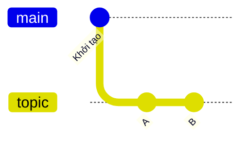
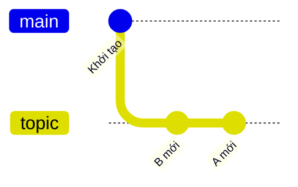
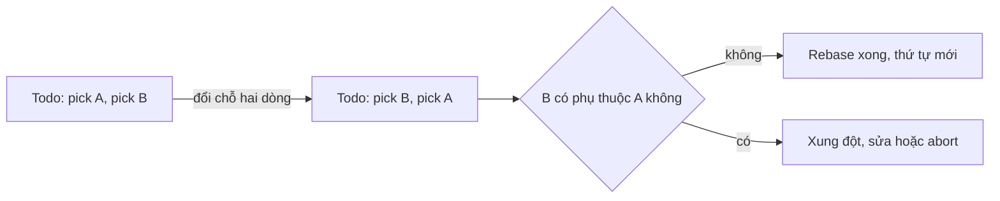

## Bạn sẽ học được gì

- Đổi thứ tự commit trong rebase tương tác bằng cách đổi thứ tự dòng.
- Hiểu vì sao đổi thứ tự tạo commit mới và có thể gây xung đột.
- Nhận biết khi nào hai commit "độc lập" để đổi chỗ an toàn.
- Kiểm tra kết quả theo thứ tự thời gian bằng `git log --reverse`.

## Khái niệm

Thứ tự commit kể câu chuyện của thay đổi. Người review đọc dễ hơn khi phần nền đi trước phần dùng nền đó: thêm hàm tiện ích trước, rồi mới tới test dùng hàm đó. Nhưng khi làm thật, bạn thường viết theo thứ tự ngược lại hoặc lộn xộn. Rebase tương tác cho phép sắp xếp lại.

Trong todo list, mỗi dòng là một commit, thực hiện từ trên xuống. Để đổi thứ tự, bạn chỉ cần đổi thứ tự dòng, giữ nguyên thao tác `pick`. Không có lệnh đặc biệt nào tên là "move": vị trí dòng chính là thứ tự áp dụng.

Khi Git áp lại commit theo thứ tự mới, mỗi commit nhận một parent khác, nên object ID của tất cả commit được sắp lại đều thay đổi. Nội dung cuối cùng (snapshot ở đầu nhánh) thường giống hệt trước, chỉ đường đi khác.

Rủi ro nằm ở chỗ mỗi commit thực chất là một bản vá so với parent của nó. Nếu commit B sửa một dòng mà commit A tạo ra, thì đưa B lên trước A nghĩa là áp bản vá vào chỗ chưa có dòng đó. Git sẽ báo xung đột. Hai commit càng chạm vào phần khác nhau của mã thì đổi chỗ càng an toàn. Hai commit sửa cùng một vùng thì nên cân nhắc gộp lại thay vì đổi chỗ.

Một cách nghĩ hữu ích: trước khi đổi thứ tự, hãy hỏi "commit phía sau có cần commit phía trước để tồn tại không?". Nếu có, đổi chỗ sẽ đau. Nếu không, cứ đổi.

## Hình dung bằng sơ đồ

Trước khi đổi, topic có A rồi B:



Sau khi đổi, B được áp trước rồi tới A; cả hai đều là commit mới:





## Lệnh cần biết

```bash
# Mở todo list cho hai commit cuối
git rebase -i HEAD~2

# Xem thứ tự theo thời gian (cũ trước), dễ so với todo list
git log --reverse --format=%s main..topic

# Khi xung đột: sửa tệp, stage, đi tiếp
git add <tệp>
git rebase --continue

# Hoặc hủy và trả về như cũ
git rebase --abort
```

| Muốn làm | Trong todo list |
| --- | --- |
| Đổi thứ tự | Cắt dán dòng `pick` lên hoặc xuống |
| Giữ commit như cũ | Để nguyên `pick` |
| Bỏ một commit | `drop` hoặc xóa dòng |
| Đổi chỗ và gộp | Đặt cạnh nhau rồi dùng `fixup` hoặc `squash` |

## Ví dụ từng bước

Nhánh topic có hai commit A (tạo `a.txt`) và B (tạo `b.txt`). Hai commit chạm vào hai tệp khác nhau, nên đổi chỗ an toàn. Object ID trên máy bạn sẽ khác.

```bash
git log --oneline main..topic
```

```text
8a504ec B
b3c6908 A
```

Chạy `git rebase -i HEAD~2`. Todo list mở ra có hai dòng `pick`, A ở trên, B ở dưới. Mình đổi chỗ để B lên trên, lưu và đóng editor:

```text
Rebasing (1/2)Rebasing (2/2)Successfully rebased and updated refs/heads/topic.
```

```bash
git log --oneline main..topic
git log --reverse --format=%s main..topic
git ls-tree --name-only HEAD
```

```text
c4327e2 A
fe85916 B
B
A
README.md
a.txt
b.txt
```

Cả hai ID đều mới, B giờ là commit cũ hơn, và snapshot cuối vẫn có đủ hai tệp.

Giờ một trường hợp không an toàn. Commit "Sửa dòng 1" đổi dòng đầu tệp thành `a1`, commit kế tiếp "Sửa tiếp dòng 1" đổi `a1` thành `a1-x`. Đổi chỗ hai commit này:

```text
Rebasing (1/2)Auto-merging f.txt
CONFLICT (content): Merge conflict in f.txt
error: could not apply c3a09fe... Sửa tiếp dòng 1
hint: Resolve all conflicts manually, mark them as resolved with
hint: "git add/rm <conflicted_files>", then run "git rebase --continue".
```

```bash
cat f.txt
```

```text
<<<<<<< HEAD
a
=======
a1-x
>>>>>>> c3a09fe (Sửa tiếp dòng 1)
b
c
```

Commit sau cần commit trước. Ở đây hợp lý nhất là `git rebase --abort`, và nếu thực sự muốn gọn thì gộp hai commit bằng `fixup` thay vì đổi chỗ.

> **Mẹo** Trước khi đổi thứ tự một chuỗi dài, chạy `git show --stat` cho từng commit để xem chúng chạm vào tệp nào. Commit chạm tệp khác nhau thường đổi chỗ được ngay.

## Lỗi thường gặp

**Đổi thứ tự theo cách nhìn của `git log`.** Log hiện commit mới nhất ở trên, todo list thì ngược lại. Nếu muốn "B cũ hơn A", trong todo list B phải đứng trên A.

**Lỡ đổi nhầm thao tác thay vì đổi dòng.** Sửa `pick` thành `squash` sẽ gộp commit, không phải đổi chỗ. Nếu kết quả sai, xem `git reflog` và reset về trạng thái trước rebase.

**Đổi chỗ commit phụ thuộc nhau.** Xung đột xuất hiện liên tục. Hãy abort, cân nhắc gộp, hoặc chấp nhận thứ tự hiện tại.

**Đổi thứ tự commit đã chia sẻ.** Như mọi rebase, object ID đổi; người khác dựa trên commit cũ sẽ gặp rắc rối. Chỉ làm trên nhánh của riêng bạn.

> **Lưu ý** Có thể đạt cùng kết quả mà không dùng rebase, bằng cách reset nhánh về nền rồi cherry-pick từng commit theo thứ tự mong muốn. Rebase tương tác chỉ làm việc đó gọn hơn.

## Áp dụng trong công việc

Bạn viết test cho màn hình mở tài khoản tiết kiệm. Bạn commit test case trước ("Thêm test kỳ hạn 6 tháng") rồi mới nhận ra cần một helper sinh dữ liệu khách hàng, và commit helper sau. Trước khi gửi review, bạn đưa commit helper lên trước để người review đọc theo đúng logic: công cụ trước, test dùng công cụ sau. Vì helper là tệp mới và test nằm ở tệp khác, việc đổi chỗ không gây xung đột.

## Chuẩn bị làm bài

Repository bài tập có nhánh topic với hai commit A rồi B, mỗi commit thêm một tệp riêng. Nhiệm vụ là đảo để B trở thành commit cũ hơn A, giữ nguyên nội dung hai tệp và working tree sạch. Câu hỏi kiến thức hỏi về thao tác trong todo list giữ commit lại nhưng cho phép bạn đổi vị trí dòng.

Hãy chuẩn bị:

- Xem `git log --oneline main..topic` để biết thứ tự hiện tại.
- Nhớ todo list đọc từ trên xuống, cũ trước.
- Biết cách cắt dán một dòng trong editor bạn dùng.
- Sau khi xong, kiểm tra bằng `git log -2 --format=%s` (mới nhất ở trên).

## Tóm tắt

- Đổi thứ tự commit bằng cách đổi thứ tự dòng trong todo list rebase.
- Mọi commit được sắp lại đều có object ID mới.
- Commit phụ thuộc nhau dễ xung đột khi đổi chỗ.
- `git log --reverse` giúp so trực tiếp với thứ tự todo list.
- Chỉ đổi thứ tự commit chưa chia sẻ.
