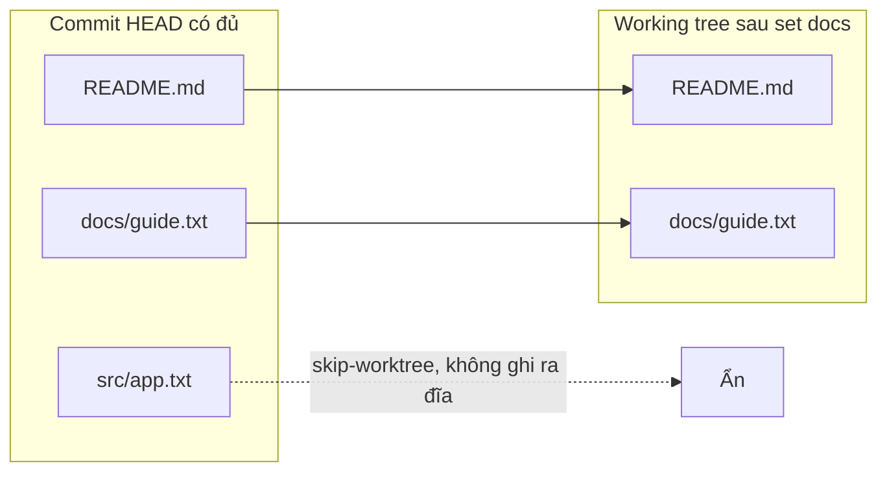
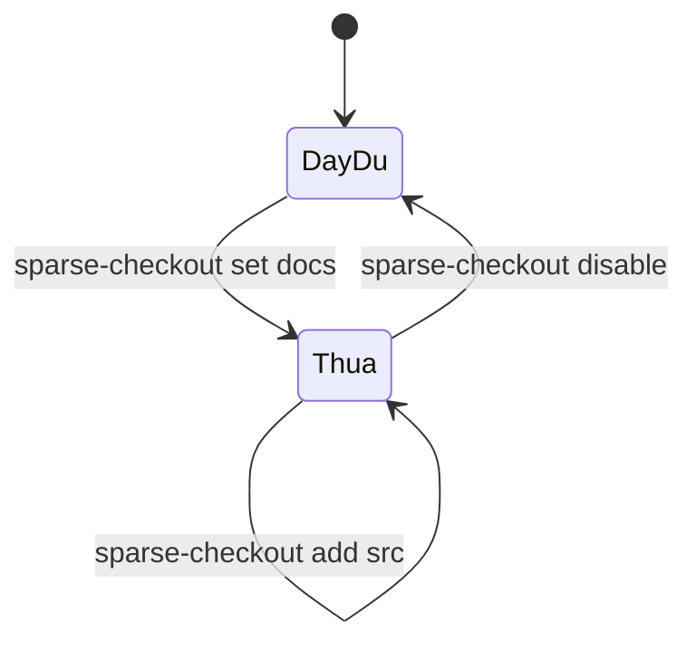

## Bạn sẽ học được gì

- Hiểu sparse checkout ẩn bớt tệp khỏi working tree nhưng không đụng tới lịch sử.
- Bật cone mode và chọn thư mục cần hiện bằng `git sparse-checkout set`.
- Kiểm tra tệp nào đang hiện, tệp nào bị ẩn, và tắt sparse khi cần.
- Biết sparse checkout khác partial clone ở điểm nào.

## Khái niệm

Trong repository lớn, nhất là monorepo chứa nhiều dịch vụ, bạn hiếm khi cần mọi thư mục trên đĩa. Nhóm test mobile chỉ quan tâm `mobile/` và `test/mobile/`, không cần hàng nghìn tệp của backend. Checkout toàn bộ làm chậm `git status`, làm IDE nặng và tốn chỗ.

Sparse checkout cho phép bạn nói với Git: "chỉ đặt lên đĩa những đường dẫn này". Các tệp khác vẫn nằm đầy đủ trong commit, trong index, trong lịch sử; Git chỉ không ghi chúng ra working tree và đánh dấu chúng là bị bỏ qua (skip-worktree). Bạn vẫn có thể `git show HEAD:đường/dẫn` để đọc, `git log` để xem lịch sử, và commit những gì mình sửa trong phần đang hiện.

Có hai cách viết mẫu:

- Cone mode (mặc định từ Git 2.37 khi dùng `set`): bạn chỉ liệt kê thư mục. Git hiện mọi tệp trong thư mục đó cùng các tệp nằm trực tiếp ở gốc repository và ở các thư mục cha. Cách này nhanh và dễ hiểu, nên được khuyên dùng.
- Non-cone mode: dùng mẫu kiểu `.gitignore`, linh hoạt hơn nhưng chậm với repository lớn và dễ viết sai.

Trạng thái sparse được lưu ở `.git/info/sparse-checkout` cùng các cấu hình `core.sparseCheckout` và `core.sparseCheckoutCone`. Tệp mẫu này không được commit, nên mỗi bản clone tự chọn phần mình cần.

Phân biệt với partial clone: sparse checkout quyết định cái gì xuất hiện trên đĩa, còn partial clone quyết định object nào được tải về từ remote. Hai thứ thường đi chung trong monorepo, nhưng độc lập nhau. Bài sau nói về partial clone.

## Hình dung bằng sơ đồ





## Lệnh cần biết

```bash
# Bật sparse checkout ở cone mode (cách cũ, vẫn chạy trên Git 2.47)
git sparse-checkout init --cone

# Đặt tập thư mục cần hiện (trong cone mode chỉ ghi thư mục)
git sparse-checkout set docs

# Thêm một thư mục vào tập đang có
git sparse-checkout add src

# Xem tập thư mục hiện tại
git sparse-checkout list

# Tắt, đưa mọi tệp trở lại working tree
git sparse-checkout disable

# Xem tệp nào bị ẩn: H là đang hiện, S là skip-worktree
git ls-files -t
```

| Lệnh con | Tác dụng |
| --- | --- |
| `init --cone` | Bật cone mode (tài liệu Git coi là cách cũ, thay bằng `set`) |
| `set <thư mục...>` | Thay tập đường dẫn, bật sparse nếu chưa bật |
| `add <thư mục...>` | Thêm vào tập hiện có |
| `list` | In tập hiện tại |
| `reapply` | Áp lại mẫu sau khi có thay đổi lạ |
| `disable` | Tắt sparse |

## Ví dụ từng bước

Repository có `README.md`, `docs/guide.txt` và `src/app.txt`. Bật cone mode và chỉ giữ `docs`:

```bash
git sparse-checkout init --cone
git sparse-checkout set docs
ls -R
```

```text
.:
README.md
docs

./docs:
guide.txt
```

`src` biến khỏi đĩa nhưng tệp gốc `README.md` vẫn còn, đúng như cone mode. Kiểm tra trạng thái:

```bash
git sparse-checkout list
git config --get core.sparseCheckout
git config --get core.sparseCheckoutCone
git status
```

```text
docs
true
true
On branch main
You are in a sparse checkout with 67% of tracked files present.

nothing to commit, working tree clean
```

Index vẫn biết đủ ba tệp, chỉ đánh dấu khác nhau:

```bash
git ls-files -t
git show HEAD:src/app.txt
```

```text
H README.md
H docs/guide.txt
S src/app.txt
Mã nguồn
```

Mẫu thật Git ghi ra cho cone mode trông như sau:

```bash
cat .git/info/sparse-checkout
```

```text
/*
!/*/
/docs/
```

Nghĩa là: lấy mọi tệp ở gốc, bỏ mọi thư mục con ở gốc, rồi lấy lại `docs/`. Thêm `src` hoặc tắt hẳn:

```bash
git sparse-checkout add src
ls
```

```text
README.md
docs
src
```

> **Mẹo** Trên Git mới, chỉ cần `git sparse-checkout set docs` là đủ, vì `set` tự bật sparse và mặc định cone mode. Bài tập vẫn dùng `init --cone` để bạn thấy rõ hai bước.

## Lỗi thường gặp

**Tưởng tệp bị ẩn đã bị xóa.** `git status` sạch và lịch sử vẫn đủ. Đừng commit "khôi phục" gì cả; chỉ cần `add` thư mục hoặc `disable`.

**Ghi tên tệp trong cone mode.** Cone mode làm việc với thư mục. Muốn mẫu theo tệp, phải dùng non-cone mode, nhưng hãy cân nhắc vì chậm hơn và dễ sai.

**Tạo tệp mới trong thư mục bị ẩn.** Git có thể cảnh báo hoặc bỏ qua tệp nằm ngoài vùng sparse khi `git add`. Hãy thêm thư mục đó vào tập trước khi làm việc trong đó.

**Nhầm sparse với giảm dung lượng tải.** Sparse checkout không làm clone nhẹ hơn; mọi object vẫn được tải. Muốn tải ít hơn, kết hợp partial clone.

> **Lưu ý** Tệp `.git/info/sparse-checkout` là cấu hình local của bản clone, không nằm trong lịch sử. Đồng nghiệp clone về sẽ thấy đầy đủ cho tới khi tự bật sparse.

## Áp dụng trong công việc

Monorepo của dự án ví điện tử có `backend/`, `web/`, `mobile/`, `e2e/`. Bạn phụ trách test end-to-end cho web. Bạn chạy `git sparse-checkout set web e2e`, IDE mở nhanh hơn, `git status` gần như tức thì. Khi cần đọc nhanh một tệp cấu hình backend để hiểu API, bạn dùng `git show HEAD:backend/config/api.yaml` thay vì kéo cả thư mục về.

## Chuẩn bị làm bài

Repository bài tập có hai thư mục `docs` và `src`. Bạn cần bật sparse checkout ở cone mode sao cho chỉ `docs` còn trên đĩa, còn tệp trong `src` vẫn tồn tại trong HEAD, và working tree sạch. Câu hỏi kiến thức hỏi lệnh dùng để đặt tập đường dẫn cần hiện trong cone mode.

Hãy chuẩn bị:

- Phân biệt bật sparse với chọn tập đường dẫn.
- Sau khi làm, kiểm tra bằng `ls`, `git sparse-checkout list` và `git ls-files -t`.
- Xác nhận `git show HEAD:src/app.txt` vẫn đọc được nội dung.

## Tóm tắt

- Sparse checkout chỉ đặt một phần tệp lên đĩa; commit, index, lịch sử vẫn đủ.
- Cone mode làm việc theo thư mục, nhanh và được khuyên dùng.
- `set` thay tập đường dẫn, `add` thêm, `disable` tắt.
- `git ls-files -t` hiện S cho tệp bị ẩn.
- Sparse checkout không giảm lượng dữ liệu tải; đó là việc của partial clone.
