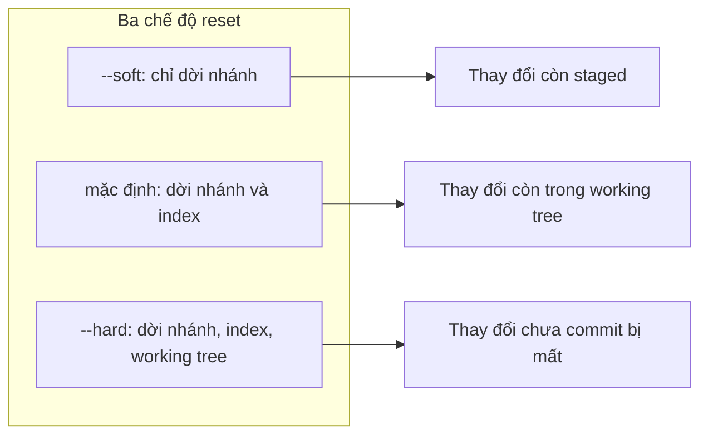
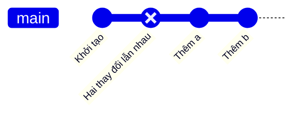

## Bạn sẽ học được gì

- Hiểu vì sao commit lẫn nhiều thay đổi gây khó cho review và hoàn tác.
- Phân biệt ba chế độ `git reset --soft`, mặc định (`--mixed`) và `--hard`.
- Tách commit cuối thành nhiều commit nhỏ, mỗi commit một mục đích.
- Tách một commit nằm giữa lịch sử bằng `edit` trong rebase tương tác.

## Khái niệm

Commit lý tưởng làm đúng một việc. Khi một commit trộn sửa lỗi với refactor, hoặc trộn hai tính năng, người review khó đọc, và nếu sau này cần revert một phần thì không có cách gọn gàng. Tách commit là đưa các thay đổi đó trở lại vùng làm việc rồi commit lại từng phần.

Công cụ chính là `git reset`, vốn dời nhánh hiện tại về một commit khác. Ba chế độ khác nhau ở chỗ nó đụng tới bao nhiêu "vùng":

- `--soft`: chỉ dời nhánh. Index và working tree giữ nguyên, nên mọi thay đổi của commit bị bỏ vẫn đang ở trạng thái staged.
- `--mixed` (mặc định khi không ghi tùy chọn): dời nhánh và đặt lại index theo commit đích. Thay đổi vẫn còn trong working tree nhưng không còn được stage.
- `--hard`: dời nhánh, đặt lại cả index lẫn working tree. Thay đổi chưa commit mất. Không dùng để tách commit.

Để tách commit cuối, cách gọn nhất là `git reset HEAD~1` (chế độ mặc định): commit biến khỏi nhánh, các tệp trở về trạng thái "đã sửa nhưng chưa stage", rồi bạn `git add` từng phần và commit lần lượt. Nếu dùng `--soft`, mọi thứ đã stage sẵn, bạn cần bỏ stage phần không thuộc commit đầu (`git restore --staged <tệp>`) trước khi commit.

Khi các thay đổi cần tách nằm trong cùng một tệp, `git add -p` cho phép chọn từng hunk.

Nếu commit cần tách không phải commit cuối, bạn dùng rebase tương tác: đổi `pick` của commit đó thành `edit`. Rebase áp commit rồi dừng lại ngay sau nó. Lúc này commit đó chính là HEAD, nên bạn làm y như tách commit cuối: reset, commit từng phần, rồi `git rebase --continue` để Git áp tiếp các commit phía sau.

Commit bị reset không mất ngay; nó vẫn trong reflog. Nhưng các thay đổi chưa commit thì không có lưới an toàn đó, nên đừng nhầm với `--hard`.

## Hình dung bằng sơ đồ





Trong sơ đồ trên, commit đánh dấu đảo là commit bị bỏ khỏi nhánh; hai commit sau thay thế nó.

## Lệnh cần biết

```bash
# Bỏ commit cuối, giữ thay đổi trong working tree (chưa stage)
git reset HEAD~1

# Bỏ commit cuối, giữ thay đổi đang staged
git reset --soft HEAD~1

# Bỏ stage một tệp mà không mất nội dung
git restore --staged b.txt

# Chọn từng hunk trong một tệp
git add -p bai.txt

# Xem commit chạm tới tệp nào
git diff-tree --no-commit-id --name-only -r HEAD

# Tách commit giữa lịch sử: đánh dấu edit, rồi tiếp tục sau khi tách
git rebase -i main
git rebase --continue
```

| Chế độ | Nhánh | Index | Working tree |
| --- | --- | --- | --- |
| `--soft` | Dời | Giữ | Giữ |
| `--mixed` (mặc định) | Dời | Đặt lại | Giữ |
| `--hard` | Dời | Đặt lại | Đặt lại |

## Ví dụ từng bước

Commit cuối "Hai thay đổi lẫn nhau" tạo cùng lúc `a.txt` và `b.txt`:

```bash
git show --stat --format=%s HEAD
```

```text
Hai thay đổi lẫn nhau

 a.txt | 1 +
 b.txt | 1 +
 2 files changed, 2 insertions(+)
```

Reset ở chế độ mặc định, rồi commit từng tệp (object ID trên máy bạn sẽ khác):

```bash
git reset HEAD~1
git status --short
```

```text
?? a.txt
?? b.txt
```

Hai tệp là tệp mới nên sau reset chúng hiện là chưa theo dõi. Commit lần lượt:

```bash
git add a.txt
git commit -m "Thêm a"
git add b.txt
git commit -m "Thêm b"
git log --oneline
git diff-tree --no-commit-id --name-only -r HEAD~1
git diff-tree --no-commit-id --name-only -r HEAD
```

```text
f370785 Thêm b
83c55bd Thêm a
6c18ce2 Khởi tạo
a.txt
b.txt
```

So sánh với `--soft` trên một repository giống hệt:

```bash
git reset --soft HEAD~1
git status --short
git restore --staged b.txt
git status --short
```

```text
A  a.txt
A  b.txt
A  a.txt
?? b.txt
```

Với `--soft`, cả hai tệp còn staged; bỏ stage `b.txt` rồi commit `a.txt` trước.

Tách commit giữa lịch sử: topic có "Lẫn" (a và b) rồi "Sau" (c). Đổi dòng đầu todo thành `edit`:

```text
Rebasing (1/2)Stopped at 5ada2c8...  Lẫn
You can amend the commit now, with

  git commit --amend 

Once you are satisfied with your changes, run

  git rebase --continue
```

Sau đó `git reset HEAD~1`, commit A rồi B, và `git rebase --continue`:

```text
Rebasing (2/2)Successfully rebased and updated refs/heads/topic.
```

```bash
git log --oneline main..topic
```

```text
a976065 Sau
b126854 B
71fb6a3 A
```

> **Cẩn thận** Gõ nhầm `git reset --hard HEAD~1` khi định tách commit sẽ xóa thay đổi khỏi working tree. Commit vẫn cứu được qua reflog, nhưng hãy tập thói quen đọc lại lệnh trước khi Enter.

## Lỗi thường gặp

**Dùng `--hard` thay vì mặc định.** Thay đổi biến mất khỏi thư mục. Chạy `git reflog`, tìm commit vừa bỏ và `git reset --hard <id>` để lấy lại trạng thái, rồi làm lại đúng cách.

**Quên tệp mới sau reset.** Tệp được tạo trong commit bị bỏ trở thành untracked; `git add -u` không thấy chúng. Đọc `git status` trước khi commit.

**Commit thứ hai vô tình rỗng hoặc gom hết.** Do `git add .` ngay từ đầu. Stage có chủ đích: chỉ đúng tệp hoặc hunk của từng commit.

**Quên `git rebase --continue` khi tách commit giữa lịch sử.** Repository đứng ở trạng thái rebase dở, nhánh chưa được cập nhật. `git status` sẽ nhắc bạn.

## Áp dụng trong công việc

Bạn lỡ commit một lần cả việc nâng phiên bản thư viện Selenium lẫn việc sửa một test đăng nhập OTP. Nếu phiên bản thư viện mới gây lỗi trên máy CI, nhóm sẽ muốn revert riêng phần nâng cấp. Bạn reset commit đó, commit riêng tệp cấu hình phụ thuộc, rồi commit riêng phần sửa test. Hai commit, hai mục đích, revert được độc lập.

## Chuẩn bị làm bài

Bài thực hành có commit cuối chứa đồng thời `a.txt` và `b.txt`. Bạn cần thay nó bằng hai commit, mỗi commit đúng một tệp, và working tree sạch. Câu hỏi kiến thức hỏi chế độ reset nào bỏ commit nhưng vẫn giữ nội dung ở trạng thái staged.

Hãy chuẩn bị:

- Nhớ bảng ba chế độ reset ở trên, đặc biệt là cột Index.
- Quyết định bạn muốn bắt đầu từ trạng thái staged hay unstaged, rồi chọn chế độ phù hợp.
- Sau khi xong, kiểm tra từng commit chạm vào tệp nào bằng `git diff-tree`.

## Tóm tắt

- Tách commit giúp mỗi commit một mục đích, dễ review và dễ revert.
- `--soft` giữ thay đổi staged, mặc định giữ trong working tree, `--hard` xóa.
- Tách commit cuối: reset rồi stage và commit từng phần.
- Tách commit giữa lịch sử: `edit` trong rebase tương tác, tách, rồi `--continue`.
- Reflog cứu được commit, nhưng không cứu được thay đổi chưa commit.
