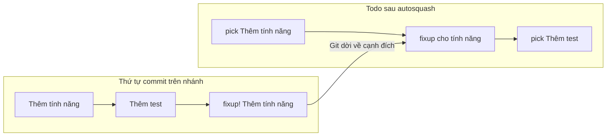
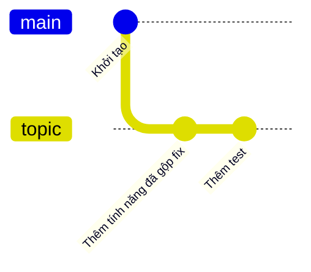

## Bạn sẽ học được gì

- Phân biệt `squash` và `fixup` khi gộp commit trong rebase tương tác.
- Tạo commit sửa có đánh dấu bằng `git commit --fixup` và `--squash`.
- Dùng `--autosquash` để Git tự xếp commit sửa về cạnh commit đích.
- Kiểm tra kết quả gộp mà không làm mất nội dung.

## Khái niệm

Trong lúc review, người ta thường góp ý nhỏ: đổi tên biến, thêm một assert, sửa chính tả. Bạn sửa và tạo thêm commit. Sau vài vòng, nhánh có một loạt commit kiểu "sửa theo review". Trước khi merge, nhóm thường muốn các sửa vặt này nhập vào đúng commit gốc của chúng, để lịch sử chính chỉ còn những bước có ý nghĩa.

Rebase tương tác có hai thao tác để gộp:

- `squash`: gộp commit vào commit ngay phía trên trong todo list, và mở editor cho bạn biên tập message chung (Git ghép cả hai message lại).
- `fixup`: gộp tương tự, nhưng bỏ hẳn message của commit sửa, giữ message của commit đích. Đây là lựa chọn hợp nhất cho sửa vặt.

Khó chịu ở chỗ: commit sửa thường nằm cách xa commit đích, bạn phải tự cắt dán dòng trong todo list. Autosquash tự động hóa việc đó dựa trên quy ước đặt tên:

- Commit có subject bắt đầu bằng `fixup! ` theo sau là subject của commit đích sẽ được chuyển về ngay dưới commit đích và đổi thành thao tác `fixup`.
- Commit bắt đầu bằng `squash! ` được chuyển tương tự nhưng thành thao tác `squash`.
- Commit bắt đầu bằng `amend! ` thay cả nội dung lẫn message của commit đích.

Bạn không cần gõ tay tiền tố. `git commit --fixup=<commit>` tự tạo subject đúng dạng, `--squash=<commit>` cũng vậy. Sau đó `git rebase -i --autosquash <nền>` mở todo list đã được xếp sẵn; bạn chỉ cần xem lại và lưu. Từ Git 2.44, `--autosquash` cũng dùng được với rebase không tương tác, và bạn có thể bật mặc định cho rebase tương tác bằng cấu hình `rebase.autoSquash`.

Gộp commit vẫn là viết lại lịch sử: commit đích và mọi commit sau nó đều có object ID mới. Quy tắc cũ vẫn áp dụng: làm trên nhánh chưa chia sẻ, hoặc thống nhất với nhóm trước khi force push.

## Hình dung bằng sơ đồ





## Lệnh cần biết

```bash
# Tạo commit sửa cho một commit đích (subject tự thành "fixup! <subject đích>")
git commit --fixup=<commit>

# Tạo commit squash kèm ghi chú thêm cho message
git commit --squash=<commit> -m "ghi chú thêm"

# Xếp và gộp tự động khi rebase tương tác
git rebase -i --autosquash main

# Bật autosquash mặc định cho rebase tương tác trong repository này
git config rebase.autoSquash true
```

| Tiền tố subject | Tạo bằng | Thao tác trong todo | Message kết quả |
| --- | --- | --- | --- |
| `fixup! ` | `--fixup=<c>` | `fixup` | Giữ message đích |
| `squash! ` | `--squash=<c>` | `squash` | Ghép, mở editor |
| `amend! ` | `--fixup=amend:<c>` | `fixup -C` | Dùng message mới |

## Ví dụ từng bước

Nhánh topic có "Thêm tính năng" rồi "Thêm test". Mình sửa lại tệp của tính năng và tạo commit sửa trỏ về commit đích (object ID trên máy bạn sẽ khác):

```bash
git add bai.txt
git commit --fixup=HEAD~1
git log --oneline main..topic
```

```text
[topic 003eefd] fixup! Thêm tính năng
 1 file changed, 1 insertion(+), 1 deletion(-)
003eefd fixup! Thêm tính năng
634e22f Thêm test
7e1b8e8 Thêm tính năng
```

Mở rebase tương tác với autosquash. Đây là ba dòng đầu của todo list Git đề xuất:

```bash
git rebase -i --autosquash main
```

```text
pick 7e1b8e8 Thêm tính năng
fixup 003eefd fixup! Thêm tính năng
pick 634e22f Thêm test
```

Commit sửa đã được dời lên ngay dưới commit đích và đổi thành `fixup`. Lưu và đóng editor:

```bash
git log --oneline main..topic
git show --stat --format=%s HEAD~1
```

```text
7f7b130 Thêm test
47139cc Thêm tính năng

Thêm tính năng

 bai.txt | 1 +
 1 file changed, 1 insertion(+)
```

Còn hai commit. Commit tính năng giờ chứa luôn phần sửa, và message không còn chữ "fixup!".

Với `--squash`, message kết quả giữ thêm phần ghi chú. Trong một lần thử khác, sau khi gộp commit `squash! Thêm tính năng` có thân "ghi chú thêm", message cuối cùng là:

```text
Thêm tính năng

ghi chú thêm
```

> **Mẹo** Không nhớ object ID của commit đích? `git commit --fixup=":/Thêm tính năng"` (nhớ đặt trong dấu nháy vì có khoảng trắng) tìm commit gần nhất có message chứa chuỗi đó. Kiểm tra lại subject trước khi rebase cho chắc.

## Lỗi thường gặp

**Subject sau `fixup!` không khớp commit đích.** Autosquash so khớp theo subject (hoặc object ID). Gõ tay sai một chữ, Git không xếp được và giữ commit ở chỗ cũ với `pick`. Dùng `--fixup` để Git tự viết subject.

**Quên `--autosquash`.** Không bật tùy chọn hay cấu hình, todo list chỉ có toàn `pick` theo thứ tự cũ. Bạn vẫn có thể tự sửa tay, hoặc hủy rồi chạy lại với tùy chọn.

**Rebase từ chối vì còn thay đổi chưa commit.** Git báo index hoặc working tree chưa sạch. Commit hoặc stash trước, hoặc dùng `git rebase --autostash`.

**Gộp nhầm vào commit khác.** Xem `git reflog`, tìm điểm trước khi rebase bắt đầu và reset về đó, rồi làm lại.

> **Lưu ý** Squash trong rebase khác với `git merge --squash`. Cái trước gộp commit trên chính nhánh của bạn; cái sau gom nội dung cả nhánh thành một commit mới trên nhánh đích.

## Áp dụng trong công việc

Bạn mở review cho nhánh thêm bộ test API tra cứu sao kê. Reviewer góp ba ý: đổi tên một test, thêm kiểm tra mã lỗi 404, bỏ một dòng log thừa. Mỗi ý bạn sửa bằng `git commit --fixup=<commit liên quan>`, push để reviewer xem từng sửa đổi riêng. Khi reviewer đồng ý, bạn chạy `git rebase -i --autosquash main`, force push có kiểm soát, và nhánh trở lại gọn gàng trước khi merge.

## Chuẩn bị làm bài

Bài thực hành dùng nhánh topic có một commit tính năng và một commit sửa đã được đặt tên theo quy ước autosquash. Bạn cần gộp để topic chỉ còn một commit sau main mà vẫn giữ nội dung đã sửa. Câu hỏi kiến thức hỏi tiền tố message đánh dấu commit sửa dành cho autosquash.

Hãy ôn:

- Đọc kỹ subject hai commit bằng `git log --oneline main..topic`.
- Nhớ sự khác nhau giữa `fixup` và `squash` để chọn đúng.
- Biết rằng autosquash chỉ sắp xếp đề xuất; bạn vẫn cần lưu và đóng editor.
- Kiểm tra lại số commit và nội dung tệp sau khi xong.

## Tóm tắt

- `squash` ghép message, `fixup` giữ message của commit đích.
- `git commit --fixup` và `--squash` tạo subject có tiền tố đúng quy ước.
- `--autosquash` tự dời commit sửa về cạnh commit đích trong todo list.
- `rebase.autoSquash` bật hành vi đó mặc định.
- Gộp commit là viết lại lịch sử, chỉ làm với commit chưa chia sẻ.
