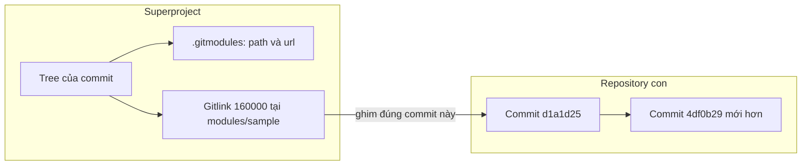
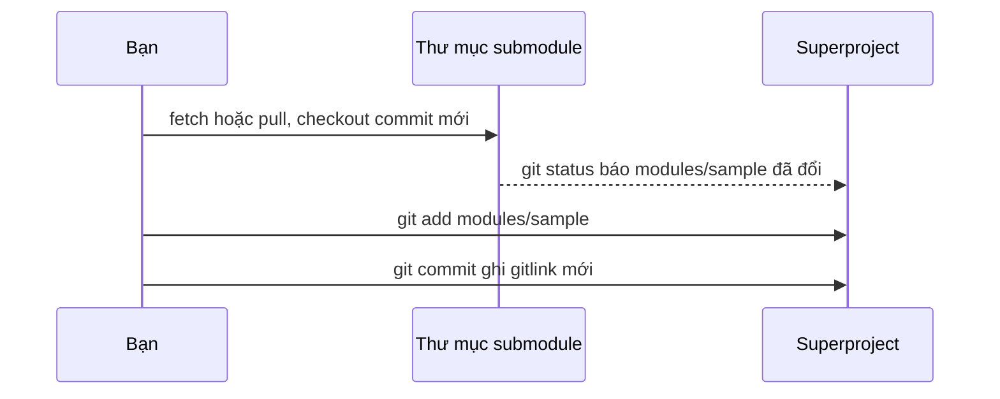

## Bạn sẽ học được gì

- Hiểu superproject lưu submodule như thế nào: tệp `.gitmodules` và gitlink.
- Thêm một repository con, commit nó, và clone lại cho đúng.
- Cập nhật submodule lên commit mới và biết vì sao phải commit lại ở superproject.
- Nhận ra các tình huống submodule "trống" hoặc "lệch" và cách xử lý.

## Khái niệm

Đôi khi dự án của bạn cần dùng mã của một repository khác, nhưng bạn muốn giữ lịch sử của nó tách biệt: một bộ thư viện test dùng chung, một bộ dữ liệu mẫu, một module do nhóm khác quản lý. Submodule là cách Git cho phép đặt một repository bên trong repository khác mà mỗi bên vẫn có lịch sử riêng.

Repository bên ngoài gọi là superproject. Superproject không chứa tệp của repository con trong lịch sử của nó. Thay vào đó, nó lưu hai thứ:

1. Tệp `.gitmodules` ở gốc, ghi đường dẫn và URL của từng submodule. Tệp này được commit như tệp thường.
2. Một mục đặc biệt trong tree, gọi là gitlink, có mode `160000` và kiểu `commit`. Gitlink ghi chính xác object ID của commit trong repository con mà superproject đang "ghim".

Điều này dẫn tới mô hình tư duy quan trọng nhất: superproject ghim một commit cụ thể của repository con, không ghim một nhánh. Khi repository con có commit mới, superproject không tự đi theo. Bạn phải vào submodule, checkout commit mới, rồi quay ra superproject commit lại gitlink. Ngược lại, khi người khác cập nhật gitlink, bạn phải chạy `git submodule update` để thư mục con nhảy tới commit được ghim.

Submodule hữu ích khi bạn muốn kiểm soát chặt phiên bản phụ thuộc. Nó cũng có giá: thêm bước khi clone, thêm bước khi cập nhật, và dễ gây nhầm cho người chưa quen.

Một chi tiết bảo mật: từ Git 2.38.1, khi URL submodule là đường dẫn local (giao thức `file`), Git mặc định chặn việc clone submodule. Đây là biện pháp phòng tấn công qua repository độc hại. Trong bài tập local, bạn bật riêng cho một lệnh bằng `-c protocol.file.allow=always`, thay vì đổi cấu hình toàn máy.

## Hình dung bằng sơ đồ



Quy trình cập nhật submodule lên commit mới:



## Lệnh cần biết

```bash
# Thêm submodule (URL hoặc đường dẫn, rồi vị trí trong superproject)
git submodule add <url> modules/sample

# Với nguồn local trong bài tập, cho phép giao thức file cho riêng lệnh này
git -c protocol.file.allow=always submodule add <đường-dẫn> modules/sample

# Xem commit đang được ghim cho từng submodule
git submodule status

# Sau khi clone superproject: đăng ký và checkout submodule
git submodule update --init

# Clone kèm submodule ngay từ đầu
git clone --recurse-submodules <url>

# Xem thay đổi submodule dưới dạng danh sách commit
git diff --submodule
```

| Thành phần | Nằm ở đâu | Ý nghĩa |
| --- | --- | --- |
| `.gitmodules` | Gốc superproject, được commit | Đường dẫn và URL |
| Gitlink | Tree của superproject, mode 160000 | Commit được ghim |
| `.git/modules/<tên>` | Trong `.git` của superproject | Kho object thật của submodule |
| `submodule.<tên>.url` trong `.git/config` | Cấu hình local | Ghi khi `init`, có thể ghi đè |

## Ví dụ từng bước

Mình có repository `module-source` với một commit "Tạo module", và một superproject `sp`. Thử thêm submodule mà không bật giao thức file:

```bash
git submodule add /tmp/pb/x/w/module-source modules/sample
```

```text
Cloning into '/tmp/pb/x/w/sp/modules/sample'...
fatal: transport 'file' not allowed
fatal: clone of '/tmp/pb/x/w/module-source' into submodule path '/tmp/pb/x/w/sp/modules/sample' failed
```

Bật cho riêng lệnh này:

```bash
git -c protocol.file.allow=always submodule add /tmp/pb/x/w/module-source modules/sample
cat .gitmodules
git status --short
```

```text
[submodule "modules/sample"]
	path = modules/sample
	url = /tmp/pb/x/w/module-source
A  .gitmodules
A  modules/sample
```

Commit rồi xem tree. Object ID trên máy bạn sẽ khác:

```bash
git commit -m "Thêm submodule"
git ls-tree HEAD modules/sample
git submodule status
```

```text
160000 commit d1a1d259eaeed93a432e299c8b520db2ba937774	modules/sample
 d1a1d259eaeed93a432e299c8b520db2ba937774 modules/sample (heads/main)
```

Repository con có commit mới "Module v2". Vào submodule kéo về, superproject thấy gitlink lệch:

```bash
git -C modules/sample pull -q
git status --short
git diff --submodule
```

```text
 M modules/sample
Submodule modules/sample d1a1d25..4df0b29:
  > Module v2
```

Nếu muốn ghim phiên bản mới, `git add modules/sample` rồi commit. Cuối cùng, clone superproject sang chỗ khác thì thư mục submodule trống cho tới khi chạy update:

```bash
git clone -q /tmp/pb/x/w/sp /tmp/pb/x/w/sp-clone
ls /tmp/pb/x/w/sp-clone/modules/sample
git -C /tmp/pb/x/w/sp-clone -c protocol.file.allow=always submodule update --init
```

```text
Submodule 'modules/sample' (/tmp/pb/x/w/module-source) registered for path 'modules/sample'
Cloning into '/tmp/pb/x/w/sp-clone/modules/sample'...
done.
Submodule path 'modules/sample': checked out 'd1a1d259eaeed93a432e299c8b520db2ba937774'
```

Để ý bản clone checkout đúng `d1a1d25`, tức commit đã được ghim, chứ không phải commit mới nhất của module.

> **Lưu ý** `protocol.file.allow=always` chỉ nên bật cho từng lệnh với nguồn bạn tin cậy, như repository trong thư mục bài tập. Đừng đặt nó vào cấu hình global.

## Lỗi thường gặp

**Clone xong thư mục submodule trống.** Đây là hành vi mặc định. Chạy `git submodule update --init` (thêm `--recursive` nếu có submodule lồng nhau), hoặc clone bằng `--recurse-submodules`.

**Commit trong submodule nhưng quên commit superproject.** Đồng nghiệp kéo về vẫn thấy commit cũ được ghim. Luôn kiểm tra `git status` ở superproject sau khi đổi submodule.

**Submodule ở trạng thái detached HEAD.** Sau `submodule update`, thư mục con thường đứng ở detached HEAD tại commit được ghim. Nếu muốn sửa code trong đó, hãy `git switch` sang một nhánh trước khi commit, kẻo commit bị lạc.

**Push superproject trước khi push submodule.** Gitlink trỏ tới commit mà remote của submodule chưa có, người khác sẽ không update được. Push submodule trước, superproject sau.

## Áp dụng trong công việc

Nhóm QA của bạn duy trì một repository `test-data` chứa bộ dữ liệu tài khoản giả lập dùng cho nhiều dự án. Dự án ứng dụng ngân hàng di động thêm `test-data` làm submodule tại `fixtures/shared`. Khi `test-data` thêm bộ dữ liệu cho tính năng mới, dự án không tự nhận ngay; người phụ trách test cập nhật submodule, chạy lại bộ test, rồi mới commit gitlink mới. Nhờ đó một thay đổi dữ liệu không âm thầm làm đỏ pipeline của dự án.

## Chuẩn bị làm bài

Bài tập đặt sẵn repository `module-source` bên cạnh repository bài tập. Bạn cần thêm nó làm submodule tại `modules/sample` và commit để HEAD có gitlink, working tree sạch. Câu hỏi kiến thức hỏi lệnh dùng để thêm một repository local làm submodule.

Hãy chuẩn bị:

- Lấy đúng đường dẫn tới `module-source` (lệnh `git-training hint` có thể in đường dẫn cụ thể).
- Nhớ vụ chặn giao thức file và cách bật cho riêng một lệnh.
- Sau khi thêm, xem `git status` có những gì đã stage, rồi commit.
- Kiểm tra bằng `git ls-tree HEAD modules/sample` xem có mode 160000 chưa.

## Tóm tắt

- Submodule là repository con được superproject ghim tại một commit cụ thể.
- `.gitmodules` lưu đường dẫn và URL; gitlink mode 160000 lưu commit được ghim.
- Cập nhật submodule cần hai bước: đổi commit trong con, rồi commit gitlink ở cha.
- Sau clone, cần `git submodule update --init` để có tệp trong submodule.
- Nguồn local bị chặn mặc định; bật bằng `-c protocol.file.allow=always` cho từng lệnh.
