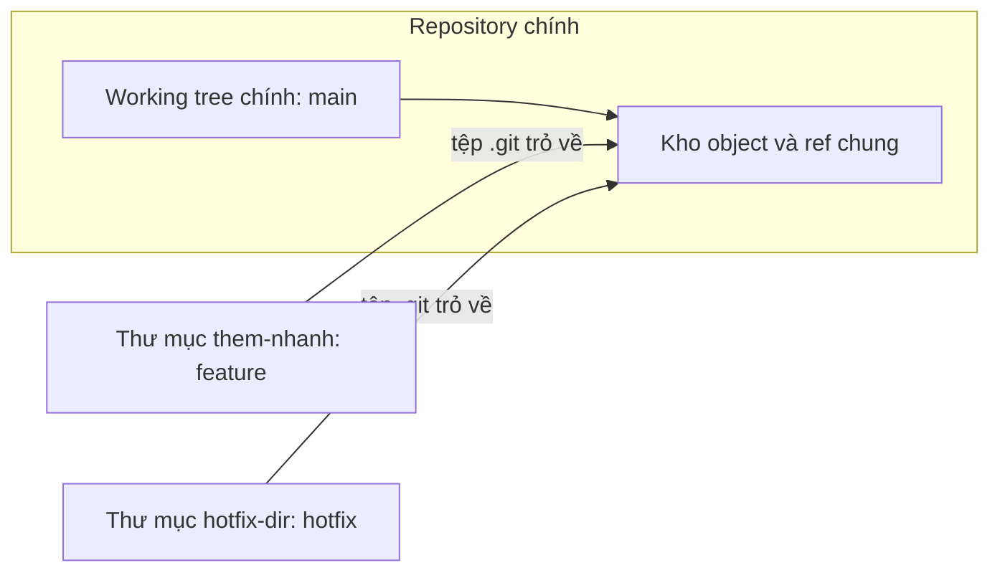
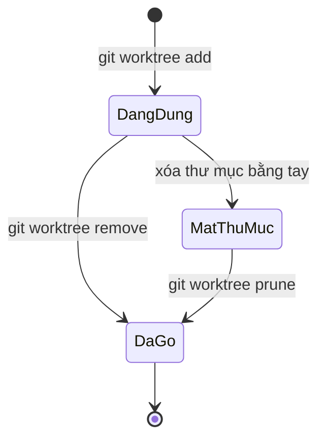

## Bạn sẽ học được gì

- Hiểu worktree là gì và khác gì so với clone thêm một bản repository.
- Tạo, liệt kê, gỡ worktree bằng nhóm lệnh `git worktree`.
- Biết vì sao một nhánh không thể được checkout ở hai worktree cùng lúc.
- Dọn dẹp worktree cũ mà không làm hỏng repository chính.

## Khái niệm

Một repository Git bình thường có đúng một working tree: thư mục bạn đang mở trong editor. Muốn xem nhánh khác, bạn phải `git switch`, và nếu đang sửa dở thì phải commit hoặc stash trước. Với việc nhỏ thì không sao, nhưng khi bạn đang chạy một bộ test dài trên nhánh này mà lại cần sửa gấp một lỗi trên nhánh khác, việc chuyển qua chuyển lại rất mệt.

Worktree giải quyết đúng chỗ đó: một repository có thể gắn thêm nhiều thư mục làm việc, mỗi thư mục checkout một nhánh (hoặc một commit) riêng. Tất cả dùng chung một kho object, chung ref, chung cấu hình. Commit bạn tạo ở worktree này lập tức thấy được ở worktree kia, vì thực ra chỉ có một repository.

Khác với clone thêm một bản:

- Clone tạo kho object thứ hai, tốn dung lượng, và hai bản phải push/fetch qua lại mới thấy nhau.
- Worktree chỉ thêm một thư mục làm việc và một ít metadata. Không có gì để đồng bộ.

Mỗi worktree phụ có tệp `.git` (là tệp, không phải thư mục) chứa đường dẫn trỏ về `.git/worktrees/<tên>` trong repository chính. Ở đó Git lưu HEAD riêng, index riêng của worktree đó. Nhờ vậy mỗi worktree có trạng thái staging độc lập.

Quy tắc an toàn quan trọng: một nhánh chỉ được checkout ở tối đa một worktree tại một thời điểm. Nếu hai thư mục cùng đứng trên một nhánh, commit ở bên này sẽ dời nhánh trong khi bên kia vẫn nghĩ nhánh ở chỗ cũ, index và working tree bên kia sẽ lệch. Git chặn điều này ngay từ đầu.

## Hình dung bằng sơ đồ



Vòng đời của một worktree phụ:



## Lệnh cần biết

```bash
# Tạo worktree ở thư mục song song, checkout nhánh có sẵn
git worktree add ../them-nhanh feature

# Tạo worktree kèm nhánh mới (nhánh mới bắt đầu từ HEAD hiện tại)
git worktree add -b hotfix ../hotfix-dir

# Liệt kê worktree; --porcelain cho định dạng dễ đọc bằng script
git worktree list
git worktree list --porcelain

# Gỡ worktree (thư mục phải sạch, nếu không cần --force)
git worktree remove ../hotfix-dir

# Dọn metadata của worktree mà thư mục đã bị xóa bằng tay
git worktree prune -v
```

| Lệnh con | Dùng khi |
| --- | --- |
| `add <đường-dẫn> [nhánh]` | Mở thêm một thư mục làm việc |
| `add -b <nhánh-mới> <đường-dẫn>` | Vừa tạo nhánh vừa mở thư mục |
| `list` | Xem worktree nào đang đứng ở đâu |
| `remove <đường-dẫn>` | Gỡ gọn gàng |
| `prune` | Dọn dấu vết worktree đã mất thư mục |
| `lock` / `unlock` | Chặn prune với worktree trên ổ di động |

## Ví dụ từng bước

Repository có hai nhánh `main` và `feature`, đang đứng ở main. Mình tạo worktree cho feature ở thư mục bên cạnh (đường dẫn và object ID trên máy bạn sẽ khác):

```bash
git worktree add ../them-nhanh feature
```

```text
Preparing worktree (checking out 'feature')
HEAD is now at 9a47a06 Khởi tạo
```

```bash
git worktree list
```

```text
/tmp/pb/x/w/wt          9a47a06 [main]
/tmp/pb/x/w/them-nhanh  9a47a06 [feature]
```

`git branch -v` đánh dấu nhánh đang được dùng ở worktree khác bằng dấu cộng ở đầu dòng:

```text
+ feature 9a47a06 Khởi tạo
* main    9a47a06 Khởi tạo
```

Thử chuyển worktree chính sang feature, Git từ chối:

```bash
git switch feature
```

```text
fatal: 'feature' is already used by worktree at '/tmp/pb/x/w/them-nhanh'
```

Nhìn vào thư mục mới, `.git` chỉ là một tệp nhỏ:

```bash
cat ../them-nhanh/.git
```

```text
gitdir: /tmp/pb/x/w/wt/.git/worktrees/them-nhanh
```

Tạo rồi gỡ một worktree tạm cho hotfix:

```bash
git worktree add -b hotfix ../hotfix-dir
git worktree remove ../hotfix-dir
```

```text
Preparing worktree (new branch 'hotfix')
HEAD is now at 9a47a06 Khởi tạo
```

Lưu ý: gỡ worktree không xóa nhánh `hotfix`. Nhánh là ref trong repository chính, vẫn còn đó cho tới khi bạn tự xóa.

> **Mẹo** Đặt worktree ở thư mục song song (dùng `../`) thay vì bên trong repository chính. Đặt bên trong dễ khiến công cụ tìm kiếm, linter hoặc chính Git nhìn thấy thư mục lạ như tệp chưa theo dõi.

## Lỗi thường gặp

**Xóa thư mục worktree bằng `rm -rf`.** Git vẫn ghi nhận worktree đó và nhánh của nó vẫn bị coi là "đang dùng". Chạy `git worktree prune` để dọn metadata. Lần sau hãy dùng `git worktree remove`.

**Muốn checkout cùng nhánh ở hai nơi.** Git không cho. Nếu chỉ cần xem code, dùng `git worktree add --detach ../xem-thu feature` để có một bản detached HEAD tại cùng commit, hoặc tạo nhánh phụ.

**Quên rằng stash và ref là chung.** Stash tạo ở worktree này hiện ở worktree kia, vì `refs/stash` là ref chung. Đặt tên stash rõ ràng để khỏi nhầm.

**`remove` từ chối vì còn thay đổi.** Git bảo vệ việc dở dang của bạn. Commit hoặc stash trước, chỉ dùng `--force` khi chắc chắn không cần các thay đổi đó.

> **Cẩn thận** Công cụ build hoặc IDE đôi khi lưu cache theo đường dẫn tuyệt đối. Mở hai worktree cùng lúc trong IDE thì nên để mỗi worktree một cửa sổ riêng.

## Áp dụng trong công việc

Bạn đang chạy bộ regression UI mất khoảng bốn mươi phút trên nhánh `test/release-2.3`. Giữa chừng, team báo một test smoke trên `main` đỏ vì locator cũ. Thay vì dừng bộ regression, bạn chạy `git worktree add ../smoke-fix main`, mở thư mục mới, sửa locator, commit và push. Bộ regression vẫn chạy yên ổn trong thư mục cũ. Xong việc, `git worktree remove ../smoke-fix`.

## Chuẩn bị làm bài

Repository bài tập đã có nhánh `feature` và bạn đang đứng ở `main`. Nhiệm vụ là mở một worktree trong thư mục song song tên `them-nhanh` cho nhánh feature, sao cho `git worktree list` thấy đường dẫn đó. Câu hỏi kiến thức hỏi lệnh dùng để thêm worktree mới.

Hãy ôn:

- Đường dẫn tương đối tính từ thư mục bạn đang đứng. "Thư mục song song" nghĩa là nằm cạnh repository, không nằm bên trong.
- Thứ tự đối số: đường dẫn trước, nhánh sau.
- Sau khi tạo, kiểm tra bằng `git worktree list` và thử `cd` vào thư mục mới để chạy `git status`.

## Tóm tắt

- Worktree cho một repository nhiều thư mục làm việc, chung kho object và ref.
- Mỗi worktree có HEAD và index riêng, nên trạng thái staging độc lập.
- Một nhánh chỉ được checkout ở một worktree tại một thời điểm.
- Dùng `remove` để gỡ, `prune` để dọn khi thư mục đã bị xóa tay.
- Gỡ worktree không xóa nhánh.
