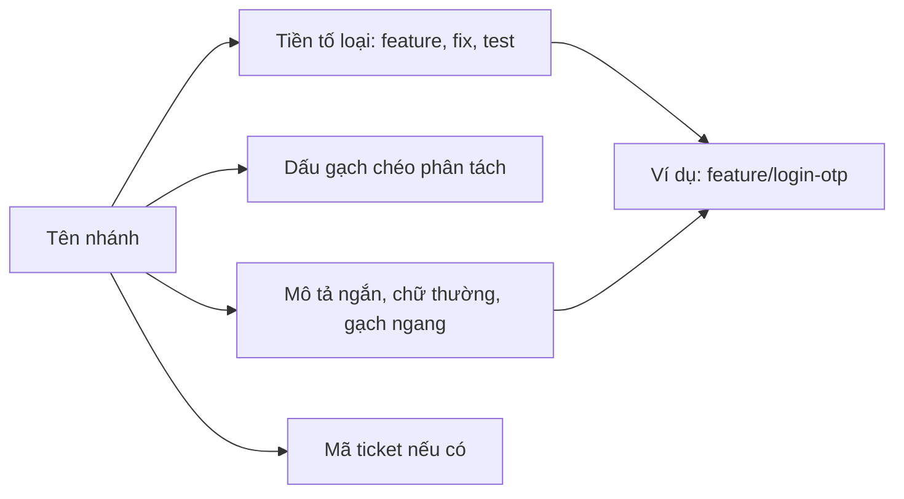
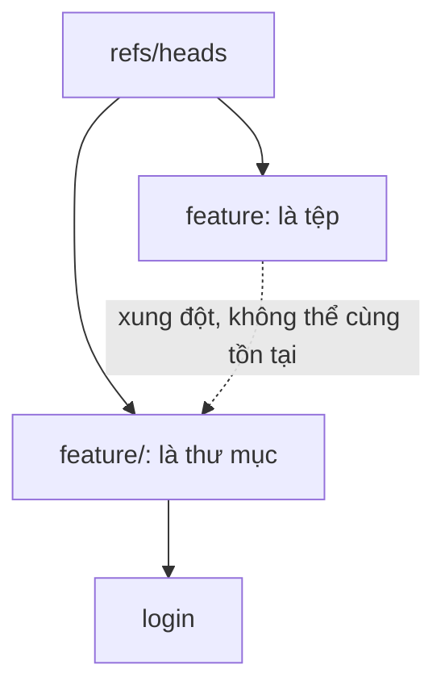

## Bạn sẽ học được gì

- Biết những ký tự và dạng tên mà Git không cho phép trong tên nhánh.
- Xây dựng quy ước tên nhánh dạng `loại/mô-tả` dễ đọc và dễ lọc.
- Tránh xung đột tên kiểu `feature` và `feature/login` cùng tồn tại.
- Kiểm tra một tên có hợp lệ trước khi dùng trong script.

## Khái niệm

Git cho bạn khá nhiều tự do khi đặt tên nhánh, nhưng tự do ấy dễ biến thành hỗn loạn: `tmp1`, `test`, `duy-new`, `fix-final-2`. Ba tuần sau không ai biết nhánh nào làm gì, nhánh nào bỏ được. Một quy ước tên nhánh nhất quán giải quyết vấn đề này với chi phí gần như bằng không.

**Quy tắc kỹ thuật của Git** (kiểm tra bằng `git check-ref-format --branch`). Một số điểm chính:

- Không chứa dấu cách, không chứa `~`, `^`, `:`, `?`, `*`, `[`, dấu gạch chéo ngược.
- Không chứa hai dấu chấm liền nhau `..`, không kết thúc bằng `.lock`, không kết thúc bằng `/`.
- Không bắt đầu bằng `-` (sẽ bị hiểu thành tùy chọn).
- Dấu `/` được phép và rất hữu ích: nó tạo "thư mục" cho tên.

Vì Git có thể lưu ref như tệp trong thư mục, bạn **không thể** có cùng lúc nhánh `feature` và nhánh `feature/login`: một bên là "tệp", một bên cần "thư mục" cùng tên. Git báo `cannot lock ref`.

**Quy ước của nhóm.** Dạng phổ biến nhất là `loại/mô-tả-ngắn`, có thể kèm mã ticket:

| Tiền tố | Mục đích |
| --- | --- |
| `feature/` | Tính năng mới |
| `fix/` hoặc `bugfix/` | Sửa lỗi thông thường |
| `hotfix/` | Sửa lỗi khẩn trên bản đang chạy |
| `release/` | Chuẩn bị phát hành |
| `test/` | Bổ sung hoặc sửa test |
| `docs/`, `chore/` | Tài liệu, việc vặt |

Phần mô tả nên viết thường, nối bằng gạch ngang, không dấu tiếng Việt để tránh rắc rối với công cụ và terminal: `feature/login-otp`, `fix/QA-123-lam-tron-so-du`.

Lợi ích không chỉ là dễ đọc. Tiền tố cho phép lọc (`git branch --list "fix/*"`), cấu hình CI chạy pipeline khác nhau theo mẫu tên, và đặt quy tắc bảo vệ theo mẫu như `release/*` trên dịch vụ hosting. Track phát hành sẽ dùng lại các tiền tố `release/` và `hotfix/`.

## Hình dung bằng sơ đồ





## Lệnh cần biết

```bash
git check-ref-format --branch "<tên>"   # in tên nếu hợp lệ, lỗi nếu không
git switch -c <loại>/<mô-tả>             # tạo nhánh theo quy ước
git branch --list "<loại>/*"             # lọc theo tiền tố
git branch -m <tên-mới>                  # sửa tên chưa đúng quy ước
```

## Ví dụ từng bước

Kiểm tra nhanh một loạt tên bằng vòng lặp Bash:

```bash
for n in feature/login "feature login" "fix..x" "test/smoke.lock" "-bad" \
         "release/2.0" "hotfix/1.0.1" "feature/" "a~b" "Feature/Login"; do
  printf '%-20s ' "$n"
  git check-ref-format --branch "$n" >/dev/null 2>&1 && echo hợp-lệ || echo không-hợp-lệ
done
```

```text
feature/login        hợp-lệ
feature login        không-hợp-lệ
fix..x               không-hợp-lệ
test/smoke.lock      không-hợp-lệ
-bad                 không-hợp-lệ
release/2.0          hợp-lệ
hotfix/1.0.1         hợp-lệ
feature/             không-hợp-lệ
a~b                  không-hợp-lệ
Feature/Login        hợp-lệ
```

`Feature/Login` hợp lệ về kỹ thuật, nhưng chữ hoa dễ gây rắc rối trên hệ thống tệp không phân biệt hoa thường. Thử tạo nhánh tên có dấu cách:

```bash
git branch "feature login"
```

```text
fatal: 'feature login' is not a valid branch name
hint: See `man git check-ref-format`
hint: Disable this message with "git config advice.refSyntax false"
```

Và xung đột "tệp với thư mục", khi đã có nhánh `feature/dung`:

```bash
git branch feature
```

```text
fatal: cannot lock ref 'refs/heads/feature': 'refs/heads/feature/dung' exists; cannot create 'refs/heads/feature'
```

Cuối cùng, tạo nhánh đúng quy ước:

```bash
git switch -c feature/login-otp
```

```text
Switched to a new branch 'feature/login-otp'
```

## Lỗi thường gặp

**Tên chung chung.** `test`, `new`, `tmp1` không nói gì. Đổi sớm bằng `git branch -m` trước khi push.

**Trộn kiểu viết.** `Feature/Login`, `feature_login`, `feat-login` cùng tồn tại khiến lọc theo mẫu thất bại. Ghi quy ước vào CONTRIBUTING hoặc README của dự án.

> **Lưu ý** Tên nhánh có dấu tiếng Việt là hợp lệ với Git, nhưng một số công cụ CI, shell trên Windows hay URL có thể hiển thị sai. Chữ không dấu an toàn hơn.

**Tạo nhánh trùng tên với tiền tố.** Nhánh `release` chặn mọi nhánh `release/...`. Đừng dùng tên tiền tố làm tên nhánh.

> **Mẹo** Ghép mã ticket vào tên (`fix/QA-123-...`) giúp nhiều công cụ quản lý công việc tự liên kết nhánh với ticket.

**Tên quá dài.** Mô tả cả câu trong tên nhánh khó gõ và bị cắt trên giao diện. Ba đến năm từ là đủ.

## Áp dụng trong công việc

Nhóm QA thống nhất: nhánh test bắt đầu bằng `test/`, kèm mã ticket, mô tả không dấu. Pipeline CI được cấu hình để nhánh khớp `test/*` chạy bộ smoke nhanh, còn `release/*` chạy toàn bộ hồi quy. Khi người mới tạo `tmp-duy`, pipeline không nhận diện được loại nhánh và nhắc đổi tên. Quy ước nhỏ, nhưng tiết kiệm nhiều cuộc hỏi đáp.

## Chuẩn bị làm bài

Bài thực hành yêu cầu tạo và chuyển sang một nhánh tính năng có tên theo đúng quy ước `loại/mô-tả` mà đề đưa ra. Câu hỏi đi kèm cho bạn chọn giữa một tên đúng quy ước và một tên tùy tiện. Hãy:

- Ôn bảng tiền tố ở trên và lý do dùng chúng.
- Nếu muốn chắc tên hợp lệ, chạy `git check-ref-format --branch`.
- Sau khi tạo, kiểm tra bằng `git branch --show-current`.

## Tóm tắt

- Git cấm dấu cách, `..`, `~`, `^`, `:`, đuôi `.lock` và một số ký tự khác trong tên nhánh.
- Dấu `/` tạo nhóm tên; không thể có cùng lúc `x` và `x/...`.
- Quy ước `loại/mô-tả` giúp đọc, lọc, cấu hình CI và quy tắc bảo vệ.
- Viết thường, gạch ngang, không dấu, có thể kèm mã ticket.
- `git check-ref-format --branch` kiểm tra tên trước khi dùng.
