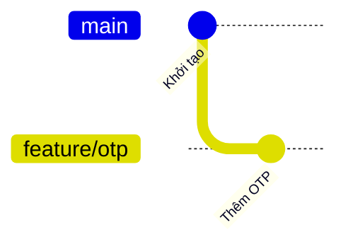
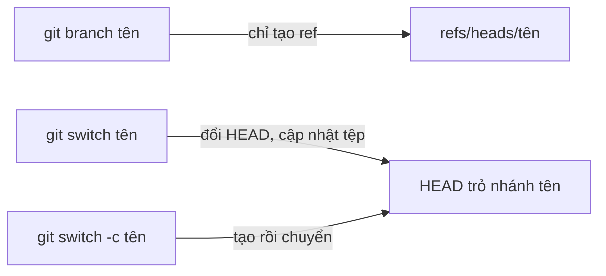

## Bạn sẽ học được gì

- Hiểu nhánh là một ref nhẹ trỏ tới commit, và tạo nhánh tốn gần như không gì.
- Tạo nhánh, chuyển nhánh, và làm cả hai trong một lệnh.
- Biết chuyển nhánh thay đổi những gì: HEAD, index và working tree.
- Xử lý khi Git từ chối chuyển nhánh vì thay đổi local có thể bị ghi đè.

## Khái niệm

Ở track nền tảng, bạn đã thấy nhánh chỉ là một tên trong `refs/heads/` chứa object ID của một commit. Tạo nhánh mới nghĩa là ghi thêm một tên như vậy, mặc định trỏ vào đúng commit bạn đang đứng. Không có tệp nào bị chép, không có commit nào được tạo. Đó là lý do người dùng Git tạo nhánh thoải mái cho từng việc nhỏ: sửa một lỗi, thử một ý tưởng, viết bộ test cho một tính năng.

Tạo nhánh và **chuyển sang** nhánh là hai việc khác nhau:

- `git branch <tên>` chỉ tạo ref. HEAD vẫn ở nhánh cũ, commit tiếp theo vẫn vào nhánh cũ.
- `git switch <tên>` chuyển sang nhánh đã có. Git đổi HEAD sang tên nhánh mới, rồi cập nhật index và working tree cho khớp với commit đầu nhánh đó.
- `git switch -c <tên>` làm cả hai: tạo nhánh tại vị trí hiện tại (hoặc tại điểm bạn chỉ định) rồi chuyển sang ngay.

Trước Git 2.23, mọi thứ đều dùng `git checkout`, và bạn sẽ còn gặp `git checkout -b <tên>` trong nhiều tài liệu. Lệnh này vẫn chạy tốt. Tuy nhiên `checkout` làm quá nhiều việc (chuyển nhánh, khôi phục tệp, vào detached HEAD), nên Git tách ra `switch` cho nhánh và `restore` cho tệp. Dùng lệnh chuyên dụng giúp ít gõ nhầm hơn.

Khi chuyển nhánh, những thay đổi chưa commit của bạn **đi theo** sang nhánh mới nếu chúng không xung đột với khác biệt giữa hai nhánh. Git chỉ từ chối khi việc chuyển sẽ ghi đè thay đổi của bạn, ví dụ tệp bạn đang sửa khác nhau giữa hai nhánh, hoặc một tệp untracked trùng tên với tệp được theo dõi ở nhánh đích. Lúc đó bạn commit, stash, hoặc dọn tệp trước rồi mới chuyển.

## Hình dung bằng sơ đồ





## Lệnh cần biết

```bash
git branch                     # liệt kê nhánh local, dấu * là nhánh hiện tại
git branch <tên>               # tạo nhánh tại HEAD, không chuyển
git branch <tên> <điểm-bắt-đầu>  # tạo nhánh tại commit, nhánh hoặc tag khác
git switch <tên>               # chuyển sang nhánh có sẵn
git switch -c <tên>            # tạo và chuyển
git switch -c <tên> <điểm>     # tạo từ điểm khác rồi chuyển
git switch -                   # quay về nhánh trước đó
git checkout -b <tên>          # cú pháp cũ, tương đương switch -c
git branch --show-current      # in tên nhánh hiện tại
```

| Tùy chọn `switch` | Ý nghĩa |
| --- | --- |
| `-c`, `--create` | Tạo nhánh mới rồi chuyển |
| `-C` | Tạo hoặc đặt lại nhánh nếu đã tồn tại (cẩn thận) |
| `--detach` | Chuyển tới commit ở trạng thái detached |
| `-` | Nhánh trước đó |

## Ví dụ từng bước

Repository mới có một commit. Tạo nhánh cho tính năng OTP và chuyển sang:

```bash
git branch
git switch -c feature/otp
git branch
```

```text
* main
Switched to a new branch 'feature/otp'
* feature/otp
  main
```

Commit một tệp trên nhánh mới (`otp.txt`), rồi qua lại giữa hai nhánh để thấy working tree thay đổi:

```bash
git switch main
ls
git switch feature/otp
ls
git switch -
```

```text
Switched to branch 'main'
README.md
Switched to branch 'feature/otp'
README.md
otp.txt
Switched to branch 'main'
```

Xem mỗi nhánh trỏ commit nào:

```bash
git branch -v
```

```text
  feature/otp 4cc3658 Thêm OTP
* main        7e1e491 Khởi tạo
```

Giờ thử một tình huống bị chặn: trên `main`, bạn tạo tệp untracked `otp.txt` trùng tên với tệp ở nhánh kia.

```bash
git switch feature/otp
```

```text
error: The following untracked working tree files would be overwritten by checkout:
	otp.txt
Please move or remove them before you switch branches.
Aborting
```

Git bảo vệ dữ liệu của bạn và không chuyển. Dời hoặc xóa tệp đó rồi thử lại.

## Lỗi thường gặp

**Tạo nhánh mà quên chuyển.** `git branch feature/x` rồi commit ngay, commit lại rơi vào nhánh cũ. Luôn liếc `git branch --show-current` hoặc dùng `switch -c`.

**Switch sang nhánh chưa tồn tại.** `git switch khong-co` báo `fatal: invalid reference: khong-co`. Thêm `-c` nếu bạn muốn tạo.

> **Lưu ý** Nếu tồn tại nhánh remote-tracking `origin/<tên>` duy nhất trùng tên, `git switch <tên>` sẽ tự tạo nhánh local theo dõi nó. Đây là hành vi tiện lợi, không phải lỗi.

**Mang thay đổi dở dang sang nhánh khác.** Thay đổi chưa commit đi theo khi chuyển nhánh, nên dễ lỡ commit vào nhầm nhánh. Commit hoặc stash trước khi chuyển nếu việc đó thuộc nhánh cũ.

> **Cẩn thận** `git switch -C <tên>` sẽ đặt lại nhánh đã có về vị trí mới. Commit chỉ có trên nhánh cũ có thể mất dấu (dù vẫn cứu được qua reflog).

## Áp dụng trong công việc

Sáng thứ hai, bạn nhận ticket viết test cho luồng nạp tiền điện thoại. Từ `main` mới nhất, bạn chạy `git switch -c test/nap-tien-dien-thoai`, viết test và commit trên nhánh đó. Giữa chừng có yêu cầu kiểm tra nhanh một lỗi khác: bạn commit dở dang (hoặc stash), `git switch main`, tạo nhánh khác cho lỗi đó. Mỗi việc một nhánh, không lẫn vào nhau.

## Chuẩn bị làm bài

Bài thực hành yêu cầu bạn kết thúc ở một nhánh mới có tên cụ thể, tạo từ vị trí hiện tại. Câu hỏi đi kèm hỏi về lệnh làm được cả việc tạo lẫn chuyển trong một bước. Hãy:

- Gõ đúng tên nhánh như đề, kể cả dấu gạch chéo.
- Sau khi làm, kiểm tra bằng `git branch --show-current`.
- Nhớ cả cú pháp mới với `switch` và cú pháp cũ với `checkout`.

## Tóm tắt

- Nhánh là ref nhẹ; tạo nhánh không chép tệp hay commit.
- `git branch` tạo, `git switch` chuyển, `git switch -c` làm cả hai.
- Chuyển nhánh đổi HEAD rồi cập nhật index và working tree.
- Git từ chối chuyển nếu thay đổi local sẽ bị ghi đè.
- `git switch -` quay nhanh về nhánh trước.
