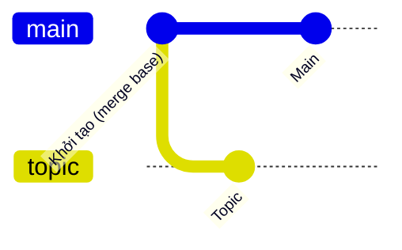
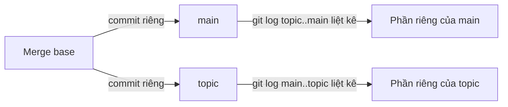

## Bạn sẽ học được gì

- Nhận ra hai nhánh đã phân kỳ khi nào, cả với nhánh local lẫn nhánh remote.
- Tìm tổ tiên chung gần nhất (merge base) của hai nhánh.
- Đếm và liệt kê commit riêng của từng bên bằng cú pháp dải `..` và `...`.
- Chọn cách hợp nhất phù hợp khi Git báo "divergent branches".

## Khái niệm

Hai nhánh **phân kỳ** khi mỗi bên có ít nhất một commit mà bên kia không có, tính từ tổ tiên chung. Hình dung một con đường tách đôi: điểm tách là **merge base**, sau đó mỗi nhánh đi một hướng.

Nếu chỉ một bên có commit mới, chúng không phân kỳ: bên kia chỉ đơn giản là "đi sau" và có thể fast-forward. Phân kỳ là lúc bạn buộc phải chọn: merge (tạo merge commit) hay rebase (phát lại commit của một bên).

**Merge base** quan trọng vì nhiều thao tác dựa vào nó:

- Three-way merge dùng merge base làm phiên bản gốc để biết mỗi bên đã đổi gì.
- `git diff A...B` (ba chấm) so sánh merge base với B, tức là "B đã làm gì kể từ khi tách khỏi A". Đây là kiểu diff mà giao diện review thường hiển thị.
- Rebase dùng nó để biết commit nào là của riêng nhánh.

Bạn tìm merge base bằng `git merge-base A B`, lệnh in ra object ID đầy đủ. Còn `git merge-base --is-ancestor A B` không in gì, chỉ trả mã thoát 0 nếu A là tổ tiên của B. Rất tiện trong script.

Hai cú pháp dải cần phân biệt:

- `A..B`: commit có trong B nhưng không có trong A. "B có gì mà A chưa có."
- `A...B`: commit có ở một bên nhưng không ở cả hai (hiệu đối xứng). Kết hợp với `--left-right` để biết commit nào thuộc bên nào.

Phân kỳ hay gặp nhất với remote: bạn commit local trong khi đồng nghiệp đã push lên cùng nhánh. Sau `git fetch`, `git status` báo "Your branch and 'origin/main' have diverged". Với các bản Git gần đây (như 2.47), nếu bạn chưa cấu hình gì thì `git pull` không tự đoán cách hợp nhất hai nhánh phân kỳ mà dừng lại, yêu cầu bạn chọn merge, rebase hay chỉ fast-forward.

## Hình dung bằng sơ đồ





## Lệnh cần biết

```bash
git merge-base A B                       # in object ID tổ tiên chung gần nhất
git merge-base --is-ancestor A B         # mã thoát 0 nếu A là tổ tiên của B
git log --oneline A..B                   # commit của B mà A chưa có
git log --oneline --left-right A...B     # commit riêng mỗi bên, < là A, > là B
git rev-list --left-right --count A...B  # đếm commit riêng: trái, phải
git diff A...B                           # B đã đổi gì kể từ merge base
git update-ref refs/<tên> <object-id>    # lưu một object ID vào ref tùy chỉnh
git pull --rebase | --no-rebase | --ff-only   # chọn cách hợp nhất khi pull
```

## Ví dụ từng bước

Hai nhánh, mỗi bên một commit:

```bash
git log --oneline --graph --all
git merge-base main topic
```

```text
* 826b2bc Main
| * 04b643b Topic
|/  
* 7e1e491 Khởi tạo
7e1e491ae5af23906ccbcf043cfcefd6ea76b59f
```

Merge base là commit "Khởi tạo". Đếm và liệt kê phần riêng:

```bash
git rev-list --left-right --count main...topic
git log --oneline main..topic
git log --oneline --left-right main...topic
git merge-base --is-ancestor main topic; echo exit=$?
```

```text
1	1
04b643b Topic
< 826b2bc Main
> 04b643b Topic
exit=1
```

Mỗi bên một commit riêng, và `main` không phải tổ tiên của `topic`: đúng định nghĩa phân kỳ. So sánh hai kiểu diff:

```bash
git diff --stat main...topic
git diff --stat main topic
```

```text
 topic.txt | 1 +
 1 file changed, 1 insertion(+)
 main.txt  | 1 -
 topic.txt | 1 +
 2 files changed, 1 insertion(+), 1 deletion(-)
```

Ba chấm chỉ hiện phần `topic` đã làm. Hai đối số trơn so thẳng hai snapshot, nên `main.txt` xuất hiện như bị "xóa" dù `topic` chưa từng đụng tới nó.

Với remote, sau khi fetch:

```text
Your branch and 'origin/main' have diverged,
and have 1 and 1 different commits each, respectively.
```

Chạy `git pull` không kèm lựa chọn sẽ kết thúc bằng `fatal: Need to specify how to reconcile divergent branches.` Chọn rõ, ví dụ `git pull --rebase`.

## Lỗi thường gặp

**Dùng `git diff main topic` để review.** Bạn sẽ thấy cả những thay đổi của `main` dưới dạng đảo ngược. Dùng ba chấm khi muốn xem đóng góp của nhánh.

**Nhầm thứ tự `A..B`.** Đổi chỗ hai bên là đổi câu hỏi. Đọc là "từ A đến B".

> **Mẹo** Đặt một lựa chọn mặc định cho `pull`, ví dụ `git config --global pull.ff only`, để không bao giờ vô tình tạo merge commit khi cập nhật; khi gặp phân kỳ, bạn tự quyết định merge hay rebase.

**Copy hash merge base bằng tay.** Dễ sót ký tự. Trong Bash, dùng thay thế lệnh `"$(git merge-base A B)"` để truyền thẳng kết quả cho lệnh khác. Trong PowerShell, dùng `(git merge-base A B)`.

**Nghĩ phân kỳ là lỗi.** Đó là trạng thái bình thường khi nhiều người làm song song. Chỉ cần chọn cách hợp nhất phù hợp.

## Áp dụng trong công việc

Nhánh test hiệu năng của bạn và `main` đều có commit mới trong tuần. Trước khi họp, bạn chạy `git rev-list --left-right --count main...perf/tai-cao` để báo cáo "nhánh đi sau main 12 commit và có 4 commit riêng", rồi `git diff --stat main...perf/tai-cao` để liệt kê đúng những tệp nhánh mình đã đổi. Con số rõ ràng giúp nhóm quyết định rebase trước hay merge luôn.

## Chuẩn bị làm bài

Bài thực hành có hai nhánh đã phân kỳ. Bạn cần tìm tổ tiên chung gần nhất và lưu object ID của nó vào một ref tùy chỉnh có tên đề cho, không thay đổi nhánh nào khác. Câu hỏi hỏi về lệnh tìm tổ tiên đó. Hãy:

- Ôn cách lấy object ID và cách ghi một ref bằng `git update-ref`.
- Nếu dùng Bash, tập kết hợp hai lệnh bằng `"$( ... )"`; với PowerShell, dùng ngoặc tròn.
- Kiểm tra kết quả bằng `git rev-parse` trên ref vừa tạo và so với `git log --graph`.

## Tóm tắt

- Phân kỳ là khi mỗi nhánh có commit riêng sau tổ tiên chung.
- Merge base là tổ tiên chung gần nhất, nền của three-way merge và diff ba chấm.
- `A..B` là commit của B chưa có ở A; `A...B` là phần riêng của cả hai bên.
- `git diff A...B` cho biết B đã đổi gì từ lúc tách khỏi A.
- Khi pull gặp phân kỳ, Git hiện đại yêu cầu bạn chọn merge, rebase hay fast-forward.
