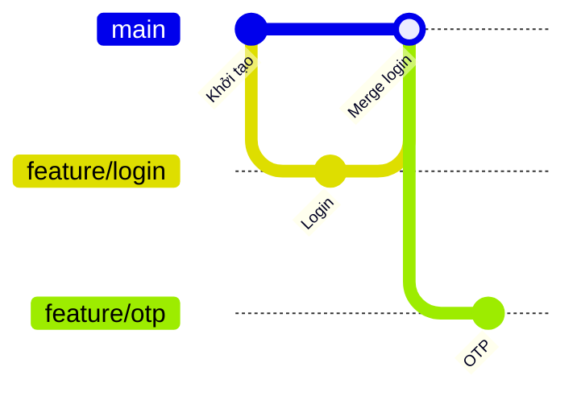
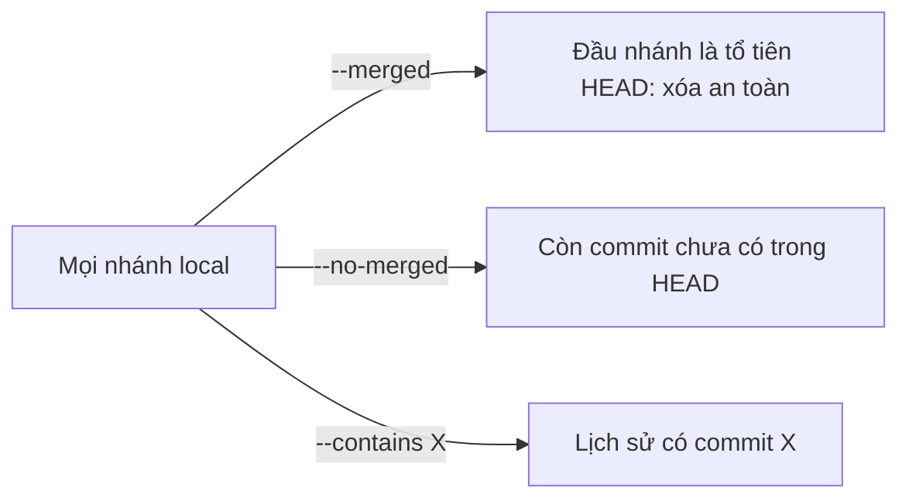

## Bạn sẽ học được gì

- Liệt kê nhánh local, nhánh remote-tracking, kèm commit mỗi nhánh đang trỏ tới.
- Lọc nhánh đã merge và chưa merge vào một điểm, để biết nhánh nào dọn được.
- Tìm mọi nhánh chứa một commit cụ thể.
- Dùng mẫu tên, sắp xếp và định dạng tùy chỉnh để có danh sách gọn.

## Khái niệm

Sau vài tuần làm việc, repository nào cũng tích tụ hàng chục nhánh: nhánh tính năng đã merge, nhánh thử nghiệm bỏ dở, nhánh review của người khác. `git branch` không chỉ để tạo nhánh; nó còn là công cụ truy vấn khá mạnh.

**Xem cơ bản.** `git branch` liệt kê nhánh local, đánh dấu `*` ở nhánh hiện tại. Thêm `-v` để thấy commit và subject mỗi nhánh đang trỏ tới; `-vv` hiện thêm upstream. `-r` liệt kê nhánh remote-tracking (như `origin/main`), `-a` liệt kê cả hai.

**Lọc theo quan hệ merge.** Đây là phần hữu ích nhất:

- `--merged [<commit>]` liệt kê nhánh mà đầu nhánh **đã là tổ tiên** của commit đó (mặc định là HEAD). Nói cách khác, mọi commit của nhánh đã nằm trong lịch sử hiện tại, nên xóa tên nhánh đi cũng không mất gì.
- `--no-merged [<commit>]` ngược lại: nhánh còn commit chưa có trong HEAD.
- `--contains <commit>` liệt kê nhánh có chứa commit đó trong lịch sử. Hữu ích khi hỏi "bản sửa này đã có ở nhánh release nào chưa?".
- `--no-contains <commit>` là phần bù.

Lưu ý định nghĩa "merged" ở đây hoàn toàn dựa trên đồ thị commit: đầu nhánh có phải tổ tiên hay không. Một nhánh vừa tạo, chưa có commit nào, cũng được tính là "merged". Ngược lại, nhánh đã squash merge hoặc rebase merge trên server thì **không** được tính là merged, vì commit gốc của nó không nằm trong lịch sử đích (bài squash merge sẽ thấy rõ).

**Mẫu tên, sắp xếp, định dạng.** `git branch --list "feature/*"` lọc theo mẫu glob. `--sort=-committerdate` đưa nhánh có commit mới nhất lên đầu, rất hợp để tìm nhánh bỏ quên. `--format` dùng các trường như `%(refname:short)`, `%(objectname:short)`, `%(subject)`, `%(upstream:short)` để in đúng thứ bạn cần, tiện cho script.

## Hình dung bằng sơ đồ





## Lệnh cần biết

```bash
git branch                       # nhánh local
git branch -v                    # kèm commit và subject
git branch -vv                   # kèm upstream và ahead/behind
git branch -r                    # nhánh remote-tracking
git branch -a                    # tất cả
git branch --merged              # đã merge vào HEAD
git branch --merged main         # đã merge vào main
git branch --no-merged           # chưa merge vào HEAD
git branch --contains <commit>   # nhánh chứa commit
git branch --list "feature/*"    # lọc theo mẫu
git branch --sort=-committerdate # nhánh mới nhất lên đầu
git branch --format="%(refname:short) %(objectname:short) %(subject)"
```

| Tùy chọn | Trả lời câu hỏi |
| --- | --- |
| `--merged` | Nhánh nào đã nằm trọn trong HEAD? |
| `--no-merged` | Nhánh nào còn việc chưa vào HEAD? |
| `--contains` | Nhánh nào đã có commit này? |
| `--list` | Nhánh nào khớp mẫu tên? |

## Ví dụ từng bước

Repository có `feature/login` đã merge vào `main`, `feature/otp` và `test/smoke` chưa merge, còn `fix/typo` vừa tạo tại `main`.

```bash
git branch -v
```

```text
  feature/login c0f25fc Login
  feature/otp   a0e88d6 OTP
  fix/typo      296a4c4 Merge login
* main          296a4c4 Merge login
  test/smoke    c6f7d34 Smoke
```

Lọc theo quan hệ merge:

```bash
git branch --merged
git branch --no-merged
```

```text
  feature/login
  fix/typo
* main
  feature/otp
  test/smoke
```

`fix/typo` được tính là merged vì nó trỏ đúng vào `main`, chưa có gì riêng. Tìm nhánh chứa commit "Login":

```bash
git branch --contains c0f25fc
```

```text
  feature/login
  feature/otp
  fix/typo
* main
  test/smoke
```

Mọi nhánh tạo sau khi merge đều chứa commit đó. Lọc theo mẫu và thử dọn:

```bash
git branch --list "feature/*"
git branch -d feature/otp
git branch -d feature/login
```

```text
  feature/login
  feature/otp
error: the branch 'feature/otp' is not fully merged
hint: If you are sure you want to delete it, run 'git branch -D feature/otp'
hint: Disable this message with "git config advice.forceDeleteBranch false"
Deleted branch feature/login (was c0f25fc).
```

`-d` dùng chính logic merged để bảo vệ bạn: nhánh còn commit riêng sẽ không bị xóa.

## Lỗi thường gặp

**Tưởng `--merged` hiểu squash merge.** Nhánh đã squash trên server vẫn hiện trong `--no-merged`. Hãy kiểm tra nội dung (diff) trước khi xóa bằng `-D`.

**Quên chỉ điểm so sánh.** `--merged` mặc định so với HEAD. Nếu bạn đang ở nhánh tính năng, kết quả khác hẳn khi so với `main`. Ghi rõ: `git branch --merged main`.

> **Cẩn thận** Đừng xóa hàng loạt bằng `git branch --merged | xargs git branch -d` mà không lọc: danh sách có thể chứa `main` và nhánh hiện tại (dòng có dấu `*`). Lọc kỹ hoặc xem trước khi chạy.

**Nhánh remote không hiện.** `git branch` không có `-r`/`-a` chỉ hiện nhánh local. Ngoài ra danh sách remote-tracking chỉ mới như lần fetch gần nhất.

**Nhầm `--contains` với "nhánh có tệp này".** Nó hỏi về commit, không hỏi về nội dung tệp.

## Áp dụng trong công việc

Cuối sprint, bạn dọn repository test automation. `git branch --merged main` cho danh sách nhánh test đã vào `main`, bạn xóa bằng `-d`. Với `--no-merged`, bạn sắp xếp theo `-committerdate` và hỏi lại chủ nhánh nào đã cũ hơn hai tuần. Khi QA lead hỏi "bản sửa test flaky đã có ở `release/3.2` chưa?", bạn chạy `git branch -a --contains <hash>` và trả lời trong vài giây.

> **Mẹo** Một alias như `git config --global alias.recent "branch --sort=-committerdate --format=%(refname:short)"` giúp xem nhanh nhánh vừa làm.

## Chuẩn bị làm bài

Đây là bài câu hỏi: bạn cần nêu tùy chọn của `git branch` để liệt kê những nhánh đã được hợp nhất vào HEAD. Trong repository bài tập, hãy tự tạo vài nhánh, merge một nhánh, để một nhánh có commit riêng, rồi thử lần lượt các tùy chọn lọc trong bảng trên và quan sát nhánh nào xuất hiện ở đâu.

## Tóm tắt

- `git branch -v`, `-vv`, `-r`, `-a` cho nhiều góc nhìn khác nhau về nhánh.
- `--merged` và `--no-merged` lọc theo việc đầu nhánh có là tổ tiên của một commit hay không.
- `--contains` tìm nhánh có một commit trong lịch sử.
- `--list`, `--sort`, `--format` giúp danh sách gọn và dùng được trong script.
- Squash merge không được tính là merged theo đồ thị commit.
