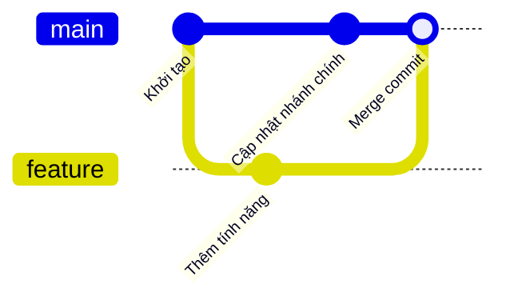
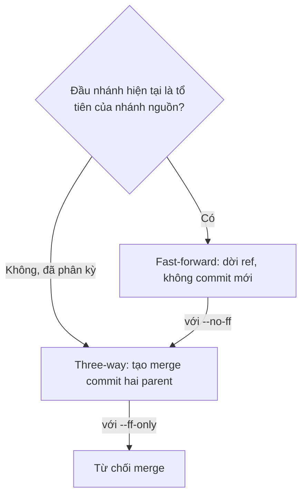

## Bạn sẽ học được gì

- Phân biệt fast-forward merge với three-way merge và biết khi nào mỗi kiểu xảy ra.
- Đọc được merge commit: nó có mấy parent và chúng là gì.
- Chủ động chọn hành vi bằng `--ff-only` hoặc `--no-ff`.
- Biết `ort` là chiến lược merge mặc định trong Git hiện đại.

## Khái niệm

Merge là cách đưa công việc của một nhánh vào nhánh hiện tại. Bạn đứng trên nhánh đích (thường là `main`) và chạy `git merge <nhánh-nguồn>`. Tùy vào hình dạng lịch sử, Git làm một trong hai việc.

**Fast-forward.** Nếu nhánh hiện tại chưa có commit nào mới kể từ khi nhánh nguồn tách ra, tức là đầu nhánh hiện tại là tổ tiên của nhánh nguồn, thì không có gì để "ghép" cả. Git chỉ việc dời ref của nhánh hiện tại tiến lên đầu nhánh nguồn. Không có commit mới nào được tạo. Lịch sử vẫn là một đường thẳng.

**Three-way merge.** Nếu cả hai nhánh đều có commit riêng sau điểm tách (đã phân kỳ), Git không thể chỉ dời ref. Nó tìm **merge base** (tổ tiên chung gần nhất), so sánh base với đầu mỗi nhánh để biết mỗi bên đã đổi gì, rồi ghép hai bộ thay đổi. Kết quả là một **merge commit** mới với hai parent: parent thứ nhất là đầu nhánh hiện tại trước merge, parent thứ hai là đầu nhánh được merge vào. Gọi là "ba phía" vì cần ba snapshot: base, ours, theirs.

Nếu hai bên sửa cùng một vùng theo cách khác nhau, Git dừng lại và báo conflict (bài cuối track này).

Chiến lược mặc định từ Git 2.34 là **ort**, bạn sẽ thấy dòng "Merge made by the 'ort' strategy." Trước đó là `recursive`. Bạn hiếm khi cần đổi chiến lược; việc thường gặp hơn là chọn có cho phép fast-forward hay không:

- `--ff-only`: chỉ merge nếu fast-forward được, ngược lại từ chối. An toàn khi bạn chỉ muốn cập nhật nhánh mà không tạo merge commit.
- `--no-ff`: luôn tạo merge commit kể cả khi fast-forward được. Nhiều nhóm dùng để giữ dấu vết "nhánh tính năng này được merge lúc nào".

Merge commit cũng có thể có nhiều hơn hai parent (octopus merge), sẽ gặp ở track nâng cao.

## Hình dung bằng sơ đồ





## Lệnh cần biết

```bash
git merge <nhánh>                 # merge nhánh vào nhánh hiện tại
git merge --ff-only <nhánh>       # chỉ chấp nhận fast-forward
git merge --no-ff <nhánh>         # luôn tạo merge commit
git merge -m "Thông điệp" <nhánh> # đặt thông điệp merge, không mở editor
git merge --abort                 # hủy merge đang dở (khi có conflict)
git log --oneline --graph         # xem hình dạng lịch sử
git log -1 --format="%P"          # in các parent của commit
git rev-list --parents -n 1 HEAD  # commit kèm danh sách parent
```

| Tùy chọn | Khi fast-forward được | Khi đã phân kỳ |
| --- | --- | --- |
| (mặc định) | Fast-forward | Merge commit |
| `--ff-only` | Fast-forward | Từ chối |
| `--no-ff` | Merge commit | Merge commit |

## Ví dụ từng bước

Nhánh `feature` có một commit, `main` chưa đổi gì. Merge:

```bash
git merge feature
git log --oneline --graph
```

```text
Updating 7e1e491..2288205
Fast-forward
 feature.txt | 1 +
 1 file changed, 1 insertion(+)
 create mode 100644 feature.txt
* 2288205 Thêm tính năng
* 7e1e491 Khởi tạo
```

Lịch sử thẳng, không có commit merge. Giờ quay lại trước merge, thêm một commit trên `main` để hai nhánh phân kỳ, và thử `--ff-only`:

```bash
git merge --ff-only feature
```

```text
fatal: Not possible to fast-forward, aborting.
```

(Trước dòng `fatal`, Git 2.47 in thêm vài dòng `hint:` gợi ý dùng `--no-ff` hoặc rebase.) Merge bình thường:

```bash
git merge -m "Merge branch feature" feature
git log --oneline --graph
git log -1 --format="%P"
```

```text
Merge made by the 'ort' strategy.
 feature.txt | 1 +
 1 file changed, 1 insertion(+)
 create mode 100644 feature.txt
*   9759895 Merge branch feature
|\  
| * 2288205 Thêm tính năng
* | 8b8ff70 Cập nhật nhánh chính
|/  
* 7e1e491 Khởi tạo
8b8ff70f94b1cad72147e479872f366c4a8c601a 228820571b486ccc7c8556dc5720721ffac97d1b
```

`%P` in ra danh sách parent: đầu `main` cũ trước, đầu `feature` sau. Nếu bạn bỏ `-m`, Git mở editor với thông điệp mặc định `Merge branch 'feature'`; lưu và đóng editor để hoàn tất.

## Lỗi thường gặp

**Merge ngược chiều.** Đứng trên `feature` rồi `git merge main` sẽ đưa `main` vào `feature`, không phải điều bạn muốn khi định "đưa tính năng vào main". Luôn kiểm tra nhánh hiện tại trước.

**Kẹt trong editor.** Merge không có `-m` mở editor mặc định (thường là Vim). Nếu chưa quen, đặt `core.editor` sang editor bạn biết, hoặc truyền `-m`.

> **Mẹo** Đặt `git config --global merge.ff only` nếu bạn muốn mọi `git merge` không có cờ chỉ chấp nhận fast-forward. Khi cần merge commit, bạn chủ động thêm `--no-ff`.

**Merge khi working tree bẩn.** Git có thể từ chối nếu thay đổi chưa commit đụng vào tệp sắp được merge. Commit hoặc stash trước.

**Tưởng fast-forward làm mất lịch sử.** Không có gì mất cả; commit của nhánh nguồn vẫn ở nguyên. Chỉ là không có merge commit đánh dấu thời điểm merge.

## Áp dụng trong công việc

Nhóm bạn quy định: nhánh test tự động được merge vào `main` bằng `--no-ff` để mỗi bộ test mới có một merge commit, dễ revert cả cụm nếu bộ test gây nhiễu pipeline. Còn khi cập nhật nhánh local từ remote, bạn dùng `--ff-only` để chắc rằng mình không vô tình tạo merge commit thừa.

## Chuẩn bị làm bài

Bài thực hành có hai nhánh đã phân kỳ, mỗi bên một commit riêng, và bạn đang đứng trên nhánh đích. Bạn cần hợp nhất nhánh kia vào sao cho giữ thay đổi của cả hai, kết quả là một commit hợp nhất và working tree sạch. Câu hỏi hỏi về số parent của loại commit đó. Hãy:

- Xem `git log --oneline --graph --all` trước để thấy hai nhánh đã phân kỳ.
- Nhớ rằng nếu không truyền thông điệp, editor sẽ mở ra.
- Sau khi xong, kiểm tra bằng `git log -1 --format="%P"`.

## Tóm tắt

- Fast-forward chỉ dời ref khi nhánh hiện tại là tổ tiên của nhánh nguồn.
- Three-way merge dùng merge base, ours, theirs và tạo merge commit.
- Merge commit thông thường có parent đầu là nhánh hiện tại, parent sau là nhánh được merge.
- `--ff-only` từ chối nếu phải tạo merge commit; `--no-ff` luôn tạo.
- Chiến lược mặc định hiện nay là `ort`.
