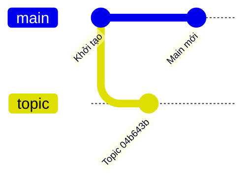
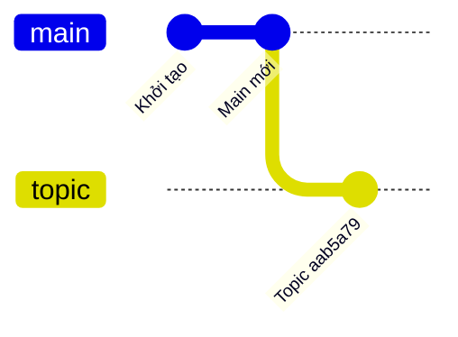
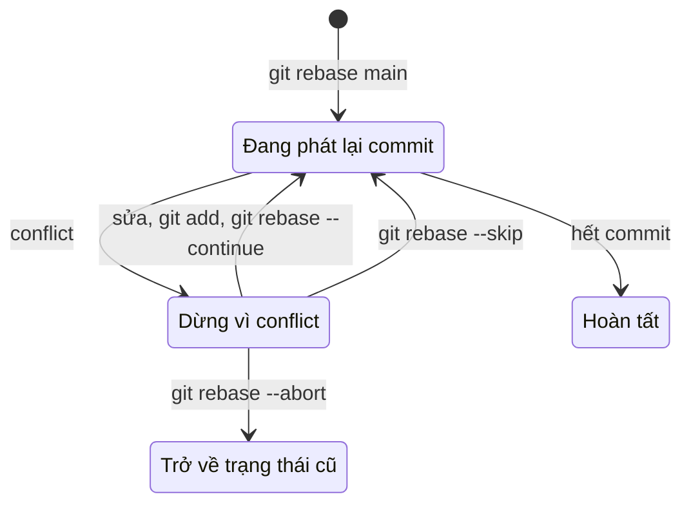

## Bạn sẽ học được gì

- Hiểu rebase thực sự làm gì: phát lại commit lên một nền mới.
- Giải thích vì sao commit sau rebase có object ID mới.
- Xử lý khi rebase dừng giữa chừng vì conflict: tiếp tục, bỏ qua, hoặc hủy.
- Biết quy tắc vàng: không rebase lịch sử đã chia sẻ với người khác.

## Khái niệm

Giả sử bạn tạo nhánh `topic` từ `main` hôm thứ hai và commit vài thay đổi. Đến thứ tư, `main` đã có thêm commit của đồng nghiệp. Hai nhánh đã phân kỳ. Bạn có hai cách đưa nhánh mình theo kịp: merge `main` vào `topic` (tạo merge commit), hoặc **rebase** `topic` lên `main`.

Rebase làm như sau, khi bạn đứng trên `topic` và chạy `git rebase main`:

1. Tìm các commit có trên `topic` mà không có trên `main` (tức là `main..topic`).
2. Tạm cất danh sách đó, rồi đưa HEAD về đầu `main` (ở trạng thái detached).
3. Lần lượt **phát lại** từng commit: lấy thay đổi mà commit đó mang theo, áp lên nền mới, tạo commit mới với cùng thông điệp và tác giả.
4. Cuối cùng dời ref `topic` sang commit mới cuối cùng và gắn HEAD lại vào `topic`.

Kết quả: lịch sử thẳng, như thể bạn bắt đầu `topic` từ `main` mới nhất. Không có merge commit nào.

Điểm cần khắc sâu: commit phát lại là **commit mới**. Nội dung thay đổi giống, thông điệp giống, nhưng parent khác (giờ là đầu `main`), và thời gian commit thường khác. Mà object ID tính từ toàn bộ những thứ đó, nên ID khác. Commit cũ không bị sửa (object không sửa được); chúng chỉ không còn được nhánh nào trỏ tới, nhưng vẫn tìm lại được qua reflog hay `ORIG_HEAD` một thời gian.

Vì đổi ID, rebase **viết lại lịch sử**. Nếu đồng nghiệp đã dựa trên các commit cũ của bạn (đã push và họ đã pull), lịch sử của họ và của bạn sẽ lệch nhau, và bạn sẽ phải force push. Quy tắc an toàn: rebase thoải mái commit chỉ có ở máy bạn hoặc trên nhánh riêng mà nhóm đồng ý; đừng rebase nhánh chung như `main`.

Khi một commit phát lại đụng vùng mà nền mới cũng đã sửa, rebase dừng với conflict. Bạn sửa tệp, `git add`, rồi `git rebase --continue`. Hoặc `git rebase --skip` để bỏ commit đó, hay `git rebase --abort` để quay về nguyên trạng trước khi rebase.

## Hình dung bằng sơ đồ

Trước rebase:



Sau rebase, `topic` có commit mới đặt trên đầu `main`:





## Lệnh cần biết

```bash
git rebase <nền>            # phát lại commit của nhánh hiện tại lên nền
git rebase --continue       # tiếp tục sau khi đã sửa và add tệp conflict
git rebase --skip           # bỏ commit đang phát lại
git rebase --abort          # hủy, quay về như trước khi rebase
git rev-list --count <nền>..HEAD   # số commit riêng của nhánh
git merge-base --is-ancestor <nền> HEAD && echo "nền là tổ tiên"
git reflog                  # tìm lại vị trí cũ nếu cần
git pull --rebase           # fetch rồi rebase lên upstream thay vì merge
```

| So sánh | Merge | Rebase |
| --- | --- | --- |
| Lịch sử | Giữ hình nhánh, có merge commit | Thẳng |
| Object ID commit cũ | Giữ nguyên | Tạo commit mới |
| An toàn với nhánh chung | Có | Chỉ với commit chưa chia sẻ |

## Ví dụ từng bước

Đang ở `topic`, hai nhánh đã phân kỳ:

```bash
git log --oneline --graph --all
git rev-parse --short topic
```

```text
* f5d2c32 Main mới
| * 04b643b Topic
|/  
* 7e1e491 Khởi tạo
04b643b
```

Rebase:

```bash
git rebase main
git log --oneline --graph --all
git rev-parse --short topic
```

```text
Successfully rebased and updated refs/heads/topic.
* aab5a79 Topic
* f5d2c32 Main mới
* 7e1e491 Khởi tạo
aab5a79
```

Cùng thông điệp "Topic", nhưng ID đổi từ `04b643b` sang `aab5a79`. Kiểm tra quan hệ và dấu vết:

```bash
git rev-list --count main..topic
git reflog -4
git rev-parse --short ORIG_HEAD
```

```text
1
aab5a79 HEAD@{0}: rebase (finish): returning to refs/heads/topic
aab5a79 HEAD@{1}: rebase (pick): Topic
f5d2c32 HEAD@{2}: rebase (start): checkout main
04b643b HEAD@{3}: checkout: moving from main to topic
04b643b
```

Reflog cho thấy từng bước rebase; `ORIG_HEAD` vẫn giữ đầu nhánh cũ. Khi có conflict, Git dừng với thông báo như sau (đã lược hint):

```text
CONFLICT (content): Merge conflict in a.txt
error: could not apply cb41454... Topic sửa a
```

Sửa tệp, `git add a.txt`, `git rebase --continue`; hoặc `git rebase --abort` để về lại nguyên trạng.

## Lỗi thường gặp

**Rebase nhánh đã push và người khác đang dùng.** Họ sẽ gặp lịch sử lệch. Nếu bắt buộc, báo trước cho nhóm và dùng `git push --force-with-lease` (track remote).

**Hoảng khi thấy "detached HEAD" lúc rebase dừng.** Đó là bình thường trong lúc rebase. Đọc `git status`, làm theo gợi ý, đừng tạo nhánh mới hay switch đi chỗ khác giữa chừng.

> **Mẹo** Rebase xong mà hối hận? `git reset --hard ORIG_HEAD` (khi chưa làm gì thêm) hoặc tìm vị trí cũ trong `git reflog` sẽ đưa nhánh về như trước.

**Quên `git add` trước `--continue`.** Git báo vẫn còn tệp chưa giải quyết. Add tệp đã sửa rồi chạy lại.

**Rebase ngược chiều.** Đứng trên `main` rồi `git rebase topic` sẽ phát lại commit của `main` lên `topic`, thường không phải ý bạn. Đứng trên nhánh muốn di chuyển, truyền nhánh làm nền.

## Áp dụng trong công việc

Nhánh test của bạn cho tính năng chuyển khoản định kỳ đã sống ba ngày, trong khi `main` nhận bản sửa API mà test của bạn cần. Trước khi mở review, bạn rebase nhánh lên `main` mới: test chạy trên mã mới nhất, reviewer thấy lịch sử thẳng chỉ gồm commit của bạn. Vì nhánh chỉ có mình bạn dùng, việc viết lại lịch sử không ảnh hưởng ai.

## Chuẩn bị làm bài

Trong bài thực hành, bạn đang ở một nhánh có một commit riêng, còn nhánh chính đã tiến thêm. Mục tiêu là đưa commit của nhánh bạn lên trên nhánh chính sao cho nhánh chính trở thành tổ tiên, vẫn chỉ một commit riêng và working tree sạch. Câu hỏi hỏi về lệnh làm việc đó. Hãy:

- Xem `git log --oneline --graph --all` trước và sau.
- Kiểm tra bạn đang đứng đúng nhánh cần di chuyển.
- Sau khi xong, đếm commit riêng bằng `git rev-list --count`.

## Tóm tắt

- Rebase phát lại commit của nhánh hiện tại lên một nền mới.
- Commit phát lại là commit mới với object ID mới.
- Kết quả là lịch sử thẳng, không có merge commit.
- Conflict được xử lý bằng sửa, `git add`, `--continue`; hoặc `--skip`, `--abort`.
- Chỉ rebase commit chưa chia sẻ; nhánh chung nên dùng merge.
