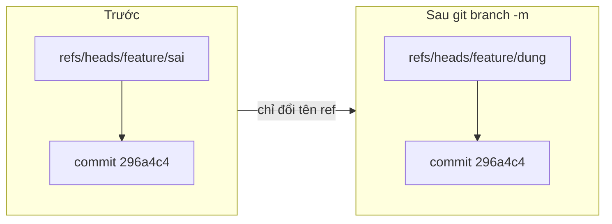

## Bạn sẽ học được gì

- Đổi tên nhánh hiện tại hoặc một nhánh khác mà không đụng tới commit.
- Hiểu vì sao đổi tên nhánh không viết lại lịch sử.
- Phân biệt `-m` và `-M`, và rủi ro khi ghi đè nhánh có sẵn.
- Biết cần làm thêm gì khi nhánh đó đã có trên remote.

## Khái niệm

Nhánh chỉ là một tên trỏ tới commit. Vì vậy đổi tên nhánh chỉ là đổi tên ref: `refs/heads/feature/sai` biến mất, `refs/heads/feature/dung` xuất hiện, cùng trỏ vào đúng commit cũ. Không commit nào bị tạo lại, không object ID nào thay đổi. Đây là khác biệt quan trọng so với rebase hay amend.

Git còn chuyển theo những thứ đi kèm tên nhánh:

- **Reflog** của nhánh được đổi tên theo, và thêm một dòng ghi nhận việc đổi tên.
- **Cấu hình nhánh** trong `.git/config` (như `branch.<tên>.remote`, `branch.<tên>.merge`) được chuyển sang khóa mang tên mới. Lưu ý giá trị upstream vẫn là nhánh remote cũ.
- Nếu bạn đang đứng trên nhánh đó, **HEAD** được cập nhật để trỏ tên mới.

Cú pháp có hai dạng. Khi đứng trên nhánh cần đổi, chỉ cần tên mới: `git branch -m <tên-mới>`. Khi đổi một nhánh khác: `git branch -m <tên-cũ> <tên-mới>`. Dạng dài của `-m` là `--move`.

Nếu tên mới đã thuộc về một nhánh khác, `-m` từ chối. `-M` (tương đương `--move --force`) thì ghi đè: nhánh có tên đó trước đây sẽ bị thay thế, và commit chỉ có trên nhánh bị thay có thể mất dấu. Chỉ dùng `-M` khi bạn chắc chắn, ví dụ đổi chữ hoa thường trên hệ thống tệp không phân biệt chữ hoa thường.

Đổi tên local **không** đổi tên nhánh trên remote. Nhánh remote là một ref nằm ở repository khác. Nếu nhánh cũ đã được push, bạn cần push tên mới, đặt lại upstream, và (khi nhóm đồng ý) xóa tên cũ trên remote. Trên các dịch vụ hosting, đổi tên nhánh mặc định thường làm trên giao diện web để cập nhật luôn các pull request và quy tắc bảo vệ.

## Hình dung bằng sơ đồ



## Lệnh cần biết

```bash
git branch -m <tên-mới>              # đổi tên nhánh hiện tại
git branch -m <tên-cũ> <tên-mới>     # đổi tên nhánh khác
git branch --move <tên-cũ> <tên-mới> # dạng dài
git branch -M <tên-cũ> <tên-mới>     # ép đổi, ghi đè nhánh trùng tên
git reflog show <nhánh>              # xem dòng ghi nhận đổi tên
# Khi nhánh đã có trên remote:
git push -u origin <tên-mới>         # đẩy tên mới và đặt upstream
git push origin --delete <tên-cũ>    # xóa tên cũ trên remote (khi nhóm đồng ý)
```

| Tùy chọn | Ý nghĩa |
| --- | --- |
| `-m`, `--move` | Đổi tên, từ chối nếu tên mới đã tồn tại |
| `-M` | Đổi tên kể cả khi phải ghi đè |
| `-c`, `-C` | Sao chép nhánh sang tên mới (giữ tên cũ) |

## Ví dụ từng bước

Bạn tạo nhánh với tên sai và đang đứng trên đó. Đổi tên tại chỗ:

```bash
git branch -m feature/dung
git branch --show-current
```

```text
feature/dung
```

Không có output từ lệnh đổi tên: thành công thì Git im lặng. Đổi tên một nhánh khác, không cần chuyển sang nó:

```bash
git branch -m fix/typo fix/chinh-ta
git branch
```

```text
* feature/dung
  feature/otp
  fix/chinh-ta
  main
  test/smoke
```

Reflog ghi lại câu chuyện của nhánh, và commit vẫn là commit cũ:

```bash
git reflog show feature/dung
```

```text
296a4c4 feature/dung@{0}: Branch: renamed refs/heads/feature/sai to refs/heads/feature/dung
296a4c4 feature/dung@{1}: branch: Created from HEAD
```

Cả hai dòng cùng `296a4c4`: không có commit mới. Thử đổi sang tên đã tồn tại:

```bash
git branch -m main
```

```text
fatal: a branch named 'main' already exists
```

`-m` bảo vệ bạn. Nếu dùng `-M` ở đây, nhánh `main` cũ sẽ bị thay thế mà không có cảnh báo nào.

## Lỗi thường gặp

**Dùng `-M` cho nhanh.** Nó ghi đè nhánh trùng tên một cách im lặng. Nếu lỡ tay, tìm vị trí cũ của nhánh bị ghi đè qua `git reflog` và tạo lại.

> **Cẩn thận** Trong lúc thử nghiệm, mình đã chạy `git branch -M test/smoke main` và lệnh thoát với mã 0, không in gì: nhánh `main` cũ bị thay bằng `test/smoke` ngay lập tức.

**Quên remote.** Sau khi đổi tên local, upstream vẫn trỏ tên cũ (ví dụ `[origin/feature]` trong `git branch -vv`). Với cấu hình mặc định `push.default=simple`, `git push` sẽ từ chối với thông báo "The upstream branch of your current branch does not match the name of your current branch". Push tên mới với `-u`, rồi dọn tên cũ.

**Đồng nghiệp vẫn dùng tên cũ.** Họ cần fetch, đổi tên local của họ, và đặt lại upstream. Báo trước cho nhóm khi đổi tên nhánh chung.

**Chỉ đổi chữ hoa thường trên Windows hay macOS.** Hệ thống tệp không phân biệt hoa thường có thể khiến `-m` báo nhánh đã tồn tại. Đây là trường hợp hiếm mà `-M` hợp lý.

## Áp dụng trong công việc

Bạn tạo nhánh `feature/chuyen-khoan` nhưng quy ước nhóm yêu cầu nhánh test bắt đầu bằng `test/` và kèm mã ticket. Chưa push, nên bạn chỉ cần `git branch -m test/QA-412-chuyen-khoan`. Lịch sử giữ nguyên, các commit vẫn mang đúng ID mà bạn đã ghi chú trong báo cáo test.

> **Mẹo** Đổi tên càng sớm càng rẻ: trước khi push, việc đổi tên chỉ ảnh hưởng máy bạn.

## Chuẩn bị làm bài

Bài thực hành để bạn đứng trên một nhánh có tên sai và có một commit riêng. Yêu cầu là kết thúc với nhánh mang tên đúng như đề, tên cũ không còn, và commit vẫn còn nguyên. Câu hỏi hỏi về tùy chọn của `git branch` dùng để đổi tên. Hãy:

- Kiểm tra bạn đang ở nhánh nào trước khi đổi.
- Chọn dạng cú pháp một đối số hay hai đối số cho phù hợp.
- Sau khi đổi, xem `git branch` và `git log --oneline -1` để chắc commit vẫn đó.

## Tóm tắt

- Đổi tên nhánh chỉ đổi tên ref; commit và object ID giữ nguyên.
- Reflog, upstream và HEAD được Git chuyển sang tên mới.
- `-m` từ chối khi tên mới đã có; `-M` ghi đè im lặng.
- Nhánh trên remote phải được xử lý riêng: push tên mới, đặt upstream, xóa tên cũ.
- Đổi tên trước khi push là rẻ nhất.
