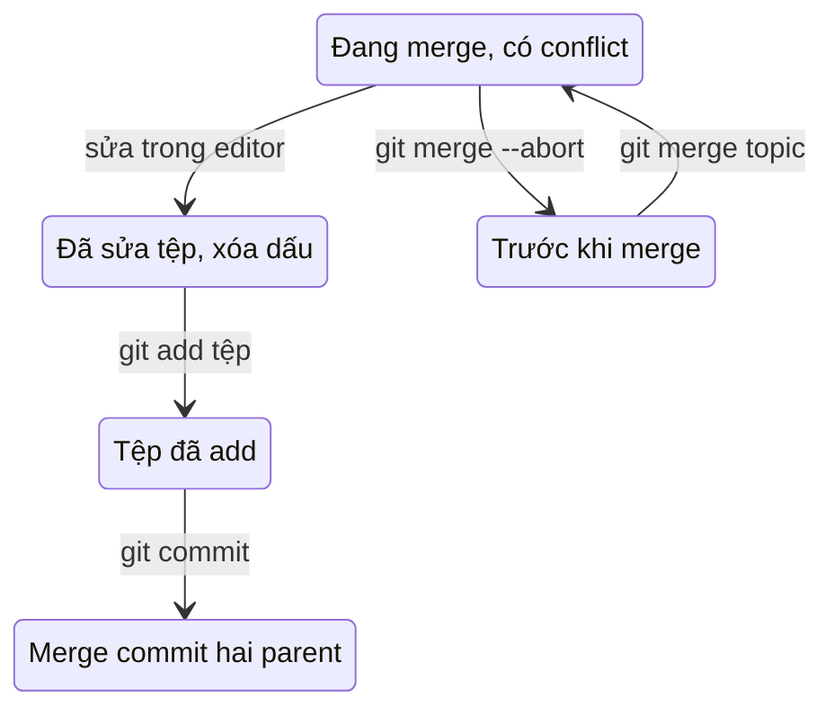
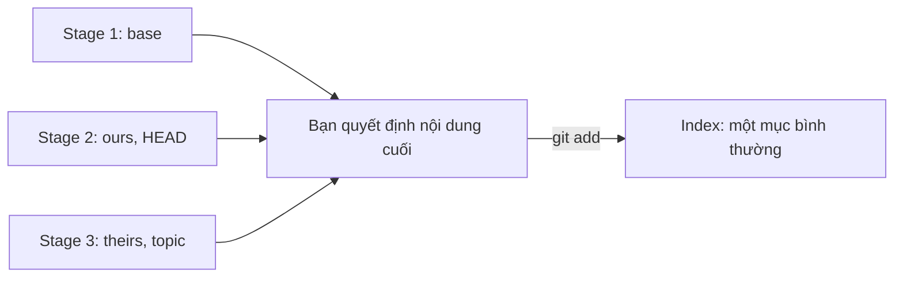

## Bạn sẽ học được gì

- Hiểu khi nào merge sinh conflict và Git đánh dấu chỗ xung đột ra sao.
- Đọc được các dấu `<<<<<<<`, `=======`, `>>>>>>>` và biết mỗi phần đến từ đâu.
- Giải quyết conflict đúng quy trình: sửa tệp, đánh dấu đã giải quyết, hoàn tất commit.
- Biết cách hủy merge hoặc chọn nhanh một phía khi cần.

## Khái niệm

Three-way merge so sánh merge base với đầu mỗi nhánh. Nếu chỉ một bên sửa một vùng, Git lấy bản sửa đó. Nếu hai bên sửa **những vùng khác nhau** của cùng tệp, Git ghép cả hai. Chỉ khi hai bên sửa **cùng một vùng** theo cách khác nhau (hoặc một bên sửa, một bên xóa tệp), Git không thể tự quyết và báo **conflict**.

Khi đó merge dừng giữa chừng. Git:

- Ghi vào tệp xung đột cả hai phiên bản, ngăn bởi dấu xung đột.
- Ghi trong index ba "stage" cho tệp đó: stage 1 là bản base, stage 2 là bản của nhánh hiện tại (ours), stage 3 là bản của nhánh được merge vào (theirs). Bạn thấy chúng bằng `git ls-files -u`.
- Ghi nhớ rằng đang có merge dở (tệp `MERGE_HEAD`), để lần commit sau thành merge commit hai parent.

Dấu xung đột trông như sau:

```text
<<<<<<< HEAD
Chao ban
=======
Xin chao quy khach
>>>>>>> topic
```

Phần giữa `<<<<<<< HEAD` và `=======` là phía nhánh hiện tại. Phần giữa `=======` và `>>>>>>> topic` là phía nhánh được merge. Nếu bật `merge.conflictStyle=diff3` (hoặc `zdiff3`), Git chèn thêm khối `|||||||` chứa bản base, giúp bạn thấy "ban đầu là gì", rất có ích khi phán đoán ý định.

**Giải quyết** nghĩa là bạn sửa tệp thành nội dung đúng cuối cùng (có thể giữ một bên, cả hai, hoặc viết lại), **xóa hết dấu xung đột**, rồi `git add` tệp đó. `git add` ở đây có nghĩa "tệp này đã giải quyết xong": nó thay ba stage bằng một mục bình thường trong index. Khi mọi tệp đã được add, `git commit` (hoặc `git merge --continue`) tạo merge commit.

Đổi ý? `git merge --abort` đưa mọi thứ về trạng thái trước merge.

Quan trọng nhất: conflict là câu hỏi về **ý định**, không phải về cú pháp. Đọc cả hai phía, hiểu mỗi bên muốn đạt điều gì, và hỏi tác giả khi không chắc.

## Hình dung bằng sơ đồ





## Lệnh cần biết

```bash
git status                          # liệt kê "Unmerged paths"
git diff                            # diff kết hợp của tệp đang xung đột
git ls-files -u                     # ba stage của mỗi tệp xung đột
git diff --name-only --diff-filter=U  # chỉ tên tệp còn xung đột
git add <tệp>                       # đánh dấu đã giải quyết
git commit                          # hoàn tất merge (hoặc git merge --continue)
git merge --abort                   # hủy merge, về trạng thái trước
git checkout --ours <tệp>           # lấy nguyên bản phía nhánh hiện tại
git checkout --theirs <tệp>         # lấy nguyên bản phía nhánh được merge
git config merge.conflictStyle diff3  # hiện thêm bản base trong dấu xung đột
```

## Ví dụ từng bước

`main` và `topic` cùng sửa dòng duy nhất của `greeting.txt`. Merge:

```bash
git merge topic
git status
```

```text
Auto-merging greeting.txt
CONFLICT (content): Merge conflict in greeting.txt
Automatic merge failed; fix conflicts and then commit the result.
On branch main
You have unmerged paths.
  (fix conflicts and run "git commit")
  (use "git merge --abort" to abort the merge)

Unmerged paths:
  (use "git add <file>..." to mark resolution)
	both modified:   greeting.txt
```

Xem tệp và ba stage:

```bash
cat greeting.txt
git ls-files -u
```

```text
<<<<<<< HEAD
Chao ban
=======
Xin chao quy khach
>>>>>>> topic
100644 24bfd9ca1477482b1cfc6f55cc47175d75f356f1 1	greeting.txt
100644 0e3426b66e00091134e43a13656e86a0d070afb6 2	greeting.txt
100644 674cad59aa7d9e35d3314b32b1e4903ca3760239 3	greeting.txt
```

Giả sử sau khi trao đổi, nhóm quyết định giữ cả hai câu. Mở editor, viết lại tệp thành hai dòng `Chao ban` và `Xin chao quy khach`, xóa ba dòng dấu. Rồi:

```bash
git add greeting.txt
git status -s
git commit --no-edit
git log --oneline --graph -4
```

```text
M  greeting.txt
[main a31776f] Merge branch 'topic'
*   a31776f Merge branch 'topic'
|\  
| * cf4941b Topic sửa
* | da8f0b0 Main sửa
|/  
* 00ee9ec Tạo lời chào
```

`--no-edit` dùng luôn thông điệp merge mặc định. Với kiểu dấu `diff3`, cùng conflict sẽ hiện thêm bản gốc:

```text
<<<<<<< HEAD
Chao ban
||||||| 00ee9ec
Xin chao
=======
Xin chao quy khach
>>>>>>> topic
```

## Lỗi thường gặp

**Commit cả dấu xung đột.** Quên xóa `<<<<<<<` hay `>>>>>>>` làm mã hỏng hoặc test lỗi cú pháp. Trước khi add, tìm nhanh bằng `git diff --check` hoặc tìm chuỗi `<<<<<<<`.

> **Cẩn thận** `git add` không kiểm tra nội dung. Nó sẽ vui vẻ đánh dấu "đã giải quyết" cho một tệp vẫn còn nguyên dấu xung đột.

**Chọn bừa một phía.** `--ours`/`--theirs` tiện, nhưng bỏ hẳn thay đổi của bên kia. Chỉ dùng khi chắc chắn bên kia không cần giữ.

**Nhầm ours/theirs khi rebase.** Trong rebase, "ours" là nhánh nền đang được phát lại lên, "theirs" là commit của bạn. Ngược với cảm giác thông thường.

**Hoảng và làm lung tung.** Khi rối, `git merge --abort` đưa bạn về điểm xuất phát an toàn. Bắt đầu lại bình tĩnh hơn.

> **Mẹo** Sau khi giải quyết, chạy test liên quan trước khi commit. Một conflict "giải quyết sạch" về cú pháp vẫn có thể sai về logic.

## Áp dụng trong công việc

Bạn và đồng nghiệp cùng sửa tệp dữ liệu test cho hạn mức chuyển khoản: bạn đổi giá trị cho khách hàng cá nhân, đồng nghiệp đổi cho doanh nghiệp, ở hai dòng liền nhau. Merge báo conflict. Bạn bật kiểu `diff3`, thấy rõ giá trị gốc, giữ cả hai thay đổi, chạy lại bộ test hạn mức, rồi mới commit. Trong thông điệp merge, bạn ghi chú ngắn đã giải quyết thế nào để reviewer dễ kiểm.

## Chuẩn bị làm bài

Bài thực hành mở ra khi merge đã dừng vì conflict trong một tệp văn bản ngắn. Đề yêu cầu một nội dung cuối cụ thể dựa trên cả hai phía; bạn cần sửa tệp đúng như vậy, không còn dấu xung đột, rồi hoàn tất merge để có commit hai parent và working tree sạch. Câu hỏi hỏi về lệnh đánh dấu tệp đã giải quyết. Hãy:

- Bắt đầu bằng `git status` và đọc kỹ tệp.
- Xóa cả ba loại dòng dấu, không chỉ dòng `=======`.
- Kiểm tra lại bằng `git log --oneline --graph` sau khi commit.

## Tóm tắt

- Conflict xảy ra khi hai nhánh sửa cùng vùng theo cách khác nhau.
- Dấu xung đột tách phía HEAD và phía nhánh được merge; `diff3` thêm bản base.
- Index giữ ba stage cho tệp xung đột cho tới khi bạn `git add`.
- Quy trình: sửa tệp, xóa dấu, `git add`, `git commit`.
- `git merge --abort` luôn là lối thoát an toàn.
