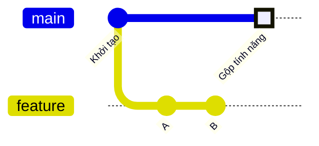
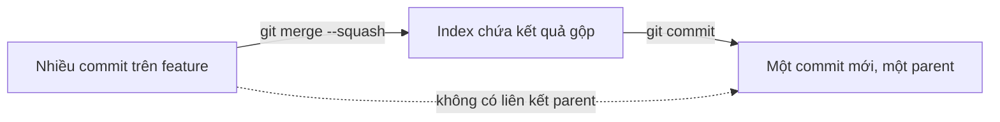

## Bạn sẽ học được gì

- Hiểu squash merge gom thay đổi của nhiều commit thành một commit mới như thế nào.
- Phân biệt squash merge với merge thường về đồ thị commit và số parent.
- Biết `git merge --squash` dừng ở đâu và bạn phải làm gì để hoàn tất.
- Nắm hệ quả: nhánh nguồn không được coi là đã merge, cần xóa bằng `-D` khi chắc chắn.

## Khái niệm

Nhánh tính năng thường có những commit nhỏ, lộn xộn trong lúc làm: "thử", "sửa lại", "thêm log", "bỏ log". Khi đưa vào `main`, nhiều nhóm muốn lịch sử chính chỉ có **một commit gọn** cho cả tính năng. Squash merge làm đúng việc đó.

Khi bạn đứng trên `main` và chạy `git merge --squash feature`, Git:

1. Tính toán kết quả hợp nhất giống như merge thường (fast-forward hay three-way đều được).
2. Ghi kết quả đó vào **index và working tree**.
3. **Dừng lại**, không tạo commit, không dời HEAD, không ghi nhận merge đang diễn ra.

Thông báo "Squash commit -- not updating HEAD" nói rõ điều đó. Bạn xem lại bằng `git status` và `git diff --staged`, rồi tự `git commit` với thông điệp mô tả toàn bộ tính năng. Git chuẩn bị sẵn thông điệp gợi ý (liệt kê các commit được gom) trong tệp `.git/SQUASH_MSG` và dùng nó nếu bạn commit mà không có `-m`.

Commit tạo ra là một **commit thường với một parent** (đầu `main` cũ). Nó không có parent trỏ sang nhánh `feature`. Với đồ thị commit, `main` và `feature` vẫn là hai nhánh tách rời; chỉ có nội dung là đã giống nhau. Hệ quả:

- `git branch --merged` không liệt kê `feature`, và `git branch -d feature` từ chối. Bạn cần `-D` khi chắc chắn nội dung đã vào `main`.
- Nếu tiếp tục commit trên `feature` rồi squash lần nữa, Git không biết phần nào đã được gộp trước đó, dễ sinh conflict. Squash merge hợp với nhánh dùng một lần rồi bỏ.
- Commit nhỏ trên `feature` không xuất hiện trong lịch sử `main`, nên `git bisect` trên `main` chỉ khoanh được tới mức "cả tính năng".

Nhiều dịch vụ hosting có nút "Squash and merge" cho pull request; về bản chất, kết quả trên nhánh đích giống lệnh này.

## Hình dung bằng sơ đồ



Trong hình, "Gộp tính năng" chứa nội dung của A và B nhưng chỉ có một parent là "Khởi tạo"; không có đường nối nào từ `feature` về `main`.



## Lệnh cần biết

```bash
git merge --squash <nhánh>   # đưa kết quả gộp vào index, chưa commit
git status -s                # xem tệp đã được stage
git diff --staged            # đọc lại toàn bộ thay đổi sẽ commit
git commit -m "Thông điệp"   # tạo commit gộp
git commit                   # mở editor với thông điệp gợi ý từ SQUASH_MSG
git reset --merge            # bỏ kết quả squash chưa commit (hoặc git reset --hard nếu chắc)
git branch -D <nhánh>        # xóa nhánh nguồn khi chắc nội dung đã vào đích
```

| So sánh | Merge thường | Squash merge |
| --- | --- | --- |
| Số commit mới trên đích | 1 merge commit (hoặc 0 nếu fast-forward) | 1 commit thường |
| Số parent | 2 | 1 |
| Commit nhỏ của nhánh nguồn | Có trong lịch sử đích | Không |
| `branch --merged` nhận ra | Có | Không |

## Ví dụ từng bước

`feature` có hai commit A và B, đang đứng trên `main`:

```bash
git merge --squash feature
git status -s
git log --oneline -1
```

```text
Updating 7e1e491..bc5b08a
Fast-forward
Squash commit -- not updating HEAD
 a.txt | 1 +
 b.txt | 1 +
 2 files changed, 2 insertions(+)
 create mode 100644 a.txt
 create mode 100644 b.txt
A  a.txt
A  b.txt
7e1e491 Khởi tạo
```

Dù kết quả gộp là dạng fast-forward, HEAD vẫn đứng yên ở "Khởi tạo"; hai tệp chỉ mới được stage. Commit:

```bash
git commit -m "Gộp tính năng"
git log --oneline --graph --all
git rev-list --count HEAD
```

```text
[main 196a2f3] Gộp tính năng
 2 files changed, 2 insertions(+)
 create mode 100644 a.txt
 create mode 100644 b.txt
* bc5b08a B
* 21acc86 A
| * 196a2f3 Gộp tính năng
|/  
* 7e1e491 Khởi tạo
2
```

`main` chỉ tiến một commit. Xem commit đó chỉ có một parent, và Git không coi `feature` là đã merge:

```bash
git cat-file -p HEAD
git branch -d feature
```

```text
tree 14c955abd41f041f3d0501d7858255f5a992abb6
parent 7e1e491ae5af23906ccbcf043cfcefd6ea76b59f
author Duy Van <duy@example.invalid> 1792029600 +0700
committer Duy Van <duy@example.invalid> 1792029600 +0700

Gộp tính năng
error: the branch 'feature' is not fully merged
hint: If you are sure you want to delete it, run 'git branch -D feature'
hint: Disable this message with "git config advice.forceDeleteBranch false"
```

## Lỗi thường gặp

**Quên commit sau `--squash`.** Thay đổi nằm ở index, `git log` chưa có gì. Nhiều người chuyển nhánh hoặc chạy lệnh khác rồi bối rối. Luôn kết thúc bằng `git commit`.

> **Lưu ý** Vì squash không ghi trạng thái "đang merge", lệnh `git merge --abort` không áp dụng ở đây. Muốn bỏ, dùng `git reset --merge` hoặc khôi phục index và working tree về HEAD.

**Tiếp tục làm trên nhánh đã squash.** Lần squash sau dễ conflict vì Git không biết phần nào đã vào đích. Tạo nhánh mới từ `main` cho việc tiếp theo.

**Xóa nhánh bằng `-D` quá sớm.** Trước khi xóa, đối chiếu nội dung bằng `git diff main feature` (khi `main` chưa có thay đổi khác) để chắc không bỏ sót.

> **Cẩn thận** Squash làm mất chi tiết lịch sử nhỏ trên nhánh đích. Nếu các commit nhỏ có giá trị (mỗi commit là một bước có ý nghĩa), merge thường hoặc rebase sẽ hợp hơn.

## Áp dụng trong công việc

Nhánh test cho tính năng mở thẻ tín dụng có mười hai commit, phần lớn là chỉnh selector và thử lại. Nhóm quy định dùng squash merge cho nhánh test, nên lịch sử `main` chỉ có một commit "test(the-tin-dung): bổ sung bộ test mở thẻ". Khi cần revert, chỉ một commit phải xử lý.

## Chuẩn bị làm bài

Bài thực hành có nhánh tính năng với hai commit, và bạn đang ở nhánh chính. Mục tiêu là nhánh chính chỉ tiến thêm đúng một commit chứa nội dung của cả hai, nhánh tính năng không trở thành tổ tiên, và working tree sạch. Câu hỏi hỏi về tùy chọn chuẩn bị nội dung gộp mà chưa commit. Hãy:

- Nhớ quy trình hai bước: chuẩn bị kết quả gộp, rồi tự commit.
- Kiểm tra bằng `git status -s` giữa hai bước.
- Đếm commit bằng `git rev-list --count HEAD` sau khi xong.

## Tóm tắt

- `git merge --squash` ghi kết quả gộp vào index và working tree rồi dừng.
- Bạn tự `git commit`; commit đó có một parent, không nối về nhánh nguồn.
- Lịch sử đích gọn, nhưng mất chi tiết commit nhỏ.
- Nhánh nguồn không được coi là merged; xóa bằng `-D` khi chắc chắn.
- Hợp với nhánh dùng một lần; không nên tiếp tục làm trên nhánh đã squash.
