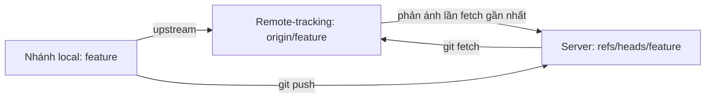
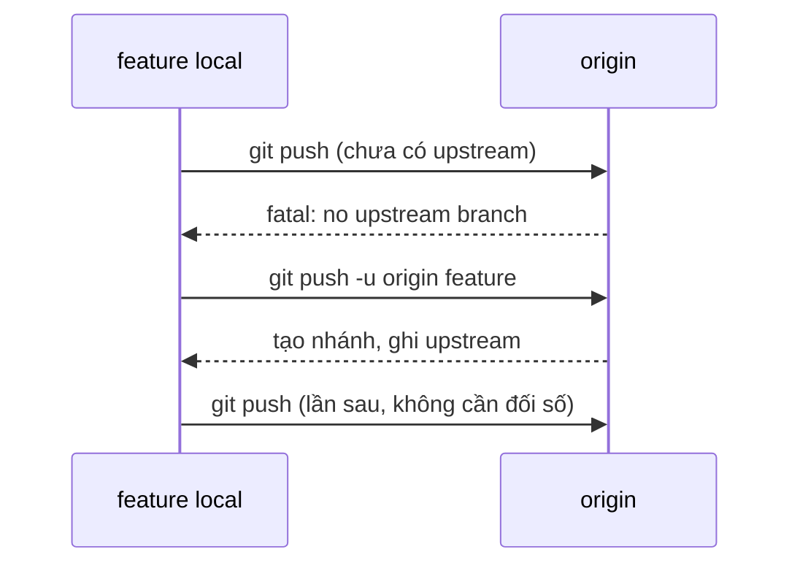

## Bạn sẽ học được gì

- Hiểu upstream là gì: liên kết giữa nhánh local và một nhánh remote-tracking.
- Đặt upstream ngay lần push đầu tiên, hoặc đặt và gỡ sau đó.
- Đọc thông tin ahead và behind trong `git status` và `git branch -vv`.
- Biết upstream được lưu ở đâu và dùng cú pháp `@{upstream}`.

## Khái niệm

Khi bạn gõ `git push` hay `git pull` mà không kèm tên remote và nhánh, Git cần biết "đẩy đi đâu, kéo về từ đâu". Câu trả lời là **upstream** của nhánh hiện tại: một nhánh trên remote mà nhánh local được gắn với. Ví dụ nhánh local `feature` có upstream là `origin/feature`.

Upstream được lưu trong cấu hình repository dưới hai khóa:

- `branch.<tên>.remote`: tên remote, như `origin`.
- `branch.<tên>.merge`: tên nhánh trên remote, như `refs/heads/feature`.

Khi đã có upstream, bạn được ba lợi ích:

1. `git push` và `git pull` không cần đối số.
2. `git status` cho biết nhánh local đi trước (ahead) hay đi sau (behind) bao nhiêu commit so với upstream, dựa trên lần fetch gần nhất.
3. Cú pháp `@{upstream}` (viết tắt `@{u}`) dùng được trong mọi lệnh, như `git log @{u}..` để xem commit chưa push.

Nhánh tạo bằng `git clone` (thường là `main`) hoặc tạo từ một nhánh remote-tracking (`git switch <tên>` khi có `origin/<tên>`) tự động có upstream. Nhưng nhánh bạn tự tạo local thì **chưa có**. Lần push đầu tiên, bạn cần nói rõ remote, tên nhánh, và yêu cầu đặt upstream bằng `--set-upstream` (viết tắt `-u`). Từ đó về sau chỉ cần `git push`.

Nếu muốn mọi nhánh mới tự đặt upstream khi push lần đầu, Git có cấu hình `push.autoSetupRemote` (từ Git 2.37). Mặc định nó tắt.

Đặt hoặc đổi upstream cho nhánh đã có: `git branch --set-upstream-to=origin/<tên>` (viết tắt `-u`). Gỡ: `git branch --unset-upstream`.

Upstream cũng là "đích mặc định" của `git pull`: lệnh này fetch từ remote của upstream rồi hợp nhất nhánh upstream vào nhánh hiện tại. Vì thế upstream sai nghĩa là pull sai chỗ. Với `push`, cấu hình mặc định `push.default=simple` chỉ cho đẩy khi tên nhánh upstream trùng tên nhánh local, một lớp bảo vệ nhỏ chống đẩy nhầm.

Lưu ý: số ahead/behind là so với **remote-tracking ref local** của bạn, không phải trạng thái trực tiếp của server. Muốn số liệu mới, chạy `git fetch` trước.

## Hình dung bằng sơ đồ





## Lệnh cần biết

```bash
git push -u origin <nhánh>                 # push lần đầu và đặt upstream
git push --set-upstream origin <nhánh>     # dạng dài
git branch -vv                             # upstream và ahead/behind từng nhánh
git status -sb                             # dòng đầu cho biết nhánh...upstream [ahead N]
git rev-parse --abbrev-ref --symbolic-full-name "<nhánh>@{upstream}"
git branch --set-upstream-to=origin/<nhánh>  # đặt hoặc đổi upstream
git branch --unset-upstream                # gỡ upstream
git log --oneline @{u}..                   # commit local chưa push
git config --global push.autoSetupRemote true  # tự đặt upstream lần push đầu
```

## Ví dụ từng bước

Nhánh `feature` vừa tạo local, có một commit. Thử push không đối số:

```bash
git push
```

```text
fatal: The current branch feature has no upstream branch.
To push the current branch and set the remote as upstream, use

    git push --set-upstream origin feature

To have this happen automatically for branches without a tracking
upstream, see 'push.autoSetupRemote' in 'git help config'.
```

Làm đúng như Git gợi ý, dùng dạng ngắn:

```bash
git push -u origin feature
git branch -vv
git status -sb
```

```text
To ../origin.git
 * [new branch]      feature -> feature
branch 'feature' set up to track 'origin/feature'.
* feature 72d67bb [origin/feature] Tính năng
  main    7e1e491 Khởi tạo
## feature...origin/feature
```

Thêm một commit, xem trạng thái ahead, rồi push không cần đối số:

```bash
git status -sb
git push
```

```text
## feature...origin/feature [ahead 1]
To ../origin.git
   72d67bb..8e1cbe7  feature -> feature
```

Upstream nằm trong cấu hình:

```bash
git config --get-regexp "^branch\.feature"
```

```text
branch.feature.remote origin
branch.feature.merge refs/heads/feature
```

## Lỗi thường gặp

**Quên `-u` ở lần push đầu.** Push vẫn thành công, nhưng lần sau `git push` trơn lại báo thiếu upstream và `status` không có ahead/behind. Sửa bằng `git branch --set-upstream-to=origin/<nhánh>`.

**Tin số ahead/behind cũ.** `status` không tự hỏi server. Chạy `git fetch` trước khi kết luận "mình đã cập nhật".

> **Lưu ý** Trong bài thực hành, `origin` là một bare repository nằm ngay trên máy bạn, nên không cần mạng hay tài khoản. Cơ chế upstream hoàn toàn giống với remote thật.

**Upstream trỏ nhầm nhánh.** Ví dụ nhánh `feature` có upstream `origin/main`, `git pull` sẽ kéo `main` vào nhánh tính năng. Kiểm tra `git branch -vv` và sửa bằng `--set-upstream-to`.

> **Mẹo** `git log --oneline @{u}..` liệt kê nhanh commit bạn chưa push; `git log --oneline ..@{u}` liệt kê commit trên remote mà bạn chưa có (sau khi fetch).

**Đổi tên nhánh local mà upstream giữ tên cũ.** Xem bài đổi tên nhánh.

## Áp dụng trong công việc

Bạn mở nhánh `test/QA-512-sao-ke` và muốn CI chạy test ngay sau mỗi lần push. Lần đầu, bạn `git push -u origin test/QA-512-sao-ke`. Từ đó, sau mỗi lần sửa test, chỉ cần `git push`, và `git status -sb` cho biết bạn còn bao nhiêu commit chưa đẩy. Trước khi rời máy cuối ngày, nhìn thấy `[ahead 2]` là lời nhắc đẩy nốt.

## Chuẩn bị làm bài

Bài thực hành có sẵn một remote local và một nhánh tính năng chưa được đẩy. Bạn cần đẩy nhánh lên và gắn nó với nhánh cùng tên trên remote, để `<nhánh>@{upstream}` trả về đúng nhánh remote-tracking. Câu hỏi hỏi về tùy chọn của `push` làm việc gắn này ở lần đầu. Hãy:

- Kiểm tra tên remote bằng `git remote -v`.
- Ôn dạng ngắn và dạng dài của tùy chọn đặt upstream.
- Xác nhận bằng `git branch -vv` hoặc lệnh `rev-parse` trong mục trên.

## Tóm tắt

- Upstream gắn nhánh local với một nhánh remote-tracking, lưu ở `branch.<tên>.remote` và `branch.<tên>.merge`.
- Có upstream thì `push`, `pull` không cần đối số và `status` hiện ahead/behind.
- Nhánh tự tạo cần `git push -u origin <nhánh>` ở lần đầu.
- `--set-upstream-to` và `--unset-upstream` để đặt, đổi, gỡ sau này.
- Số ahead/behind dựa trên lần fetch gần nhất.
