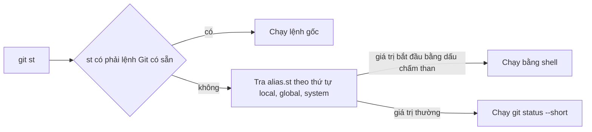
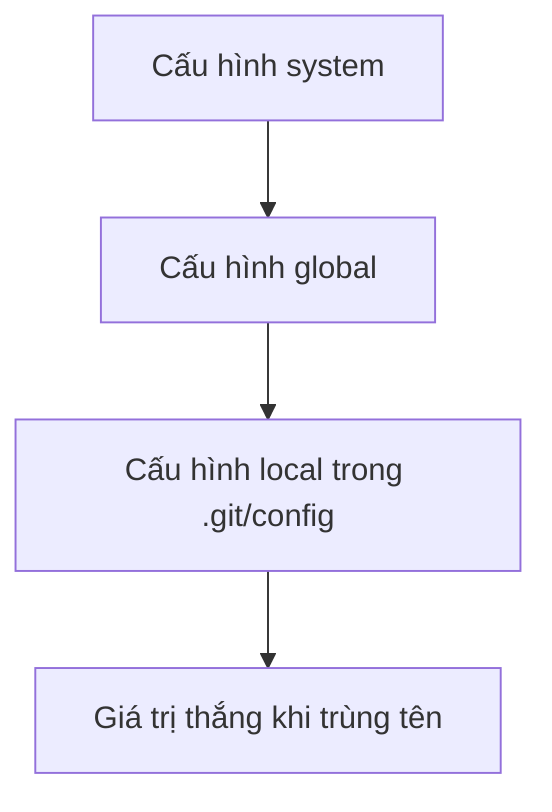

## Bạn sẽ học được gì

- Hiểu alias trong Git là một khóa cấu hình nằm dưới nhóm `alias`.
- Tạo alias ở phạm vi repository, người dùng, và biết phạm vi nào được ưu tiên.
- Viết alias gọi lệnh Git có tham số, và alias gọi lệnh shell bằng dấu chấm than.
- Kiểm tra, liệt kê và gỡ alias khi không cần.

## Khái niệm

Mỗi ngày bạn gõ `git status`, `git log --oneline --graph`, `git switch` hàng chục lần. Alias cho phép đặt tên ngắn cho các lệnh đó. Gõ `git st` thay cho `git status --short` nghe có vẻ nhỏ, nhưng cộng lại cả năm là đáng kể, và quan trọng hơn: alias giúp bạn gõ đúng cùng một tổ hợp tùy chọn mỗi lần.

Về kỹ thuật, alias chỉ là một dòng cấu hình. Khóa có dạng `alias.<tên>`, giá trị là phần lệnh sẽ thay vào. Khi bạn gõ `git st`, Git không tìm thấy lệnh con `st`, nó tra cấu hình `alias.st`, lấy giá trị `status --short` và chạy như thể bạn đã gõ `git status --short`. Mọi đối số bạn gõ thêm sau alias được nối vào cuối.

Vì là cấu hình, alias tuân theo các phạm vi cấu hình quen thuộc:

- `--system`: cho mọi người dùng trên máy.
- `--global`: cho người dùng hiện tại, lưu trong tệp cấu hình ở thư mục home.
- `--local`: chỉ cho repository hiện tại, lưu trong `.git/config`.

Phạm vi gần repository hơn được ưu tiên khi trùng tên. Alias local hợp để thử nghiệm hoặc cho quy ước riêng của một dự án mà không làm thay đổi môi trường cả máy. Đây cũng là cách an toàn trong ứng dụng luyện tập: bài tập chỉ đụng tới cấu hình của repository bài tập.

Hai loại alias:

- Alias thường: giá trị là lệnh con Git và tùy chọn, ví dụ `log --oneline --graph --decorate`.
- Alias shell: giá trị bắt đầu bằng dấu chấm than, Git chạy phần còn lại bằng shell. Ví dụ `!git log --format=%an | sort | uniq -c`. Loại này mạnh nhưng phụ thuộc shell của hệ điều hành, nên cẩn thận khi chia sẻ giữa Windows và Linux.

Một giới hạn: alias không thể ghi đè lệnh Git có sẵn. Nếu bạn đặt `alias.status`, Git vẫn chạy lệnh `status` gốc và bỏ qua alias.

## Hình dung bằng sơ đồ





## Lệnh cần biết

```bash
# Alias chỉ cho repository hiện tại
git config --local alias.st "status --short"

# Alias cho mọi repository của bạn
git config --global alias.lg "log --oneline --graph --decorate"

# Alias shell, dùng dấu nháy đơn để shell không xử lý dấu chấm than
git config --local alias.who '!git log --format=%an | sort | uniq -c'

# Liệt kê alias
git config --get-regexp '^alias\.'

# Xem alias nằm ở tệp nào
git config --show-origin alias.st

# Hỏi Git alias đó là gì
git help st

# Gỡ alias
git config --local --unset alias.st
```

| Phạm vi | Tùy chọn | Tệp lưu |
| --- | --- | --- |
| Hệ thống | `--system` | Tệp cấu hình chung của Git trên máy |
| Người dùng | `--global` | Tệp cấu hình trong thư mục home |
| Repository | `--local` | `.git/config` |

## Ví dụ từng bước

Tạo hai alias local và thử:

```bash
git config --local alias.st "status --short"
git config --local alias.lg "log --oneline --graph --decorate"
echo x > x.txt
git st
git lg
```

```text
?? x.txt
* 6a1df55 (HEAD -> main) Khởi tạo
```

Liệt kê và xem nguồn gốc (object ID trên máy bạn sẽ khác):

```bash
git config --local --get-regexp '^alias\.'
git config --show-origin alias.st
git help st
```

```text
alias.st status --short
alias.lg log --oneline --graph --decorate
file:.git/config	status --short
'st' is aliased to 'status --short'
```

Alias shell để đếm commit theo tác giả:

```bash
git config --local alias.who '!git log --format=%an | sort | uniq -c'
git who
```

```text
      1 Duy
```

Thử ghi đè lệnh có sẵn:

```bash
git config --local alias.status "status -s"
git status
```

```text
On branch main
Untracked files:
  (use "git add <file>..." to include in what will be committed)
	x.txt

nothing added to commit but untracked files present (use "git add" to track)
```

Git vẫn chạy `status` đầy đủ; alias trùng tên lệnh gốc bị bỏ qua.

> **Mẹo** Khi giá trị có một tùy chọn chứa khoảng trắng, như định dạng log, hãy thêm nháy đơn bên trong. Mình thử `git config --local alias.last "log -1 --format=%h %s"` thì `git last` báo `fatal: ambiguous argument '%s'`, vì Git tách `%s` thành đối số riêng. Viết `git config --local alias.last "log -1 --format='%h %s'"` thì `git last` in ra `6a1df55 Khởi tạo`.

## Lỗi thường gặp

**Quên dấu nháy quanh giá trị có khoảng trắng.** `git config alias.st status --short` khiến shell tách đối số; Git có thể báo lỗi hoặc ghi sai. Luôn bọc giá trị trong nháy.

**Viết alias shell trong nháy kép trên Bash.** Bash có thể diễn giải dấu chấm than theo lịch sử lệnh. Dùng nháy đơn.

**Đặt alias global khi chỉ muốn thử.** Alias đi theo mọi repository của bạn. Thử ở `--local` trước, hài lòng rồi mới chuyển global.

**Alias đặt trùng tên lệnh có sẵn.** Không có tác dụng. Chọn tên khác.

> **Lưu ý** Alias là cấu hình cá nhân. Đừng viết tài liệu hay script cho nhóm dựa trên alias của riêng bạn; người khác không có chúng.

## Áp dụng trong công việc

Trong repository test tự động, bạn thường xuyên cần xem commit nào chạm tới thư mục test của một module. Bạn tạo alias local `git config --local alias.tl "log --oneline -- tests/"` để `git tl` liệt kê ngay lịch sử thư mục test. Alias chỉ nằm trong repository đó, không ảnh hưởng các dự án khác trên máy công ty.

## Chuẩn bị làm bài

Bài thực hành yêu cầu tạo một alias ở phạm vi repository cho lệnh trạng thái dạng ngắn, với tên alias cho trước. Câu hỏi kiến thức hỏi khóa cấu hình nào tạo ra alias đó.

Hãy chuẩn bị:

- Nhớ cấu trúc khóa alias: nhóm, dấu chấm, tên.
- Chọn đúng phạm vi mà đề bài yêu cầu.
- Bọc giá trị trong dấu nháy.
- Kiểm tra bằng `git config --local --get-regexp '^alias\.'` và chạy thử alias.

## Tóm tắt

- Alias là khóa cấu hình `alias.<tên>` với giá trị là lệnh thay thế.
- Alias local chỉ áp dụng cho repository hiện tại, được ưu tiên khi trùng tên.
- Giá trị bắt đầu bằng dấu chấm than chạy bằng shell.
- Alias không ghi đè được lệnh Git có sẵn.
- Dùng `--get-regexp`, `--show-origin`, `git help <alias>` để kiểm tra.
