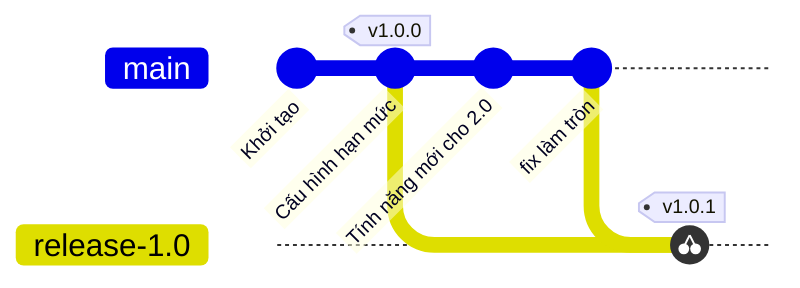
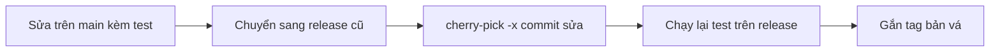

## Bạn sẽ học được gì

- Hiểu backport là gì và vì sao không merge cả main vào nhánh release cũ.
- Chép đúng commit sửa lỗi sang nhánh release bằng cherry-pick.
- Ghi lại nguồn gốc commit để truy vết.
- Kiểm tra lại sau backport và xác nhận những gì chưa được đưa sang.

## Khái niệm

Khi phần mềm có nhiều phiên bản đang được dùng cùng lúc, ví dụ bản 1.0 đang chạy production còn main đã tiến tới 2.0, một lỗi được sửa trên main thường cũng cần có mặt ở bản cũ. Đưa bản sửa đó về nhánh phát hành cũ gọi là backport.

Vì sao không merge main vào nhánh release? Vì main còn mang theo mọi tính năng mới, thay đổi chưa ổn định, có khi cả thay đổi phá vỡ tương thích. Bản 1.0 chỉ cần đúng bản sửa, không hơn. Cherry-pick là công cụ đúng: nó lấy thay đổi của một commit (diff giữa commit đó và parent của nó) và áp lên nhánh hiện tại thành commit mới.

Một quy trình backport điển hình:

1. Sửa lỗi trên main trước, kèm test tái hiện lỗi. Đây là nơi bản sửa được review đầy đủ.
2. Chuyển sang nhánh release cần vá, ví dụ `release/1.0`.
3. Cherry-pick commit sửa lỗi, thường với `-x` để message ghi "(cherry picked from commit ...)".
4. Chạy lại test trên nhánh release. Mã ở bản cũ có thể khác nên bản sửa đôi khi cần điều chỉnh.
5. Gắn tag phiên bản vá, ví dụ `v1.0.1`, và phát hành.

Để backport dễ dàng, commit sửa lỗi nên tập trung: chỉ chứa bản sửa và test của nó. Nếu bản sửa nằm lẫn trong commit có cả tính năng mới, cherry-pick sẽ kéo theo cả tính năng, hoặc xung đột vì tính năng đó dựa vào mã không có ở bản cũ. Đây là lý do thực tế mạnh nhất để viết commit tập trung.

Một chi tiết: commit sau cherry-pick là object khác commit gốc (parent khác, nên ID khác). Git vẫn có thể nhận ra chúng "tương đương" qua patch ID; lệnh `git cherry` dùng điều này để cho biết commit nào của main đã có bản tương đương trên nhánh release.

## Hình dung bằng sơ đồ





## Lệnh cần biết

```bash
# Chuyển sang nhánh release cần vá
git switch release/1.0

# Chép commit sửa lỗi, ghi nguồn gốc
git cherry-pick -x <commit-sửa-lỗi>

# Chép nhiều commit sửa lỗi liên tiếp, gồm cả commit đầu
git cherry-pick -x A^..B

# Xem commit nào của main đã có bản tương đương trên release (dấu trừ)
git cherry -v release/1.0 main

# Gắn tag bản vá
git tag v1.0.1
```

| Tình huống | Cách làm |
| --- | --- |
| Một commit sửa gọn | `git cherry-pick -x <commit>` |
| Chuỗi commit sửa | Phạm vi `A^..B` |
| Xung đột do mã cũ khác | Sửa tay, `git add`, `git cherry-pick --continue` |
| Bản sửa không áp dụng cho bản cũ | `git cherry-pick --abort`, viết bản sửa riêng |

## Ví dụ từng bước

Main có ba commit sau khởi tạo; nhánh `release/1.0` tách ra tại "Cấu hình hạn mức". Object ID trên máy bạn sẽ khác.

```bash
git log --oneline
```

```text
d0c3943 fix: làm tròn số tiền xuống
0448a74 Tính năng mới cho 2.0
ed5b345 Cấu hình hạn mức
abe34ca Khởi tạo
```

Chỉ backport bản sửa:

```bash
git switch release/1.0
git cherry-pick -x main
```

```text
Switched to branch 'release/1.0'
[release/1.0 a1e1af1] fix: làm tròn số tiền xuống
 Date: Thu Oct 15 23:57:00 2026 +0700
 1 file changed, 1 insertion(+)
```

Mình dùng tên nhánh `main` thay cho ID vì commit sửa đang là đầu main; ghi ID `d0c3943` cũng cho kết quả như nhau. Kiểm tra:

```bash
git log --oneline
git log -1 --format=%B
ls
```

```text
a1e1af1 fix: làm tròn số tiền xuống
ed5b345 Cấu hình hạn mức
abe34ca Khởi tạo
fix: làm tròn số tiền xuống

(cherry picked from commit d0c39438ca3c8c943716868d0cb4f5fa12e8349a)

README.md
config.txt
```

Không có `new.txt` của tính năng 2.0. Hỏi Git commit nào của main đã sang release:

```bash
git cherry -v release/1.0 main
```

```text
+ 0448a749b808523146f37717820d1f277994a1e1 Tính năng mới cho 2.0
- d0c39438ca3c8c943716868d0cb4f5fa12e8349a fix: làm tròn số tiền xuống
```

Dấu trừ là đã có bản tương đương, dấu cộng là chưa có. Đúng ý: tính năng mới chưa sang, bản sửa đã sang.

> **Mẹo** Thêm `-x` gần như luôn đáng. Khi audit hoặc điều tra sự cố trên bản cũ, dòng nguồn gốc giúp bạn tìm ngay PR và review gốc trên main.

## Lỗi thường gặp

**Merge main vào release.** Kéo cả tính năng chưa sẵn sàng vào bản production. Nếu đã lỡ và chưa push, `git reset --hard ORIG_HEAD`; nếu đã push, revert merge commit và trao đổi với nhóm.

**Cherry-pick commit lẫn tính năng.** Bản cũ nhận thêm mã không mong muốn hoặc xung đột liên tục. Tách bản sửa thành commit riêng trên main trước khi backport.

**Không chạy lại test trên release.** Bản sửa đúng với main có thể sai với mã cũ. Luôn chạy bộ test của nhánh release sau khi cherry-pick.

**Đứng nhầm nhánh khi cherry-pick.** Kiểm tra `git branch --show-current` trước.

> **Lưu ý** Có nhóm làm ngược lại: sửa trên nhánh release trước rồi đưa lên main. Cả hai cách đều được, miễn nhất quán và bản sửa không bị quên ở nhánh còn lại.

## Áp dụng trong công việc

App ngân hàng bản 3.2 đang chạy production, main đã ở 3.3 với giao diện mới. Một lỗi làm tròn phí chuyển khoản được phát hiện và sửa trên main kèm test hồi quy. QA chuyển sang `release/3.2`, cherry-pick với `-x`, chạy lại bộ test phí và smoke test thanh toán trên bản 3.2, rồi xác nhận để đội phát hành gắn tag `v3.2.1`.

## Chuẩn bị làm bài

Bài thực hành có nhánh source với một commit riêng, và main đã có commit riêng của nó. Bạn đang ở main và cần đưa thay đổi của commit trên source sang main thành một commit mới, không merge toàn nhánh, working tree sạch. Câu hỏi kiến thức hỏi lệnh dùng để chép riêng commit sửa lỗi.

Hãy chuẩn bị:

- Xác định commit cần chép bằng `git log --oneline source`.
- Nhớ rằng tên nhánh trỏ tới commit đầu nhánh, có thể dùng thay ID.
- Sau khi xong, kiểm tra tệp mới có trên main và source chưa trở thành tổ tiên của main.

## Tóm tắt

- Backport đưa bản sửa lỗi về nhánh phát hành cũ mà không kéo theo tính năng mới.
- Cherry-pick áp thay đổi của một commit lên nhánh hiện tại.
- `-x` ghi nguồn gốc để truy vết.
- `git cherry` cho biết commit nào đã có bản tương đương.
- Luôn chạy lại test trên nhánh release sau backport.
