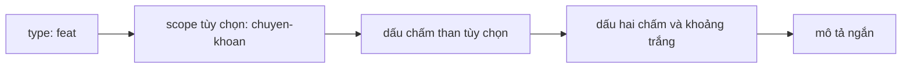
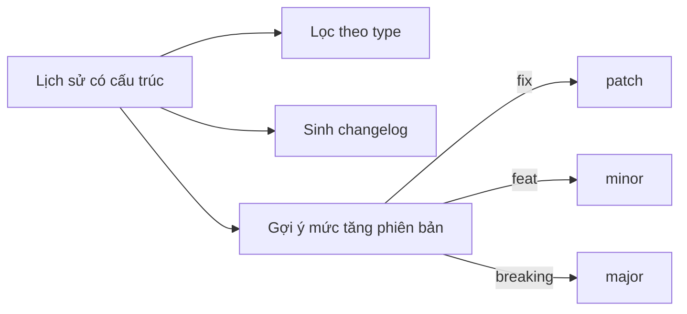

## Bạn sẽ học được gì

- Nắm cấu trúc subject theo quy ước Conventional Commits: type, scope tùy chọn, dấu hai chấm, mô tả.
- Chọn type phù hợp cho từng loại thay đổi.
- Đánh dấu thay đổi phá vỡ tương thích bằng dấu chấm than hoặc footer.
- Hiểu vì sao công cụ cần cấu trúc này để phân nhóm thay đổi và sinh changelog.

## Khái niệm

Message commit tự do như "update", "fix", "sửa tí" không nói được gì cho người đọc sau này, và máy càng không hiểu. Conventional Commits là một quy ước phổ biến giúp subject vừa dễ đọc vừa máy đọc được. Dạng cơ bản:

```text
<type>[(scope)][!]: <mô tả ngắn>

[phần thân tùy chọn]

[footer tùy chọn]
```

- **type** cho biết loại thay đổi. Hai type cốt lõi của quy ước là `feat` (tính năng mới) và `fix` (sửa lỗi). Nhiều nhóm dùng thêm `docs`, `test`, `refactor`, `chore`, `ci`, `perf`, `build`, `style`.
- **scope** (tùy chọn) đặt trong ngoặc đơn, chỉ phạm vi: `feat(chuyen-khoan): ...`.
- **dấu chấm than** trước dấu hai chấm đánh dấu thay đổi phá vỡ tương thích: `fix!: ...`.
- **dấu hai chấm và một khoảng trắng** ngăn cách tiền tố với mô tả. Thiếu hai thứ này, công cụ không nhận ra cấu trúc.
- **mô tả** ngắn gọn, nói thay đổi làm gì.

Footer `BREAKING CHANGE: <giải thích>` ở cuối phần thân là cách khác (hoặc bổ sung) để đánh dấu thay đổi phá vỡ, kèm lời giải thích.

Lợi ích lớn nhất đến từ công cụ. Khi mọi subject có type, bạn có thể lọc lịch sử bằng `git log` với regex, sinh changelog tự động nhóm theo "Tính năng" và "Sửa lỗi", và các công cụ phát hành có thể suy ra nên tăng phiên bản semver ở mức nào: `fix` tăng patch, `feat` tăng minor, có breaking change thì tăng major.

Quy ước không thay thế nội dung tốt. `feat: thêm` đúng dạng nhưng nghèo thông tin; `feat(otp): cho phép gửi lại mã sau 60 giây` mới thật sự hữu ích. Giữ subject ngắn (nhiều nhóm đặt giới hạn khoảng 72 ký tự) để hiển thị gọn trong `git log --oneline` và giao diện web.

## Hình dung bằng sơ đồ





## Lệnh cần biết

```bash
# Commit với subject có type và scope
git commit -m "feat(chuyen-khoan): thêm kiểm tra hạn mức ngày"

# Thay đổi phá vỡ: dấu chấm than và footer giải thích (mỗi -m là một đoạn)
git commit -m "fix!: đổi định dạng mã lỗi" -m "BREAKING CHANGE: mã lỗi trả về dạng chuỗi"

# Xem subject commit cuối
git log -1 --format=%s

# Lọc các commit tính năng bằng regex
git log --format=%s | grep -E '^feat(\(.+\))?!?: '

# Sửa subject commit cuối nếu viết sai (chỉ khi chưa push)
git commit --amend -m "feat: mô tả đúng"
```

| Type | Dùng khi |
| --- | --- |
| `feat` | Thêm tính năng cho người dùng |
| `fix` | Sửa lỗi |
| `docs` | Chỉ đổi tài liệu |
| `test` | Thêm hoặc sửa test |
| `refactor` | Đổi cấu trúc mã, không đổi hành vi |
| `chore` | Việc lặt vặt: cấu hình, phụ thuộc |
| `ci` | Đổi pipeline CI |

## Ví dụ từng bước

Commit một tính năng có scope (object ID trên máy bạn sẽ khác):

```bash
git add bai.txt
git commit -m "feat(chuyen-khoan): thêm kiểm tra hạn mức ngày"
git log -1 --format=%s
```

```text
[main c04c765] feat(chuyen-khoan): thêm kiểm tra hạn mức ngày
 1 file changed, 1 insertion(+)
 create mode 100644 bai.txt
feat(chuyen-khoan): thêm kiểm tra hạn mức ngày
```

Một thay đổi phá vỡ, kèm footer:

```bash
git commit --allow-empty -m "fix!: đổi định dạng mã lỗi" -m "BREAKING CHANGE: mã lỗi trả về dạng chuỗi"
git log -1 --format=%B
```

```text
[main 423e465] fix!: đổi định dạng mã lỗi
fix!: đổi định dạng mã lỗi

BREAKING CHANGE: mã lỗi trả về dạng chuỗi
```

Lọc các commit tính năng bằng regex chấp nhận scope và dấu chấm than tùy chọn:

```bash
git log --format=%s | grep -E '^feat(\(.+\))?!?: '
```

```text
feat(chuyen-khoan): thêm kiểm tra hạn mức ngày
```

Commit `fix!` không khớp vì type khác, đúng như mong muốn.

> **Mẹo** Regex trên cũng là cách ứng dụng luyện tập kiểm tra subject của bạn. Hiểu nó giúp bạn tự soát trước khi commit.

## Lỗi thường gặp

**Thiếu khoảng trắng sau dấu hai chấm.** `feat:thêm` trông gần đúng nhưng nhiều công cụ không nhận. Luôn có một khoảng trắng.

**Viết hoa type hoặc dùng type lạ.** `Feat:` hay `feature:` có thể không được nhận, tùy công cụ. Thống nhất danh sách type trong nhóm.

**Subject chỉ có từ chung chung.** "update", "fix bug" không có type đúng dạng và không có thông tin. Viết rõ cái gì thay đổi.

**Subject quá dài.** Bị cắt trong giao diện, khó đọc. Đưa chi tiết xuống phần thân.

> **Lưu ý** Conventional Commits là quy ước, Git không bắt buộc. Muốn ép buộc, nhóm thường thêm hook `commit-msg` cục bộ và kiểm tra lại ở CI.

## Áp dụng trong công việc

Repository bộ test tự động của dự án thẻ tín dụng dùng Conventional Commits với scope theo module: `test(sao-ke): thêm case kỳ sao kê cuối tháng`, `fix(login): tăng timeout chờ OTP`. Trước mỗi đợt phát hành bộ test, trưởng nhóm QA lọc `git log` theo type để viết ghi chú thay đổi gửi đội phát triển: thêm bao nhiêu case mới, sửa bao nhiêu test không ổn định.

## Chuẩn bị làm bài

Bài thực hành có tệp `bai.txt` chưa commit. Bạn cần commit nó với một subject theo quy ước, loại tính năng mới (có thể kèm scope hoặc dấu chấm than), ngắn hơn giới hạn độ dài cho trước, và giữ working tree sạch. Câu hỏi kiến thức đưa ra hai subject và hỏi cái nào đúng dạng cho tính năng mới.

Hãy chuẩn bị:

- Ôn lại cấu trúc type, scope, dấu chấm than, dấu hai chấm, mô tả.
- Tự kiểm tra subject bằng regex ở phần ví dụ.
- Đếm sơ độ dài subject trước khi commit.

## Tóm tắt

- Subject có dạng type, scope tùy chọn, dấu chấm than tùy chọn, dấu hai chấm, khoảng trắng, mô tả.
- `feat` cho tính năng, `fix` cho sửa lỗi; nhóm có thể thêm type khác.
- Breaking change đánh dấu bằng dấu chấm than hoặc footer `BREAKING CHANGE:`.
- Cấu trúc giúp lọc lịch sử, sinh changelog, gợi ý tăng phiên bản.
- Đúng dạng vẫn cần mô tả có thông tin.
