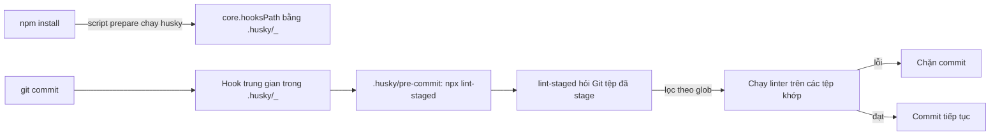
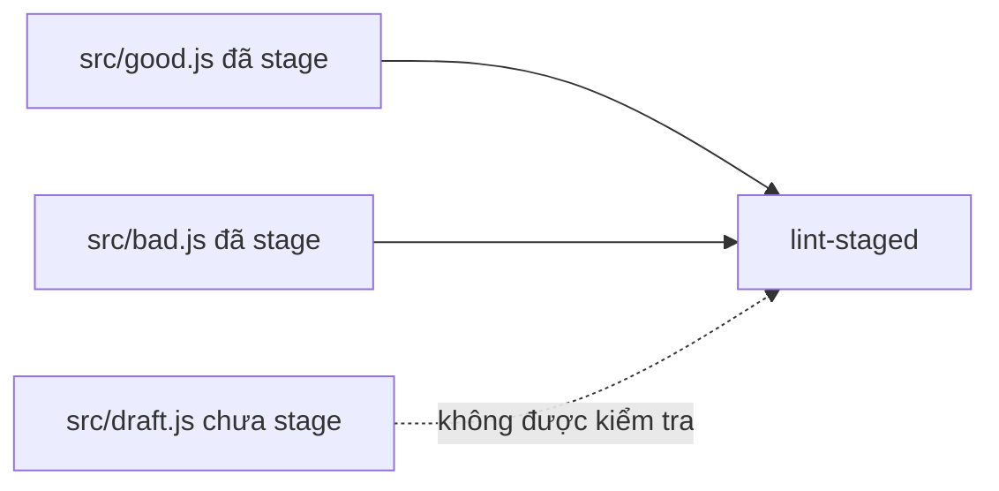

## Bạn sẽ học được gì

- Hiểu Husky giải quyết vấn đề chia sẻ hook trong dự án Node như thế nào.
- Hiểu lint-staged chọn đúng tệp đã stage để đưa cho linter.
- Đọc cấu hình tối thiểu của hai công cụ trong `package.json` và thư mục `.husky`.
- Biết phần nào của bài là mô phỏng trong ứng dụng luyện tập.

## Khái niệm

Ở bài trước, bạn thấy hook Git nằm trong `.git/hooks` và không đi theo khi clone. Với dự án Node, Husky là cách phổ biến để biến hook thành một phần của repository. Ý tưởng của Husky (phiên bản 9, bản mình thử là 9.1.7) khá đơn giản:

- Script hook nằm trong thư mục `.husky/` ở gốc dự án và được commit như mã thường. Ví dụ `.husky/pre-commit` chứa lệnh cần chạy.
- Khi chạy lệnh `husky` (thường qua script `prepare` trong `package.json`, tự chạy sau `npm install`), Husky đặt `core.hooksPath` của repository trỏ tới `.husky/_`, nơi nó tạo các hook trung gian. Các hook trung gian này gọi tới script bạn viết trong `.husky/`.

Nhờ vậy, người mới clone dự án và chạy `npm install` là có hook, không cần nhớ thao tác thủ công. Bản chất vẫn là cơ chế `core.hooksPath` của Git.

Vấn đề tiếp theo: nếu hook chạy linter trên toàn bộ dự án, mỗi lần commit sẽ chậm, và có thể chặn bạn vì lỗi ở tệp người khác viết. lint-staged giải quyết điều đó. Nó hỏi Git danh sách tệp đã stage, lọc theo mẫu glob trong cấu hình (ví dụ `src/*.js`), rồi chạy lệnh tương ứng chỉ với các tệp đó. Nếu lệnh thất bại, lint-staged thoát với mã khác 0 và hook chặn commit.

lint-staged còn làm một việc tinh tế: khi một tệp vừa có phần staged vừa có phần chưa stage, nó tạm cất phần chưa stage, chạy công cụ trên đúng nội dung sẽ commit, rồi trả lại phần dở dang cho bạn. Nếu công cụ sửa tệp (như formatter), nó stage lại kết quả.

Ứng dụng luyện tập không cài Node package vào repository bài tập. Bài này được đánh dấu mô phỏng: bạn chỉ cần trả lời câu hỏi kiến thức. Ví dụ dưới đây mình chạy thật trong một thư mục tạm với Husky 9.1.7 và lint-staged 17.6.0.

## Hình dung bằng sơ đồ





## Lệnh cần biết

```bash
# Cài hai công cụ làm devDependency (trong dự án Node thật)
npm install --save-dev husky lint-staged

# Khởi tạo Husky: tạo .husky/pre-commit và thêm script prepare
npx husky init

# Kiểm tra Husky đã trỏ hook về đâu
git config --get core.hooksPath

# Chạy lint-staged thủ công để thử
npx lint-staged
```

Cấu hình lint-staged trong `package.json` (trích):

```json
{
  "scripts": {
    "prepare": "husky"
  },
  "lint-staged": {
    "src/*.js": "node check.js"
  }
}
```

Nội dung `.husky/pre-commit`:

```bash
npx lint-staged
```

| Thành phần | Vai trò |
| --- | --- |
| `.husky/pre-commit` | Script hook do bạn viết, được commit |
| `.husky/_/` | Hook trung gian do Husky sinh, không cần commit |
| `prepare` trong `package.json` | Tự chạy `husky` sau `npm install` |
| Khóa `lint-staged` | Ánh xạ glob tới lệnh cần chạy |

## Ví dụ từng bước

Trong thư mục tạm, sau khi cài và chạy `npx husky init`:

```bash
cat .husky/pre-commit
git config --get core.hooksPath
```

```text
npm test
.husky/_
```

Mình thay nội dung `.husky/pre-commit` bằng `npx lint-staged`, và viết một "linter" mẫu `check.js` báo lỗi nếu tệp còn `console.log`. Có ba tệp: `src/good.js` sạch, `src/draft.js` có `console.log` nhưng chưa stage. Commit tệp sạch:

```bash
git add src/good.js
git commit -m "feat: thêm good"
git status --short
```

```text
[main 8b05856] feat: thêm good
 1 file changed, 1 insertion(+)
 create mode 100644 src/good.js
?? src/draft.js
```

Commit qua dù `draft.js` có lỗi, vì nó không được stage. Giờ stage một tệp có lỗi:

```bash
git add src/bad.js
git commit -m "feat: thêm bad"
```

Phần cuối output (mình đã bỏ các ký hiệu trạng thái trang trí mà lint-staged in ra ở đầu dòng):

```text
node check.js:
/tmp/pb/hu2/src/bad.js: còn console.log
husky - pre-commit script failed (code 1)
```

```bash
git status --short
```

```text
A  src/bad.js
?? src/draft.js
```

Commit bị chặn, `bad.js` vẫn nằm trong index chờ sửa.

> **Lưu ý** Như mọi hook cục bộ, `git commit --no-verify` vẫn bỏ qua được Husky. Kiểm tra bắt buộc phải chạy lại ở CI.

## Lỗi thường gặp

**Clone xong commit không thấy hook chạy.** Chưa chạy `npm install` nên script `prepare` chưa đặt `core.hooksPath`. Chạy `npm install` hoặc `npx husky`.

**Glob không khớp.** lint-staged báo không tìm thấy tệp đã stage khớp cấu hình, và không chạy gì. Kiểm tra đường dẫn trong glob, ví dụ `src/*.js` không khớp tệp trong thư mục con `src/a/b.js` (cần `src/**/*.js`).

**Linter chạy trên cả dự án trong hook.** Lệnh như `eslint .` trong `.husky/pre-commit` bỏ qua lợi ích của lint-staged. Đưa linter vào cấu hình lint-staged.

**Ghi đè `core.hooksPath` bằng tay.** Nếu bạn hoặc công cụ khác đổi giá trị này, hook của Husky ngừng chạy. `git config --get core.hooksPath` để kiểm tra.

> **Cẩn thận** Script trong `.husky/` chạy trên máy mọi người với quyền của họ. Review thay đổi trong thư mục này kỹ như review mã ứng dụng.

## Áp dụng trong công việc

Dự án test end-to-end viết bằng TypeScript của nhóm bạn dùng Husky với lint-staged chạy ESLint và Prettier trên các tệp `.ts` đã stage. Một QA mới clone repository, chạy `npm install`, và ngay lần commit đầu đã bị chặn vì để sót `test.only` trong một spec, nhờ một quy tắc lint. Lỗi đó nếu lọt lên CI sẽ khiến cả bộ regression chỉ chạy một test.

## Chuẩn bị làm bài

Bài này là mô phỏng trong app: không có nhiệm vụ trạng thái Git và app không cài Husky hay lint-staged. Câu hỏi kiến thức hỏi công cụ nào chọn tệp đã stage để đưa cho linter. Hãy phân biệt rõ vai trò của hai công cụ: một bên quản lý hook, một bên chọn tệp.

Nếu bạn có sẵn môi trường Node và muốn thử, hãy làm trong một thư mục tạm riêng, không làm trên repository công việc.

## Tóm tắt

- Husky giữ script hook trong `.husky/` và đặt `core.hooksPath` khi cài.
- Script `prepare` giúp hook tự có sau `npm install`.
- lint-staged chỉ chạy công cụ trên tệp đã stage khớp glob.
- Tệp chưa stage không bị kiểm tra và không chặn commit.
- Hook cục bộ vẫn bỏ qua được, CI là lớp kiểm tra cuối.
