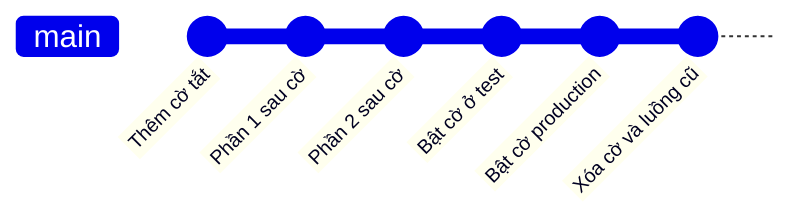
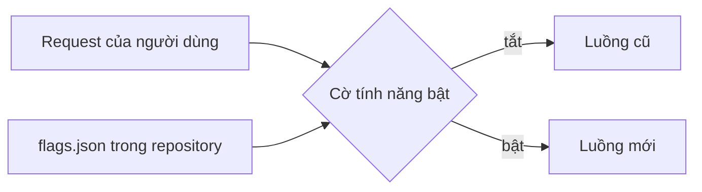

## Bạn sẽ học được gì

- Hiểu feature flag là gì và vì sao nó thay thế được nhánh sống lâu.
- Tách hai khái niệm: mã đã merge (deploy) và tính năng đã bật (release).
- Commit mã tính năng mới mà vẫn giữ cờ ở trạng thái tắt.
- Biết những rủi ro của cờ và cách dọn cờ cũ.

## Khái niệm

Một tính năng lớn, như luồng mở tài khoản trực tuyến mới, có thể mất vài tuần. Nếu giữ toàn bộ trên một nhánh riêng tới khi xong, bạn gặp đúng các vấn đề của nhánh sống lâu: lệch xa main, xung đột lớn, review một cục khổng lồ, và lỗi tích hợp lộ ra muộn.

Feature flag (cờ tính năng) tách việc "mã có trong trunk" khỏi việc "người dùng thấy tính năng". Bạn merge từng phần nhỏ của tính năng vào main ngay khi phần đó đã có test, nhưng toàn bộ đường đi vào tính năng được bọc trong một điều kiện:

```text
nếu cờ "mo-tai-khoan-moi" bật: dùng luồng mới
ngược lại: dùng luồng cũ
```

Cờ được đọc từ cấu hình (một tệp, biến môi trường, hoặc dịch vụ quản lý cờ). Ở production, cờ tắt, nên mã mới nằm im. Ở môi trường test, QA bật cờ để kiểm thử luồng mới bất cứ lúc nào. Khi đã sẵn sàng, bật cờ ở production, có thể bật dần cho một nhóm người dùng. Nếu có sự cố, tắt cờ là quay về luồng cũ, không cần deploy lại.

Từ góc độ Git, điều quan trọng là: cờ là một phần của mã và cấu hình được commit. Giá trị mặc định của cờ trong repository nên là tắt. Mỗi commit đưa phần mã mới vào phải giữ nguyên giá trị đó, để main luôn ở trạng thái phát hành được.

Cờ không miễn phí. Mỗi cờ là một nhánh logic trong mã, nhân đôi số trường hợp cần test. Cờ quên dọn tích tụ thành nợ kỹ thuật. Thực hành tốt: đặt tên cờ rõ ràng, ghi người chịu trách nhiệm, và khi tính năng đã bật ổn định, xóa cờ cùng luồng cũ trong một commit riêng.

## Hình dung bằng sơ đồ





## Lệnh cần biết

```bash
# Xem giá trị cờ trong commit hiện tại, không phụ thuộc working tree
git show HEAD:flags.json

# Xem commit này đổi những tệp nào, chắc rằng cờ không bị đổi
git show --stat HEAD

# So sánh với commit trước, chỉ riêng tệp cờ
git diff HEAD~1 -- flags.json

# Tìm commit nào đã đổi tệp cờ
git log --oneline -- flags.json
```

| Khái niệm | Ý nghĩa |
| --- | --- |
| Deploy | Mã đã nằm trên môi trường chạy |
| Release | Người dùng thấy tính năng |
| Cờ mặc định | Giá trị trong repository, thường là tắt |
| Dọn cờ | Xóa điều kiện và luồng cũ khi tính năng ổn định |

## Ví dụ từng bước

Repository có sẵn `flags.json` với cờ tắt. Mình thêm mã tính năng mà không đụng tới cờ (object ID trên máy bạn sẽ khác):

```bash
echo "Tính năng mới" > feature.txt
git add feature.txt
git commit -m "Thêm tính năng sau cờ"
git log --oneline
```

```text
058ecfe Thêm tính năng sau cờ
459a04a Thêm cờ
abe34ca Khởi tạo
```

Xác nhận commit chỉ thêm tệp tính năng và cờ vẫn tắt:

```bash
git diff HEAD~1 --stat
git show HEAD:flags.json
```

```text
 feature.txt | 1 +
 1 file changed, 1 insertion(+)
{"enabled":false}
```

Lệnh `git show HEAD:flags.json` đọc nội dung đã commit, nên nó đáng tin hơn mở tệp trong editor (có thể bạn đang sửa dở mà chưa commit).

> **Cẩn thận** Đừng bật cờ trong commit "cho tiện test". Hãy bật bằng cấu hình môi trường test hoặc biến môi trường. Một lần lỡ merge cờ bật là tính năng chưa xong lên production.

## Lỗi thường gặp

**Commit luôn cờ đã bật.** Main không còn an toàn để phát hành. Sửa bằng một commit đặt lại cờ tắt (hoặc revert), và thêm kiểm tra trong CI rằng cờ mặc định là tắt.

**Mã mới chạy dù cờ tắt.** Có đường đi không qua điều kiện cờ, ví dụ một cron job hoặc một API endpoint mới. Review mọi điểm vào của tính năng.

**Không test cả hai trạng thái.** Chỉ test với cờ bật, rồi luồng cũ bị hỏng. Bộ test cần chạy ở cả hai trạng thái trong thời gian cờ tồn tại.

**Quên dọn cờ.** Sau vài tháng, không ai dám xóa vì không biết cờ còn dùng không. Ghi hạn dọn cờ ngay khi tạo.

> **Lưu ý** Feature flag là kỹ thuật ở tầng ứng dụng, không phải tính năng của Git. Git chỉ giúp bạn kiểm soát giá trị mặc định của cờ qua lịch sử commit.

## Áp dụng trong công việc

Đội phát triển làm luồng eKYC mới bằng nhận diện khuôn mặt trong sáu tuần. Mỗi phần nhỏ được merge vào main sau cờ `ekyc-v2`, mặc định tắt. Môi trường UAT bật cờ, nên QA kiểm thử dần từng bước thay vì nhận cả khối vào tuần cuối. CI chạy bộ test đăng ký tài khoản hai lần: cờ tắt và cờ bật. Sau khi bật production ổn định hai tuần, một commit riêng xóa cờ và luồng eKYC cũ.

## Chuẩn bị làm bài

Bài thực hành có sẵn tệp cờ với giá trị tắt. Bạn cần tạo tệp tính năng với nội dung cho trước và commit, trong khi tệp cờ trong commit vẫn giữ nguyên trạng thái tắt, và working tree sạch. Câu hỏi kiến thức hỏi tên cơ chế giữ tính năng mới ở trạng thái tắt trên production.

Hãy chuẩn bị:

- Đọc nội dung tệp cờ trước khi làm, đừng sửa nó.
- Ghi đúng nội dung tệp tính năng như đề bài.
- Sau khi commit, kiểm tra bằng `git show HEAD:flags.json` và `git status`.

## Tóm tắt

- Feature flag tách việc merge mã khỏi việc bật tính năng cho người dùng.
- Cờ cho phép merge sớm từng phần, tránh nhánh sống lâu.
- Giá trị cờ mặc định trong repository nên là tắt.
- Test cả hai trạng thái cờ trong thời gian cờ tồn tại.
- Dọn cờ và luồng cũ khi tính năng đã ổn định.
