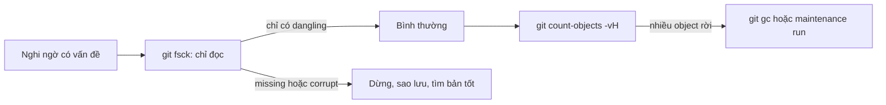
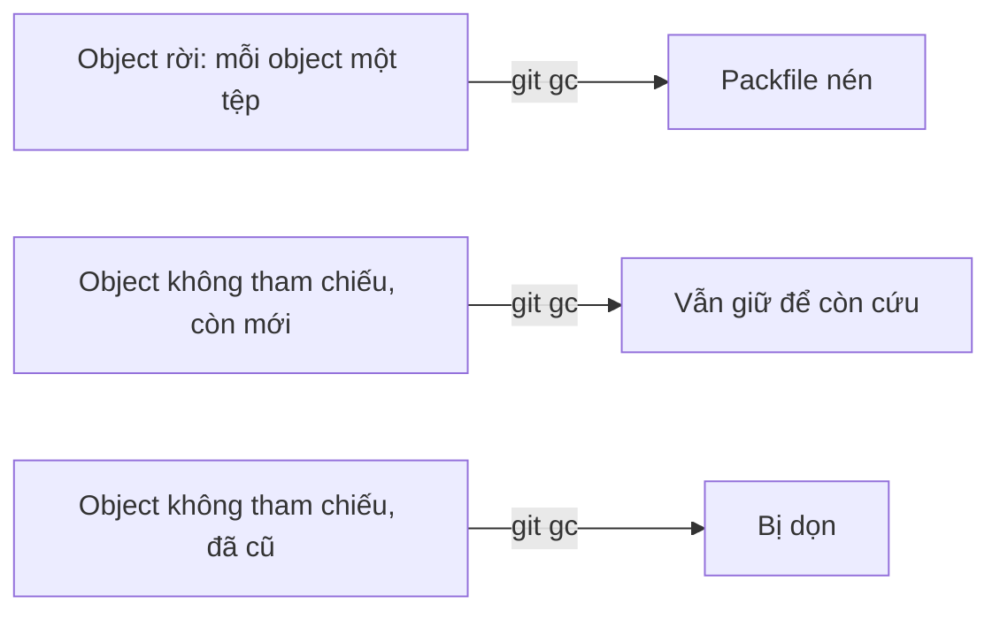

## Bạn sẽ học được gì

- Kiểm tra tính toàn vẹn của kho object và hiểu các loại cảnh báo.
- Đo kích thước repository và số object rời, đã đóng gói.
- Chạy gom object, dọn ref, cập nhật commit-graph khi cần.
- Biết phạm vi tác động của từng lệnh trước khi chạy.

## Khái niệm

Repository Git là một cơ sở dữ liệu nhỏ. Theo thời gian, nó tích lũy object rời (mỗi object một tệp), object không còn ai tham chiếu (sau reset, rebase, xóa nhánh), và hàng nghìn ref. Git tự bảo trì phần lớn những việc này ở chế độ nền khi bạn chạy lệnh thường. Nhưng biết các lệnh bảo trì giúp bạn chẩn đoán khi repository chậm, phình to, hoặc nghi ngờ bị hỏng (ví dụ sau khi ổ đĩa đầy hoặc máy tắt đột ngột).

Có hai nhóm việc khác nhau:

**Kiểm tra.** `git fsck` đi qua kho object, xác minh mỗi object đọc được, đúng định dạng, và kiểm tra các liên kết: commit trỏ tới tree có tồn tại, tree trỏ tới blob có tồn tại. Lệnh này chỉ đọc, không sửa gì. Nó có thể báo:

- `dangling`: object tồn tại nhưng không ai trỏ tới (ví dụ blob bạn từng `git add` rồi bỏ). Đây thường là bình thường.
- `missing` hoặc `corrupt`: object cần thiết bị thiếu hoặc hỏng. Đây là vấn đề thật.

**Tối ưu.** `git gc` gom object rời vào packfile, nén lại, đóng gói ref vào `packed-refs`, và dọn object không còn được tham chiếu nếu chúng đủ cũ (mặc định Git giữ object không tham chiếu ít nhất hai tuần, và các mục reflog còn lâu hơn, để bạn còn đường cứu). `git maintenance run` là giao diện mới hơn, cho phép chạy từng tác vụ riêng như `commit-graph`, `loose-objects`, `incremental-repack`, `pack-refs`.

Nguyên tắc an toàn: kiểm tra trước, tối ưu sau, và hiểu rằng tối ưu có thể làm mất vĩnh viễn những object đã đủ cũ mà không còn được tham chiếu. Đừng chạy các lệnh dọn mạnh như `git gc --prune=now` hay `git reflog expire --expire=now --all` trên repository mà bạn còn hy vọng cứu commit cũ.

`git count-objects -vH` cho bạn bức tranh nhanh: bao nhiêu object rời, bao nhiêu object trong pack, tổng dung lượng.

## Hình dung bằng sơ đồ





## Lệnh cần biết

```bash
# Kiểm tra toàn vẹn (chỉ đọc)
git fsck

# Liệt kê object không truy cập được, bỏ qua reflog
git fsck --unreachable --no-reflogs

# Thống kê object, -H cho đơn vị dễ đọc
git count-objects -vH

# Gom và nén object, đóng gói ref, dọn object đủ cũ
git gc

# Chạy từng tác vụ bảo trì
git maintenance run --task=commit-graph
git maintenance run --task=loose-objects
git maintenance run --task=pack-refs
```

| Lệnh | Đọc hay ghi | Rủi ro |
| --- | --- | --- |
| `git fsck` | Chỉ đọc | Không |
| `git count-objects` | Chỉ đọc | Không |
| `git gc` | Ghi | Thấp, giữ object mới |
| `git maintenance run` | Ghi | Thấp |
| `git gc --prune=now` | Ghi | Mất object không tham chiếu ngay |

## Ví dụ từng bước

Repository mới có vài commit, chưa đóng gói:

```bash
git fsck
git count-objects -vH
```

```text
count: 12
size: 48.00 KiB
in-pack: 0
packs: 0
size-pack: 0 bytes
prune-packable: 0
garbage: 0
size-garbage: 0 bytes
```

`git fsck` không in gì nghĩa là không phát hiện vấn đề. Giờ mình stage một tệp rồi bỏ, và tạo một commit rồi reset bỏ nó:

```bash
git fsck
git fsck --unreachable --no-reflogs
```

```text
dangling blob a9a5aecf429fd8a0d81fbd5fd37006bfa498d5c1
unreachable blob a9a5aecf429fd8a0d81fbd5fd37006bfa498d5c1
unreachable commit 13d2ce7ac85371a7ca8feb823d95bbab84dd7543
```

Lần đầu chỉ thấy blob, vì commit bị reset vẫn còn trong reflog nên được coi là còn dùng. Bỏ qua reflog thì thấy cả commit. Chạy gc rồi đo lại:

```bash
git gc
git count-objects -vH
```

```text
count: 0
size: 0 bytes
in-pack: 14
packs: 2
size-pack: 3.50 KiB
prune-packable: 0
garbage: 0
size-garbage: 0 bytes
```

Object rời đã vào pack, dung lượng giảm mạnh. Object không tham chiếu vẫn được giữ vì còn mới.

Để thấy fsck báo lỗi thật, mình cố ý ghi đè tệp của một blob trong repository thử nghiệm:

```text
error: inflate: data stream error (incorrect header check)
error: unable to unpack header of .git/objects/ce/013625030ba8dba906f756967f9e9ca394464a
error: ce013625030ba8dba906f756967f9e9ca394464a: object corrupt or missing: .git/objects/ce/013625030ba8dba906f756967f9e9ca394464a
missing blob ce013625030ba8dba906f756967f9e9ca394464a
```

> **Cẩn thận** Chỉ làm hỏng object có chủ đích trong thư mục tạm. Với repository thật bị báo `corrupt`, hãy sao lưu nguyên thư mục trước khi thử sửa, và ưu tiên lấy lại object từ remote hoặc bản clone khác.

## Lỗi thường gặp

**Hoảng khi thấy `dangling`.** Đó thường là phần thừa bình thường sau reset hay rebase. Chỉ `missing` và `corrupt` mới cần xử lý.

**Chạy `gc --prune=now` để "dọn sạch".** Bạn mất lưới an toàn cho commit vừa bỏ. Dùng `git gc` mặc định trừ khi biết chắc mình muốn gì.

**Bảo trì repository đang có lệnh Git khác chạy.** Ví dụ IDE đang fetch. Git có khóa, nhưng tốt nhất chạy bảo trì khi không có thao tác khác.

**Nhầm bảo trì với giảm kích thước lịch sử.** `gc` nén tốt hơn nhưng không xóa tệp lớn đã commit. Muốn bỏ tệp lớn khỏi lịch sử là việc viết lại lịch sử, khác hẳn (xem track điều tra).

> **Lưu ý** `git maintenance start` đăng ký tác vụ chạy định kỳ với bộ lập lịch của hệ điều hành. Nó thay đổi cấu hình hệ thống của bạn, nên chỉ bật khi hiểu và muốn điều đó.

## Áp dụng trong công việc

Máy CI của nhóm QA giữ sẵn một bản clone lớn của repository ứng dụng để tiết kiệm thời gian. Sau vài tháng, bước checkout chậm dần. Bạn chạy `git count-objects -vH` thấy hàng chục nghìn object rời, chạy `git fsck` xác nhận không hỏng, rồi lên lịch `git maintenance run --task=loose-objects --task=incremental-repack` vào khung giờ không có pipeline. Thời gian checkout trở lại bình thường.

## Chuẩn bị làm bài

Đây là bài trả lời câu hỏi. Câu hỏi hỏi lệnh nào kiểm tra tính toàn vẹn của object. Hãy ôn sự khác nhau giữa lệnh chỉ đọc để kiểm tra và lệnh ghi để tối ưu ở bảng trên.

Bạn có thể tự chạy các lệnh chỉ đọc trong repository bài tập để xem kết quả. Tránh chạy lệnh dọn mạnh, dù trong sandbox, cho tới khi hiểu rõ tác động.

## Tóm tắt

- `git fsck` kiểm tra toàn vẹn kho object, chỉ đọc.
- `dangling` thường vô hại; `missing` và `corrupt` là vấn đề thật.
- `git count-objects -vH` cho biết số object rời, trong pack và dung lượng.
- `git gc` và `git maintenance run` tối ưu, nhưng giữ object mới để còn cứu.
- Tránh `--prune=now` khi còn cần khôi phục commit cũ.
