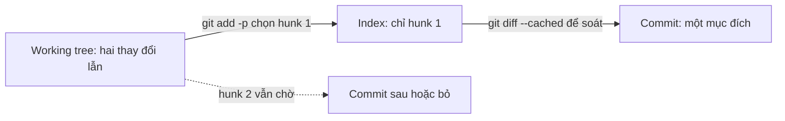
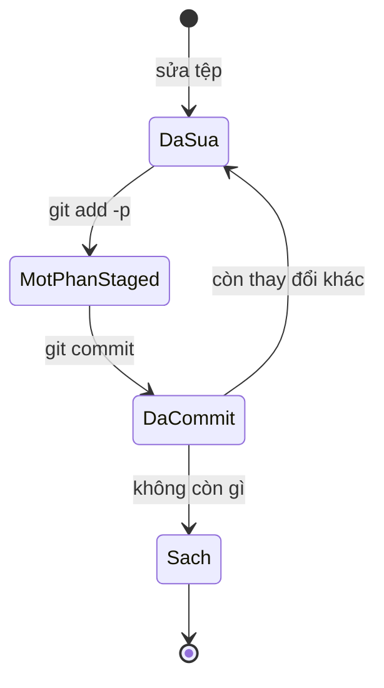

## Bạn sẽ học được gì

- Hiểu thế nào là một commit tập trung và vì sao nó đáng công sức.
- Kiểm tra kỹ phần sẽ commit bằng `git diff` và `git diff --cached`.
- Stage từng phần của một tệp bằng chế độ patch của `git add`.
- Giữ working tree sạch sau khi commit để biết chắc không bỏ sót gì.

## Khái niệm

Một commit tập trung trả lời được một câu hỏi duy nhất: "thay đổi này làm gì?". Nếu câu trả lời có chữ "và" ("sửa lỗi đăng nhập và đổi màu nút và cập nhật thư viện"), đó là dấu hiệu nên tách. Lợi ích rất thực tế:

- Review nhanh hơn, vì người đọc chỉ cần giữ một ý trong đầu.
- Revert an toàn hơn, vì đảo ngược một commit không kéo theo thay đổi không liên quan.
- Bisect chính xác hơn, vì commit gây lỗi nhỏ và rõ.
- Lịch sử dễ đọc lại sau sáu tháng, khi chính bạn quên vì sao đã sửa.

Công cụ giúp bạn làm được điều đó là index (vùng staging). Index là bản nháp của commit kế tiếp. Bạn không bị buộc phải commit mọi thứ đang sửa trong working tree; bạn chọn chính xác thứ gì đi vào. `git add <tệp>` chọn cả tệp. Khi một tệp chứa hai thay đổi không liên quan, chế độ patch (`git add -p`) cho bạn đi qua từng hunk (một khối dòng thay đổi liền nhau) và quyết định: stage hay chưa.

Thói quen của người viết commit tốt gồm ba bước lặp lại:

1. Xem mình đã đổi gì: `git status` và `git diff`.
2. Chọn phần thuộc về một mục đích: `git add <tệp>` hoặc `git add -p`.
3. Xem lại phần đã chọn: `git diff --cached`. Đây là đúng nội dung commit sẽ chứa.

Rồi mới `git commit`. Sau khi commit, `git status` cho biết còn gì chưa commit. Nếu phần còn lại thuộc mục đích khác, lặp lại vòng trên cho commit tiếp theo. Nếu phần còn lại là rác (log debug, tệp thử), hãy dọn đi thay vì để lẫn.

Commit tập trung không có nghĩa là commit thật nhỏ. Một tính năng hoàn chỉnh có thể chạm nhiều tệp nhưng vẫn là một mục đích. Ngược lại, hai dòng ở hai tệp có thể thuộc hai mục đích khác nhau.

## Hình dung bằng sơ đồ





## Lệnh cần biết

```bash
# Thay đổi chưa stage so với index
git diff

# Thay đổi đã stage so với HEAD: đúng nội dung commit sắp tạo
git diff --cached

# Stage cả tệp
git add bai.txt

# Stage từng hunk, Git hỏi lần lượt
git add -p bai.txt

# Bỏ stage nếu chọn nhầm (nội dung trong working tree vẫn giữ)
git restore --staged bai.txt

# Commit và xem diff ngay trong editor message
git commit -v
```

Các phím hay dùng khi `git add -p` hỏi "Stage this hunk":

| Phím | Ý nghĩa |
| --- | --- |
| `y` | Stage hunk này |
| `n` | Bỏ qua hunk này |
| `s` | Chia hunk thành các hunk nhỏ hơn (nếu được) |
| `e` | Sửa tay hunk trước khi stage |
| `q` | Thoát, giữ những gì đã chọn |
| `?` | Xem giải thích mọi phím |

## Ví dụ từng bước

Tệp `bai.txt` có 24 dòng nền. Mình thêm một dòng "Tính năng" ở gần đầu và một dòng "Thử nghiệm" ở gần cuối. Hai dòng cách xa nhau nên Git tách thành hai hunk.

```bash
git diff --stat
```

```text
 bai.txt | 2 ++
 1 file changed, 2 insertions(+)
```

Chạy chế độ patch, trả lời `y` cho hunk đầu và `n` cho hunk sau:

```bash
git add -p bai.txt
```

```text
@@ -1,5 +1,6 @@
 Dòng nền 1
 Dòng nền 2
+Tính năng
 Dòng nền 3
 Dòng nền 4
 Dòng nền 5
(1/2) Stage this hunk [y,n,q,a,d,j,J,g,/,e,p,?]? y
@@ -19,6 +20,7 @@ Dòng nền 18
 Dòng nền 19
 Dòng nền 20
 Dòng nền 21
+Thử nghiệm
 Dòng nền 22
 Dòng nền 23
 Dòng nền 24
(2/2) Stage this hunk [y,n,q,a,d,K,g,/,e,p,?]? n
```

Mình đã lược phần đầu diff. Giờ cùng một tệp vừa có phần staged vừa có phần chưa stage:

```bash
git status --short
git diff --cached
```

```text
MM bai.txt
@@ -1,5 +1,6 @@
 Dòng nền 1
 Dòng nền 2
+Tính năng
 Dòng nền 3
```

Chữ `M` đầu là thay đổi trong index, chữ `M` thứ hai là thay đổi chỉ có ở working tree. Commit phần đã chọn:

```bash
git commit -m "Thêm tính năng"
git status --short
```

```text
 M bai.txt
```

Dòng "Thử nghiệm" vẫn nằm trong working tree, chưa vào commit.

> **Mẹo** Khi hai thay đổi nằm sát nhau, Git gộp chúng thành một hunk. Thử phím `s` để chia nhỏ; nếu vẫn không chia được, dùng `e` để sửa tay hunk.

## Lỗi thường gặp

**Dùng `git add .` theo thói quen.** Mọi thứ, kể cả tệp debug, vào cùng một commit. Tập đọc `git status` trước và chỉ add có chủ đích.

**Commit mà không xem `git diff --cached`.** Bạn tưởng đã stage đúng nhưng thật ra thiếu một tệp hoặc thừa một dòng log. Một lần soát mất mười giây, sửa sau khi push mất nhiều hơn.

**Quên tệp mới.** `git add -p` chỉ làm việc với tệp đã được theo dõi. Tệp mới cần `git add <tệp>` (hoặc `git add -N <tệp>` trước để chọn từng phần).

**Sửa tiếp tệp sau khi stage.** Index giữ phiên bản lúc bạn add. Sửa thêm thì phải add lại; `git status` sẽ báo `MM`.

> **Lưu ý** Nếu đã lỡ commit lẫn, đừng lo. Bài tách commit trong track nâng cao chỉ cách làm lại cho gọn trước khi push.

## Áp dụng trong công việc

Khi sửa test thanh toán QR, bạn vừa cập nhật locator cho nút "Xác nhận" (do giao diện mới), vừa thêm tạm vài dòng in log để debug. Bạn dùng `git add -p` chỉ stage phần locator, commit với message rõ ràng, rồi xóa các dòng log debug thay vì để chúng lọt vào lịch sử. Reviewer chỉ thấy đúng một thay đổi cần duyệt.

## Chuẩn bị làm bài

Bài thực hành có tệp `bai.txt` chưa được commit. Bạn cần stage và commit nó sao cho HEAD có tệp đúng nội dung, lịch sử có thêm một commit và working tree sạch. Câu hỏi kiến thức hỏi lệnh dùng để stage từng phần thay đổi thay vì cả tệp.

Hãy chuẩn bị:

- Đọc `git status` trước khi làm để biết tệp đang ở trạng thái nào.
- Ôn sự khác nhau giữa `git diff` và `git diff --cached`.
- Viết một message ngắn, rõ nghĩa cho commit.
- Kiểm tra `git status` sau khi commit phải sạch.

## Tóm tắt

- Một commit nên phục vụ một mục đích, dễ review, dễ revert.
- Index cho phép chọn chính xác thứ gì đi vào commit.
- `git add -p` chọn từng hunk trong một tệp.
- Luôn soát `git diff --cached` trước khi commit.
- Sau commit, `git status` cho biết còn gì bỏ sót.
