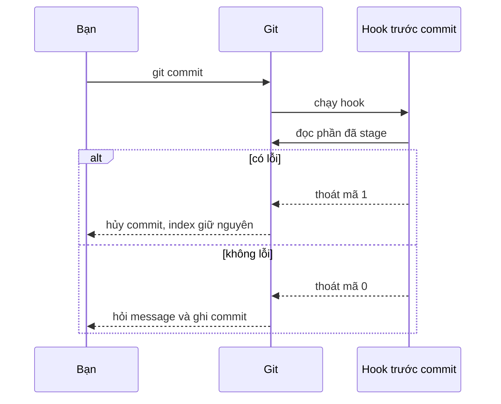
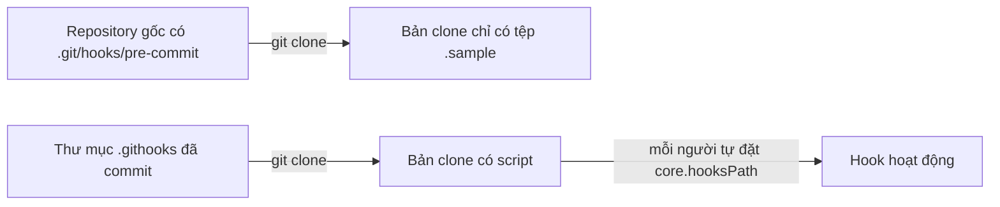

## Bạn sẽ học được gì

- Hiểu vai trò của hook chạy ngay trước khi Git ghi commit mới.
- Viết một hook kiểm tra phần đã stage và chặn commit khi có vấn đề.
- Biết vì sao hook local không đi theo khi clone và cách chia sẻ hook trong nhóm.
- Phân biệt hook Git gốc với các framework quản lý hook.

## Khái niệm

Trong các hook của Git, hook chạy trước khi tạo commit là hook được dùng nhiều nhất trong công việc hằng ngày. Nó là chốt chặn sớm nhất: lỗi bị bắt ở đây không bao giờ vào lịch sử, không lên CI, không tới tay reviewer.

Git gọi hook này khi bạn chạy `git commit`, trước khi hỏi message. Hook nhận bối cảnh là repository hiện tại; nó có thể đọc index để biết những gì sắp được commit. Nếu hook thoát với mã 0, commit tiếp tục. Mã khác 0, commit bị hủy và mọi thứ vẫn nằm nguyên trong index để bạn sửa.

Những việc phù hợp cho hook này:

- Kiểm tra lỗi khoảng trắng thừa, dấu xung đột còn sót (`git diff --cached --check` làm sẵn việc đó).
- Chạy linter hoặc formatter trên các tệp đã stage.
- Quét chuỗi trông giống mật khẩu, khóa API trong phần thêm mới.
- Chặn commit tệp quá lớn hoặc tệp không nên có trong repository.

Một nguyên tắc quan trọng: kiểm tra phần đã stage, không phải working tree. Bạn có thể đang có thay đổi dở dang không định commit; hook không nên chặn vì chúng, và cũng không được bỏ sót lỗi trong những gì thật sự đi vào commit.

Về chia sẻ: thư mục `.git/hooks` không phải là một phần của lịch sử, nên khi đồng nghiệp clone repository, họ chỉ nhận các tệp mẫu `.sample` mặc định. Đây là thiết kế có chủ đích về bảo mật: clone một repository không được tự chạy mã của người khác trên máy bạn. Để dùng chung, nhóm thường:

- Commit script vào một thư mục như `.githooks` và mỗi người tự chạy `git config core.hooksPath .githooks` (ghi trong README).
- Dùng framework quản lý hook. Trong hệ Python có công cụ tên pre-commit, đọc cấu hình từ một tệp YAML trong repository và cài hook khi bạn chạy lệnh cài đặt. Trong hệ Node có Husky (bài sau). Dù dùng công cụ nào, mỗi người vẫn phải chủ động chạy bước cài đặt một lần.

Trong ứng dụng luyện tập này, bài này được đánh dấu mô phỏng: app không cài framework hook nào cho bạn, và câu hỏi là câu hỏi kiến thức. Các ví dụ dưới đây dùng hook Git gốc, chạy được trong repository bài tập.

## Hình dung bằng sơ đồ





## Lệnh cần biết

```bash
# Kiểm tra lỗi khoảng trắng và dấu xung đột trong phần đã stage
git diff --cached --check

# Xem các dòng thêm mới trong phần đã stage, không kèm ngữ cảnh
git diff --cached -U0

# Bật hook: tạo tệp đúng tên và cấp quyền chạy
chmod +x .git/hooks/pre-commit

# Dùng thư mục hook chung đã commit
git config core.hooksPath .githooks

# Bỏ qua hook một lần (cân nhắc kỹ)
git commit --no-verify -m "..."
```

Một hook mẫu, lưu ở `.git/hooks/pre-commit`:

```bash
#!/bin/sh
# Chặn commit nếu phần đã stage có lỗi khoảng trắng hoặc chuỗi giống khóa bí mật
git diff --cached --check || exit 1
if git diff --cached -U0 | grep -E '^\+.*(API_KEY|SECRET)=' >/dev/null; then
  echo "pre-commit: phát hiện chuỗi giống khóa bí mật trong phần đã stage" >&2
  exit 1
fi
```

## Ví dụ từng bước

Với hook mẫu ở trên, mình stage một tệp cấu hình có khoảng trắng thừa cuối dòng:

```bash
git add env.txt
git commit -m "test: thêm cấu hình"
```

```text
env.txt:1: trailing whitespace.
+BASE_URL=https://uat.example.invalid 
```

Commit bị hủy. Sửa khoảng trắng nhưng lỡ thêm một dòng khóa:

```text
pre-commit: phát hiện chuỗi giống khóa bí mật trong phần đã stage
```

Bỏ dòng khóa, stage lại, commit thành công:

```text
[main 7ee0647] test: thêm cấu hình
 1 file changed, 1 insertion(+)
 create mode 100644 env.txt
```

Giờ clone repository này sang thư mục khác và xem thư mục hook:

```bash
git clone -q r r2
ls r2/.git/hooks
```

```text
applypatch-msg.sample
commit-msg.sample
fsmonitor-watchman.sample
post-update.sample
pre-applypatch.sample
pre-commit.sample
pre-merge-commit.sample
pre-push.sample
pre-rebase.sample
pre-receive.sample
prepare-commit-msg.sample
push-to-checkout.sample
sendemail-validate.sample
update.sample
```

Không có hook mình vừa viết, chỉ có mẫu mặc định. Mẫu `pre-commit.sample` thật ra cũng dùng cơ chế kiểm tra khoảng trắng tương tự (`git diff-index --check --cached`).

> **Cẩn thận** Quét chuỗi bằng regex chỉ là lưới thô. Nó không thay được công cụ quét bí mật chuyên dụng ở CI, và càng không thay được việc đừng bao giờ đặt khóa thật vào mã.

## Lỗi thường gặp

**Hook kiểm tra working tree.** Dùng `git diff` thay vì `git diff --cached` khiến hook chặn nhầm vì thay đổi chưa định commit, hoặc bỏ sót lỗi đã stage.

**Hook chậm.** Chạy toàn bộ test trong hook này khiến mọi người quen tay `--no-verify`. Chỉ chạy kiểm tra nhanh trên tệp đã stage.

**Quên quyền thực thi.** Git bỏ qua hook và chỉ in gợi ý. Kiểm tra bằng `ls -l .git/hooks/pre-commit`.

**Tưởng clone mang theo hook.** Không. Ghi hướng dẫn cài hook trong README cho người mới.

> **Lưu ý** Hook cục bộ là công cụ hỗ trợ, ai cũng bỏ qua được. Quy tắc bắt buộc phải được kiểm tra lại ở CI hoặc phía server.

## Áp dụng trong công việc

Repository test API của nhóm bạn chứa nhiều tệp cấu hình môi trường UAT. Một lần, ai đó suýt commit tệp có mật khẩu tài khoản test. Nhóm thêm hook trước commit quét các dòng mới trong phần đã stage, kết hợp kiểm tra khoảng trắng. Script nằm trong `.githooks`, README hướng dẫn đặt `core.hooksPath`. CI vẫn chạy công cụ quét bí mật riêng cho mọi pull request.

## Chuẩn bị làm bài

Đây là bài trả lời câu hỏi và được đánh dấu mô phỏng trong app: không có nhiệm vụ trạng thái Git, không cài framework hook. Câu hỏi hỏi tên hook chạy trước khi Git ghi commit mới. Hãy ôn thứ tự hook khi commit (bài hook ở track nâng cao có sơ đồ đầy đủ).

Nếu muốn thử, tạo hook mẫu ở trên trong repository bài tập, stage một dòng có khoảng trắng thừa và quan sát commit bị chặn.

## Tóm tắt

- Hook trước commit là chốt chặn sớm nhất, chạy trước khi Git hỏi message.
- Mã thoát khác 0 hủy commit, index giữ nguyên.
- Kiểm tra phần đã stage, không phải working tree.
- `.git/hooks` không đi theo clone; chia sẻ qua `core.hooksPath` hoặc framework.
- Hook cục bộ bỏ qua được, nên CI vẫn phải kiểm tra lại.
