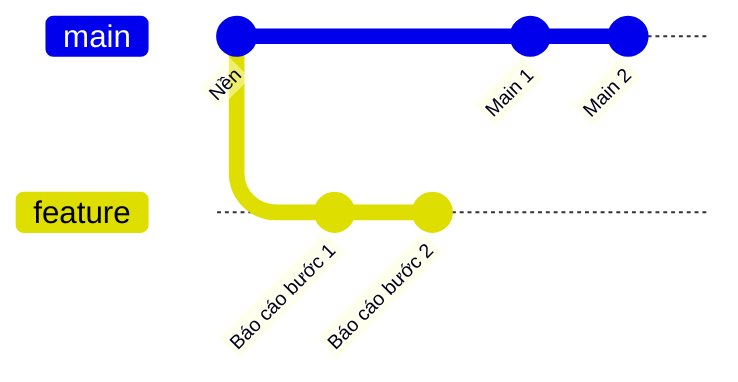
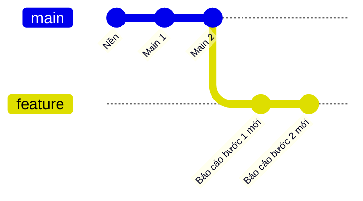

## Bạn sẽ học được gì

- Hiểu vì sao nhánh tính năng cần được cập nhật theo main định kỳ.
- Rebase nhánh lên main mới và xử lý xung đột từng commit.
- So sánh rebase với merge main vào nhánh khi cập nhật.
- Đẩy nhánh đã rebase lên remote một cách an toàn.

## Khái niệm

Dù cố giữ nhánh ngắn, đôi khi một nhánh vẫn phải sống vài ngày hoặc vài tuần. Trong thời gian đó, main tiếp tục nhận thay đổi. Nhánh càng lệch, xung đột khi gộp càng lớn, và bạn càng khó biết mã của mình còn chạy đúng với main mới hay không. Cách phòng là cập nhật nhánh theo main thường xuyên, mỗi lần một ít.

Có hai cách cập nhật:

- **Merge main vào nhánh**: tạo merge commit trên nhánh. An toàn, không viết lại lịch sử, nhưng nhánh có thêm nhiều merge commit khiến lịch sử khó đọc.
- **Rebase nhánh lên main**: Git tạm cất các commit riêng của nhánh, đưa nhánh tới đầu main mới, rồi áp lại từng commit riêng lên trên. Kết quả là lịch sử thẳng, như thể bạn vừa bắt đầu nhánh từ main mới nhất.

Rebase viết lại commit: mỗi commit được áp lại thành commit mới có object ID mới. Với nhánh chỉ mình bạn dùng, điều này không vấn đề gì. Với nhánh đã push và người khác cũng dựa vào, rebase buộc bạn force push và người khác phải đồng bộ lại. Quy ước phổ biến: rebase thoải mái trên nhánh cá nhân; nhánh chung thì thống nhất trước hoặc dùng merge.

Khi rebase gặp xung đột, Git dừng ở commit gây xung đột (không phải ở cuối như merge). Bạn sửa tệp cho commit đó, `git add`, rồi `git rebase --continue`. Nếu nhánh có nhiều commit cùng chạm một vùng mã mà main cũng sửa, bạn có thể phải giải quyết nhiều lần. Đó là cái giá của lịch sử thẳng, và là lý do nên rebase sớm, thường xuyên, khi xung đột còn nhỏ.

Sau khi rebase một nhánh đã push, remote vẫn giữ các commit cũ. `git push` thường sẽ bị từ chối vì không phải fast-forward. Dùng `git push --force-with-lease`: nó chỉ ghi đè nếu nhánh trên remote vẫn đúng là thứ bạn đã thấy lần fetch cuối, tránh xóa nhầm commit người khác vừa push.

## Hình dung bằng sơ đồ

Trước khi rebase:



Sau khi rebase, hai commit báo cáo là bản mới nằm trên Main 2:



## Lệnh cần biết

```bash
# Cập nhật main trước (nếu làm với remote)
git switch main
git pull

# Quay lại nhánh và rebase lên main
git switch feature/bao-cao
git rebase main

# Khi dừng vì xung đột
git status
git add <tệp đã sửa>
git rebase --continue
# hoặc bỏ qua commit đang áp, hoặc hủy toàn bộ
git rebase --skip
git rebase --abort

# Kiểm tra main đã là tổ tiên của nhánh
git merge-base --is-ancestor main feature/bao-cao && echo "main là tổ tiên"

# Đẩy nhánh đã rebase lên remote an toàn
git push --force-with-lease
```

| Cách cập nhật | Lịch sử | Viết lại commit | Hợp với |
| --- | --- | --- | --- |
| `git merge main` | Có merge commit | Không | Nhánh chung |
| `git rebase main` | Thẳng | Có | Nhánh cá nhân |

## Ví dụ từng bước

Nhánh `feature/bao-cao` có hai commit; main có thêm hai commit, trong đó "Main 2" sửa cùng dòng với "Báo cáo bước 2" (object ID trên máy bạn sẽ khác):

```bash
git log --oneline --graph --all
```

```text
* af8ade9 Báo cáo bước 2
* 7a9214c Báo cáo bước 1
| * a851c86 Main 2
| * 229e756 Main 1
|/  
* f65e664 Nền
* abe34ca Khởi tạo
```

Rebase lên main:

```bash
git rebase main
```

```text
Rebasing (1/2)Rebasing (2/2)Auto-merging app.txt
CONFLICT (content): Merge conflict in app.txt
error: could not apply af8ade9... Báo cáo bước 2
hint: Resolve all conflicts manually, mark them as resolved with
hint: "git add/rm <conflicted_files>", then run "git rebase --continue".
```

Commit đầu áp êm, commit thứ hai xung đột. Xem vùng xung đột:

```bash
git diff
```

```text
diff --cc app.txt
index 024e98e,bcad896..0000000
--- a/app.txt
+++ b/app.txt
@@@ -1,3 -1,3 +1,7 @@@
  a
++<<<<<<< HEAD
 +b-main
++=======
+ b-feature
++>>>>>>> af8ade9 (Báo cáo bước 2)
  c
```

Trong rebase, phía HEAD là main mới (cộng các commit đã áp), phía dưới là commit của bạn đang được áp. Mình kết hợp hai ý thành `b-main-feature`, stage và tiếp tục:

```bash
git add app.txt
git rebase --continue
git log --oneline --graph --all
```

```text
[detached HEAD bae4ef2] Báo cáo bước 2
 1 file changed, 1 insertion(+), 1 deletion(-)
Successfully rebased and updated refs/heads/feature/bao-cao.
* bae4ef2 Báo cáo bước 2
* 2f52977 Báo cáo bước 1
* a851c86 Main 2
* 229e756 Main 1
* f65e664 Nền
* abe34ca Khởi tạo
```

Lịch sử thẳng, hai commit báo cáo có ID mới. Xác nhận:

```bash
git merge-base --is-ancestor main feature/bao-cao && echo "main là tổ tiên"
git rev-list --count main..feature/bao-cao
```

```text
main là tổ tiên
2
```

> **Lưu ý** Trong xung đột khi rebase, "ours" và "theirs" đảo nghĩa so với merge: HEAD là nền mới, còn commit của bạn là phía được áp vào. Đọc kỹ nhãn dưới dấu `>>>>>>>` để biết đâu là thay đổi của mình.

## Lỗi thường gặp

**Rebase nhánh chung rồi `git push --force`.** Đồng nghiệp mất commit hoặc gặp lịch sử lệch. Dùng `--force-with-lease`, và thống nhất trước với người dùng chung nhánh.

**Rebase lên main local cũ.** Quên cập nhật main nên rebase xong vẫn lệch remote. Fetch hoặc pull main trước, hoặc rebase thẳng lên `origin/main`.

**Giải quyết xung đột xong quên `git add`.** `git rebase --continue` từ chối vì còn tệp chưa giải quyết. `git status` liệt kê chúng.

**Để nhánh lệch quá lâu rồi mới rebase.** Xung đột lặp lại ở nhiều commit. Rebase thường xuyên; với xung đột lặp lại, có thể bật `rerere` để Git nhớ cách bạn đã giải quyết.

> **Mẹo** Lỡ tay giải quyết sai? Khi rebase còn dở, `git rebase --abort` đưa mọi thứ về như trước. Khi đã xong, commit đầu nhánh cũ vẫn nằm trong reflog của nhánh (`git reflog feature/bao-cao`).

## Áp dụng trong công việc

Bạn có nhánh `test/statement-export` viết bộ test xuất sao kê PDF, kéo dài một tuần vì chờ API. Mỗi sáng, bạn rebase nhánh lên `origin/main` để chắc page object dùng chung không bị lệch so với thay đổi giao diện mới nhất. Xung đột mỗi lần chỉ vài dòng locator. Đến lúc mở PR, nhánh đã thẳng và sạch, reviewer chỉ thấy đúng phần test mới.

## Chuẩn bị làm bài

Bài thực hành có nhánh topic với một commit riêng, main có commit mới, và bạn đang ở topic. Bạn cần đưa commit của topic lên trên main mới sao cho main là tổ tiên của topic, topic vẫn có đúng một commit riêng, working tree sạch. Câu hỏi kiến thức hỏi lệnh đưa nhánh hiện tại lên main mới.

Hãy chuẩn bị:

- Xem `git log --oneline --graph --all` để hình dung hai nhánh.
- Xác nhận bạn đang đứng đúng nhánh.
- Biết sẵn ba lối ra nếu gặp xung đột.
- Kiểm tra kết quả bằng `git merge-base --is-ancestor` và `git rev-list --count main..topic`.

## Tóm tắt

- Cập nhật nhánh sống lâu theo main thường xuyên để xung đột nhỏ.
- Rebase áp lại commit riêng lên main mới, cho lịch sử thẳng nhưng viết lại commit.
- Merge main vào nhánh an toàn hơn cho nhánh chung.
- Xung đột khi rebase giải quyết theo từng commit với `--continue`.
- Đẩy nhánh đã rebase bằng `--force-with-lease`.
