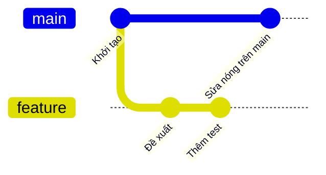
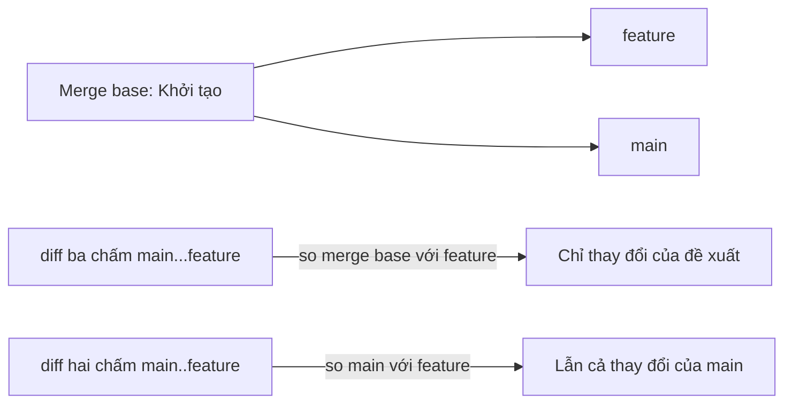

## Bạn sẽ học được gì

- Tải nhánh đề xuất về máy bằng `git fetch` mà không đụng tới nhánh của bạn.
- Phân biệt diff hai chấm và diff ba chấm khi so nhánh đề xuất với main.
- Tạo nhánh review local để chạy thử và kiểm thử.
- Liệt kê đúng những commit mà đề xuất mang vào.

## Khái niệm

Giao diện web của dịch vụ hosting cho bạn xem diff của một pull request, nhưng với QA, đọc thôi thường chưa đủ. Bạn muốn chạy ứng dụng, chạy bộ test, thử vài trường hợp biên trên chính mã của đề xuất. Việc đó cần mã nằm trên máy bạn.

Quy trình gồm ba ý:

**Tải về mà chưa gộp.** `git fetch origin` hỏi remote có gì mới và cập nhật các remote-tracking ref như `origin/main`, `origin/feature`. Nó không đổi nhánh local nào của bạn, không đổi working tree. Bạn xem xét xong rồi mới quyết định có làm gì tiếp.

**So sánh đúng cách.** Đây là chỗ dễ nhầm nhất. Khi main và nhánh đề xuất đã phân kỳ (main có commit mới sau khi đề xuất tách ra), có hai kiểu diff:

- `git diff main..feature` (hoặc `git diff main feature`): so trực tiếp snapshot của main với snapshot của feature. Kết quả lẫn cả những thay đổi mà main có nhưng feature chưa có, hiện ra như thể feature đã xóa chúng.
- `git diff main...feature` (ba chấm): so feature với merge base, tức tổ tiên chung gần nhất của hai nhánh. Kết quả chỉ gồm những gì feature thật sự thay đổi. Đây chính là cách giao diện pull request thường hiển thị.

Với `git log`, ý nghĩa của hai chấm và ba chấm khác với `git diff`: `git log main..feature` liệt kê commit có ở feature mà không có ở main, tức là danh sách commit của đề xuất. Đừng lẫn hai cú pháp giữa hai lệnh.

**Chạy thử trên nhánh riêng.** Tạo nhánh local, ví dụ `review/pr`, từ `origin/feature` để chạy test, ghi chú, thậm chí thử sửa mà không ảnh hưởng main. Xong thì xóa nhánh review.

## Hình dung bằng sơ đồ





## Lệnh cần biết

```bash
# Tải mọi cập nhật từ origin, không gộp gì
git fetch origin

# Hoặc chỉ tải một nhánh
git fetch origin feature

# Danh sách commit của đề xuất
git log --oneline main..origin/feature

# Diff chỉ gồm thay đổi của đề xuất (so với merge base)
git diff main...origin/feature

# Tóm tắt tệp thay đổi
git diff --stat main...origin/feature

# Tìm merge base
git merge-base main origin/feature

# Tạo nhánh review để chạy thử
git switch -c review/pr origin/feature

# Commit riêng mỗi bên, đánh dấu bằng dấu nhỏ hơn và lớn hơn
git log --oneline --left-right main...review/pr
```

| Cú pháp | Với `git diff` | Với `git log` |
| --- | --- | --- |
| `A..B` | So snapshot A với B | Commit có ở B, không ở A |
| `A...B` | So merge base với B | Commit có ở đúng một bên |

## Ví dụ từng bước

Trên remote, nhánh feature có hai commit; main có thêm một commit sửa nóng sau khi feature tách ra. Fetch và xem (object ID trên máy bạn sẽ khác):

```bash
git fetch origin
git log --oneline main..origin/feature
```

```text
7872afb Thêm test cho đề xuất
86ae035 Đề xuất
```

So sánh hai kiểu diff:

```bash
git diff --stat main..origin/feature
```

```text
 feature.test | 1 +
 feature.txt  | 1 +
 main.txt     | 1 -
 3 files changed, 2 insertions(+), 1 deletion(-)
```

```bash
git diff --stat main...origin/feature
```

```text
 feature.test | 1 +
 feature.txt  | 1 +
 2 files changed, 2 insertions(+)
```

Kiểu hai chấm báo `main.txt` bị xóa, dù đề xuất chưa hề đụng tới tệp đó; chỉ là main có tệp này còn feature thì chưa. Kiểu ba chấm cho đúng phần đề xuất thay đổi.

Tạo nhánh review và xem hai bên:

```bash
git switch -c review/pr origin/feature
git log --oneline --left-right main...review/pr
```

```text
Switched to a new branch 'review/pr'
branch 'review/pr' set up to track 'origin/feature'.
< c72711c Sửa nóng trên main
> 7872afb Thêm test cho đề xuất
> 86ae035 Đề xuất
```

Dấu nhỏ hơn là commit chỉ có ở main, dấu lớn hơn là commit chỉ có ở nhánh review. Giờ bạn có thể chạy bộ test ngay trên nhánh này.

> **Mẹo** Nếu thay đổi của main có thể ảnh hưởng tới đề xuất, hãy thử thêm `git merge --no-commit --no-ff main` trên nhánh review để xem kết hợp có xung đột không, rồi `git merge --abort`.

## Lỗi thường gặp

**Dùng diff hai chấm và tưởng đề xuất xóa mã.** Đọc nhầm khiến bạn góp ý sai. Dùng ba chấm khi review.

**Review `origin/feature` cũ.** Quên fetch lại sau khi tác giả push sửa đổi. Chạy `git fetch` trước mỗi vòng review.

**Sửa trực tiếp trên main để thử.** Nhánh main local bị lẫn mã chưa duyệt. Luôn dùng nhánh review riêng.

**Checkout `origin/feature` trực tiếp.** Bạn vào detached HEAD; commit thử ở đó dễ thất lạc. Tạo nhánh bằng `git switch -c`.

> **Lưu ý** Trong ứng dụng luyện tập, pull request không tồn tại; nhánh feature trên origin local đóng vai đề xuất. Trên dịch vụ thật, cách tải PR có thể khác (mỗi dịch vụ có ref đặc biệt hoặc công cụ dòng lệnh riêng), nhưng nguyên tắc fetch rồi so ba chấm vẫn giữ.

## Áp dụng trong công việc

Một developer mở PR sửa logic tính phí chuyển khoản liên ngân hàng. Bạn fetch nhánh đó, tạo `review/fee-fix`, chạy bộ test phí với dữ liệu biên (số tiền bằng đúng ngưỡng, số tiền 0, số âm). Diff ba chấm cho thấy PR cũng đổi một hằng số làm tròn mà mô tả PR không nhắc tới. Bạn ghi nhận xét cụ thể kèm tên test đỏ.

## Chuẩn bị làm bài

Bài thực hành có origin local, và trên origin đã có commit mới mà main local chưa có. Bạn cần tải commit đó về sao cho `origin/main` được cập nhật nhưng main local vẫn ở commit cũ. Câu hỏi kiến thức hỏi lệnh xem diff giữa main và nhánh feature.

Hãy chuẩn bị:

- Phân biệt lệnh chỉ tải với lệnh vừa tải vừa gộp.
- Sau khi tải, kiểm tra bằng `git status -sb` (sẽ thấy main đứng sau) và `git log --oneline main..origin/main`.
- Ôn bảng hai chấm, ba chấm ở trên cho câu hỏi.

## Tóm tắt

- `git fetch` cập nhật remote-tracking ref, không đổi nhánh của bạn.
- `git diff A...B` so B với merge base: đúng phần đề xuất thay đổi.
- `git diff A..B` so trực tiếp hai snapshot, dễ gây hiểu nhầm khi đã phân kỳ.
- `git log A..B` liệt kê commit của đề xuất.
- Chạy thử trên nhánh review riêng, xóa khi xong.
