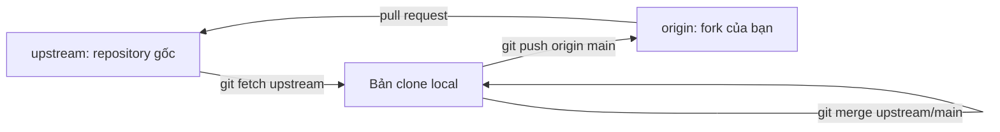
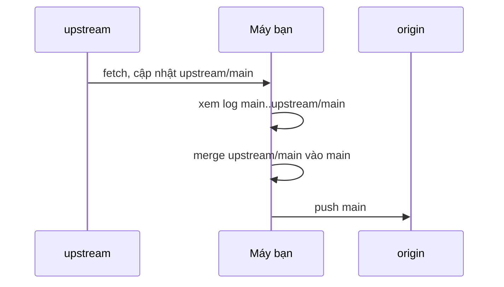

## Bạn sẽ học được gì

- Hiểu mô hình fork: hai remote `origin` (bản của bạn) và `upstream` (bản gốc).
- Tải thay đổi từ upstream mà chưa gộp, rồi xem trước.
- Tích hợp upstream vào nhánh local và đẩy lên fork của bạn.
- Tránh các lỗi thường gặp như push nhầm remote hay làm việc trực tiếp trên main của fork.

## Khái niệm

Khi đóng góp cho một dự án mà bạn không có quyền ghi, bạn tạo fork: một bản sao repository dưới tài khoản của bạn trên dịch vụ hosting. Bạn clone fork về máy, nên remote mặc định `origin` trỏ tới fork. Bạn push nhánh lên fork, rồi mở pull request vào repository gốc.

Vấn đề: repository gốc vẫn tiếp tục nhận thay đổi từ người khác, còn fork của bạn đứng yên tại thời điểm tạo. Để không làm việc trên mã cũ, bạn cần đồng bộ fork định kỳ. Cách làm chuẩn là thêm một remote thứ hai, thường đặt tên `upstream`, trỏ tới repository gốc.

Luồng dữ liệu khi đồng bộ:

1. `git fetch upstream`: tải commit mới của repository gốc về máy, cập nhật `upstream/main`. Không đổi nhánh nào của bạn.
2. Xem trước: `git log --oneline main..upstream/main` cho biết có gì mới.
3. Tích hợp vào main local: `git merge upstream/main` (thường là fast-forward nếu bạn không commit trực tiếp lên main) hoặc `git rebase upstream/main`.
4. `git push origin main`: đưa main đã đồng bộ lên fork.

Thói quen quan trọng nhất: đừng commit công việc của bạn trực tiếp lên main của fork. Giữ main giống hệt upstream, làm việc trên nhánh riêng. Khi đó bước 3 luôn là fast-forward, không bao giờ xung đột, và nhánh tính năng của bạn có thể rebase lên main mới bất cứ lúc nào.

Tách fetch khỏi merge cho bạn cơ hội xem trước. Lệnh `git pull upstream main` làm cả hai bước một lúc, tiện nhưng không cho bạn dừng lại kiểm tra.

Nhiều dịch vụ hosting có nút đồng bộ fork ngay trên web. Nó làm được bước 1 đến 4 cho nhánh mặc định trên server, nhưng bản clone trên máy bạn vẫn cần fetch lại. Trong ứng dụng luyện tập, mọi remote đều là bare repository local, nên không có giao diện web; bạn làm toàn bộ bằng dòng lệnh.

## Hình dung bằng sơ đồ





## Lệnh cần biết

```bash
# Thêm remote trỏ tới repository gốc (một lần)
git remote add upstream <url-gốc>

# Xem các remote
git remote -v

# Tải thay đổi từ upstream, chưa gộp
git fetch upstream

# Xem có gì mới
git log --oneline main..upstream/main

# Tích hợp vào main local
git switch main
git merge upstream/main

# Đẩy lên fork
git push origin main

# Đưa nhánh tính năng lên main mới
git switch feature/x
git rebase main
```

| Remote | Trỏ tới | Bạn làm gì với nó |
| --- | --- | --- |
| `origin` | Fork của bạn | Push nhánh, mở PR |
| `upstream` | Repository gốc | Chỉ fetch |

## Ví dụ từng bước

Repository local có hai remote đều là bare repository trong thư mục thử nghiệm:

```bash
git remote -v
```

```text
origin	../fork.git (fetch)
origin	../fork.git (push)
upstream	../up.git (fetch)
upstream	../up.git (push)
```

Upstream vừa có commit mới. Tải về và xem trước (object ID trên máy bạn sẽ khác):

```bash
git fetch upstream
git log --oneline main..upstream/main
```

```text
From ../up
   125497d..88c1a62  main       -> upstream/main
88c1a62 Cập nhật upstream
```

Gộp vào main local. Vì main không có commit riêng, đây là fast-forward:

```bash
git merge upstream/main
```

```text
Updating 125497d..88c1a62
Fast-forward
 upstream.txt | 1 +
 1 file changed, 1 insertion(+)
 create mode 100644 upstream.txt
```

Đẩy lên fork và xác nhận ba nơi trùng nhau:

```bash
git push origin main
git rev-parse main origin/main upstream/main
```

```text
To ../fork.git
   125497d..88c1a62  main -> main
88c1a628740607b5cf26f744ffd66493d4aa2447
88c1a628740607b5cf26f744ffd66493d4aa2447
88c1a628740607b5cf26f744ffd66493d4aa2447
```

Chỉ fetch mà chưa merge thì sao? Ở một repository khác, sau `git fetch origin`, trạng thái cho thấy main local đứng sau:

```bash
git status
```

```text
On branch main
Your branch is behind 'origin/main' by 1 commit, and can be fast-forwarded.
  (use "git pull" to update your local branch)

nothing to commit, working tree clean
```

Main vẫn ở commit cũ, working tree không đổi. Bạn quyết định khi nào gộp.

> **Mẹo** Một số người đặt push URL của upstream thành một giá trị cố tình không hợp lệ, ví dụ `git config remote.upstream.pushurl no-push`. Sau đó `git remote -v` hiện dòng `upstream	no-push (push)`, nghĩa là Git không có địa chỉ thật nào để đẩy lên upstream. Hãy chắc cả nhóm hiểu mẹo này trước khi dùng.

## Lỗi thường gặp

**Commit thẳng lên main của fork.** Mỗi lần đồng bộ thành merge thật, có thể xung đột, và PR sau này lẫn commit không liên quan. Đưa công việc sang nhánh riêng và đặt lại main theo upstream.

**Push nhầm lên upstream.** Nếu bạn có quyền ghi ở upstream, việc này có thể gây rắc rối thật. Kiểm tra `git remote -v` và luôn ghi rõ tên remote khi push.

**Quên fetch, merge `upstream/main` cũ.** Remote-tracking ref chỉ cập nhật khi fetch. Luôn fetch trước khi merge.

**Dùng `git pull` mà không ghi remote.** `git pull` kéo từ upstream của nhánh hiện tại, thường là origin, chứ không phải repository gốc. Ghi rõ `git fetch upstream`.

> **Lưu ý** Tên `upstream` chỉ là quy ước. Git không có ý nghĩa đặc biệt cho tên này; bạn có thể đặt khác, miễn cả nhóm hiểu như nhau.

## Áp dụng trong công việc

Nhóm QA của bạn fork một framework test mã nguồn mở để thêm vài tiện ích riêng cho dự án ngân hàng. Mỗi khi framework gốc phát hành bản vá bảo mật, bạn fetch upstream, xem log thay đổi, merge vào main của fork, chạy lại bộ test nội bộ, rồi push lên fork. Các tiện ích riêng nằm trên nhánh riêng được rebase lên main mới sau mỗi lần đồng bộ.

## Chuẩn bị làm bài

Bài thực hành có origin local, và origin đã nhận commit mới mà main local chưa có. Bạn cần tải commit đó về để `origin/main` được cập nhật nhưng main local vẫn ở commit cũ, tức là chỉ tải, chưa gộp. Câu hỏi kiến thức hỏi lệnh tải thay đổi từ upstream mà chưa merge.

Hãy chuẩn bị:

- Phân biệt `fetch` với `pull`.
- Để ý tên remote trong đề bài và trong câu hỏi có thể khác nhau; trả lời đúng tên remote mà câu hỏi nhắc tới.
- Sau khi tải, kiểm tra bằng `git status` (sẽ báo main đứng sau origin/main) và `git log --oneline main..origin/main`.

## Tóm tắt

- Fork có hai remote: `origin` là bản của bạn, `upstream` là bản gốc.
- `git fetch upstream` tải mà chưa gộp, cho bạn xem trước.
- Merge `upstream/main` vào main local rồi push lên origin.
- Giữ main của fork sạch, làm việc trên nhánh riêng.
- Luôn ghi rõ tên remote khi fetch và push.
