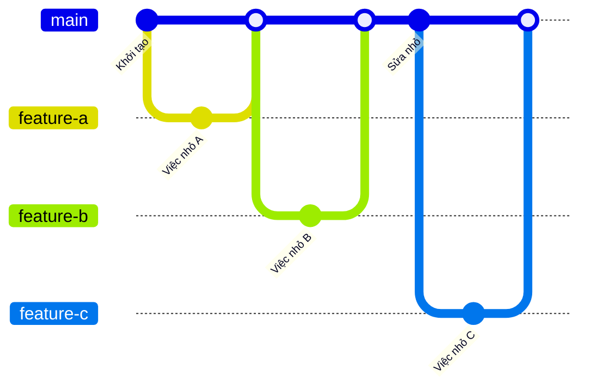
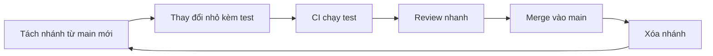

## Bạn sẽ học được gì

- Hiểu mô hình trunk-based: một nhánh trung tâm, nhánh phụ sống ngắn.
- Tạo nhánh ngắn từ trunk và đưa về sớm.
- Nhận ra chi phí của nhánh sống lâu: phân kỳ, xung đột, review khó.
- Biết các kỹ thuật đi kèm như feature flag và CI chạy liên tục.

## Khái niệm

Trong trunk-based development, cả nhóm tích hợp vào một nhánh trung tâm duy nhất, gọi là trunk. Trong Git hiện đại, trunk thường mang tên `main`. Mọi thay đổi đi vào trunk thường xuyên, lý tưởng là ít nhất mỗi ngày, qua các nhánh rất ngắn hoặc commit trực tiếp nếu nhóm nhỏ và có kiểm thử tự động tốt.

Ý tưởng cốt lõi: càng để nhánh tách xa trunk lâu, càng khó gộp lại. Mỗi ngày nhánh sống thêm, trunk lại nhận thêm thay đổi của người khác. Khi cuối cùng gộp, bạn phải giải quyết xung đột của cả tuần, review một diff khổng lồ, và lỗi tích hợp chỉ lộ ra muộn. Trunk-based đảo ngược điều đó: tích hợp nhỏ và sớm, xung đột nhỏ và dễ hiểu.

Một nhánh ngắn trong mô hình này thường:

- Tách từ trunk mới nhất.
- Mang một thay đổi nhỏ, hoàn chỉnh về mặt kiểm thử.
- Được review và merge trong vòng một hoặc hai ngày.
- Bị xóa ngay sau khi merge.

Nếu tính năng quá lớn để xong trong một hai ngày, nhóm không giữ nhánh lâu mà chia nhỏ tính năng, merge từng phần vào trunk và giấu phần chưa xong sau feature flag (bài 10 của track này).

Trunk-based cần hai điều kiện: kiểm thử tự động đủ tin cậy để mỗi lần merge không làm trunk đỏ, và văn hóa giữ trunk luôn ở trạng thái có thể phát hành. Với QA, điều này có nghĩa test phải chạy nhanh và ổn định, vì chúng là cửa kiểm soát chính.

So với mô hình nhiều nhánh dài hạn (như có `develop`, `release`, `hotfix` song song), trunk-based ít nghi thức hơn nhưng đòi hỏi kỷ luật cao hơn. Nhiều nhóm kết hợp: trunk-based cho phát triển hằng ngày, nhánh release ngắn hạn khi cần đóng băng một phiên bản.

## Hình dung bằng sơ đồ





## Lệnh cần biết

```bash
# Cập nhật trunk trước khi tách nhánh
git switch main
git pull

# Tạo và chuyển sang nhánh ngắn trong một lệnh
git switch -c feature/bai-hoc

# Xem nhánh hiện tại
git branch --show-current

# Đo độ lệch của nhánh so với trunk (số commit mỗi bên)
git rev-list --left-right --count main...feature/bai-hoc

# Sau khi merge, xóa nhánh local
git branch -d feature/bai-hoc
```

| Đặc điểm | Trunk-based | Nhánh sống lâu |
| --- | --- | --- |
| Thời gian sống nhánh | Giờ hoặc vài ngày | Tuần hoặc tháng |
| Kích thước merge | Nhỏ | Lớn |
| Xung đột | Ít, dễ hiểu | Nhiều, khó |
| Phần chưa xong | Giấu sau feature flag | Nằm trên nhánh |

## Ví dụ từng bước

Bắt đầu từ main, tạo một nhánh ngắn:

```bash
git switch -c feature/bai-hoc
git branch --show-current
```

```text
Switched to a new branch 'feature/bai-hoc'
feature/bai-hoc
```

Làm một thay đổi nhỏ, commit. Trong lúc đó, giả sử main nhận một commit từ đồng nghiệp. Lệnh đếm hai chiều cho biết mỗi bên có bao nhiêu commit riêng:

```bash
git rev-list --left-right --count main...feature/bai-hoc
```

```text
1	1
```

Số bên trái là commit chỉ có ở main, bên phải là commit chỉ có ở nhánh. Con số này còn nhỏ thì gộp rất dễ. Để nó lớn dần qua nhiều ngày là dấu hiệu nhánh đang sống quá lâu. Sau khi merge, xóa nhánh:

```bash
git switch main
git merge feature/bai-hoc
git branch -d feature/bai-hoc
```

> **Mẹo** Tên nhánh ngắn vẫn nên rõ mục đích, ví dụ `feature/otp-retry` hay `test/login-timeout`. Nhánh sống ngắn không có nghĩa là đặt tên tùy tiện.

## Lỗi thường gặp

**Tách nhánh từ main cũ.** Bạn bắt đầu đã lệch. Luôn cập nhật main trước khi `git switch -c`.

**Gom quá nhiều việc vào một nhánh.** Nhánh phình to, review chậm, merge muộn. Chia nhỏ thành nhiều nhánh nối tiếp, mỗi nhánh merge được độc lập.

**Merge khi CI còn đỏ.** Trunk-based dựa vào việc trunk luôn xanh. Một lần merge đỏ làm cả nhóm bị chặn. Sửa trên nhánh trước, merge sau.

**Quên xóa nhánh đã merge.** Danh sách nhánh đầy rác khiến khó biết việc nào đang dở. `git branch --merged main` giúp tìm nhánh có thể xóa.

> **Lưu ý** Trunk-based là quy ước của nhóm, không phải tính năng của Git. Git chỉ cung cấp nhánh và merge; kỷ luật tích hợp sớm là việc của con người.

## Áp dụng trong công việc

Nhóm phát triển app ngân hàng chuyển sang trunk-based. Thay vì một nhánh `test/regression-q4` sống cả quý, mỗi QA tạo nhánh ngắn cho từng nhóm test (ví dụ `test/transfer-limit`), merge trong ngày khi pipeline xanh. Các test cho tính năng chưa bật được đánh dấu bỏ qua theo cùng feature flag với mã ứng dụng. Kết quả là ít xung đột ở thư mục test chung và lỗi tích hợp lộ ra trong ngày thay vì cuối quý.

## Chuẩn bị làm bài

Bài thực hành bắt đầu ở nhánh trung tâm của repository. Bạn cần tạo một nhánh tính năng có tên cho trước và chuyển sang nó, sao cho HEAD trỏ tới nhánh mới. Câu hỏi kiến thức hỏi tên nhánh trung tâm trong bài tập.

Hãy chuẩn bị:

- Chạy `git branch` để thấy nhánh hiện có và nhánh bạn đang đứng.
- Ôn lệnh vừa tạo vừa chuyển nhánh.
- Gõ đúng tên nhánh, kể cả dấu gạch chéo.
- Kiểm tra lại bằng `git branch --show-current`.

## Tóm tắt

- Trunk-based: một nhánh trung tâm, nhánh phụ sống rất ngắn.
- Tích hợp sớm giữ xung đột nhỏ và review nhẹ.
- Tính năng lớn được chia nhỏ và giấu sau feature flag.
- Cần CI tin cậy để trunk luôn ở trạng thái phát hành được.
- Xóa nhánh ngay sau khi merge.
