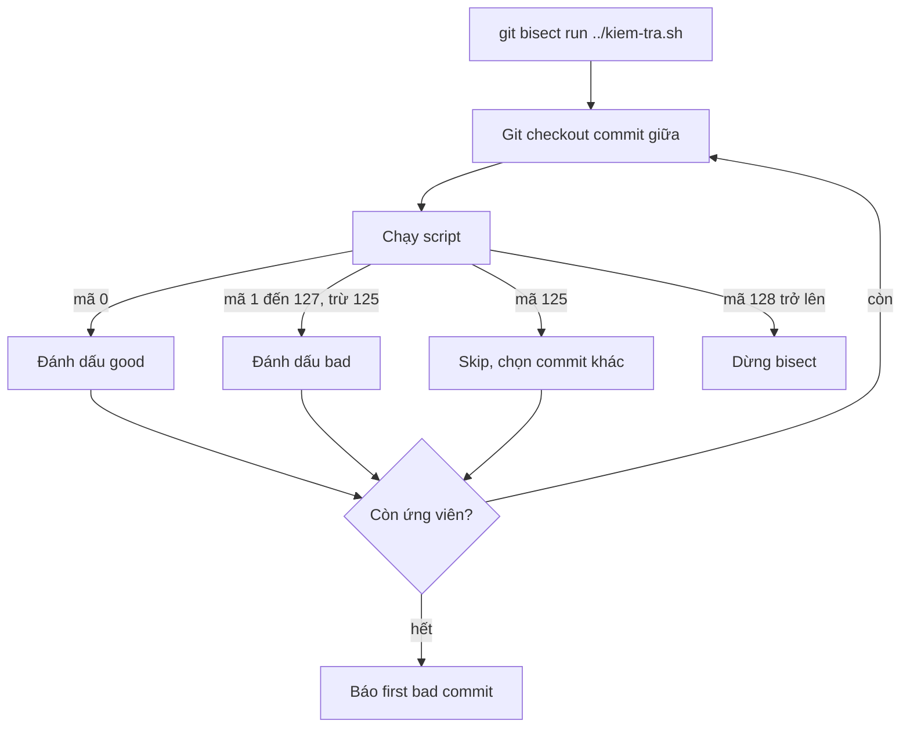

## Bạn sẽ học được gì

- Dùng `git bisect run` để Git tự kiểm tra từng commit bằng một script hay lệnh.
- Nắm quy ước mã thoát: 0 là good, 1 đến 127 (trừ 125) là bad, 125 là skip, từ 128 trở lên làm dừng bisect.
- Viết script kiểm tra nhỏ, ổn định, đặt ngoài working tree.
- Xử lý commit không kiểm tra được bằng mã 125.

## Khái niệm

Bisect thủ công đòi bạn ngồi chạy kiểm tra rồi gõ `good` hoặc `bad` ở mỗi bước. Nếu việc kiểm tra diễn đạt được thành một lệnh có mã thoát, hãy để Git làm hết: `git bisect run <lệnh> [tham số...]`.

Ở mỗi bước, Git checkout commit giữa, chạy lệnh, rồi đọc mã thoát:

| Mã thoát | Ý nghĩa với bisect |
| --- | --- |
| 0 | good: commit này chưa có lỗi |
| 1 đến 127, trừ 125 | bad: commit này có lỗi |
| 125 | skip: không kết luận được, bỏ qua |
| 128 trở lên, hoặc âm | Dừng bisect vì lệnh kiểm tra gặp sự cố |

Quy ước này khớp tự nhiên với hầu hết công cụ test: test pass thoát 0, fail thoát 1. Mã 125 dành cho trường hợp "commit này không build được, không chạy được test". Mã từ 128 trở lên thường nghĩa là tiến trình bị tín hiệu giết, nên Git chọn dừng hẳn thay vì đoán.

Viết script kiểm tra tốt:

- **Đặt ngoài working tree** hoặc ít nhất ngoài phần được Git theo dõi. Nếu script nằm trong repository, khi bisect checkout commit cũ, script có thể biến mất hoặc là bản cũ.
- **Chỉ kiểm tra đúng một điều**: chính lỗi bạn đang tìm. Script kiểm tra quá nhiều sẽ "bad" vì lý do khác.
- **Ổn định**: không phụ thuộc mạng, giờ hệ thống, hay dữ liệu thay đổi.
- **Trả 125 khi không kiểm tra được**, đừng trả 1, kẻo bisect đổ lỗi nhầm.

Với lỗi đơn giản, bạn thậm chí không cần tệp script: `git bisect run grep -q 3300 bieu-phi.txt` hay `git bisect run sh -c '...'` cũng được.

## Hình dung bằng sơ đồ



## Lệnh cần biết

```bash
# Khai báo hai mốc rồi để Git tự chạy
git bisect start HEAD <commit-tốt>
git bisect run ../kiem-tra.sh

# Không cần tệp script
git bisect run grep -q 3300 bieu-phi.txt
git bisect run sh -c '[ "$(./tinh-phi.sh | tr -d " ")" = 3300 ]'

# Kết thúc
git bisect reset
```

## Ví dụ từng bước

Cùng repository dịch vụ tính phí như bài trước: HEAD in `330` thay vì `3300`. Script kiểm tra đặt ở thư mục cha, ngoài repository:

```bash
cat ../kiem-tra.sh
```

```text
#!/bin/sh
[ "$(./tinh-phi.sh | tr -d " ")" = "3300" ]
```

Lệnh `[` thoát 0 nếu đúng, 1 nếu sai, đúng quy ước bisect. Chạy (ID trên máy bạn sẽ khác):

```bash
git bisect start HEAD dd02f86
git bisect run ../kiem-tra.sh
```

```text
Bisecting: 3 revisions left to test after this (roughly 2 steps)
[ab0765bdad0d5f91a91319a329bd2ae49fc5a427] Làm gọn biểu phí
running '../kiem-tra.sh'
Bisecting: 1 revision left to test after this (roughly 1 step)
[a29f00a690a12574bbd4d69c8a87682d8a4f6ab6] Thêm cấu hình môi trường
running '../kiem-tra.sh'
Bisecting: 0 revisions left to test after this (roughly 0 steps)
[f044cf7cba38612a1f6c9b2fdc2c0b1e58e320cf] Cập nhật README
running '../kiem-tra.sh'
ab0765bdad0d5f91a91319a329bd2ae49fc5a427 is the first bad commit
commit ab0765bdad0d5f91a91319a329bd2ae49fc5a427
Author: Chi <chi@example.invalid>
...
    Làm gọn biểu phí
...
bisect found first bad commit
```

Cùng kết quả với bài thủ công, nhưng bạn không phải gõ gì giữa chừng.

Giờ thử mã 125. Script dưới đây giả lập tình huống commit "Thêm cấu hình môi trường" không build được:

```bash
cat ../kiem-tra4.sh
git bisect start HEAD dd02f86
git bisect run ../kiem-tra4.sh
```

```text
#!/bin/sh
# Giả lập: commit này không build được, không kết luận được
[ "$(git log -1 --format=%s)" = "Thêm cấu hình môi trường" ] && exit 125
[ "$(./tinh-phi.sh | tr -d ' ')" = "3300" ]
...
[a29f00a690a12574bbd4d69c8a87682d8a4f6ab6] Thêm cấu hình môi trường
running '../kiem-tra4.sh'
Bisecting: 1 revision left to test after this (roughly 1 step)
[009abe12cddf71462a13e4d1d6f7aa99b4a35390] Thêm script tính phí
running '../kiem-tra4.sh'
Bisecting: 1 revision left to test after this (roughly 1 step)
[f044cf7cba38612a1f6c9b2fdc2c0b1e58e320cf] Cập nhật README
running '../kiem-tra4.sh'
ab0765bdad0d5f91a91319a329bd2ae49fc5a427 is the first bad commit
...
```

Git bỏ qua commit trả 125, thử commit lân cận và vẫn tìm ra đúng commit, chỉ tốn thêm một bước.

Cuối cùng, xem điều gì xảy ra khi script trả mã ngoài phạm vi, ví dụ `exit 200`:

```bash
git bisect run ../kiem-tra3.sh
```

```text
running '../kiem-tra3.sh'
error: bisect run failed: exit code 200 from '../kiem-tra3.sh' is < 0 or >= 128
```

Bisect dừng, không đoán bừa. Nhớ chạy `git bisect reset` sau mỗi phiên.

> **Mẹo** Thử script trên hai mốc trước khi bisect: chạy trên HEAD phải thoát khác 0, trên commit tốt phải thoát 0. Kiểm tra bằng `../kiem-tra.sh; echo $?`. Hai giây này tránh được cả phiên bisect sai.

## Lỗi thường gặp

**Script nằm trong repository.** Khi checkout commit cũ, script biến mất hoặc khác, mọi bước đều "bad". Đặt ở ngoài.

**Trả 1 khi không build được.** Bisect hiểu là "có lỗi" và có thể chỉ nhầm vào commit làm hỏng build. Dùng 125.

**Script phụ thuộc thứ thay đổi theo thời gian.** Mạng, giờ, dữ liệu ngoài làm kết quả lúc đúng lúc sai.

**Kiểm tra quá rộng.** Chạy toàn bộ bộ test có thể fail vì một lỗi khác cũ hơn. Chỉ kiểm tra triệu chứng cần tìm.

> **Lưu ý** Script chạy trong working tree đang được bisect checkout. Nếu script tạo tệp tạm hay build ra thư mục, hãy dọn ở cuối script, kẻo các tệp chưa được theo dõi làm lần checkout tiếp theo thất bại.

## Áp dụng trong công việc

Test tự động phát hiện API trả sai định dạng số tiền, nhưng giữa bản tốt gần nhất và HEAD có hơn 200 commit. Bạn viết script ngắn gọi đúng một test case đó, trả 125 nếu bước build lỗi, rồi để `git bisect run` chạy trong lúc đi họp. Quay lại đã có commit gây lỗi, kèm log của phiên để đính vào ticket.

## Chuẩn bị làm bài

Đây là bài trả lời câu hỏi. Repository bài tập có một tệp ứng dụng mà ở HEAD có thêm một dòng đánh dấu lỗi. Bạn cần tìm commit đầu tiên đưa dòng đó vào và trả lời bằng subject. Hãy thử biến việc kiểm tra thành một lệnh có mã thoát phù hợp (một lệnh tìm chuỗi trong tệp là đủ), chú ý chiều của mã thoát: commit tốt phải thoát 0. Rồi để `git bisect run` làm phần còn lại.

## Tóm tắt

- `git bisect run` để Git tự checkout và chạy kiểm tra ở mỗi bước.
- Mã 0 là good, 1 đến 127 trừ 125 là bad, 125 là skip, 128 trở lên dừng bisect.
- Đặt script ngoài working tree, chỉ kiểm tra đúng triệu chứng.
- Trả 125 khi commit không kiểm tra được.
- Thử script trên hai mốc trước khi chạy cả phiên.
