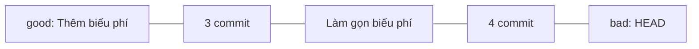
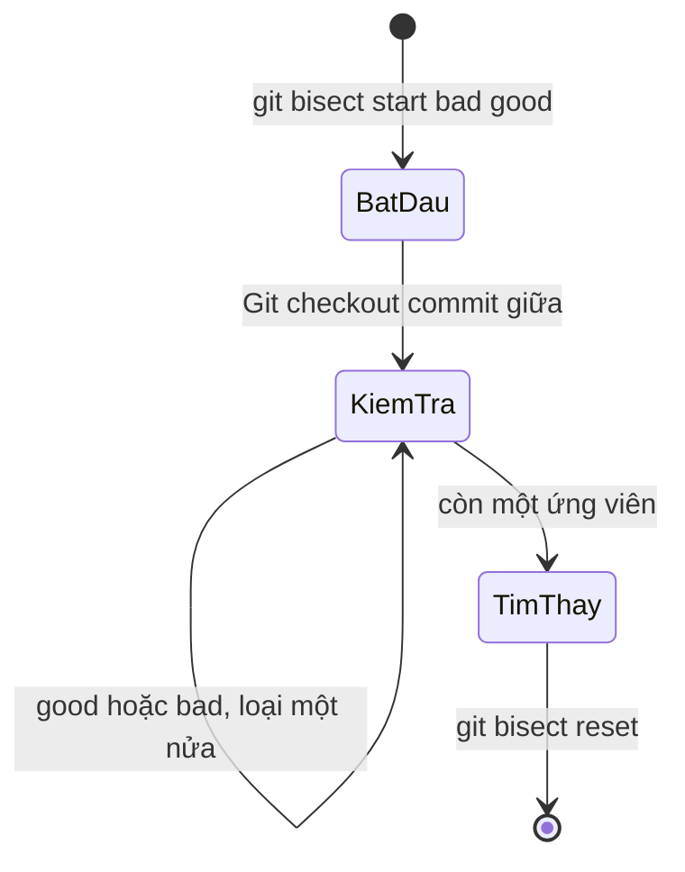

## Bạn sẽ học được gì

- Hiểu ý tưởng tìm kiếm nhị phân trên lịch sử commit của `git bisect`.
- Chạy một phiên bisect thủ công: chọn mốc tốt, mốc xấu, kiểm tra và đánh dấu từng bước.
- Đọc kết quả "first bad commit" và kết thúc phiên an toàn bằng `git bisect reset`.
- Xem lại và sửa phiên bisect khi lỡ đánh dấu sai.

## Khái niệm

Một lỗi xuất hiện ở bản hiện tại, nhưng tuần trước mọi thứ vẫn ổn. Ở giữa có hàng chục, có khi hàng trăm commit. Kiểm tra lần lượt từng cái thì quá lâu.

`git bisect` áp dụng tìm kiếm nhị phân. Bạn cho Git biết một commit **bad** (có lỗi, thường là HEAD) và một commit **good** (chưa có lỗi). Git checkout commit nằm khoảng giữa và hỏi: commit này tốt hay xấu? Mỗi câu trả lời loại đi khoảng một nửa số ứng viên. Với 100 commit, chỉ cần khoảng 7 bước; với 1000 commit, khoảng 10 bước.

Kết quả cuối cùng là **first bad commit**: commit xấu đầu tiên mà parent của nó còn tốt. Đó là nơi lỗi được đưa vào, và thường là nơi tốt nhất để đọc diff, hiểu nguyên nhân.

Bisect dựa trên một giả định: lỗi xuất hiện một lần và tồn tại từ đó về sau. Nếu lỗi lúc có lúc không (flaky), hoặc bị sửa rồi lại xuất hiện, kết quả có thể gây hiểu lầm.

Trong lúc bisect, repository ở trạng thái detached HEAD. Đừng commit lúc này. Khi xong, `git bisect reset` đưa bạn về nhánh ban đầu.

Một vài tiện ích:

- `git bisect start <bad> <good>`: khai báo luôn hai mốc khi bắt đầu.
- `git bisect skip`: bỏ qua commit không kiểm tra được (ví dụ không build được).
- `git bisect log` và `git bisect replay`: ghi lại phiên và chạy lại, dùng khi lỡ đánh dấu sai.
- `git bisect start ... -- <đường dẫn>`: chỉ xét commit chạm vào đường dẫn đó, rút ngắn đáng kể.
- `--term-old` và `--term-new`: đổi tên "good, bad" khi bạn đang tìm thứ không phải lỗi, ví dụ commit làm một tính năng chạy nhanh hơn.

## Hình dung bằng sơ đồ





## Lệnh cần biết

```bash
git bisect start
git bisect bad              # commit hiện tại có lỗi
git bisect good <commit>    # commit chưa có lỗi

# Hoặc gọn trong một lệnh
git bisect start HEAD <commit-tốt>

# Sau mỗi lần kiểm tra
git bisect good
git bisect bad
git bisect skip

# Xem lại, chạy lại, kết thúc
git bisect log > bisect.log
git bisect replay bisect.log
git bisect reset
```

## Ví dụ từng bước

Repository dịch vụ tính phí có 10 commit. Script `tinh-phi.sh` lẽ ra in `3300` nhưng ở HEAD in `330`. Commit "Thêm biểu phí" được biết là còn đúng (ID trên máy bạn sẽ khác):

```bash
git bisect start HEAD dd02f86
./tinh-phi.sh
```

```text
Bisecting: 3 revisions left to test after this (roughly 2 steps)
[ab0765bdad0d5f91a91319a329bd2ae49fc5a427] Làm gọn biểu phí
330
```

Sai, đánh dấu bad:

```bash
git bisect bad
./tinh-phi.sh
```

```text
Bisecting: 1 revision left to test after this (roughly 1 step)
[a29f00a690a12574bbd4d69c8a87682d8a4f6ab6] Thêm cấu hình môi trường
3300
```

Đúng, đánh dấu good. Git đưa ra ứng viên cuối:

```bash
git bisect good
./tinh-phi.sh
git bisect good
```

```text
Bisecting: 0 revisions left to test after this (roughly 0 steps)
[f044cf7cba38612a1f6c9b2fdc2c0b1e58e320cf] Cập nhật README
3300
ab0765bdad0d5f91a91319a329bd2ae49fc5a427 is the first bad commit
commit ab0765bdad0d5f91a91319a329bd2ae49fc5a427
Author: Chi <chi@example.invalid>
Date:   Sun Sep 6 09:00:00 2026 +0700

    Làm gọn biểu phí

 bieu-phi.txt | 2 +-
 1 file changed, 1 insertion(+), 1 deletion(-)
```

Chỉ ba lần kiểm tra cho tám commit ứng viên. Xem lại phiên rồi kết thúc:

```bash
git bisect log
git bisect reset
```

```text
# bad: [240ca079f2fc1cb27642043c773cd22f7ffe434e] Thêm liên hệ
# good: [dd02f8691bc01686cc10c5d4f39b2b1750e001bb] Thêm biểu phí
git bisect start 'HEAD' 'dd02f86'
# bad: [ab0765bdad0d5f91a91319a329bd2ae49fc5a427] Làm gọn biểu phí
git bisect bad ab0765bdad0d5f91a91319a329bd2ae49fc5a427
# good: [a29f00a690a12574bbd4d69c8a87682d8a4f6ab6] Thêm cấu hình môi trường
git bisect good a29f00a690a12574bbd4d69c8a87682d8a4f6ab6
# good: [f044cf7cba38612a1f6c9b2fdc2c0b1e58e320cf] Cập nhật README
git bisect good f044cf7cba38612a1f6c9b2fdc2c0b1e58e320cf
# first bad commit: [ab0765bdad0d5f91a91319a329bd2ae49fc5a427] Làm gọn biểu phí
Previous HEAD position was f044cf7 Cập nhật README
Switched to branch 'main'
```

Vì lỗi nằm ở `bieu-phi.txt`, bạn có thể thu hẹp ngay từ đầu bằng `git bisect start HEAD dd02f86 -- bieu-phi.txt`. Trong repository này, Git chỉ còn hỏi đúng các commit chạm vào tệp đó.

> **Cẩn thận** Một lần đánh dấu nhầm là cả phiên đi sai hướng, và Git vẫn tự tin báo một "first bad commit" không liên quan. Khi viết bài này, mình đã lỡ gõ `good` cho một commit in ra `330`, và bisect kết luận lỗi nằm ở "Bỏ khóa khỏi cấu hình", một commit chỉ sửa tệp cấu hình. Nếu kết quả không hợp lý, hãy lưu `git bisect log` ra tệp, xóa các dòng sai, rồi `git bisect reset` và `git bisect replay` tệp đó.

## Lỗi thường gặp

**Chọn mốc good mà thật ra đã có lỗi.** Bisect sẽ báo lỗi hoặc ra kết quả vô nghĩa. Kiểm tra mốc good trước.

**Kiểm tra không nhất quán.** Lúc chạy test, lúc nhìn bằng mắt. Dùng cùng một cách kiểm tra cho mọi bước.

**Commit trong lúc bisect.** Bạn đang ở detached HEAD; commit sẽ lạc. Kết thúc bằng `git bisect reset` trước.

**Quên reset.** Lần sau mở repository, bạn vẫn đang ở giữa phiên bisect và không hiểu vì sao HEAD lạ.

> **Mẹo** Nếu thao tác kiểm tra lặp lại được bằng một lệnh, hãy chuyển sang `git bisect run` (bài tiếp theo) để Git tự làm mọi bước.

## Áp dụng trong công việc

Bộ test hồi quy đêm báo phí chuyển khoản liên ngân hàng sai trên môi trường test, trong khi bản phát hành tháng trước vẫn đúng. Bạn bisect giữa tag phát hành và HEAD, giới hạn vào thư mục cấu hình biểu phí. Sau bốn bước, bạn có commit gây lỗi, tác giả và diff, đủ để mở ticket chính xác thay vì một mô tả mơ hồ.

## Chuẩn bị làm bài

Đây là bài trả lời câu hỏi. Repository bài tập có một tệp ứng dụng và vài commit của hai người; ở HEAD, tệp có một dòng đánh dấu lỗi. Bạn cần tìm commit đầu tiên đưa dòng đó vào và trả lời bằng subject của commit. Hãy chọn mốc good là một commit mà tệp chưa có dòng lỗi, mốc bad là HEAD, rồi bisect. Với lịch sử ngắn, bạn cũng có thể kiểm chứng kết quả bằng `git show`.

## Tóm tắt

- `git bisect` tìm commit gây lỗi bằng tìm kiếm nhị phân giữa mốc good và bad.
- Mỗi bước loại khoảng một nửa ứng viên; 1000 commit cần khoảng 10 bước.
- Kết quả là first bad commit: commit xấu đầu tiên có parent còn tốt.
- Giới hạn bằng đường dẫn để rút ngắn; dùng `skip` cho commit không kiểm tra được.
- Luôn kết thúc bằng `git bisect reset`; đánh dấu sai thì sửa bằng log và replay.
