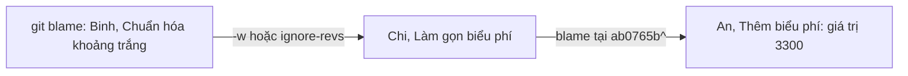

## Bạn sẽ học được gì

- Đọc output của `git blame`: commit, tác giả, thời gian, số dòng, nội dung.
- Bỏ qua thay đổi khoảng trắng bằng `-w` và bỏ qua commit định dạng bằng `--ignore-revs-file`.
- Giới hạn vùng bằng `-L` theo số dòng hoặc theo regex.
- Đào sâu hơn một lớp: blame tại parent của commit vừa tìm thấy.

## Khái niệm

`git blame <tệp>` cho biết, với từng dòng hiện tại, commit nào là lần cuối đổi dòng đó. Mỗi dòng output gồm: object ID rút gọn của commit, tên tác giả, thời điểm, số dòng, rồi nội dung.

Tên lệnh nghe như "đổ lỗi", nhưng mục đích thật là tìm **ngữ cảnh**: commit nào, message nói gì, PR nào, để hiểu vì sao dòng đó như vậy. Vấn đề là blame chỉ nhìn lần thay đổi **cuối cùng**. Nếu ai đó vừa chạy công cụ định dạng toàn tệp, mọi dòng đều mang tên họ, che mất lịch sử thật. Một số công cụ giúp gỡ nhiễu:

- **`-w`**: bỏ qua thay đổi chỉ về khoảng trắng. Blame nhìn xuyên qua commit thêm, bớt dấu cách để tìm commit đổi nội dung thật.
- **`--ignore-rev <commit>`** và **`--ignore-revs-file <tệp>`**: bỏ qua hẳn những commit được liệt kê (thường là commit định dạng hàng loạt). Nhiều dự án giữ tệp `.git-blame-ignore-revs` và đặt `git config blame.ignoreRevsFile .git-blame-ignore-revs`.
- **`-L <đầu>,<cuối>`**: chỉ blame một khoảng dòng. Có thể dùng regex: `-L '/phi_lien/,+1'` nghĩa là từ dòng đầu tiên khớp, lấy một dòng.
- **`-C`**: phát hiện dòng được di chuyển hoặc sao chép từ tệp khác trong cùng commit (thêm `-C` lần nữa để tìm rộng hơn).
- **Blame tại một commit cũ**: `git blame <commit>^ -- <tệp>` cho biết dòng đó trông thế nào và do ai viết ngay trước commit đã tìm được. Lặp lại để lần ngược từng lớp lịch sử.

Khi cần đưa kết quả vào script, `--line-porcelain` in thông tin chi tiết cho mỗi dòng theo định dạng ổn định (ví dụ dòng `author <tên>`).

## Hình dung bằng sơ đồ



## Lệnh cần biết

```bash
git blame bieu-phi.txt
git blame -w bieu-phi.txt
git blame -w -L 2,2 bieu-phi.txt
git blame -L '/phi_lien/,+1' bieu-phi.txt

# Bỏ qua commit định dạng
git blame --ignore-revs-file .git-blame-ignore-revs bieu-phi.txt
git config blame.ignoreRevsFile .git-blame-ignore-revs

# Lần ngược thêm một lớp
git blame -L 2,2 <commit>^ -- bieu-phi.txt

# Cho script
git blame -w --line-porcelain -L 2,2 bieu-phi.txt
```

## Ví dụ từng bước

Repository dịch vụ tính phí: dòng phí liên ngân hàng đang sai (`330`). Ai đã đổi? Blame thông thường (ID trên máy bạn sẽ khác):

```bash
git blame bieu-phi.txt
```

```text
eecc97a1 (Binh 2026-09-08 09:00:00 +0700 1) phi_noi_bo=0  
eecc97a1 (Binh 2026-09-08 09:00:00 +0700 2) phi_lien_ngan_hang=330  
9bb7d504 (An   2026-09-09 09:00:00 +0700 3) phi_quoc_te=50000
```

Hai dòng đầu mang tên Binh, nhưng commit `eecc97a` chỉ thêm khoảng trắng cuối dòng. Nhìn xuyên qua bằng `-w`:

```bash
git blame -w bieu-phi.txt
```

```text
dd02f869 (An  2026-09-02 09:00:00 +0700 1) phi_noi_bo=0  
ab0765bd (Chi 2026-09-06 09:00:00 +0700 2) phi_lien_ngan_hang=330  
9bb7d504 (An  2026-09-09 09:00:00 +0700 3) phi_quoc_te=50000
```

Giờ thấy được dòng 2 do commit `ab0765b` của Chi đổi. Thay vì `-w`, bạn cũng có thể liệt kê commit định dạng vào một tệp và bỏ qua nó:

```bash
git blame --ignore-revs-file ../.ignore-revs bieu-phi.txt
```

```text
dd02f869 (An  2026-09-02 09:00:00 +0700 1) phi_noi_bo=0  
ab0765bd (Chi 2026-09-06 09:00:00 +0700 2) phi_lien_ngan_hang=330  
9bb7d504 (An  2026-09-09 09:00:00 +0700 3) phi_quoc_te=50000
```

Chỉ blame đúng dòng cần quan tâm, theo regex. Để ý: không có `-w`, kết quả vẫn là commit khoảng trắng:

```bash
git blame -L '/phi_lien/,+1' bieu-phi.txt
git blame -w -L 2,2 bieu-phi.txt
```

```text
eecc97a1 (Binh 2026-09-08 09:00:00 +0700 2) phi_lien_ngan_hang=330  
ab0765bd (Chi 2026-09-06 09:00:00 +0700 2) phi_lien_ngan_hang=330  
```

Đào thêm một lớp: trước commit của Chi, dòng này trông thế nào?

```bash
git blame -L 2,2 ab0765b^ -- bieu-phi.txt
```

```text
dd02f869 (An 2026-09-02 09:00:00 +0700 2) phi_lien_ngan_hang=3300
```

Trước đó giá trị là `3300`, do An viết từ đầu. Câu chuyện đầy đủ: An đặt 3300, Chi "làm gọn" thành 330, Binh thêm khoảng trắng. Lấy riêng tên tác giả cho script:

```bash
git blame -w --line-porcelain -L 2,2 bieu-phi.txt | grep '^author '
```

```text
author Chi
```

> **Mẹo** Đặt `git config blame.ignoreRevsFile .git-blame-ignore-revs` cho repository có commit định dạng hàng loạt. Mỗi lần nhóm chạy công cụ định dạng, thêm ID commit đó vào tệp và commit tệp này lên.

## Lỗi thường gặp

**Dừng ở kết quả blame đầu tiên.** Đó có thể chỉ là commit định dạng, đổi tên biến hay di chuyển code.

**Kết luận "lỗi của người này".** Blame chỉ cho biết ai đổi lần cuối. Người đó có thể làm đúng yêu cầu lúc ấy. Dùng kết quả để tìm ngữ cảnh và hỏi, không phải để quy lỗi.

**Blame trên working tree đang sửa dở.** Dòng chưa commit hiện là `Not Committed Yet`. Blame trên một commit cụ thể nếu cần kết quả sạch.

**Quên `--` khi blame tại commit cũ.** `git blame <commit>^ -- <tệp>` rõ ràng hơn, tránh nhầm tên tệp với tên revision.

> **Lưu ý** Blame không theo dõi dòng bị xóa: dòng đã không còn trong tệp thì blame không thấy. Muốn tìm commit xóa một dòng, dùng `git log -S` hoặc blame ngược với `--reverse`.

## Áp dụng trong công việc

Một ca kiểm thử hồi quy fail vì giới hạn số lần nhập sai mật khẩu đã đổi từ 5 xuống 3. `git blame` chỉ vào commit định dạng của bot. Bạn chạy lại với `-w` và tệp ignore-revs, tìm ra commit thật kèm đường dẫn ticket trong message. Hóa ra đây là yêu cầu bảo mật mới; bạn cập nhật ca kiểm thử thay vì báo lỗi.

## Chuẩn bị làm bài

Đây là bài trả lời câu hỏi. Repository bài tập có một tệp ứng dụng do hai người cùng sửa qua vài commit, và có một dòng đánh dấu lỗi. Câu hỏi yêu cầu tên tác giả của dòng đó. Dùng `git blame` giới hạn vào đúng dòng (theo số dòng hoặc regex), đọc cột tác giả, và xác minh bằng `git show` commit tương ứng.

## Tóm tắt

- `git blame` cho biết commit, tác giả, thời điểm của lần đổi cuối mỗi dòng.
- `-w` và `--ignore-revs-file` gỡ nhiễu từ commit khoảng trắng, định dạng.
- `-L` giới hạn theo số dòng hoặc regex; `-C` tìm dòng di chuyển, sao chép.
- Blame tại `<commit>^` để lần ngược thêm từng lớp lịch sử.
- Dùng blame để tìm ngữ cảnh, không phải để quy lỗi.
