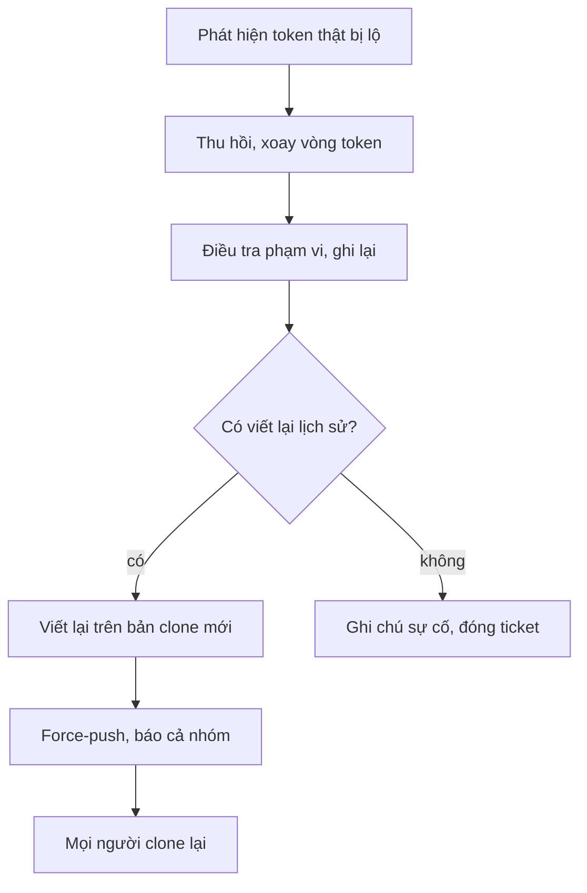
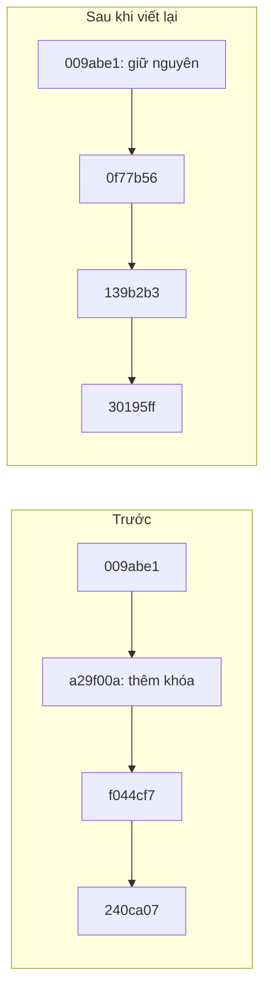

## Bạn sẽ học được gì

- Biết thứ tự ưu tiên khi secret thật bị lộ: vô hiệu hóa secret trước, dọn lịch sử sau.
- Hiểu vì sao viết lại lịch sử đổi object ID của commit bị ảnh hưởng và mọi commit sau nó.
- Thấy tận mắt (trên repository nháp) rằng bản sao cũ, ref dự phòng và reflog vẫn giữ secret sau khi viết lại.
- Nắm các bước phối hợp với nhóm: force-push, yêu cầu clone lại, dọn ở phía hosting.

## Khái niệm

> **Lưu ý** Bài này là mô phỏng. Ứng dụng luyện tập không chạy công cụ viết lại lịch sử trên repository bài tập, và câu hỏi chỉ kiểm tra kiến thức. Phần thử nghiệm dưới đây được mình chạy trên một bản clone nháp trong thư mục tạm bằng `git filter-branch` có sẵn trong Git. Công cụ `git filter-repo` được nhắc tới là công cụ riêng, phải cài thêm, và mình không chạy nó trong bài.

Khi phát hiện một secret thật (token, mật khẩu, khóa API) đã bị commit và push, hãy nhớ: **dọn lịch sử không làm secret hết lộ**. Từ lúc commit lên remote, bất kỳ ai đã clone, fork, hoặc hệ thống CI nào đã fetch đều có thể đang giữ nó. Vì vậy thứ tự đúng là:

1. **Vô hiệu hóa secret ngay**: thu hồi (revoke) hoặc xoay vòng (rotate) ở hệ thống cấp phát. Đây là bước duy nhất thật sự chặn được việc lạm dụng. Làm trước mọi thứ khác.
2. **Điều tra**: commit nào thêm, phạm vi nhánh, tag, thời gian phơi nhiễm (bài trước). Kiểm tra log truy cập của hệ thống liên quan.
3. **Báo cáo** theo quy trình sự cố của tổ chức.
4. **Quyết định có viết lại lịch sử không**. Secret đã bị thu hồi thì không còn giá trị; nhiều nhóm vẫn dọn lịch sử để tránh công cụ quét báo động mãi, hoặc vì quy định. Nhưng đây là bước dọn dẹp, không phải bước bảo vệ.
5. **Nếu viết lại**: phối hợp cả nhóm, vì mọi người phải bỏ bản clone cũ.

Viết lại lịch sử nghĩa là tạo commit mới với nội dung đã loại secret. Vì object ID được tính từ nội dung, và mỗi commit chứa ID của parent, nên commit đầu tiên bị sửa đổi ID, kéo theo **mọi commit sau nó** đổi ID. Các commit trước đó giữ nguyên.

Công cụ thường dùng:

- `git filter-repo` (công cụ riêng, được khuyến nghị bởi chính tài liệu Git): nhanh, an toàn hơn, có tùy chọn như `--replace-text` để thay chuỗi và `--invert-paths --path <tệp>` để loại bỏ một tệp khỏi toàn bộ lịch sử.
- `git filter-branch` (có sẵn trong Git): chậm, nhiều bẫy, Git in cảnh báo khuyên dùng công cụ khác. Mình chỉ dùng nó ở đây vì có sẵn để minh họa trên bản nháp.

## Hình dung bằng sơ đồ





## Lệnh cần biết

```bash
# Thử nghiệm trên bản clone nháp, không trên repository làm việc
git clone <đường-dẫn> /tmp/ban-nhap

# Minh họa bằng công cụ có sẵn (chậm, chỉ để học)
git filter-branch --prune-empty --tree-filter "<lệnh sửa tệp>" main

# Dọn ref dự phòng và reflog để object cũ có thể bị xóa
git update-ref -d refs/original/refs/heads/main
git reflog expire --expire=now --all
git gc --prune=now

# Tham khảo cú pháp git filter-repo (không chạy trong bài)
git filter-repo --replace-text bieu-thuc.txt
git filter-repo --invert-paths --path cau-hinh.txt
```

## Ví dụ từng bước

Toàn bộ phần này chạy trên bản clone nháp trong thư mục tạm của repository dịch vụ tính phí, đã gỡ remote để không thể vô tình push. Khóa mẫu `API_KEY_DEMO` không có giá trị thật. (ID trên máy bạn sẽ khác.)

Viết lại main, xóa dòng chứa khóa ở mọi commit, bỏ commit trở nên rỗng:

```bash
FILTER_BRANCH_SQUELCH_WARNING=1 git filter-branch --prune-empty \
  --tree-filter "sed -i '/API_KEY_DEMO/d' cau-hinh.txt 2>/dev/null || true" main
git log --oneline
```

```text
Ref 'refs/heads/main' was rewritten
30195ff Thêm liên hệ
4d6b0c5 Thêm phí quốc tế
3503a61 Chuẩn hóa khoảng trắng
e8f45a9 Làm gọn biểu phí
139b2b3 Cập nhật README
0f77b56 Thêm cấu hình môi trường
009abe1 Thêm script tính phí
dd02f86 Thêm biểu phí
cb90130 Khởi tạo dự án
```

(Các dòng tiến trình "Rewrite ..." đã được lược bớt.) So với trước: ba commit đầu giữ nguyên ID; từ "Thêm cấu hình môi trường" trở đi, mọi ID đều mới. Commit "Bỏ khóa khỏi cấu hình" biến mất vì không còn gì để bỏ.

Nhưng secret đã hết chưa?

```bash
git log --all --oneline -S API_KEY_DEMO
git for-each-ref
```

```text
7144980 Bỏ khóa khỏi cấu hình
a29f00a Thêm cấu hình môi trường
30195ff6c6bda979c8eb2cb598d40554afe6bda2 commit	refs/heads/main
240ca079f2fc1cb27642043c773cd22f7ffe434e commit	refs/original/refs/heads/main
```

Vẫn còn: `filter-branch` giữ bản cũ dưới `refs/original/`. Xóa ref đó, object cũ vẫn sống nhờ reflog:

```bash
git update-ref -d refs/original/refs/heads/main
git log --all --oneline -S API_KEY_DEMO
git cat-file -t a29f00a
```

```text
commit
```

Chỉ sau khi cho reflog hết hạn và gc mới thật sự mất:

```bash
git reflog expire --expire=now --all
git gc -q --prune=now
git cat-file -t a29f00a
```

```text
fatal: Not a valid object name a29f00a
```

Còn repository gốc (đóng vai một bản clone khác của đồng nghiệp) thì không hề thay đổi:

```bash
git -C ../r log --oneline -S API_KEY_DEMO
```

```text
7144980 Bỏ khóa khỏi cấu hình
a29f00a Thêm cấu hình môi trường
```

Đây chính là lý do bước đầu tiên luôn là vô hiệu hóa secret: bạn không thể dọn được các bản sao nằm ngoài máy mình.

> **Cẩn thận** Sau khi viết lại, đẩy lên remote cần force-push, ghi đè lịch sử của mọi người. Phải thông báo trước, yêu cầu mọi người push công việc dở, rồi sau khi force-push thì clone lại (không pull vào bản cũ, vì merge sẽ mang commit cũ chứa secret trở lại). Nền tảng hosting có thể còn giữ bản cache, PR cũ hay fork; liên hệ bộ phận hỗ trợ của nền tảng nếu cần dọn phía đó.

## Lỗi thường gặp

**Viết lại lịch sử trước, thu hồi secret sau.** Trong lúc bạn loay hoay, secret vẫn dùng được.

**Nghĩ xóa ở HEAD là đủ.** Bài trước đã cho thấy lịch sử vẫn giữ.

**Viết lại mà không báo nhóm.** Đồng nghiệp pull, merge, và đưa commit cũ quay lại.

**Quên ref dự phòng và reflog trên chính máy mình.** Object cũ vẫn còn, công cụ quét vẫn tìm thấy.

**Chạy thử trên repository làm việc.** Luôn thử trên bản clone nháp trước.

## Áp dụng trong công việc

Một token thử nghiệm của cổng thanh toán đối tác (môi trường sandbox) bị đẩy lên repository test của nhóm. Bạn báo ngay cho người quản lý tích hợp để thu hồi token, xác nhận token mới đã được cấp qua kênh quản lý secret. Sau đó nhóm họp, thống nhất viết lại lịch sử vào cuối ngày, thông báo trước hai giờ, force-push, và mọi người clone lại. Biên bản sự cố ghi rõ: thời điểm lộ, thời điểm thu hồi, các commit ID cũ và mới.

## Chuẩn bị làm bài

Đây là bài trả lời câu hỏi, không có thao tác viết lại lịch sử trong ứng dụng. Câu hỏi đặt tình huống bạn vừa phát hiện một token thật bị lộ, và hỏi hành động khẩn cấp cần làm trước tiên. Ôn lại thứ tự ưu tiên ở phần Khái niệm và lý do của nó.

## Tóm tắt

- Secret thật bị lộ: vô hiệu hóa ngay, trước mọi bước dọn dẹp.
- Viết lại lịch sử đổi ID của commit bị sửa và mọi commit sau nó.
- Ref dự phòng, reflog và mọi bản clone khác vẫn giữ secret cho tới khi được dọn.
- Viết lại cần force-push, báo trước và yêu cầu cả nhóm clone lại.
- `git filter-repo` là công cụ được khuyến nghị; `filter-branch` chỉ dùng minh họa trên bản nháp.
