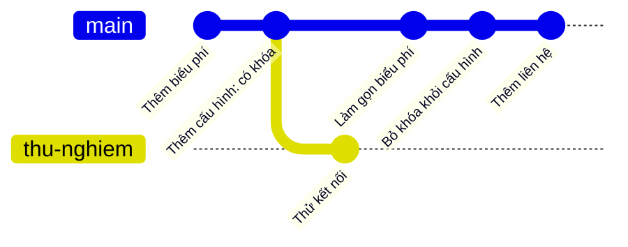

## Bạn sẽ học được gì

- Hiểu vì sao xóa secret khỏi HEAD không làm nó biến mất khỏi lịch sử.
- Tìm commit đầu tiên đưa secret vào bằng `git log -S --all --reverse`.
- Xác định phạm vi lộ: nhánh nào, tag nào, snapshot nào còn chứa secret.
- Biết những gì cần ghi lại để báo cáo sự cố cho đúng.

## Khái niệm

Secret (mật khẩu, token, khóa API) lỡ commit vào repository là sự cố phổ biến. Phản xạ đầu tiên của nhiều người là xóa dòng đó rồi commit "Bỏ khóa". Nhưng nhớ lại cách Git lưu dữ liệu: mỗi commit là một snapshot đầy đủ. Commit cũ vẫn còn, blob cũ vẫn còn, và bất kỳ ai có bản clone, hoặc có quyền đọc remote, đều lấy lại được secret bằng một lệnh `git show`.

Vì vậy, điều tra một vụ lộ secret cần trả lời bốn câu hỏi:

1. **Lần đầu xuất hiện**: commit nào đưa secret vào, khi nào, ai? Từ thời điểm đó secret được coi là đã lộ với mọi người đọc được repository.
2. **Phạm vi**: những nhánh, tag nào chứa commit đó? Có nhánh nào vẫn còn secret ở đầu nhánh không?
3. **Đã push chưa**: commit có trên remote không? Nếu có, mọi bản clone và fork đều có thể đã có.
4. **Lần bị gỡ**: commit nào xóa secret (nếu có), và trên những nhánh nào.

Công cụ chính là pickaxe:

- `git log --all -S <chuỗi>` tìm mọi commit làm thay đổi số lần xuất hiện, trên **mọi** nhánh và tag.
- `--reverse` đưa commit cũ nhất lên đầu: đó là lần thêm đầu tiên.
- `git branch -a --contains <commit>` và `git tag --contains <commit>` cho biết phạm vi.
- `git grep <chuỗi> $(git rev-list --all)` quét mọi snapshot (chậm với repository lớn nhưng triệt để).

`--diff-filter=A` chỉ giữ commit **thêm tệp**, không phải thêm dòng. Nó chỉ hữu ích khi secret nằm trong tệp được tạo mới; secret thêm vào tệp có sẵn sẽ bị bỏ sót.

> **Cẩn thận** Bài này dùng chuỗi mẫu không có giá trị thật. Với secret thật, đừng dán giá trị vào lệnh, ticket hay chat; tìm bằng một phần đặc trưng như tên biến, và coi secret đã lộ ngay từ lúc phát hiện.

## Hình dung bằng sơ đồ



Khóa bị gỡ trên main, nhưng nhánh `thu-nghiem` tách ra trước đó nên vẫn chứa khóa ở đầu nhánh.

## Lệnh cần biết

```bash
# HEAD hiện tại có còn không
git grep -n API_KEY_DEMO

# Mọi commit thêm hoặc xóa, cũ nhất trước, trên mọi ref
git log --all --format='%h %an %ad %s' --date=short -S API_KEY_DEMO --reverse

# Phạm vi
git branch -a --contains <commit-thêm>
git tag --contains <commit-thêm>
git branch -a --contains <commit-gỡ>

# Quét mọi snapshot
git rev-list --all | xargs git grep -l API_KEY_DEMO
```

## Ví dụ từng bước

Repository dịch vụ tính phí. Khóa mẫu `API_KEY_DEMO` đã bị gỡ trên main. Ngoài ra có nhánh `thu-nghiem` tách ra từ trước và tag `v1.0` (ID trên máy bạn sẽ khác). HEAD sạch:

```bash
git grep -n API_KEY_DEMO
```

Không có output, mã thoát 1. Nhưng lịch sử thì khác:

```bash
git log --all --format='%h %an %ad %s' --date=short -S API_KEY_DEMO --reverse
```

```text
a29f00a Chi 2026-09-04 Thêm cấu hình môi trường
7144980 Chi 2026-09-07 Bỏ khóa khỏi cấu hình
```

Lần thêm đầu tiên là `a29f00a`, ngày 04. Khóa tồn tại trên main trong ba ngày. Phạm vi:

```bash
git branch -a --contains a29f00a
git tag --contains a29f00a
git branch -a --contains 7144980
```

```text
* main
  thu-nghiem
v1.0
* main
```

Cả `main`, `thu-nghiem` và tag `v1.0` đều chứa commit thêm khóa. Nhưng chỉ `main` chứa commit gỡ: đầu nhánh `thu-nghiem` vẫn còn khóa. Quét mọi snapshot để chắc chắn:

```bash
git rev-list --all | xargs git grep -l API_KEY_DEMO | cut -c1-7 | sort -u
```

```text
a29f00a
ab0765b
c1156d6
f044cf7
```

Bốn snapshot chứa khóa: ba trên main trước khi gỡ, cộng `c1156d6` là đầu nhánh `thu-nghiem`.

Bẫy `--diff-filter=A`: trên nhánh `thu-nghiem`, commit "Thử kết nối" thêm một dòng `PASS_DEMO` vào tệp cấu hình có sẵn:

```bash
git log --all --oneline -S PASS_DEMO --diff-filter=A
git log --all --oneline -S PASS_DEMO
```

```text
c1156d6 Thử kết nối
```

Lệnh đầu không in gì vì commit đó sửa tệp (trạng thái M), không thêm tệp. Lệnh thứ hai mới tìm ra.

> **Lưu ý** Ngoài nhánh và tag, secret có thể nằm trong stash, reflog, hay object không còn được tham chiếu trên máy bạn. `--all` không xem reflog. Với remote, các bản fork và bản clone của người khác nằm ngoài tầm kiểm soát của bạn.

## Lỗi thường gặp

**Kiểm tra mỗi HEAD rồi kết luận "đã sạch".** HEAD sạch không có nghĩa lịch sử sạch.

**Quên `--all`.** Secret có thể nằm ở nhánh khác hoặc chỉ ở tag.

**Dùng `--diff-filter=A` để tìm "lần thêm".** Bộ lọc này nói về tệp, không phải dòng.

**Chỉ ghi lại commit gỡ.** Báo cáo cần thời điểm lộ đầu tiên, vì đó là mốc tính thời gian phơi nhiễm.

> **Mẹo** Ghi kết quả điều tra ra tệp ngay khi chạy, ví dụ `git log --all ... > dieu-tra.txt`. Nếu sau đó nhóm viết lại lịch sử, các object ID cũ sẽ không còn tra được dễ dàng.

## Áp dụng trong công việc

Công cụ quét tự động cảnh báo một chuỗi giống token thử nghiệm của cổng thanh toán trong repository test. HEAD đã sạch, nhưng bạn chạy pickaxe với `--all --reverse` và thấy chuỗi xuất hiện từ ba tuần trước, trên hai nhánh và một tag phát hành nội bộ. Bạn ghi lại commit, ngày, phạm vi, rồi chuyển cho nhóm bảo mật để thu hồi token và quyết định có viết lại lịch sử hay không (bài tiếp theo).

## Chuẩn bị làm bài

Đây là bài trả lời câu hỏi. Repository bài tập có một tệp ứng dụng; chuỗi mẫu `TOKEN_DEMO` từng được thêm vào rồi bị xóa, nên ở HEAD bạn không thấy nó nữa. Câu hỏi yêu cầu subject của commit đầu tiên thêm chuỗi. Hãy tìm trên mọi ref, sắp cũ nhất trước, và phân biệt commit thêm với commit xóa bằng `git show`.

## Tóm tắt

- Xóa secret ở HEAD không xóa nó khỏi các commit cũ.
- `git log --all -S <chuỗi> --reverse` cho lần thêm đầu tiên.
- `git branch -a --contains` và `git tag --contains` xác định phạm vi lộ.
- Quét mọi snapshot bằng `git grep` trên `git rev-list --all` khi cần triệt để.
- `--diff-filter=A` chỉ bắt tệp mới, không bắt dòng mới trong tệp có sẵn.
