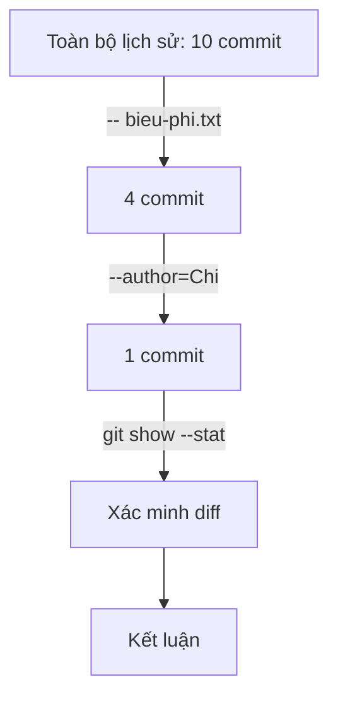

## Bạn sẽ học được gì

- Kết hợp các bộ lọc của `git log`: tác giả, message, đường dẫn, thời gian, nội dung.
- Hiểu cách các bộ lọc kết hợp với nhau (AND hay OR) để không bị bất ngờ.
- Áp dụng chiến lược "thu hẹp ứng viên rồi xác minh bằng `git show`".
- Tránh các bẫy hay gặp: so khớp email, mốc thời gian không kèm giờ.

## Khái niệm

Khi điều tra, bạn hiếm khi biết chính xác commit mình cần. Bạn chỉ có vài manh mối: "hình như Chi sửa", "khoảng đầu tháng", "liên quan tới biểu phí". Mỗi manh mối là một bộ lọc của `git log`:

| Manh mối | Bộ lọc |
| --- | --- |
| Ai viết | `--author=<mẫu>` (khớp cả tên lẫn email) |
| Message nói gì | `--grep=<mẫu>`, `-i` để bỏ qua hoa thường |
| Tệp, thư mục nào | `-- <đường dẫn>` ở cuối lệnh |
| Khi nào | `--since`, `--until` (hoặc `--after`, `--before`) |
| Nội dung thay đổi | `-S <chuỗi>`, `-G <regex>` |
| Loại commit | `--no-merges`, `--merges` |

Cách kết hợp:

- Các **loại** bộ lọc khác nhau kết hợp theo kiểu AND: `--author=Chi -- bieu-phi.txt` là commit của Chi **và** chạm vào `bieu-phi.txt`.
- Nhiều `--grep` (hoặc nhiều `--author`) mặc định là OR: khớp một trong các mẫu là được. Thêm `--all-match` để yêu cầu message khớp **tất cả** các `--grep`.
- `--invert-grep` đảo điều kiện `--grep`: lấy commit có message **không** khớp.

Chiến lược hiệu quả là đi từ rộng đến hẹp: bắt đầu bằng một bộ lọc chắc chắn nhất (thường là đường dẫn), xem số kết quả, rồi thêm bộ lọc kế tiếp cho tới khi còn vài ứng viên. Sau đó **xác minh** từng ứng viên bằng `git show --stat` hoặc `git show`: message có thể mô tả sai, tên tác giả có thể trùng. Kết luận dựa trên diff, không dựa trên message.

`--format` giúp hiển thị đúng thông tin cần: `%h` (ID ngắn), `%an` (tác giả), `%ad` (ngày tác giả), `%s` (subject). Kết hợp `--date=short` hoặc `--date=iso` cho dễ đọc. `git shortlog -sn` đếm số commit theo tác giả, hữu ích để biết ai hay sửa một tệp.

## Hình dung bằng sơ đồ



## Lệnh cần biết

```bash
git log --oneline --author=Chi
git log --oneline -- bieu-phi.txt
git log --oneline --author=Chi -- bieu-phi.txt
git log --oneline --grep=phí
git log --oneline --grep=phí --grep=biểu --all-match
git log --oneline --invert-grep --grep=phí
git log --oneline --since="2026-09-05 00:00" --until="2026-09-07 23:59"
git log --format='%h %an %ad %s' --date=short --author=Chi -- bieu-phi.txt
git shortlog -sn HEAD -- bieu-phi.txt
git show --stat <commit>
```

## Ví dụ từng bước

Repository dịch vụ tính phí; manh mối: "Chi đã sửa gì đó trong biểu phí" (ID trên máy bạn sẽ khác). Từng bộ lọc riêng lẻ:

```bash
git log --oneline --author=Chi
git log --oneline -- bieu-phi.txt
```

```text
7144980 Bỏ khóa khỏi cấu hình
ab0765b Làm gọn biểu phí
a29f00a Thêm cấu hình môi trường
9bb7d50 Thêm phí quốc tế
eecc97a Chuẩn hóa khoảng trắng
ab0765b Làm gọn biểu phí
dd02f86 Thêm biểu phí
```

Kết hợp (AND) chỉ còn một ứng viên:

```bash
git log --format='%h %an %ad %s' --date=short --author=Chi -- bieu-phi.txt
```

```text
ab0765b Chi 2026-09-06 Làm gọn biểu phí
```

Xác minh:

```bash
git show --stat --format="%h %an %s" ab0765b
```

```text
ab0765b Chi Làm gọn biểu phí

 bieu-phi.txt | 2 +-
 1 file changed, 1 insertion(+), 1 deletion(-)
```

Nhiều `--grep` là OR; `--all-match` biến thành AND:

```bash
git log --oneline --grep=phí --grep=biểu --all-match
```

```text
ab0765b Làm gọn biểu phí
dd02f86 Thêm biểu phí
```

Ai hay sửa biểu phí nhất?

```bash
git shortlog -sn HEAD -- bieu-phi.txt
```

```text
     2	An
     1	Binh
     1	Chi
```

Hai bẫy đáng nhớ. Thứ nhất, `--author` khớp cả email, và không phân biệt chữ hoa ở đây chỉ vì email viết thường:

```bash
git log --oneline --author=chi
```

```text
7144980 Bỏ khóa khỏi cấu hình
ab0765b Làm gọn biểu phí
a29f00a Thêm cấu hình môi trường
```

Chữ `chi` không khớp tên `Chi`, nhưng khớp email `chi@example.invalid`. Thứ hai, ngày không kèm giờ:

```bash
git log --oneline --since=2026-09-05 --until=2026-09-07
git log --oneline --since="2026-09-05 00:00" --until="2026-09-07 23:59"
```

```text
ab0765b Làm gọn biểu phí
f044cf7 Cập nhật README
7144980 Bỏ khóa khỏi cấu hình
ab0765b Làm gọn biểu phí
f044cf7 Cập nhật README
```

Lệnh đầu bỏ sót commit lúc 09:00 ngày 07, vì Git ghép ngày bạn ghi với giờ hiện tại trên máy (lúc thử là sau nửa đêm). Ghi rõ giờ để kết quả không phụ thuộc lúc chạy.

> **Mẹo** Khi chưa chắc tên tác giả được ghi thế nào, chạy `git shortlog -sne HEAD` để xem mọi cặp tên và email trong lịch sử trước khi lọc.

## Lỗi thường gặp

**Tin message thay vì diff.** "Sửa lỗi nhỏ" có thể chứa thay đổi lớn. Luôn xác minh bằng `git show`.

**Đặt đường dẫn trước tùy chọn.** Đường dẫn phải ở cuối, sau `--`.

**Nghĩ nhiều `--grep` là AND.** Mặc định là OR; cần `--all-match`.

**Quên `--all`.** Commit cần tìm có thể nằm trên nhánh khác.

> **Lưu ý** `--since`, `--until` lọc theo ngày committer. Sau rebase hay cherry-pick, ngày committer có thể khác xa ngày tác giả hiển thị bằng `%ad`.

## Áp dụng trong công việc

Kiểm toán hỏi: "Trong tuần trước kỳ phát hành, ai đã đổi cấu hình biểu phí và vì sao?". Bạn kết hợp `--since`, `--until` có giờ rõ ràng, đường dẫn thư mục cấu hình, `--no-merges`, xuất `--format='%h %an %ad %s'`, rồi `git show` từng commit để trích lý do từ message và diff. Báo cáo gọn trong nửa trang.

## Chuẩn bị làm bài

Đây là bài trả lời câu hỏi. Repository bài tập có một tệp ứng dụng với vài commit của hai người, trong đó có một commit với subject được nêu trong câu hỏi. Bạn cần tìm tác giả của commit đó. Hãy lọc theo message, hiển thị kèm tên tác giả bằng `--format`, rồi xác minh bằng `git show`.

## Tóm tắt

- Mỗi manh mối là một bộ lọc: `--author`, `--grep`, đường dẫn, `--since`, `-S`, `-G`.
- Các loại bộ lọc khác nhau là AND; nhiều `--grep` là OR trừ khi có `--all-match`.
- Đi từ rộng đến hẹp, rồi xác minh ứng viên bằng `git show`.
- `--author` khớp cả email; ngày không kèm giờ bị ghép với giờ hiện tại.
- `--format` và `git shortlog -sn` giúp trình bày kết quả gọn gàng.
