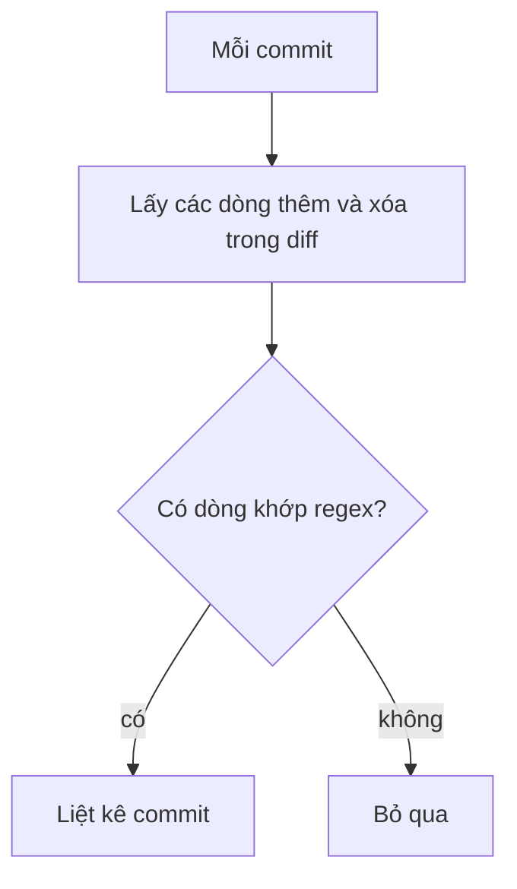

## Bạn sẽ học được gì

- Dùng `git log -G <regex>` để tìm commit có dòng thêm hoặc xóa khớp một biểu thức chính quy.
- Phân biệt rõ `-G` (dòng diff khớp regex) với `-S` (đếm số lần xuất hiện).
- Viết regex đủ chặt để giảm nhiễu: neo đầu dòng, lớp ký tự, số lần lặp.
- Biết rằng thay đổi chỉ khoảng trắng vẫn khớp `-G` và cách xử lý.

## Khái niệm

`git log -G <regex>` liệt kê commit mà **diff của nó có ít nhất một dòng thêm hoặc xóa khớp regex**. Không đếm số lần, không quan tâm chuỗi còn hay mất sau commit; chỉ hỏi: trong các dòng `+` và `-` của commit này, có dòng nào khớp không?

So với `-S`:

| Tình huống | `-S chuỗi` | `-G regex` |
| --- | --- | --- |
| Thêm dòng chứa chuỗi | Khớp | Khớp |
| Xóa dòng chứa chuỗi | Khớp | Khớp |
| Sửa phần khác trên dòng, chuỗi vẫn còn | Không khớp | Khớp (dòng cũ bị xóa, dòng mới được thêm, đều chứa chuỗi) |
| Chỉ đổi khoảng trắng trên dòng | Không khớp | Khớp |
| Di chuyển dòng trong tệp | Không khớp | Khớp |

Vì vậy `-G` cho nhiều kết quả hơn: dùng khi bạn muốn thấy **mọi lần dòng đó bị đụng tới**, hoặc khi điều cần tìm là một mẫu (pattern) chứ không phải một chuỗi cố định, ví dụ "dòng gán phí có giá trị năm chữ số".

Regex của `-G` theo cú pháp POSIX mở rộng: dùng được `+`, `?`, `{n}`, nhóm và lớp ký tự, như các ví dụ bên dưới. Neo `^` và `$` áp dụng với nội dung từng dòng (không tính dấu `+` hay `-` của diff). Thêm `-i` để không phân biệt hoa thường.

## Hình dung bằng sơ đồ



## Lệnh cần biết

```bash
# Commit có dòng diff khớp regex
git log --oneline -G 'phi_lien_ngan_hang'

# Regex chặt hơn: giá trị năm chữ số
git log --oneline -G 'phi_[a-z_]+=[0-9]{5}'

# Neo cả dòng
git log --oneline -G '^phi_noi_bo=0$'

# Kèm diff, chỉ một tệp
git log -G 'phi_lien' -p -- bieu-phi.txt

# So sánh nhanh với -S
git log --oneline -S phi_lien_ngan_hang
```

## Ví dụ từng bước

Cùng repository dịch vụ tính phí (ID trên máy bạn sẽ khác). So `-S` và `-G` với tên biến phí liên ngân hàng:

```bash
git log --oneline -S phi_lien_ngan_hang
git log --oneline -G phi_lien_ngan_hang
```

```text
009abe1 Thêm script tính phí
dd02f86 Thêm biểu phí
eecc97a Chuẩn hóa khoảng trắng
ab0765b Làm gọn biểu phí
009abe1 Thêm script tính phí
dd02f86 Thêm biểu phí
```

`-S` chỉ thấy hai commit lần đầu đưa tên biến vào tệp. `-G` thấy thêm hai commit đã đụng vào dòng đó: "Làm gọn biểu phí" (đổi giá trị) và "Chuẩn hóa khoảng trắng" (chỉ thêm khoảng trắng cuối dòng). Nếu bạn đang tìm "ai đã đổi giá trị phí", `-G` mới đưa ra commit cần thiết.

Tìm theo mẫu thay vì chuỗi cố định: dòng gán phí có giá trị năm chữ số:

```bash
git log --oneline -G 'phi_[a-z_]+=[0-9]{5}'
```

```text
9bb7d50 Thêm phí quốc tế
```

Chỉ `phi_quoc_te=50000` khớp; `3300` có bốn chữ số.

Regex neo cả dòng, và hiệu ứng của commit khoảng trắng:

```bash
git log --oneline -G '^phi_noi_bo=0$'
```

```text
eecc97a Chuẩn hóa khoảng trắng
dd02f86 Thêm biểu phí
```

Commit "Chuẩn hóa khoảng trắng" khớp vì dòng **bị xóa** của nó là `phi_noi_bo=0` (bản trước khi thêm khoảng trắng). Dòng mới có khoảng trắng cuối nên không khớp `$`, nhưng chỉ cần một dòng khớp là đủ.

Với khóa mẫu ở bài trước, `-G` cũng cho cùng kết quả với `-S` vì dòng chứa khóa chỉ bị thêm rồi xóa:

```bash
git log --oneline -G API_KEY_DEMO
```

```text
7144980 Bỏ khóa khỏi cấu hình
a29f00a Thêm cấu hình môi trường
```

> **Mẹo** Đừng trông vào `-w` để loại commit chỉ đổi khoảng trắng: mình đã thử `git log --oneline -G phi_lien_ngan_hang -w` và "Chuẩn hóa khoảng trắng" vẫn có trong kết quả, vì `-G` xét các dòng thêm, xóa của diff thô. Hãy lọc bằng mắt với `git show -w <commit>`: commit nào hiện diff rỗng là commit chỉ đổi khoảng trắng.

## Lỗi thường gặp

**Dùng `-G` khi muốn tìm "lúc xuất hiện lần đầu".** `-G` trả nhiều commit; lần đầu là commit cũ nhất. Thêm `--reverse` hoặc dùng `-S`.

**Quên escape ký tự đặc biệt.** Dấu chấm khớp mọi ký tự; tìm `v1.2` bằng `-G 'v1\.2'`.

**Regex quá lỏng.** `-G 'phi'` khớp gần như mọi commit đụng vào biểu phí. Thêm ngữ cảnh như tên biến, dấu `=`, lớp chữ số.

**Nhầm `-G` tìm trong message.** `-G` tìm trong diff. Message dùng `--grep`.

> **Lưu ý** Cả `-S` và `-G` đều phân biệt hoa thường theo mặc định. Thêm `-i` khi không chắc kiểu chữ: `git log --oneline -G api_key_demo -i` vẫn tìm ra hai commit chứa `API_KEY_DEMO`.

## Áp dụng trong công việc

Một bài kiểm thử phát hiện timeout kết nối ngân hàng đối tác bị đặt quá thấp. Bạn không biết giá trị cụ thể trước đây, chỉ biết tên khóa. `git log -G 'timeout_ms=[0-9]+' -p -- config/` liệt kê mọi lần dòng đó đổi giá trị, kèm diff, giúp bạn dựng lại dòng thời gian thay đổi cho buổi họp phân tích sự cố.

## Chuẩn bị làm bài

Đây là bài trả lời câu hỏi. Repository bài tập có một tệp ứng dụng; một commit nào đó thêm vào một dòng có nội dung đánh dấu lỗi. Câu hỏi yêu cầu subject của commit đó. Dùng `-G` với một regex khớp dòng ấy, đọc kỹ kết quả (có thể có hơn một commit đụng vào dòng khớp), rồi xác minh bằng `git show`.

## Tóm tắt

- `git log -G <regex>` tìm commit có dòng thêm hoặc xóa khớp regex.
- `-G` khớp cả khi chỉ đổi khoảng trắng hay sửa phần khác trên dòng; `-S` thì không.
- Dùng `-G` khi tìm theo mẫu hoặc muốn thấy mọi lần dòng bị đụng tới.
- Viết regex chặt bằng neo, lớp ký tự, số lần lặp; escape ký tự đặc biệt.
- `-G` tìm trong diff, `--grep` tìm trong message.
