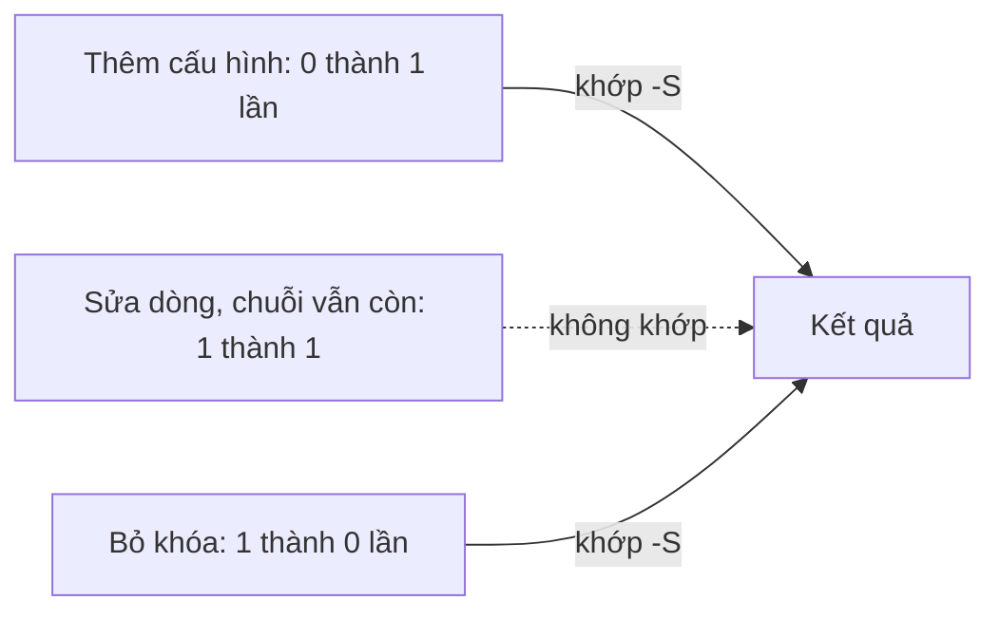

## Bạn sẽ học được gì

- Dùng `git log -S <chuỗi>` (pickaxe) để tìm commit thêm hoặc xóa một chuỗi.
- Hiểu chính xác điều kiện khớp của `-S`: số lần xuất hiện chuỗi trong tệp thay đổi.
- Kết hợp `-S` với `-p`, `--stat`, đường dẫn và `--reverse` để điều tra nhanh.
- Biết khi nào `-S` bỏ sót và cần chuyển sang `-G`.

## Khái niệm

`git log` thường lọc theo message, tác giả, thời gian. Nhưng câu hỏi điều tra hay gặp lại là về **nội dung**: "chuỗi này xuất hiện trong mã từ khi nào?", "ai đã xóa dòng cấu hình này?". `git log -S <chuỗi>`, thường gọi là pickaxe (cuốc chim), trả lời đúng loại câu hỏi đó.

Điều kiện khớp của `-S` hơi khác với trực giác. Với mỗi commit, Git đếm số lần chuỗi xuất hiện trong mỗi tệp trước và sau commit. Commit được liệt kê nếu **số lần đó thay đổi**. Hệ quả:

- Commit thêm chuỗi lần đầu: khớp (0 thành 1).
- Commit xóa chuỗi: khớp (1 thành 0).
- Commit chỉ sửa dòng chứa chuỗi mà chuỗi vẫn còn nguyên, số lần không đổi: **không khớp**.
- Commit di chuyển dòng chứa chuỗi trong cùng tệp: không khớp.

Điều này khiến `-S` cực kỳ phù hợp để tìm "lúc chuỗi xuất hiện" và "lúc chuỗi biến mất", và lọc bớt nhiễu từ các commit chỉ đụng nhẹ vào dòng đó.

`-S` tìm chuỗi cố định, phân biệt hoa thường (thêm `-i` để bỏ qua). Thêm `--pickaxe-regex` nếu muốn coi đối số là regex (vẫn với luật đếm số lần). Thêm `-p` để xem luôn diff, `--` và đường dẫn để giới hạn tệp, `--all` để tìm trên mọi nhánh, `--reverse` để đưa commit cũ nhất lên đầu.

## Hình dung bằng sơ đồ



## Lệnh cần biết

```bash
# Commit làm đổi số lần xuất hiện chuỗi
git log --oneline -S API_KEY_DEMO

# Kèm diff, giới hạn một tệp
git log -S API_KEY_DEMO -p -- cau-hinh.txt

# Mọi nhánh, cũ nhất trước
git log --all --oneline --reverse -S API_KEY_DEMO

# Coi đối số là regex
git log --oneline -S 'phi_[a-z_]+=[0-9]{5}' --pickaxe-regex
```

## Ví dụ từng bước

Dùng lại repository dịch vụ tính phí. Có một khóa mẫu `API_KEY_DEMO` từng nằm trong `cau-hinh.txt` (ID trên máy bạn sẽ khác):

```bash
git log --oneline -S API_KEY_DEMO
```

```text
7144980 Bỏ khóa khỏi cấu hình
a29f00a Thêm cấu hình môi trường
```

Hai commit: một thêm, một xóa. Xem chi tiết:

```bash
git log --oneline -S API_KEY_DEMO -p -- cau-hinh.txt
```

```text
7144980 Bỏ khóa khỏi cấu hình
diff --git a/cau-hinh.txt b/cau-hinh.txt
index 478773c..3d251d6 100644
--- a/cau-hinh.txt
+++ b/cau-hinh.txt
@@ -1,2 +1 @@
 moi_truong=test
-API_KEY_DEMO=demo-abc-123
a29f00a Thêm cấu hình môi trường
diff --git a/cau-hinh.txt b/cau-hinh.txt
new file mode 100644
index 0000000..478773c
--- /dev/null
+++ b/cau-hinh.txt
@@ -0,0 +1,2 @@
+moi_truong=test
+API_KEY_DEMO=demo-abc-123
```

Giờ xem luật đếm số lần hoạt động thế nào. Dòng phí liên ngân hàng từng là `=3300`, bị đổi thành `=330`, sau đó được thêm khoảng trắng cuối dòng:

```bash
git log --oneline -S 3300
git log --oneline -S 330
```

```text
ab0765b Làm gọn biểu phí
dd02f86 Thêm biểu phí
dd02f86 Thêm biểu phí
```

Với `3300`: commit thêm và commit đổi (3300 biến mất) đều khớp. Với `330`: chỉ commit thêm khớp. Lý do: chuỗi `330` có trong cả `3300` lẫn `330`, nên khi đổi 3300 thành 330, số lần xuất hiện của `330` vẫn là 1. Commit thêm khoảng trắng cũng không đổi số lần. Cùng một dòng, hai chuỗi tìm khác nhau cho kết quả khác nhau.

Tên biến `phi_lien_ngan_hang` thì sao?

```bash
git log --oneline -S phi_lien_ngan_hang
```

```text
009abe1 Thêm script tính phí
dd02f86 Thêm biểu phí
```

Chỉ các commit lần đầu thêm tên biến vào một tệp (biểu phí và script). Hai commit sửa giá trị trên dòng đó không xuất hiện, vì tên biến vẫn còn nguyên.

> **Mẹo** Chọn chuỗi tìm kiếm càng đặc trưng càng tốt: tên hằng, mã lỗi, một đoạn URL. Chuỗi ngắn như `330` dễ trùng với chuỗi dài hơn và cho kết quả khó hiểu như ví dụ trên.

## Lỗi thường gặp

**Mong `-S` liệt kê mọi commit chạm vào dòng.** Nó chỉ liệt kê commit làm đổi số lần xuất hiện. Muốn thấy mọi commit có dòng diff khớp, dùng `-G`.

**Quên phân biệt hoa thường.** `-S api_key_demo` không khớp `API_KEY_DEMO`. Thêm `-i` nếu muốn bỏ qua hoa thường.

**Chỉ tìm trên nhánh hiện tại.** Chuỗi có thể nằm ở nhánh khác. Thêm `--all`.

**Quên nháy khi chuỗi có khoảng trắng hay ký tự đặc biệt.** Shell tách đối số, Git tìm sai chuỗi.

> **Lưu ý** `-S` và `-G` làm việc trên diff, nên tìm trong lịch sử dài có thể mất thời gian. Thu hẹp bằng đường dẫn (`-- thu-muc/`) hoặc khoảng thời gian (`--since`) khi có thể.

## Áp dụng trong công việc

Bộ test báo một endpoint cũ vẫn được gọi trong cấu hình môi trường test, dù nhóm tin rằng nó đã bị gỡ từ lâu. Bạn chạy `git log --all -S '/v1/chuyen-khoan' --oneline` và thấy commit gỡ nằm trên một nhánh chưa bao giờ được merge. Vấn đề được giải thích trong một phút.

## Chuẩn bị làm bài

Đây là bài trả lời câu hỏi. Repository bài tập có một tệp ứng dụng với vài commit của hai người, trong đó một commit đưa chuỗi mẫu `TOKEN_DEMO` vào tệp. Câu hỏi yêu cầu subject của commit đó. Dùng pickaxe với đúng chuỗi (chú ý hoa thường), rồi xác minh bằng `git show` trước khi trả lời.

## Tóm tắt

- `git log -S <chuỗi>` tìm commit làm đổi số lần xuất hiện của chuỗi.
- Commit thêm và commit xóa chuỗi khớp; commit chỉ sửa quanh chuỗi thì không.
- Kết hợp `-p`, đường dẫn, `--all`, `--reverse` để điều tra nhanh.
- Chuỗi ngắn dễ trùng, cho kết quả khó hiểu; chọn chuỗi đặc trưng.
- Cần thấy mọi commit có dòng diff khớp thì chuyển sang `-G`.
