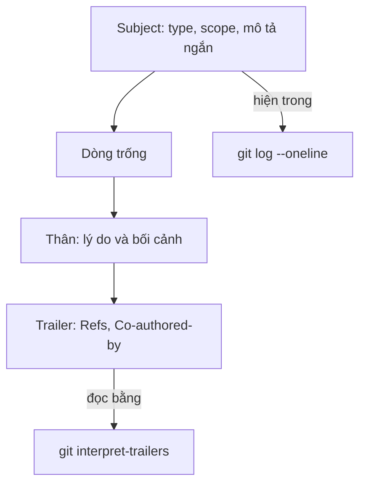

## Bạn sẽ học được gì

- Nắm cấu trúc chuẩn của thông điệp commit: subject, dòng trống, thân, trailer.
- Viết subject ngắn, cụ thể, nói rõ commit làm gì.
- Biết khi nào cần phần thân và nên viết gì trong đó.
- Làm quen với quy ước Conventional Commits và các loại (type) phổ biến.

## Khái niệm

Thông điệp commit là thứ duy nhất trong lịch sử giải thích **ý định** của thay đổi. Diff cho biết dòng nào đổi; thông điệp cho biết vì sao. Sáu tháng sau, khi ai đó chạy `git log` hay `git blame` để hiểu vì sao một test bị tắt, họ chỉ có thông điệp của bạn.

Cấu trúc mà hầu hết công cụ Git hiểu:

1. **Subject**: dòng đầu, ngắn (nhiều nhóm giữ dưới khoảng 50 đến 72 ký tự), nói commit làm gì. Đây là dòng hiện trong `git log --oneline`, trong tiêu đề email patch và nhiều giao diện review.
2. **Một dòng trống**: Git và công cụ dựa vào dòng trống này để tách subject khỏi thân.
3. **Thân** (tùy chọn): giải thích lý do, bối cảnh, hệ quả, những gì đã cân nhắc. Không cần lặp lại diff.
4. **Trailer** (tùy chọn): các dòng `Khóa: giá trị` ở cuối, như `Refs: QA-123`, `Co-authored-by: ...`. Công cụ có thể đọc chúng tự động.

Subject tốt trả lời được câu "Nếu áp dụng, commit này sẽ...". Ví dụ "Sửa kiểm tra độ dài OTP" tốt hơn nhiều so với "fix bug" hay "update".

**Conventional Commits** là một quy ước phổ biến, thêm tiền tố loại thay đổi vào subject theo dạng `type(scope): mô tả`. Phần scope trong ngoặc là tùy chọn. Các type thường gặp:

| Type | Dùng khi |
| --- | --- |
| `feat` | Thêm tính năng mới cho người dùng |
| `fix` | Sửa lỗi |
| `docs` | Chỉ đổi tài liệu |
| `test` | Thêm hoặc sửa test |
| `refactor` | Đổi cấu trúc mã, không đổi hành vi |
| `chore` | Việc vặt: cấu hình, công cụ, phụ thuộc |
| `ci` | Pipeline CI |

Dấu `!` trước dấu hai chấm (ví dụ `feat!:`) hoặc trailer `BREAKING CHANGE:` báo hiệu thay đổi phá tương thích. Lợi ích chính của quy ước này: công cụ có thể tự gom commit thành changelog và gợi ý tăng phiên bản (track phát hành sẽ quay lại).

## Hình dung bằng sơ đồ



## Lệnh cần biết

```bash
git commit                       # mở editor để viết thông điệp nhiều dòng
git commit -m "subject"          # thông điệp một dòng
git commit -m "subject" -m "thân" -m "Refs: QA-123"   # mỗi -m là một đoạn, cách bằng dòng trống
git log -1 --format=%s           # chỉ subject của commit cuối
git log -1 --format=%B           # toàn bộ thông điệp thô
git log --format="%(trailers:key=Refs)" -1   # đọc trailer
```

| Placeholder | Nội dung |
| --- | --- |
| `%s` | Subject |
| `%b` | Thân |
| `%B` | Toàn bộ thông điệp |

## Ví dụ từng bước

Bạn thêm kiểm tra độ dài OTP cho màn hình đăng nhập. Viết thông điệp ba đoạn bằng ba `-m`:

```bash
git commit -m "feat(login): thêm kiểm tra mã OTP" \
  -m "Ngân hàng yêu cầu OTP 6 chữ số. Trước đây form chấp nhận mọi độ dài." \
  -m "Refs: QA-123"
```

```text
[main 2d01539] feat(login): thêm kiểm tra mã OTP
 1 file changed, 1 insertion(+)
 create mode 100644 bai.txt
```

Đọc lại toàn bộ và từng phần:

```bash
git log -1 --format=%B
git log -1 --format=%s
git log -1 --format="%(trailers:key=Refs)"
```

```text
feat(login): thêm kiểm tra mã OTP

Ngân hàng yêu cầu OTP 6 chữ số. Trước đây form chấp nhận mọi độ dài.

Refs: QA-123

feat(login): thêm kiểm tra mã OTP
Refs: QA-123
```

Mỗi `-m` thành một đoạn, cách nhau bằng dòng trống, đúng cấu trúc chuẩn. Đo độ dài subject:

```bash
git log -1 --format=%s | wc -m
```

```text
34
```

Con số gồm cả ký tự xuống dòng; subject này nằm thoải mái dưới ngưỡng 72.

## Lỗi thường gặp

**Subject chung chung.** "fix", "update", "wip" không giúp ai. Hãy nêu đối tượng và hành động: "Sửa timeout test chuyển khoản liên ngân hàng".

**Dồn mọi thứ vào subject.** Subject 150 ký tự bị cắt ở nhiều giao diện. Đưa phần giải thích xuống thân.

> **Mẹo** Nếu không viết được subject ngắn vì commit làm quá nhiều việc, đó là dấu hiệu nên tách commit.

**Quên dòng trống giữa subject và thân.** Khi viết trong editor mà không có dòng trống, Git coi cả đoạn đầu là subject. Dùng nhiều `-m` hoặc nhớ để trống dòng thứ hai.

**Sai cú pháp Conventional Commits.** `feat:thêm` thiếu dấu cách, `Feat:` viết hoa, `feature:` sai tên type đều có thể khiến công cụ phân loại bỏ qua. Dạng chuẩn là chữ thường, dấu hai chấm, một dấu cách.

> **Lưu ý** Conventional Commits là quy ước của nhóm, không phải yêu cầu của Git. Git chấp nhận mọi thông điệp không rỗng.

## Áp dụng trong công việc

Nhóm bạn sinh release note tự động từ lịch sử. Commit thêm bộ test mới cho tính năng sao kê dùng `test(statement): ...`, commit sửa lỗi làm tròn số dư dùng `fix(balance): ...` kèm trailer mã ticket. Khi đến ngày phát hành, công cụ gom đúng các mục `feat` và `fix` vào ghi chú, còn reviewer chỉ cần đọc subject là biết commit thuộc loại nào.

## Chuẩn bị làm bài

Bài thực hành có sẵn một tệp chờ commit. Bạn cần commit nó với subject theo quy ước Conventional Commits, đúng loại dành cho tính năng mới, có thể kèm scope, và không quá dài. Câu hỏi đi kèm hỏi về tiền tố đó. Hãy:

- Ôn bảng type ở trên và cú pháp chính xác: chữ thường, dấu hai chấm, dấu cách.
- Nhớ stage tệp trước khi commit và giữ working tree sạch.
- Sau khi commit, đọc lại bằng `git log -1 --format=%s` và đếm độ dài.

## Tóm tắt

- Thông điệp gồm subject, dòng trống, thân tùy chọn và trailer tùy chọn.
- Subject ngắn, cụ thể, nói commit làm gì; thân giải thích vì sao.
- Mỗi `-m` tạo một đoạn riêng, tiện cho thân và trailer.
- Conventional Commits dùng `type(scope): mô tả`, `!` cho thay đổi phá tương thích.
- Thông điệp rõ giúp review, blame, changelog và chính bạn trong tương lai.
