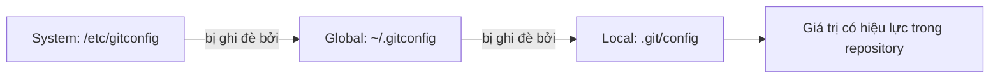

## Bạn sẽ học được gì

- Biết Git đọc cấu hình từ những tầng nào và tầng nào thắng khi trùng khóa.
- Đặt, đọc, xóa một giá trị cấu hình ở đúng phạm vi.
- Tra được một giá trị đang có hiệu lực đến từ tệp nào.
- Biết những khóa cấu hình nên đặt ngay khi bắt đầu.

## Khái niệm

Git có rất nhiều thiết lập: tên và email ghi vào commit, editor mở khi viết thông điệp, tên nhánh mặc định, cách xử lý xuống dòng, alias... Tất cả đều là cặp **khóa = giá trị**, khóa có dạng `section.name` như `user.name` hay `core.editor`.

Các giá trị này nằm trong nhiều tệp, xếp thành tầng từ rộng đến hẹp:

1. **System** (`--system`): áp dụng cho mọi người dùng trên máy, thường ở `/etc/gitconfig`. Ít khi bạn đụng tới.
2. **Global** (`--global`): áp dụng cho mọi repository của bạn, nằm ở `~/.gitconfig` hoặc `~/.config/git/config`.
3. **Local** (`--local`): chỉ áp dụng cho một repository, nằm ở `.git/config` của repository đó.

Git đọc lần lượt từ rộng đến hẹp, và giá trị đọc sau ghi đè giá trị đọc trước. Vì vậy, **tầng gần repository nhất thắng**. Nếu global ghi tên bạn là "Duy Van" nhưng local của một repository ghi "Hoc Vien QA", commit trong repository đó mang tên "Hoc Vien QA".

Khi bạn chạy `git config <khóa> <giá-trị>` mà không chỉ tầng, Git ghi vào local (nếu đang ở trong repository). Nhưng khi chỉ **đọc** `git config <khóa>` không chỉ tầng, Git trả giá trị đang có hiệu lực sau khi gộp mọi tầng. Đây là nguồn nhầm lẫn kinh điển: bạn đọc thấy đúng tên, nhưng không biết nó đến từ tầng nào. Tùy chọn `--show-origin` và `--show-scope` giải quyết chuyện này.

Từ Git 2.46, có thêm cú pháp subcommand rõ ràng hơn như `git config get` và `git config set`. Cú pháp cũ vẫn chạy bình thường; trong bài này mình dùng cú pháp cũ vì gặp nhiều nhất trong tài liệu và script.

Một chi tiết quan trọng: `user.name` và `user.email` chỉ là chữ được ghi vào commit. Git không kiểm tra chúng là ai. Muốn chứng minh danh tính, cần ký commit (track phát hành có bài riêng).

## Hình dung bằng sơ đồ



## Lệnh cần biết

```bash
git config --global user.name "Tên Của Bạn"   # đặt cho mọi repository
git config --global user.email "ban@example.com"
git config --local user.name "Tên riêng"      # chỉ repository hiện tại
git config user.name                          # đọc giá trị có hiệu lực
git config --show-origin user.name            # kèm tệp nguồn
git config --show-scope --get-all user.name   # mọi giá trị ở mọi tầng
git config --list --show-scope                # liệt kê toàn bộ
git config --local --unset user.name          # xóa khóa ở tầng local
git config --global --edit                    # mở tệp global trong editor
```

| Tùy chọn | Tệp tác động |
| --- | --- |
| `--system` | Cấu hình toàn máy |
| `--global` | Cấu hình người dùng |
| `--local` | `.git/config` của repository hiện tại |
| `--file <path>` | Một tệp cấu hình chỉ định |

Các khóa nên đặt sớm: `user.name`, `user.email`, `init.defaultBranch`, `core.editor`.

## Ví dụ từng bước

Global đã có tên "Duy Van". Trong một repository bài tập, đặt tên riêng:

```bash
git config --global user.name
git config --local user.name "Hoc Vien QA"
git config user.name
git config --show-origin user.name
```

```text
Duy Van
Hoc Vien QA
file:.git/config	Hoc Vien QA
```

Xem toàn cảnh mọi tầng:

```bash
git config --show-scope --get-all user.name
```

```text
global	Duy Van
local	Hoc Vien QA
```

Tầng local nằm sau nên thắng. Mở thẳng tệp local để thấy cấu trúc:

```bash
cat .git/config
```

```text
[core]
	repositoryformatversion = 0
	filemode = true
	bare = false
	logallrefupdates = true
[user]
	name = Hoc Vien QA
```

Gỡ giá trị local, tên global có hiệu lực trở lại:

```bash
git config --local --unset user.name
git config user.name
```

```text
Duy Van
```

## Lỗi thường gặp

**Đặt nhầm tầng.** Bạn muốn đổi email chỉ cho repository công việc nhưng gõ `--global`, kết quả là mọi dự án cá nhân cũng đổi theo. Kiểm tra lại bằng `--show-scope` và sửa ở đúng tầng.

> **Mẹo** Nếu bạn có repository công việc và cá nhân trên cùng máy, đặt email cá nhân ở global và email công việc ở local của từng repository công việc (hoặc dùng `includeIf` theo thư mục khi đã quen).

**Quên dấu ngoặc kép.** `git config user.name Hoc Vien QA` không có ngoặc sẽ làm shell tách thành nhiều đối số; Git 2.47 từ chối với thông báo `error: no action specified`. Giá trị có dấu cách phải đặt trong ngoặc kép.

**Sửa tay `.git/config` sai cú pháp.** Một dấu ngoặc vuông thiếu khiến mọi lệnh Git báo "bad config line". Ưu tiên dùng `git config` để ghi.

> **Lưu ý** Commit đã tạo không tự đổi tên tác giả khi bạn sửa cấu hình. Cấu hình chỉ ảnh hưởng commit tạo sau đó.

**Tưởng `git config user.name` cho biết tầng.** Nó chỉ in giá trị cuối cùng. Thêm `--show-origin` khi cần biết nguồn.

## Áp dụng trong công việc

Máy làm việc của bạn có global email cá nhân dùng cho blog. Dự án test automation của ngân hàng yêu cầu commit dùng email công việc để hệ thống review nhận diện đúng người. Bạn đặt `user.email` ở tầng local cho repository đó, kiểm tra bằng `git config --show-origin user.email`, rồi mới commit. Repository cá nhân vẫn dùng email global như cũ.

## Chuẩn bị làm bài

Bài thực hành yêu cầu đặt một giá trị `user.name` chỉ có hiệu lực trong repository bài tập, không ảnh hưởng cấu hình chung trên máy. Câu hỏi đi kèm hỏi về tùy chọn chọn đúng phạm vi đó. Hãy:

- Ôn lại ba tầng cấu hình và tầng nào ghi vào `.git/config`.
- Nhớ đặt giá trị có dấu cách trong ngoặc kép và gõ đúng chữ hoa, chữ thường như đề.
- Sau khi đặt, kiểm tra bằng `git config --show-scope --get-all user.name`.

## Tóm tắt

- Cấu hình Git gồm ba tầng chính: system, global, local.
- Tầng gần repository nhất thắng khi trùng khóa.
- Ghi không chỉ tầng sẽ vào local; đọc không chỉ tầng trả giá trị đã gộp.
- `--show-origin` và `--show-scope` cho biết giá trị đến từ đâu.
- `user.name` và `user.email` chỉ là nhãn, không chứng minh danh tính.
