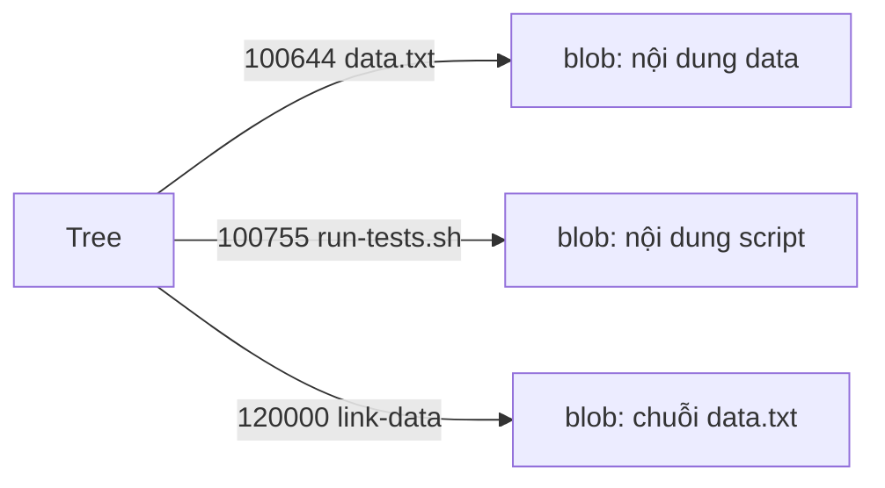

## Bạn sẽ học được gì

- Biết Git lưu những mode tệp nào và lưu ở đâu.
- Phân biệt thay đổi nội dung với thay đổi mode khi đọc diff.
- Đặt hoặc bỏ bit thực thi trong index, kể cả trên hệ thống không hỗ trợ chmod.
- Hiểu Git lưu symlink như thế nào và cần lưu ý gì khi làm việc đa nền tảng.

## Khái niệm

Bài mô hình object đã cho thấy blob chỉ chứa byte nội dung. Vậy thông tin "tệp này chạy được" hay "đây là symlink" nằm đâu? Câu trả lời: trong **mode** của mục tương ứng trong index và trong tree.

Git không lưu đầy đủ quyền Unix như `rw-r--r--` cho từng người dùng. Nó chỉ phân biệt vài loại mode:

| Mode | Ý nghĩa |
| --- | --- |
| `100644` | Tệp thường, không thực thi |
| `100755` | Tệp thường, có quyền thực thi |
| `120000` | Symbolic link |
| `040000` | Thư mục (tree) |
| `160000` | Gitlink, dùng cho submodule |

Quyền ghi, quyền nhóm, chủ sở hữu... đều không được lưu. Khi checkout, Git tạo tệp theo umask của máy, chỉ thêm hoặc bỏ bit thực thi theo mode.

Hệ quả quan trọng: đổi quyền thực thi **không đổi blob**. Nội dung giống hệt, nên object ID giữ nguyên; chỉ mode trong tree thay đổi. Trong diff, bạn sẽ thấy hai dòng `old mode 100644` và `new mode 100755` mà không có hunk nội dung nào.

Với **symlink**, Git lưu một blob chứa chuỗi đường dẫn đích (ví dụ `data.txt`), và đánh dấu mode `120000`. Git không theo symlink để lấy nội dung tệp đích. Trên hệ thống không hỗ trợ symlink (hoặc khi `core.symlinks=false`), Git checkout symlink thành một tệp văn bản thường chứa đường dẫn.

Cấu hình `core.fileMode` quyết định Git có để ý bit thực thi trên đĩa hay không. Trên Linux và macOS nó thường là `true`. Trên Windows, hệ thống tệp không có bit này nên Git thường đặt `false` khi tạo repository, và bạn đổi mode trực tiếp trong index bằng `git update-index --chmod`.

## Hình dung bằng sơ đồ




## Lệnh cần biết

```bash
git ls-files --stage                     # mode, object ID, stage, đường dẫn trong index
git ls-tree HEAD                         # mode và loại object trong commit
chmod +x <tệp> && git add <tệp>          # đặt bit thực thi trên Linux, macOS
git update-index --chmod=+x <tệp>        # đặt thẳng trong index, dùng được cả trên Windows
git update-index --chmod=-x <tệp>        # bỏ bit thực thi trong index
git config core.fileMode                 # Git có theo dõi bit thực thi trên đĩa không
git cat-file -p :<symlink>               # xem đường dẫn đích mà symlink lưu
```

## Ví dụ từng bước

Repository có một script test và một tệp dữ liệu, ban đầu đều là tệp thường:

```bash
git ls-files --stage
```

```text
100644 1269488f7fb1f4b56a8c0e5eb48cecbfadfa9219 0	data.txt
100644 cb59bf60cb6054a551c3572a6c4f3bb98a2157f7 0	run-tests.sh
```

Cấp quyền chạy và xem Git nhận ra gì:

```bash
chmod +x run-tests.sh
git status -s
git diff
```

```text
 M run-tests.sh
diff --git a/run-tests.sh b/run-tests.sh
old mode 100644
new mode 100755
```

Không có dòng `+` hay `-` nào: chỉ mode đổi. Commit:

```bash
git add run-tests.sh
git commit -m "Cho phép chạy script"
```

```text
[main f1638bb] Cho phép chạy script
 1 file changed, 0 insertions(+), 0 deletions(-)
 mode change 100644 => 100755 run-tests.sh
```

Thêm một symlink và xem index:

```bash
ln -s data.txt link-data
git add link-data
git ls-files --stage
git cat-file -p :link-data
```

```text
100644 1269488f7fb1f4b56a8c0e5eb48cecbfadfa9219 0	data.txt
120000 4669fe92b8f2067302a2cb4c64d88ed0a43d1ec0 0	link-data
100755 cb59bf60cb6054a551c3572a6c4f3bb98a2157f7 0	run-tests.sh
data.txt
```

ID blob của script vẫn là `cb59bf6...` trước và sau khi đổi mode. Blob của symlink chỉ chứa chữ `data.txt`. Cuối cùng, đổi mode thẳng trong index mà không chạm tệp:

```bash
git update-index --chmod=-x run-tests.sh
git ls-files --stage run-tests.sh
ls -l run-tests.sh
```

```text
100644 cb59bf60cb6054a551c3572a6c4f3bb98a2157f7 0	run-tests.sh
-rwxr-xr-x 1 box box 27 Oct 15 23:44 run-tests.sh
```

Index ghi `100644` nhưng tệp trên đĩa vẫn có `x`. Đây là cách người dùng Windows chỉnh mode.

## Lỗi thường gặp

**Diff đầy thay đổi mode sau khi copy dự án qua ổ đĩa khác.** Một số hệ thống tệp đánh dấu mọi tệp là thực thi. Nếu repository không cần theo dõi bit này trên máy đó, đặt `core.fileMode false` ở tầng local, hoặc sửa lại quyền cho đúng.

> **Cẩn thận** Đặt `core.fileMode false` chỉ khiến Git trên máy bạn ngừng để ý bit thực thi trên đĩa. Nó không đổi mode đã lưu trong lịch sử, và không phải cách sửa script mất quyền chạy trên CI.

**Script chạy được trên máy, lỗi "Permission denied" trên CI.** Bạn tạo script trên Windows nên mode trong repository là `100644`. Sửa bằng `git update-index --chmod=+x` rồi commit.

**Tưởng Git lưu chủ sở hữu và quyền ghi.** Chỉ có bit thực thi. Quyền khác do môi trường checkout quyết định.

**Symlink thành tệp văn bản trên Windows.** Khi symlink không được hỗ trợ, bạn thấy tệp chứa một dòng đường dẫn. Tránh dựa vào symlink trong dự án cần chạy trên nhiều hệ điều hành.

## Áp dụng trong công việc

Pipeline CI của nhóm chạy `./run-tests.sh` trên runner Linux, nhưng một đồng nghiệp tạo script từ Windows nên job báo "Permission denied". Thay vì thêm `chmod` vào pipeline, bạn kiểm tra `git ls-files --stage run-tests.sh`, thấy `100644`, dùng `git update-index --chmod=+x` để sửa mode trong index, rồi commit. Từ đó mọi bản checkout đều có quyền chạy.

> **Mẹo** Khi review, diff chỉ có `old mode`/`new mode` là thay đổi mode thuần túy; đừng bỏ qua nó, vì nó ảnh hưởng việc chạy script.

## Chuẩn bị làm bài

Bài này là câu hỏi lý thuyết về mã mode Git dùng cho một tệp thường có quyền thực thi. Hãy tự thử trong repository bài tập: tạo một script nhỏ, commit, rồi bật bit thực thi bằng `chmod` hoặc `git update-index --chmod`, và đọc mode bằng `git ls-files --stage`. So sánh với mode của tệp thường và của symlink.

## Tóm tắt

- Mode nằm trong index và tree, không nằm trong blob.
- Git chỉ phân biệt vài mode: tệp thường, tệp thực thi, symlink, thư mục, gitlink.
- Đổi quyền thực thi không đổi blob; diff chỉ hiện `old mode` và `new mode`.
- Symlink được lưu như blob chứa đường dẫn đích, mode `120000`.
- `git update-index --chmod` đổi mode thẳng trong index, hữu ích trên Windows.
