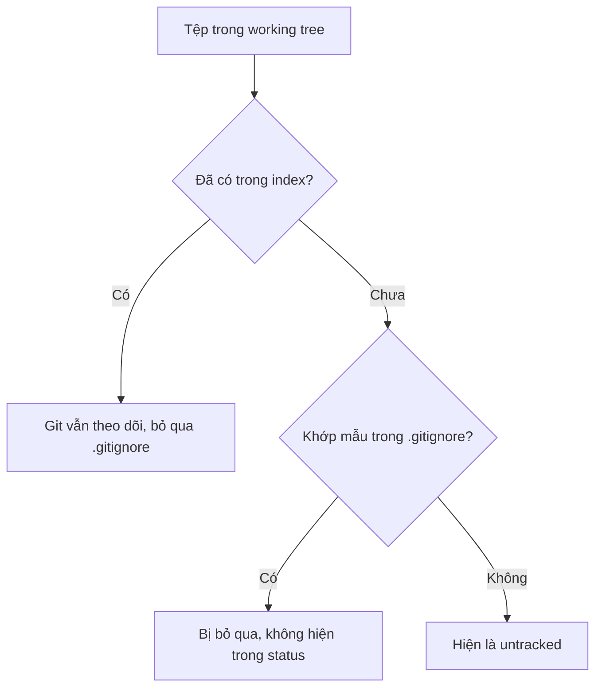

## Bạn sẽ học được gì

- Hiểu `.gitignore` làm gì và, quan trọng hơn, nó không làm gì.
- Viết được các mẫu (pattern) thường dùng: tên tệp cụ thể, đuôi tệp, thư mục, phủ định.
- Kiểm tra một tệp có bị bỏ qua không và bởi dòng quy tắc nào.
- Xử lý trường hợp tệp đã lỡ được theo dõi trước khi thêm quy tắc.

## Khái niệm

Mỗi dự án đều sinh ra những tệp không nên vào lịch sử: log chạy test, thư mục build, báo cáo HTML, tệp môi trường local chứa URL hay tài khoản demo. Nếu không có cơ chế lọc, `git status` sẽ đầy những dòng `??` và sớm muộn ai đó sẽ `git add .` gom hết vào commit.

Tệp `.gitignore` là danh sách mẫu tên. Tệp nào **chưa được theo dõi** mà khớp một mẫu thì Git coi như vô hình: không hiện trong `git status`, không bị `git add .` gom vào. Bản thân `.gitignore` là một tệp bình thường, bạn commit nó để cả nhóm dùng chung quy tắc.

Điểm then chốt mà nhiều người vấp: `.gitignore` **chỉ áp dụng cho tệp untracked**. Nếu một tệp đã nằm trong index (đã từng add hoặc commit), thêm tên nó vào `.gitignore` không có tác dụng gì; Git vẫn tiếp tục theo dõi mọi thay đổi. Muốn ngừng theo dõi, bạn phải gỡ nó khỏi index bằng `git rm --cached <tệp>` (giữ tệp trên đĩa), rồi commit việc gỡ đó.

Một số quy tắc cú pháp đáng nhớ:

- Dòng trống và dòng bắt đầu bằng `#` bị bỏ qua (dùng để chú thích).
- `local.env` khớp tệp tên đó ở bất kỳ cấp thư mục nào.
- `*.log` khớp mọi tệp có đuôi `.log`.
- `logs/` với dấu gạch chéo cuối chỉ khớp thư mục.
- `/build` với gạch chéo đầu chỉ khớp ở gốc repository (nơi chứa `.gitignore`).
- `!keep.log` phủ định: đưa tệp trở lại dù mẫu trước đã bỏ qua. Lưu ý không thể "cứu" tệp nằm trong thư mục đã bị bỏ qua toàn bộ.

Ngoài `.gitignore` commit chung, còn có `.git/info/exclude` cho quy tắc riêng của bạn trong một repository, và tệp ignore global (cấu hình `core.excludesFile`) cho quy tắc cá nhân trên mọi repository, ví dụ tệp rác của hệ điều hành hay editor.

## Hình dung bằng sơ đồ



## Lệnh cần biết

```bash
git check-ignore <tệp>          # in tên tệp nếu nó bị bỏ qua, mã thoát 1 nếu không
git check-ignore -v <tệp>       # kèm tệp quy tắc, số dòng và mẫu đã khớp
git status --ignored            # liệt kê cả tệp đang bị bỏ qua (ký hiệu !!)
git rm --cached <tệp>           # ngừng theo dõi nhưng giữ tệp trên đĩa
git add -f <tệp>                # cố ý add tệp dù bị bỏ qua
git ls-files -o -i --exclude-standard   # liệt kê tệp chưa track đang bị bỏ qua
```

| Mẫu | Khớp với |
| --- | --- |
| `local.env` | Tệp hoặc thư mục tên đó, mọi cấp |
| `*.log` | Mọi tệp đuôi `.log` |
| `logs/` | Chỉ thư mục tên `logs` |
| `/build` | `build` ở gốc, không khớp `src/build` |
| `!keep.log` | Bỏ bỏ-qua cho `keep.log` |

## Ví dụ từng bước

Thư mục có ba thứ chưa theo dõi: tệp môi trường, một log, và thư mục log.

```bash
git status -s
```

```text
?? debug.log
?? local.env
?? logs/
```

Tạo `.gitignore` ba dòng `local.env`, `*.log`, `logs/`, rồi xem lại:

```bash
git status -s
git check-ignore -v local.env logs/run.log debug.log
git check-ignore README.md; echo "exit=$?"
```

```text
?? .gitignore
.gitignore:1:local.env	local.env
.gitignore:3:logs/	logs/run.log
.gitignore:2:*.log	debug.log
exit=1
```

Chỉ còn `.gitignore` cần commit. Khi nhiều mẫu cùng khớp, `-v` báo mẫu cuối cùng quyết định. `README.md` không bị bỏ qua nên lệnh thoát với mã 1.

Giờ đến cái bẫy. Giả sử `app.env` đã lỡ được commit. Thêm `app.env` vào `.gitignore` rồi sửa tệp:

```bash
git status -s
```

```text
 M app.env
?? .gitignore
```

Git vẫn thấy thay đổi. Phải gỡ khỏi index:

```bash
git rm --cached app.env
git status -s
```

```text
rm 'app.env'
D  app.env
?? .gitignore
```

Commit kế tiếp sẽ ghi nhận việc gỡ; tệp trên đĩa vẫn còn và từ nay được bỏ qua.

## Lỗi thường gặp

**Thêm quy tắc cho tệp đã track rồi thắc mắc vì sao không có tác dụng.** Dùng `git rm --cached`, như ví dụ trên.

> **Cẩn thận** Tệp chứa mật khẩu hay token đã từng được commit thì vẫn nằm trong lịch sử cũ dù bạn gỡ ở commit mới. Nếu đó là bí mật thật, phải thu hồi và đổi bí mật; track điều tra lịch sử có bài riêng về chuyện này.

**Gõ sai mẫu thư mục.** `logs` không có gạch chéo khớp cả tệp lẫn thư mục; `/logs/` chỉ khớp thư mục ở gốc. Khi nghi ngờ, hỏi thẳng Git bằng `git check-ignore -v`.

**Phủ định không ăn.** `!logs/keep.log` không cứu được tệp nếu cả thư mục `logs/` đã bị bỏ qua, vì Git không đi vào thư mục bị bỏ qua. Đổi mẫu thành `logs/*` rồi mới phủ định.

**Đưa quy tắc cá nhân vào `.gitignore` chung.** Tệp rác của editor riêng bạn nên nằm trong ignore global, không làm phình `.gitignore` của dự án.

## Áp dụng trong công việc

Bộ test end-to-end của bạn sinh thư mục `reports/`, ảnh chụp màn hình khi test fail và tệp `.env.local` chứa URL môi trường staging. Bạn thêm ba mẫu tương ứng vào `.gitignore`, commit cùng một tệp `.env.example` không chứa giá trị thật để người mới biết cần biến nào. CI tự sinh `.env` từ secret, nên không ai phải commit cấu hình thật.

> **Mẹo** Một tệp `.env.example` được commit, kèm `.env` bị bỏ qua, là mẫu rất phổ biến để vừa hướng dẫn vừa bảo vệ cấu hình.

## Chuẩn bị làm bài

Repository bài tập có một tệp môi trường chưa theo dõi. Bạn cần tạo tệp quy tắc để Git bỏ qua tệp đó, trong khi các tệp khác như README vẫn được theo dõi bình thường. Câu hỏi đi kèm hỏi về tên của tệp quy tắc. Hãy:

- Xem `git status -s` trước và sau khi tạo quy tắc.
- Dùng `git check-ignore -v` để chắc mẫu của bạn khớp đúng tệp cần bỏ qua.
- Không cần commit, nhưng tệp quy tắc phải nằm ở gốc repository bài tập.

## Tóm tắt

- `.gitignore` chỉ ẩn tệp chưa được theo dõi khỏi status và `git add`.
- Tệp đã track cần `git rm --cached` để ngừng theo dõi mà vẫn giữ trên đĩa.
- `*.log`, `logs/`, `/build`, `!keep.log` là các dạng mẫu hay gặp.
- `git check-ignore -v` cho biết chính xác dòng quy tắc nào đang tác động.
- Quy tắc cá nhân nên để ở `.git/info/exclude` hoặc ignore global.
