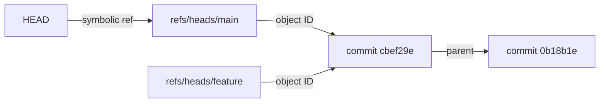
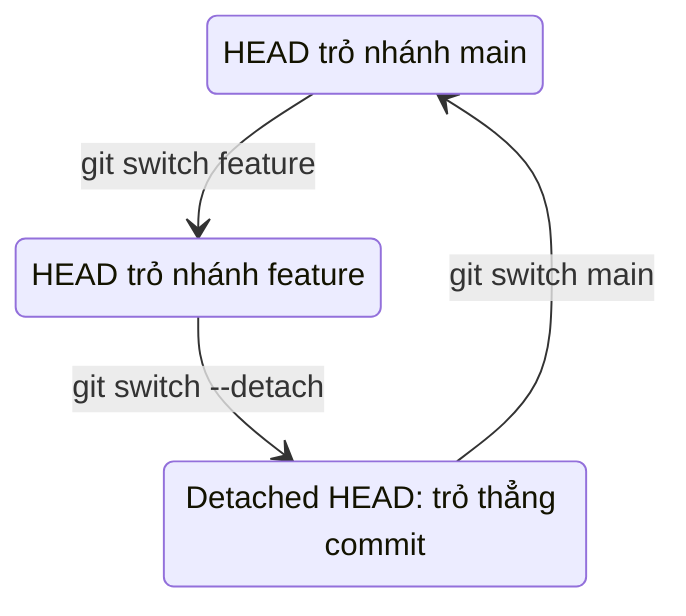

## Bạn sẽ học được gì

- Hiểu ref là gì: một cái tên trỏ tới object ID.
- Phân biệt ref thông thường (nhánh, tag) với symbolic ref như `HEAD`.
- Biết `HEAD` thay đổi thế nào khi bạn commit, chuyển nhánh hay vào trạng thái detached.
- Đọc và kiểm tra ref bằng các lệnh an toàn thay vì mở tệp trong `.git`.

## Khái niệm

Object ID dài 40 ký tự, không ai nhớ nổi. Vì vậy Git có **ref**: những cái tên dễ đọc, mỗi tên trỏ tới một object ID. Nhánh `main` thực chất là ref `refs/heads/main`, chứa ID của commit mới nhất trên nhánh. Tag `v1.0.0` là `refs/tags/v1.0.0`. Nhánh remote-tracking như `origin/main` là `refs/remotes/origin/main`.

Nhánh rẻ đến bất ngờ: tạo nhánh chỉ là ghi thêm một ref, không chép tệp nào. Khi bạn commit trên nhánh, Git tạo commit mới rồi cập nhật ref của nhánh sang ID mới. Nhánh "di chuyển" theo commit.

**HEAD** đặc biệt hơn. Thông thường nó không chứa object ID mà chứa **tên của một ref khác**. Loại ref trỏ tới ref này gọi là **symbolic ref**. Khi bạn đứng trên nhánh `main`, tệp `.git/HEAD` chứa dòng `ref: refs/heads/main`. Mọi lệnh cần biết "commit hiện tại" sẽ đi theo chuỗi: HEAD trỏ tới `refs/heads/main`, `refs/heads/main` trỏ tới commit.

Nhờ tầng gián tiếp này mà commit mới tự động cập nhật đúng nhánh: Git nhìn HEAD, thấy tên nhánh, rồi dời nhánh đó. Chuyển nhánh bằng `git switch` thực chất là đổi nội dung HEAD sang tên nhánh khác (và cập nhật working tree cho khớp).

Khi bạn checkout thẳng một commit thay vì một nhánh, HEAD chứa trực tiếp object ID. Đây là trạng thái **detached HEAD**. Lúc này HEAD không còn là symbolic ref nữa; commit mới tạo ra sẽ không thuộc nhánh nào. Track hoàn tác có bài riêng về cách giữ lại những commit đó.

Một số cú pháp tương đối dựa trên ref: `HEAD~1` (hoặc `HEAD^`) là commit cha của HEAD, `HEAD~2` là ông, `main~3` là commit cách đầu nhánh `main` ba bước.

Về lưu trữ, ref có thể là tệp lẻ trong `.git/refs/` hoặc được gom vào `.git/packed-refs`. Vì thế đừng dựa vào việc đọc thẳng tệp; hãy hỏi Git.

## Hình dung bằng sơ đồ





## Lệnh cần biết

```bash
git symbolic-ref HEAD           # in tên ref mà HEAD trỏ tới
git symbolic-ref --short HEAD   # dạng ngắn, ví dụ main
git rev-parse HEAD              # object ID mà HEAD cuối cùng trỏ tới
git rev-parse --abbrev-ref HEAD # tên nhánh hiện tại, hoặc HEAD nếu detached
git branch --show-current       # tên nhánh hiện tại, trống nếu detached
git show-ref --heads            # liệt kê ref nhánh và ID
git for-each-ref --format="%(refname) %(objectname:short)"
git log --oneline --decorate    # thấy ref gắn vào commit nào
```

| Ref | Tên đầy đủ |
| --- | --- |
| Nhánh local `main` | `refs/heads/main` |
| Tag `v1.0.0` | `refs/tags/v1.0.0` |
| Nhánh remote-tracking | `refs/remotes/origin/main` |
| HEAD | `HEAD` (thường là symbolic ref) |

## Ví dụ từng bước

Repository có hai commit trên `main`, và một nhánh `feature` vừa tạo.

```bash
git symbolic-ref HEAD
cat .git/HEAD
git rev-parse HEAD main refs/heads/main
```

```text
refs/heads/main
ref: refs/heads/main
cbef29e895f0af6d2508d8cb0506075e7a743585
cbef29e895f0af6d2508d8cb0506075e7a743585
cbef29e895f0af6d2508d8cb0506075e7a743585
```

Ba cách gọi, cùng một commit. Hai nhánh cũng đang trỏ cùng chỗ:

```bash
git show-ref --heads
git log --oneline --decorate -2
```

```text
cbef29e895f0af6d2508d8cb0506075e7a743585 refs/heads/feature
cbef29e895f0af6d2508d8cb0506075e7a743585 refs/heads/main
cbef29e (HEAD -> main, feature) Thêm bản sao
0b18b1e Snapshot đầu
```

`HEAD -> main` trong output nghĩa là HEAD đang trỏ tới `main`. Thử vào trạng thái detached:

```bash
git switch --detach HEAD~1
git symbolic-ref HEAD
cat .git/HEAD
```

```text
HEAD is now at 0b18b1e Snapshot đầu
fatal: ref HEAD is not a symbolic ref
0b18b1ecabc0cd223016dea71c91af3b7a5bdd72
```

HEAD giờ chứa thẳng object ID, nên `symbolic-ref` báo lỗi. Quay về nhánh:

```bash
git switch main
git rev-parse --abbrev-ref HEAD
```

```text
Previous HEAD position was 0b18b1e Snapshot đầu
Switched to branch 'main'
main
```

## Lỗi thường gặp

**Sửa tay `.git/HEAD` hoặc tệp ref.** Một ký tự thừa có thể làm repository không mở được. Dùng `git switch`, `git branch`, `git update-ref` hoặc `git symbolic-ref` khi thật sự cần ghi.

> **Cẩn thận** Ghi bằng `git symbolic-ref HEAD <ref>` đổi nhánh hiện tại mà không cập nhật working tree hay index. Nó hữu ích cho công cụ, nhưng dùng tay dễ khiến status hiện đầy thay đổi lạ.

**Tưởng nhánh chứa commit.** Nhánh chỉ là con trỏ. Xóa nhánh không xóa ngay commit; tạo nhánh không chép commit.

**Dùng `symbolic-ref` trong script mà không xử lý detached.** Ở CI, repository thường được checkout ở detached HEAD, lệnh sẽ thất bại. Dùng `git rev-parse --abbrev-ref HEAD` hoặc kiểm tra mã thoát.

**Đọc `.git/refs/heads/<tên>` và không thấy tệp.** Ref có thể đã nằm trong `packed-refs`. `git show-ref` luôn cho kết quả đúng.

## Áp dụng trong công việc

Script chạy test hồi quy của nhóm cần ghi tên nhánh vào báo cáo. Trên máy dev, `git symbolic-ref --short HEAD` cho tên nhánh; nhưng trên CI, job checkout ở detached HEAD và lệnh lỗi. Bạn sửa script: thử `symbolic-ref`, nếu thất bại thì lấy biến môi trường của CI chứa tên nhánh, và luôn in kèm `git rev-parse --short HEAD` để báo cáo có commit chính xác.

## Chuẩn bị làm bài

Câu hỏi của bài hỏi lệnh nào cho bạn xem đích của một symbolic ref như HEAD. Trong repository bài tập, hãy thử các lệnh ở mục trên, so sánh output khi đang ở nhánh và khi ở detached HEAD, và để ý lệnh nào in ra tên ref chứ không phải object ID.

> **Mẹo** Nhớ quy tắc: lệnh nào trả lời "HEAD đang đứng trên nhánh nào" thì in tên ref; lệnh nào trả lời "commit nào" thì in object ID.

## Tóm tắt

- Ref là tên trỏ tới object ID; nhánh là ref dưới `refs/heads/`.
- HEAD thường là symbolic ref, chứa tên nhánh hiện tại thay vì ID.
- Commit mới dời nhánh mà HEAD đang trỏ tới.
- Detached HEAD là khi HEAD chứa thẳng object ID.
- Hỏi Git bằng `symbolic-ref`, `rev-parse`, `show-ref` thay vì đọc tệp trong `.git`.
